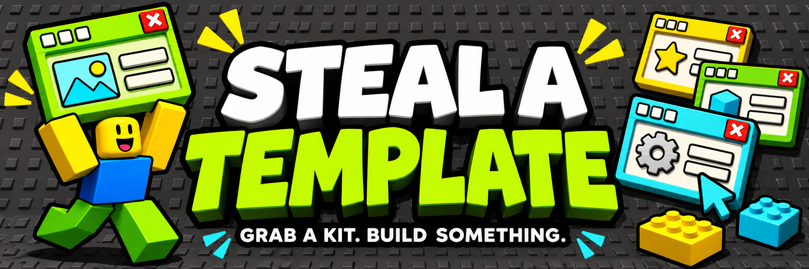

<div align="center">



# Steal a Template

**Free Roblox asset packs for developers and their AI agents.**

UI kits now. Models, VFX, and Luau systems next.

[Browse assets](#browse-assets) · [Install a kit](#drop-it-into-studio) · [Agent setup](docs/USING_WITH_AGENTS.md) · [Contribute](CONTRIBUTING.md)

</div>

Skip the blank baseplate. Start with an editable kit, open the source, and build your game around it. Studded panels, chunky buttons, loud colors, and actual Roblox instances you can change.

**Current status:** packs are available to repository collaborators as private drafts. Free public distribution is the goal; licensing and rights review are pending.

<a id="catalog"></a>

## Browse assets

| Library | Status |
| --- | --- |
| [UI kits](packs/ui/) | Browse editable interfaces, model downloads, and galleries |
| [Models](packs/models/) | Planned |
| [VFX](packs/effects/) | Planned |
| [Luau systems](packs/systems/) | Planned |
| [Audio](packs/audio/) | Planned |

Each pack has its own page with screenshots, source, setup, and compatibility notes. The [machine-readable catalog](catalog.json) lists exact file paths for tools and agents.

## Drop it into Studio

1. Open a pack's page and download its **`.rbxm`**.
2. Stop Play in Roblox Studio. Right-click **StarterGui → Insert from File** and select the model.
3. If dragging or importing places it elsewhere, move the kit's **ScreenGui** into **StarterGui**. If it is already there, leave it there.
4. Import one copy, press **Play**, and try the included interactions.

The controller comes with the model. No code paste or extra plugin is needed to try the current kits. Purchases, rewards, currency, and inventory are demos until connected to your game's backend.

### Have an agent set it up

With your agent connected to Studio, give it this:

```text
Install [kit name] from Steal a Template in my open Studio place.
Read its catalog entry and setup notes. Check whether the kit is
already imported. If its ScreenGui is outside StarterGui, move it
into StarterGui. If it is already there, leave it in place.
If it is missing, import the pack's native model once. Preserve
unrelated UI and included scripts. Verify it opens in Play mode.
If you cannot access Studio or import the file, tell me what remains.
```

[Agent setup details](docs/USING_WITH_AGENTS.md) · [Repository instructions](AGENTS.md)

## Add a pack

Keep each pack in its own folder with a native model, readable source, screenshots, setup instructions, and an honest verification record.

[Contribute](CONTRIBUTING.md) · [Pack format](docs/AUTHORING.md) · [Release checklist](docs/DISTRIBUTION.md) · [Brand kit](docs/BRAND.md)

## Use and licensing

Free downloads are the intended release model. Current packs have no reuse or redistribution license yet; there is no blanket license for this repository. Consult each pack's README, credits, and license status. [Licensing status](docs/LICENSING.md).

Independent project; not affiliated with Roblox.
