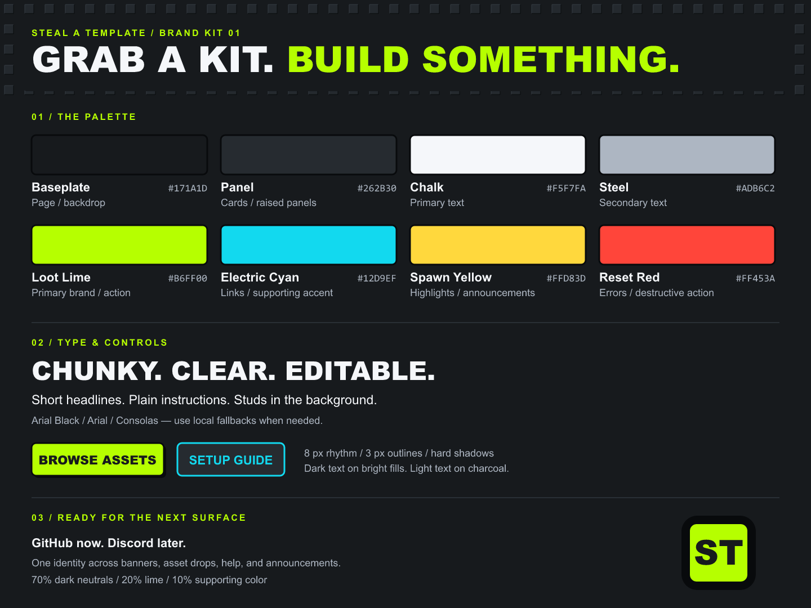

# Steal a Template — brand kit

[Editable reference sheet](../assets/branding/brand-board.svg) · [Color and layout tokens](../assets/branding/tokens.json) · [Existing banner](../assets/branding/banner.png)

## Identity

**Steal a Template**

**Grab a kit. Build something.**

Free Roblox asset packs for developers and their AI agents. UI kits first; models, VFX, and Luau systems later.

Old Roblox plastic, square studs, chunky outlines, and loud buttons. A little brainrot in the artwork; precise language in the instructions. Keep the existing banner as the main illustrated header.

## Colors

| Color | Hex | Job |
| --- | --- | --- |
| Baseplate | `#171A1D` | Page / backdrop |
| Panel | `#262B30` | Cards / raised panels |
| Chalk | `#F5F7FA` | Primary text |
| Steel | `#ADB6C2` | Secondary text |
| Loot Lime | `#B6FF00` | Primary brand / action |
| Electric Cyan | `#12D9EF` | Links / supporting accent |
| Spawn Yellow | `#FFD83D` | Highlights / announcements |
| Reset Red | `#FF453A` | Errors / destructive action |

Use roughly **70% dark neutrals, 20% lime, and 10% supporting color** in promotional layouts. This is a composition guide, not a rigid formula. Lime should be the first accent people notice.

Use Baseplate text on lime, cyan, yellow, and red fills. Use Chalk or Steel on dark backgrounds. Avoid white text on the bright accent fills. Communicate status with words or icons as well as color.

The hex values are the canonical flat palette chosen to match the banner's direction; the banner contains lighting and shading rather than exact flat fills.

## Type

- **Display:** Arial Black, uppercase, short headlines. Use Arial Bold if unavailable. The banner's custom lettering is artwork, not an installable font.
- **Body:** Arial, normal sentence case. Keep setup instructions comfortably spaced.
- **Code:** Consolas, with a monospace fallback.

For designed graphics, start with 48–72 px headlines and 18–24 px body text on a 1440 px wide canvas. Adjust for the actual display size. These are art-layout starting points, not settings to apply inside every UI pack.

## Shapes and texture

Use an 8 px spacing rhythm, 3 px near-black outlines, 8 px corners, and a short hard shadow offset by 4 px. Keep controls boxy. Studs belong on backdrops and broad surfaces; leave reading areas clear.

Decorative windows can tilt slightly. Text blocks, tables, and setup diagrams should remain straight. A red close button, cyan cursor, and yellow block character are supporting motifs, not mandatory decoration on every graphic.

## Marks

Use the full **Steal a Template** name whenever it remains readable. For a small square or circular avatar, use the [ST monogram SVG](../assets/branding/avatar.svg) / [PNG](../assets/branding/avatar.png): dark field, lime tile, black lettering. It is an editable secondary mark designed for small display sizes; it does not replace the existing banner.

Keep clear space around a mark equal to one letter-stroke width. Do not squeeze the full banner into an avatar. Avoid fine text or tiny studs inside small icons.

## Discord

The [Discord kit](../community/discord/README.md) contains deployed banners, the builder profile image, onboarding icons, copy, and configuration. Use charcoal reading areas, the yellow-and-blue character carrying a lime UI window from the GitHub hero, square studs, and a lime-to-cyan accent. Avoid nested decorative borders. Channel banners contain only a large channel title and artwork; omit the brand-name label and subtitles because the body embed supplies the explanation.

Banner masters are 1200 × 320. Use bold labels, short numbered sections, quote bars, and whitespace in written messages. Avoid emojis, ornamental Unicode fonts, and repeated headings. Banner guides use an image-only embed followed by a title-free body embed and link buttons. General has no banner.

### Role palette

The role palette forms a lime-to-cyan progression across visible identities:

| Role | Color |
| --- | --- |
| Maintainer | `#B6FF00` |
| Moderator | `#8EF640` |
| Contributor | `#65EC80` |
| Member | `#12D9EF` |
| Agent identity roles | Default / no color (`0`) |
| All notification roles | Default / no color (`0`) |

These are flat role colors, not an animated or per-name gradient. The current server does not expose enhanced role styles. Notification roles never supply a display color. A member with multiple colored roles displays the color of their highest role. Hierarchy: Maintainer, Moderator, Contributor, Member, agent identities, then notification roles. The setup bot remains above the managed community roles.

## Voice and discovery

Use **kit**, **pack**, **native model**, **Luau source**, **StarterGui**, and **demo** consistently. Headlines can be playful: “Grab a kit.” Instructions should say exactly what to do.

Do not force meme slang into support messages. Do not claim production readiness, all-device compatibility, or a license that has not been established.

The homepage is a category entry point, not an expanding wall of kit cards. Individual packs belong in the category catalog and `catalog.json`; screenshots and download details belong on each pack's page. Avoid hard-coded pack counts in evergreen homepage copy.

## Artwork record

The existing banner was generated with the built-in image generation tool; its [exact prompt](../assets/branding/prompt.txt) is retained. The brand sheet and ST monogram are editable SVG geometry and typography, with PNG previews rendered from those sources.

MUX informed the earlier README structure; Local Shazam informed explicit setup and verification language. No artwork from either project is bundled.

This kit does not change repository visibility or existing pack licenses.
