# Review gallery — v2

Actual Roblox Studio MCP captures. Source geometry and effects are not interchangeable: geometry shots intentionally suppress particles/beams/trails; triggered-effect stills hide carriers. Preview scales/camera/visibility changes are confined to temporary clones. Runtime tests are labeled separately.

### effect-001

Isolated native burst, carrier geometry hidden. EmitCount/EmitDuration applied, captured simulation paused at ~0.18 sec. Not a motion recording.

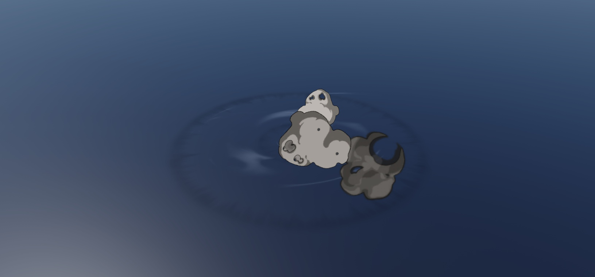

### effect-002

Isolated native burst, carrier geometry hidden. EmitCount/EmitDuration applied, captured simulation paused at ~0.18 sec. Not a motion recording.

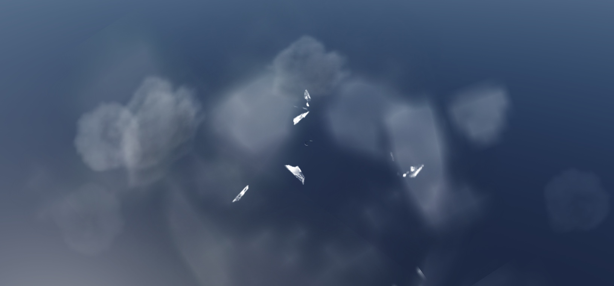

### effect-003

Isolated native burst, carrier geometry hidden. EmitCount/EmitDuration applied, captured simulation paused at ~0.18 sec. Not a motion recording.

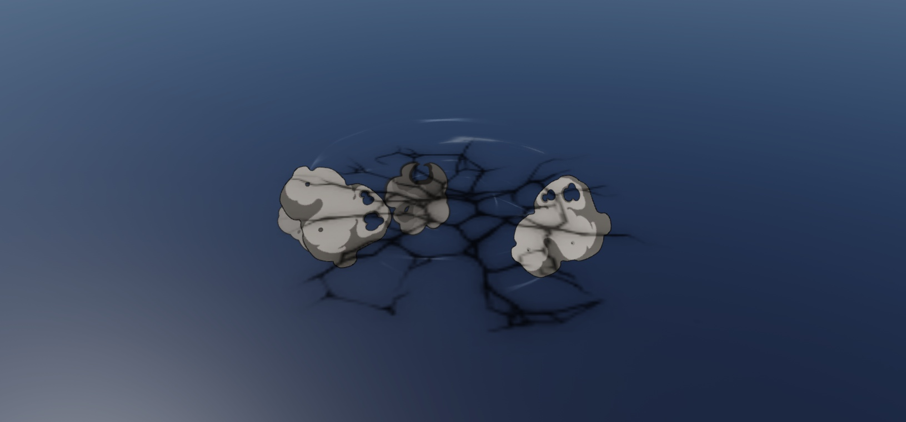

### effect-004

Isolated native burst, carrier geometry hidden. EmitCount/EmitDuration applied, captured simulation paused at ~0.18 sec. Not a motion recording.

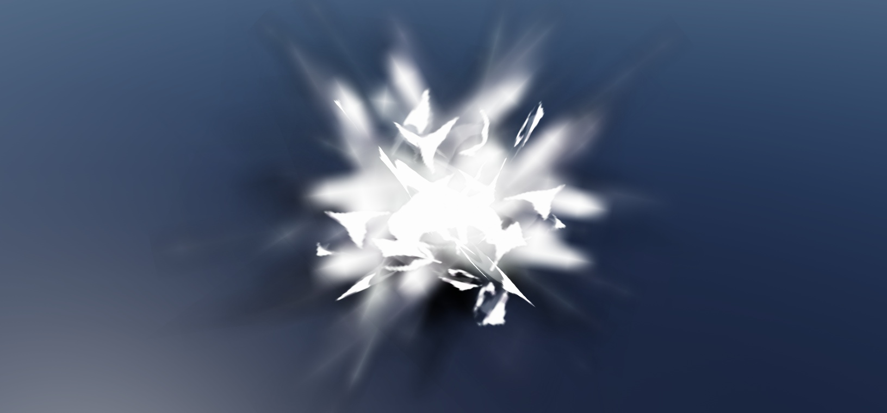

### effect-005

Isolated native burst, carrier geometry hidden. EmitCount/EmitDuration applied, captured simulation paused at ~0.18 sec. Not a motion recording.

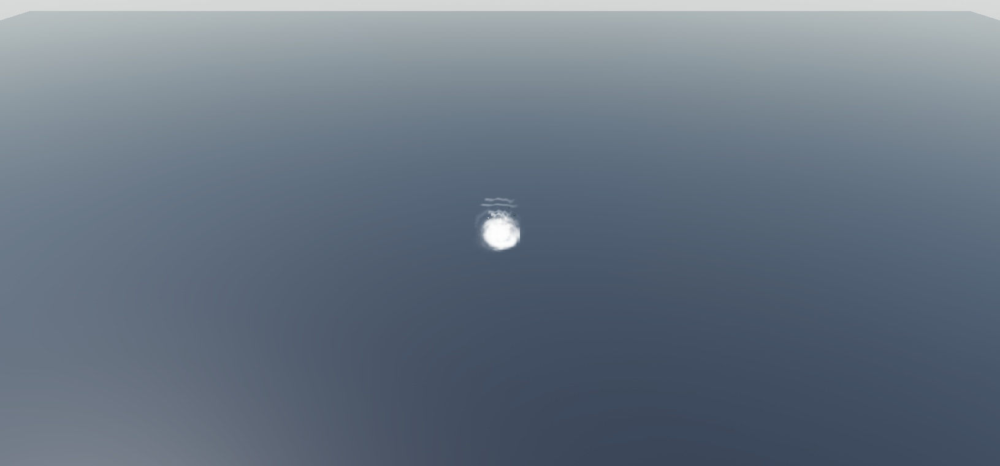

### effect-006

Isolated native burst, carrier geometry hidden. EmitCount/EmitDuration applied, captured simulation paused at ~0.18 sec. Not a motion recording.

### effect-007

Isolated native burst, carrier geometry hidden. EmitCount/EmitDuration applied, captured simulation paused at ~0.18 sec. Not a motion recording.

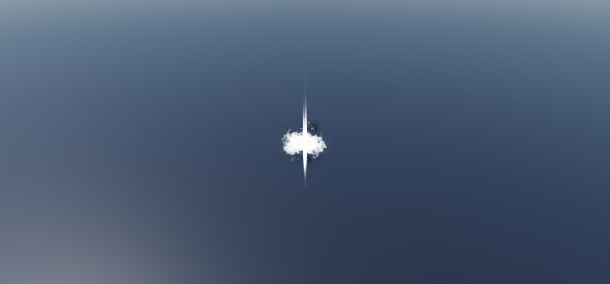

### effect-008

Isolated native burst, carrier geometry hidden. EmitCount/EmitDuration applied, captured simulation paused at ~0.18 sec. Not a motion recording.

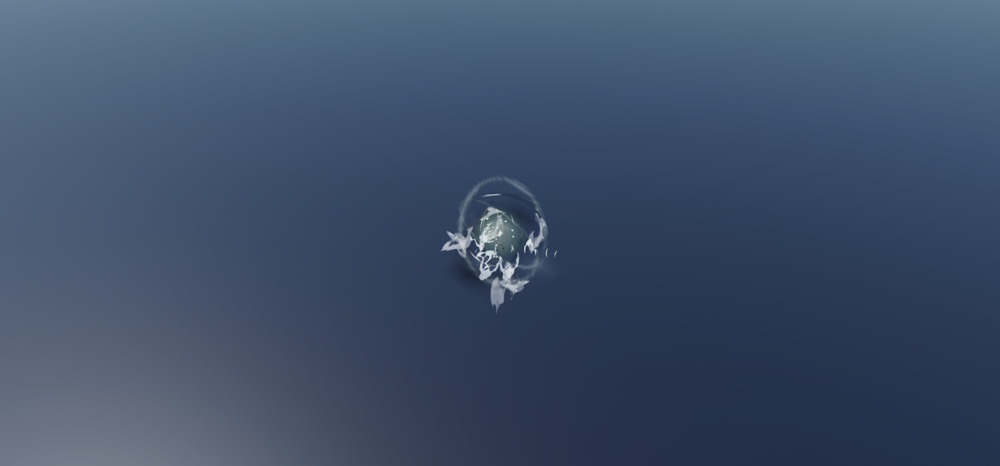

### effect-009

Isolated native burst, carrier geometry hidden. EmitCount/EmitDuration applied, captured simulation paused at ~0.18 sec. Not a motion recording.

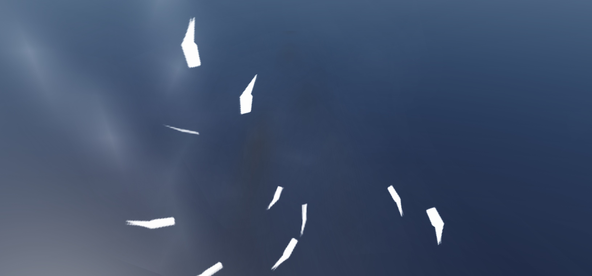

### effect-010

Isolated native burst, carrier geometry hidden. EmitCount/EmitDuration applied, captured simulation paused at ~0.18 sec. Not a motion recording.

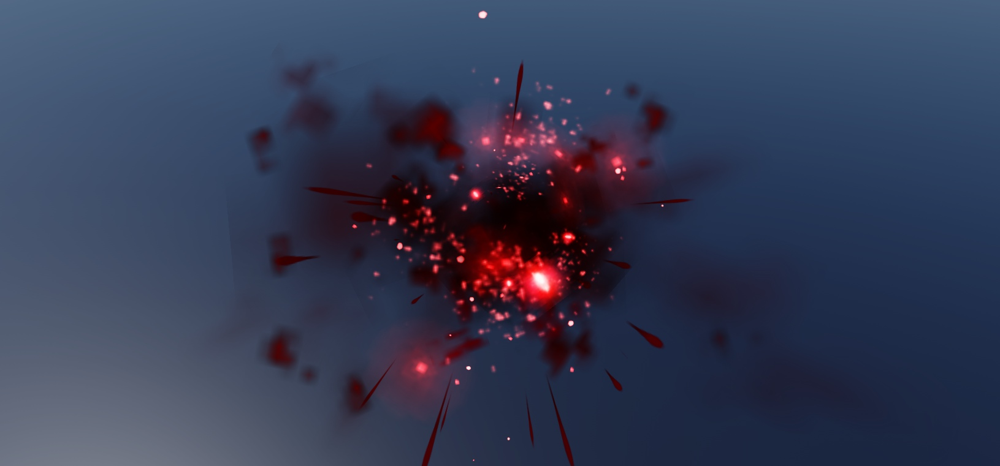

### effect-011

Isolated native burst, carrier geometry hidden. EmitCount/EmitDuration applied, captured simulation paused at ~0.18 sec. Not a motion recording.

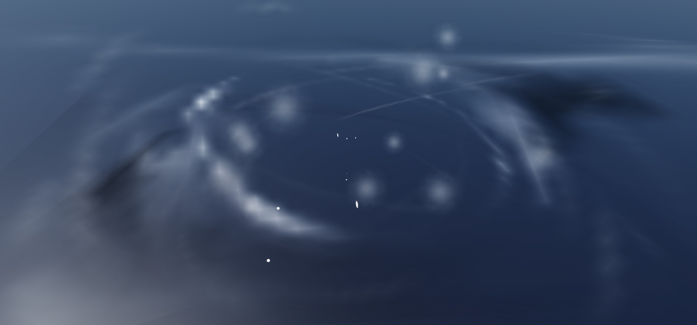

### effect-012

Isolated native burst, carrier geometry hidden. EmitCount/EmitDuration applied, captured simulation paused at ~0.18 sec. Not a motion recording.

### effect-013

Isolated native burst, carrier geometry hidden. EmitCount/EmitDuration applied, captured simulation paused at ~0.18 sec. Not a motion recording.

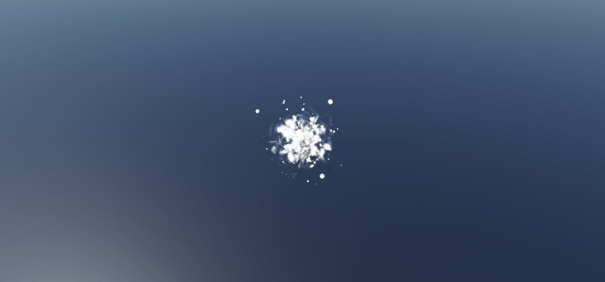

### effect-014

Isolated native burst, carrier geometry hidden. EmitCount/EmitDuration applied, captured simulation paused at ~0.18 sec. Not a motion recording.

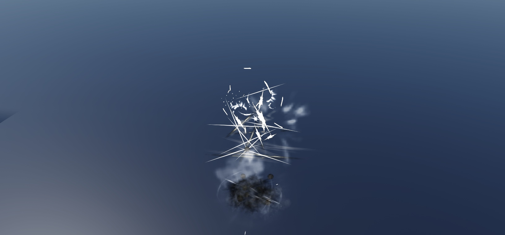

### effect-015

Isolated native burst, carrier geometry hidden. EmitCount/EmitDuration applied, captured simulation paused at ~0.18 sec. Not a motion recording.

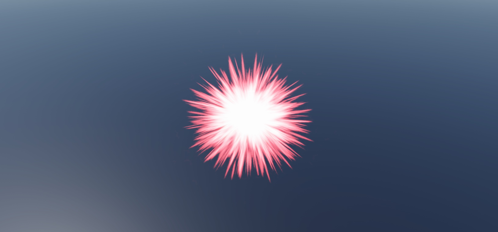

### effect-016

Isolated native burst, carrier geometry hidden. EmitCount/EmitDuration applied, captured simulation paused at ~0.18 sec. Not a motion recording.

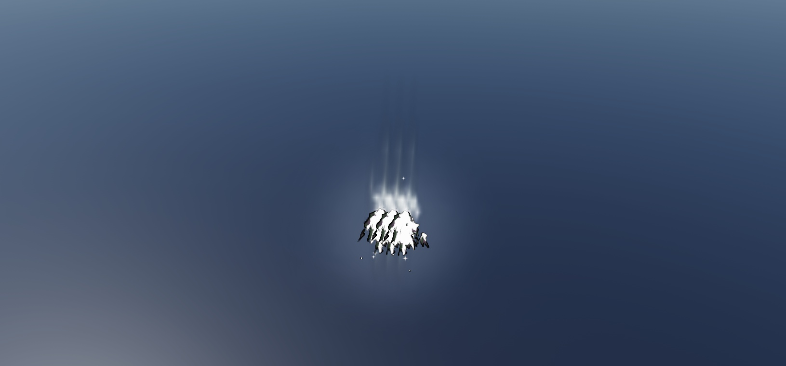

### effect-017

Isolated native burst, carrier geometry hidden. EmitCount/EmitDuration applied, captured simulation paused at ~0.18 sec. Not a motion recording.

### effect-018

Isolated native burst, carrier geometry hidden. EmitCount/EmitDuration applied, captured simulation paused at ~0.18 sec. Not a motion recording.

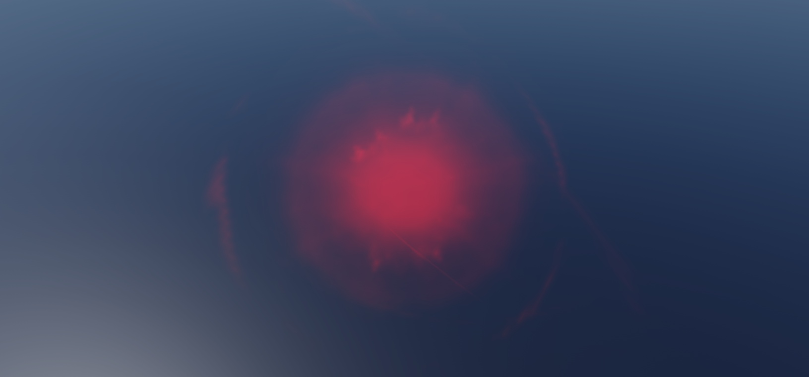

### effect-019

Isolated native burst, carrier geometry hidden. EmitCount/EmitDuration applied, captured simulation paused at ~0.18 sec. Not a motion recording.

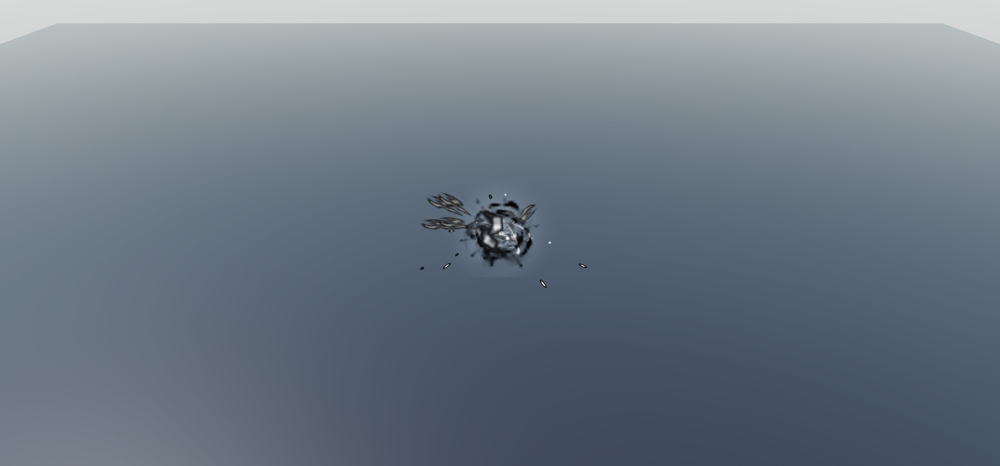

### effect-020

Isolated native burst, carrier geometry hidden. EmitCount/EmitDuration applied, captured simulation paused at ~0.18 sec. Not a motion recording.

### effect-021

Isolated native burst, carrier geometry hidden. EmitCount/EmitDuration applied, captured simulation paused at ~0.18 sec. Not a motion recording.

### effect-022

Isolated native burst, carrier geometry hidden. EmitCount/EmitDuration applied, captured simulation paused at ~0.18 sec. Not a motion recording.

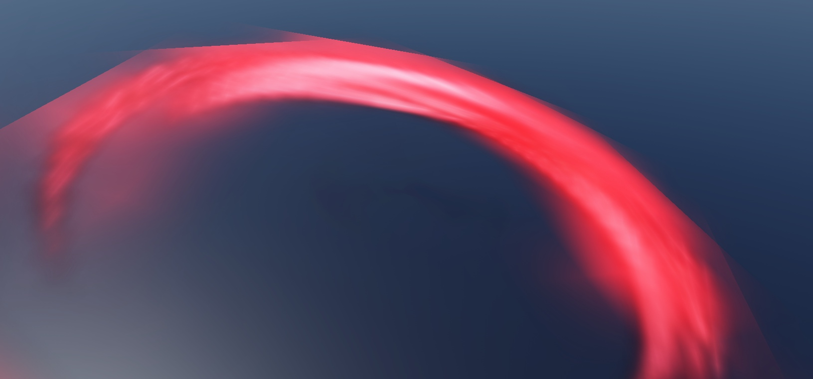

### effect-023

Isolated native burst, carrier geometry hidden. EmitCount/EmitDuration applied, captured simulation paused at ~0.18 sec. Not a motion recording.

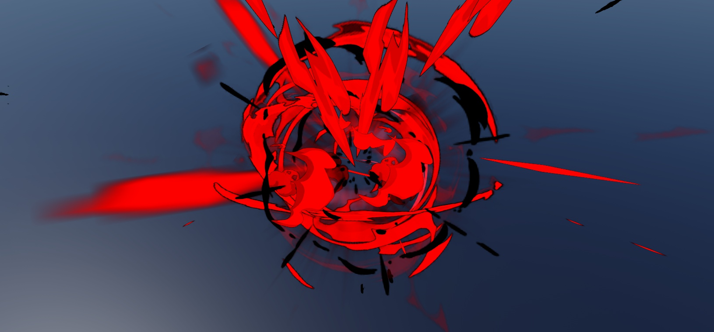

### effect-024

Isolated native burst, carrier geometry hidden. EmitCount/EmitDuration applied, captured simulation paused at ~0.18 sec. Not a motion recording.

### effect-025

Isolated native burst, carrier geometry hidden. EmitCount/EmitDuration applied, captured simulation paused at ~0.18 sec. Not a motion recording.

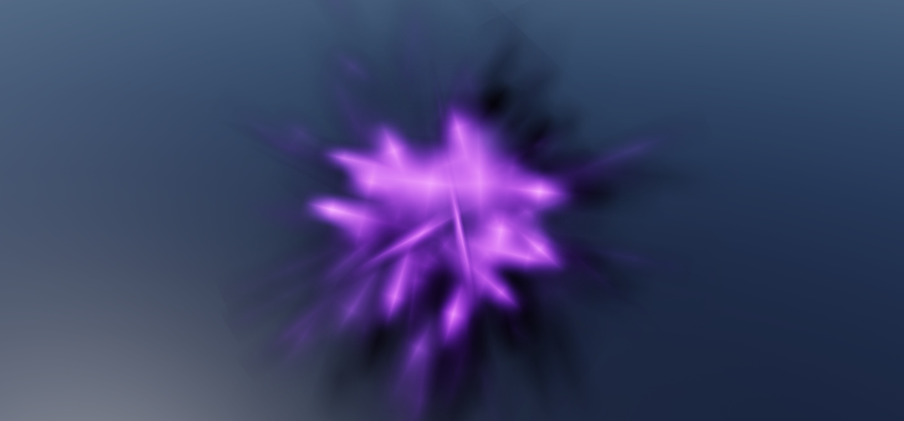

### effect-026

Isolated native burst, carrier geometry hidden. EmitCount/EmitDuration applied, captured simulation paused at ~0.18 sec. Not a motion recording.

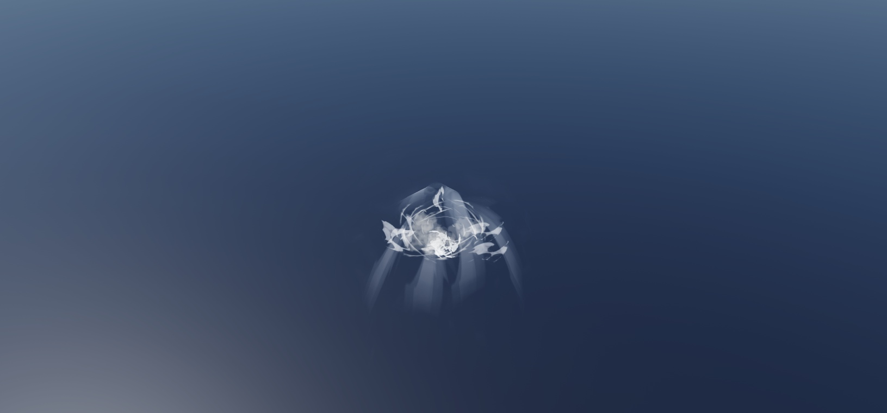

### effect-027

Isolated native burst, carrier geometry hidden. EmitCount/EmitDuration applied, captured simulation paused at ~0.18 sec. Not a motion recording.

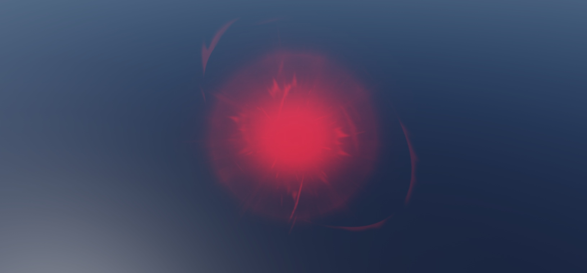

### effect-028

Isolated native burst, carrier geometry hidden. EmitCount/EmitDuration applied, captured simulation paused at ~0.18 sec. Not a motion recording.

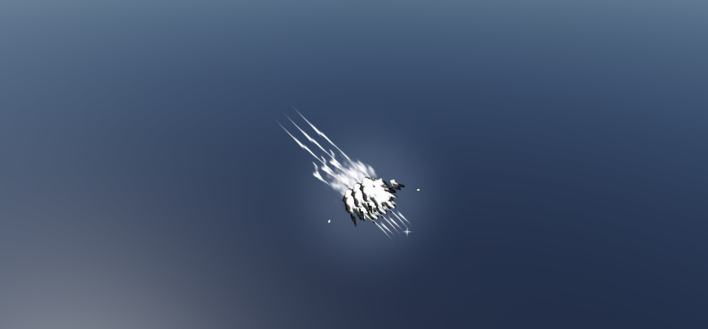

### effect-029

Isolated native burst, carrier geometry hidden. EmitCount/EmitDuration applied, captured simulation paused at ~0.18 sec. Not a motion recording.

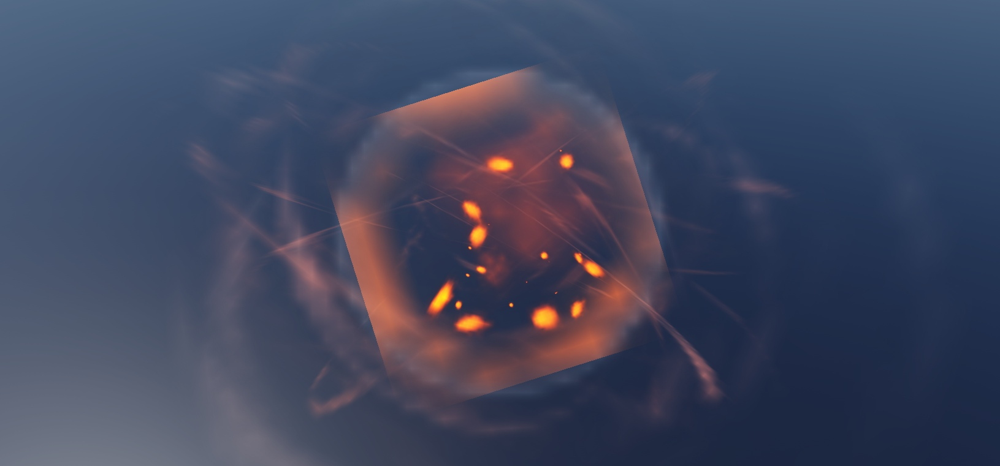

### effect-030

Isolated native burst, carrier geometry hidden. EmitCount/EmitDuration applied, captured simulation paused at ~0.18 sec. Not a motion recording.

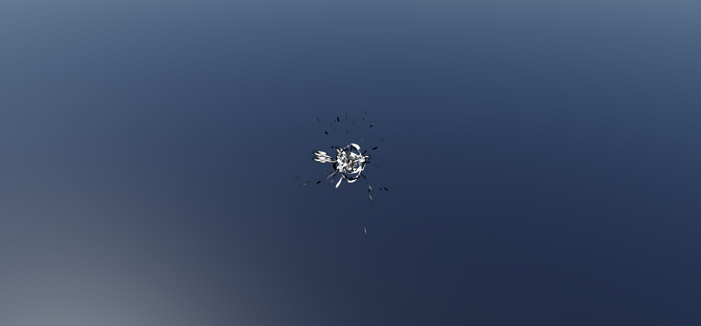

### effect-031

Isolated native burst, carrier geometry hidden. EmitCount/EmitDuration applied, captured simulation paused at ~0.18 sec. Not a motion recording.

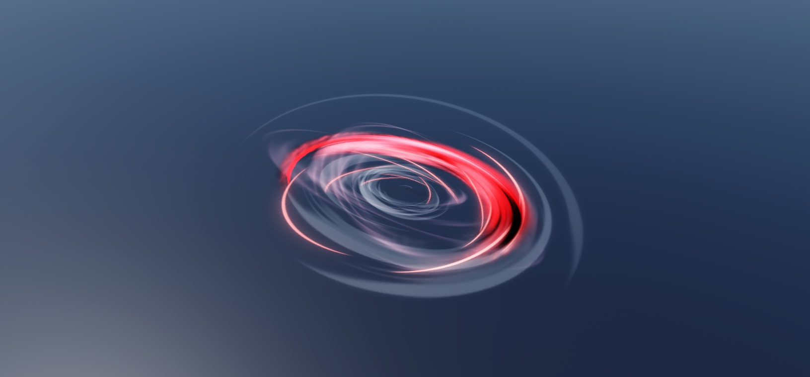

### effect-032

Isolated native burst, carrier geometry hidden. EmitCount/EmitDuration applied, captured simulation paused at ~0.18 sec. Not a motion recording.

### effect-033

Isolated native burst, carrier geometry hidden. EmitCount/EmitDuration applied, captured simulation paused at ~0.18 sec. Not a motion recording.

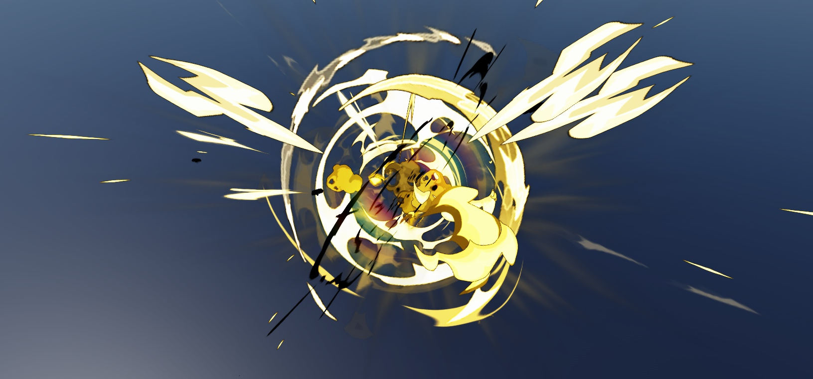

### effect-034

Isolated native burst, carrier geometry hidden. EmitCount/EmitDuration applied, captured simulation paused at ~0.18 sec. Not a motion recording.

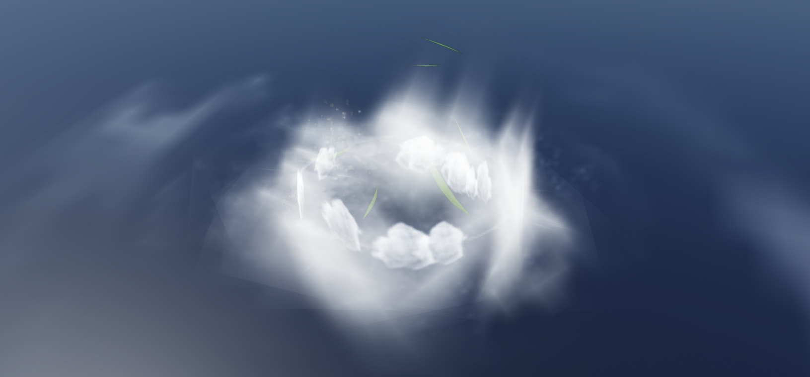

### effect-035

Isolated native burst, carrier geometry hidden. EmitCount/EmitDuration applied, captured simulation paused at ~0.18 sec. Not a motion recording.

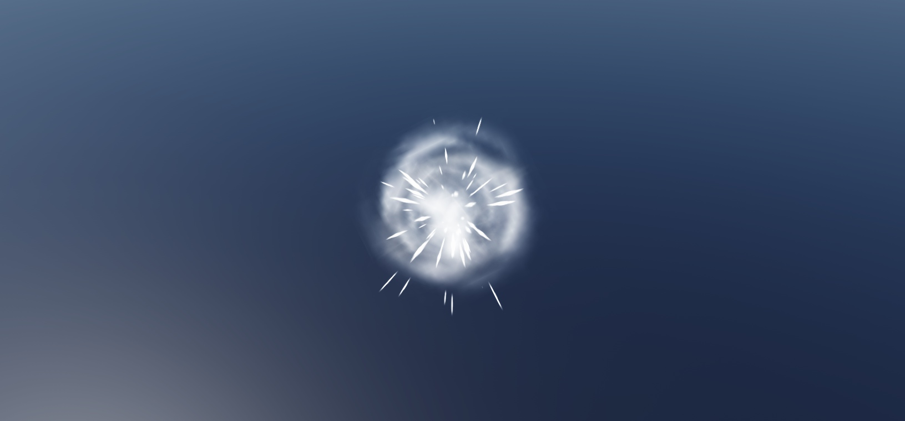

### effect-036

Isolated native burst, carrier geometry hidden. EmitCount/EmitDuration applied, captured simulation paused at ~0.18 sec. Not a motion recording.

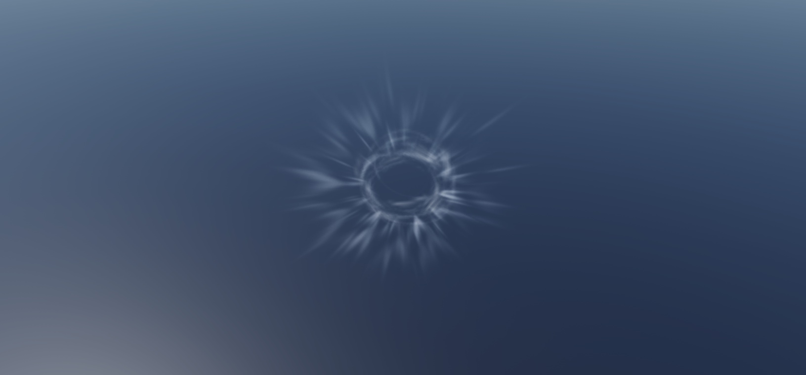

### effect-037

Isolated native burst, carrier geometry hidden. EmitCount/EmitDuration applied, captured simulation paused at ~0.18 sec. Not a motion recording.

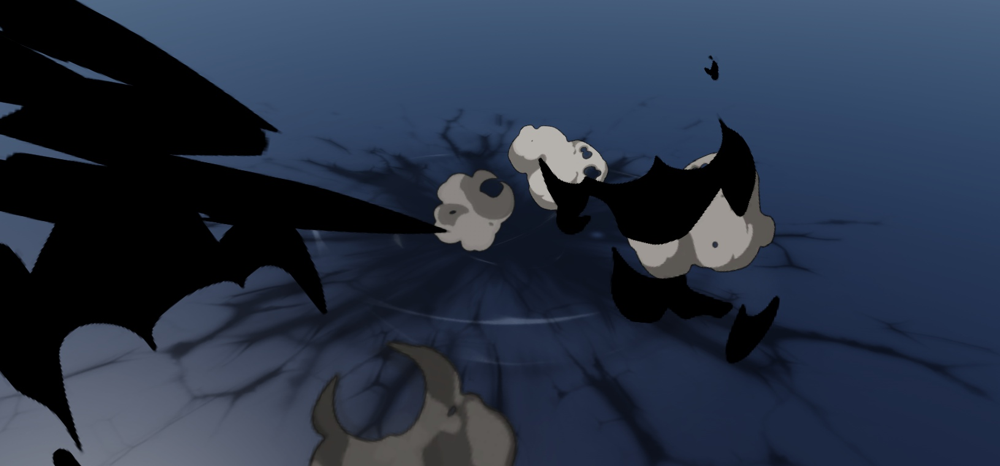

### effect-038

Isolated native burst, carrier geometry hidden. EmitCount/EmitDuration applied, captured simulation paused at ~0.18 sec. Not a motion recording.

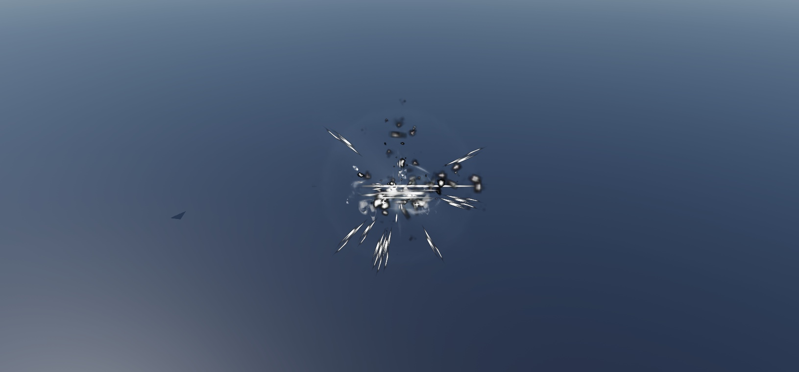

### effect-039

Isolated native burst, carrier geometry hidden. EmitCount/EmitDuration applied, captured simulation paused at ~0.18 sec. Not a motion recording.

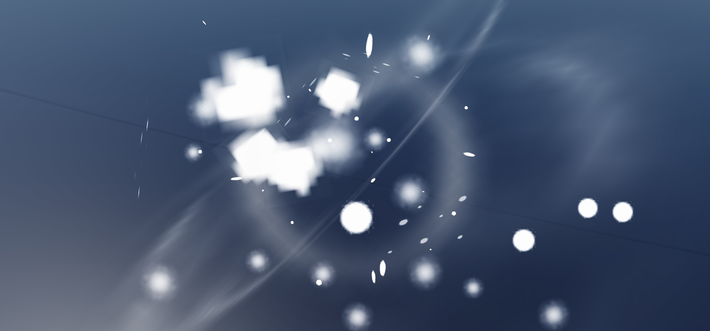

### effect-040

Isolated native burst, carrier geometry hidden. EmitCount/EmitDuration applied, captured simulation paused at ~0.18 sec. Not a motion recording.

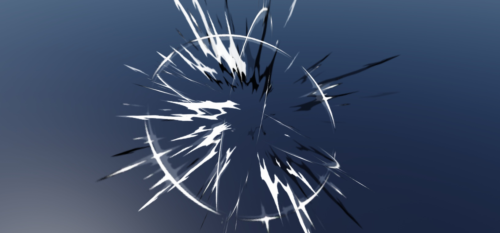

### effect-041

Isolated native burst, carrier geometry hidden. EmitCount/EmitDuration applied, captured simulation paused at ~0.18 sec. Not a motion recording.

### effect-042

Isolated native burst, carrier geometry hidden. EmitCount/EmitDuration applied, captured simulation paused at ~0.18 sec. Not a motion recording.

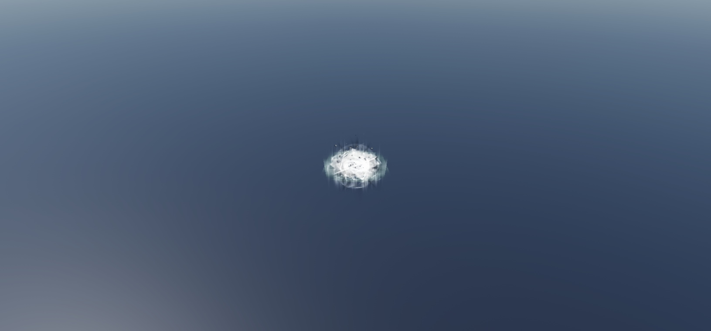

### effect-043

Isolated native burst, carrier geometry hidden. EmitCount/EmitDuration applied, captured simulation paused at ~0.18 sec. Not a motion recording.

### effect-044

Isolated native burst, carrier geometry hidden. EmitCount/EmitDuration applied, captured simulation paused at ~0.18 sec. Not a motion recording.

### effect-045

Isolated native burst, carrier geometry hidden. EmitCount/EmitDuration applied, captured simulation paused at ~0.18 sec. Not a motion recording.

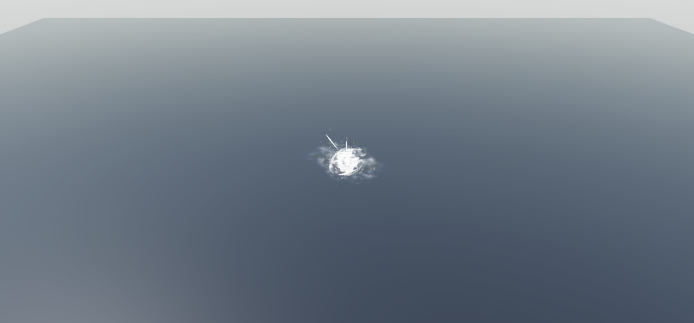

### effect-046

Isolated native burst, carrier geometry hidden. EmitCount/EmitDuration applied, captured simulation paused at ~0.18 sec. Not a motion recording.

### effect-047

Isolated native burst, carrier geometry hidden. EmitCount/EmitDuration applied, captured simulation paused at ~0.18 sec. Not a motion recording.

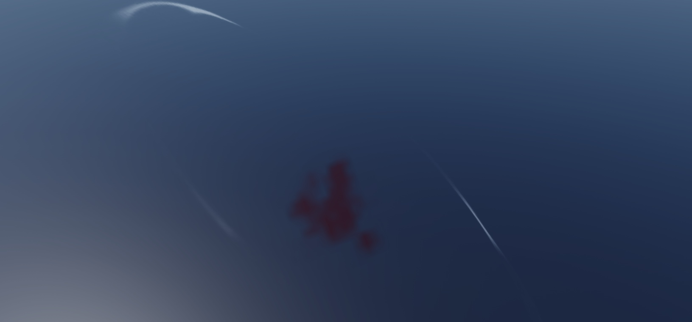

### effect-048

Isolated native burst, carrier geometry hidden. EmitCount/EmitDuration applied, captured simulation paused at ~0.18 sec. Not a motion recording.

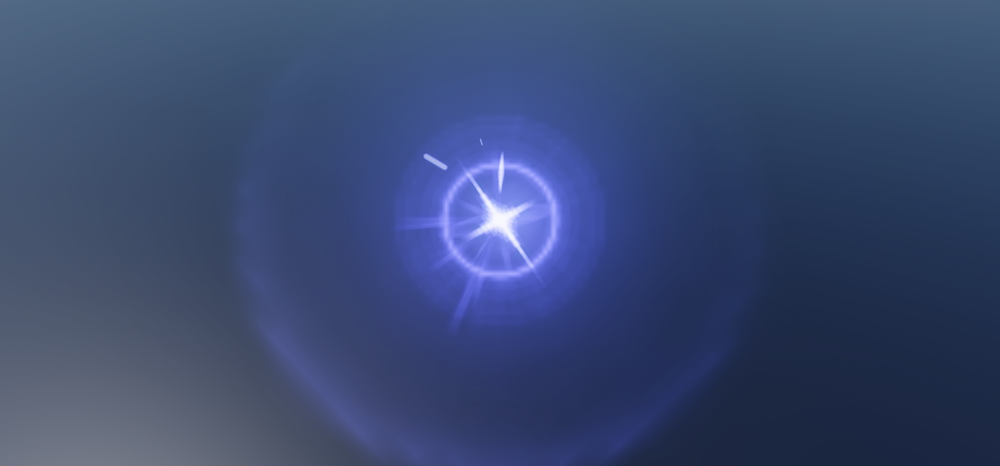

### effect-049

Isolated native burst, carrier geometry hidden. EmitCount/EmitDuration applied, captured simulation paused at ~0.18 sec. Not a motion recording.

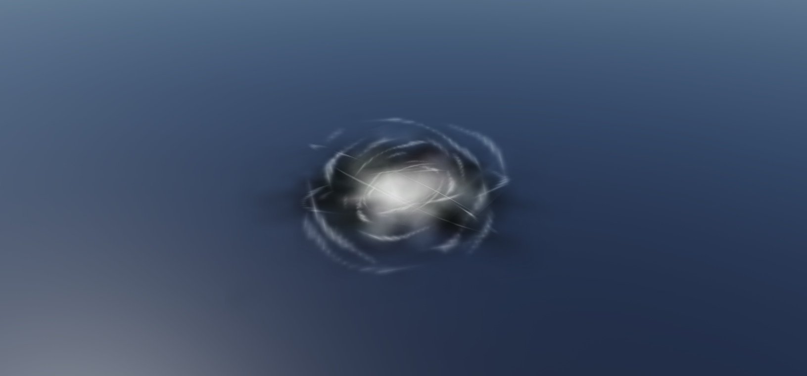

### effect-050

Isolated native burst, carrier geometry hidden. EmitCount/EmitDuration applied, captured simulation paused at ~0.18 sec. Not a motion recording.

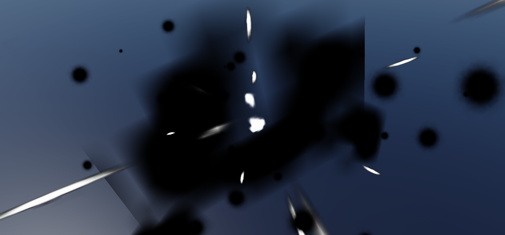

### effect-051

Isolated native burst, carrier geometry hidden. EmitCount/EmitDuration applied, captured simulation paused at ~0.18 sec. Not a motion recording.

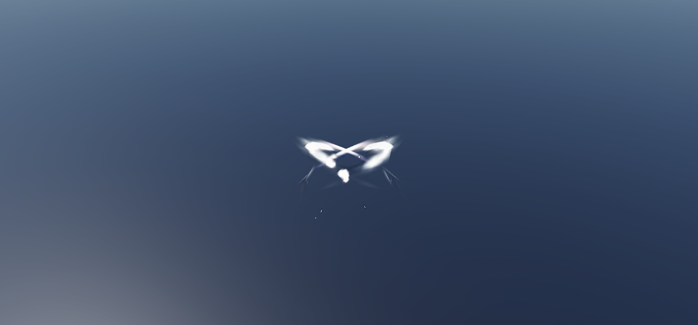

### effect-052

Isolated native burst, carrier geometry hidden. EmitCount/EmitDuration applied, captured simulation paused at ~0.18 sec. Not a motion recording.

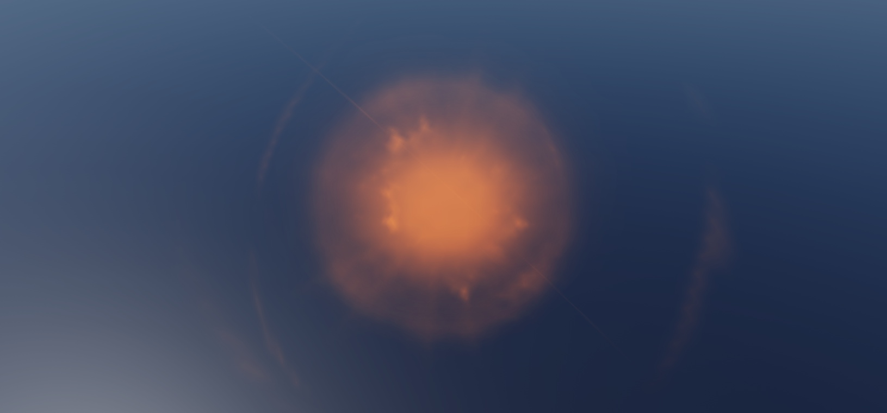

### effect-053

Isolated native burst, carrier geometry hidden. EmitCount/EmitDuration applied, captured simulation paused at ~0.18 sec. Not a motion recording.

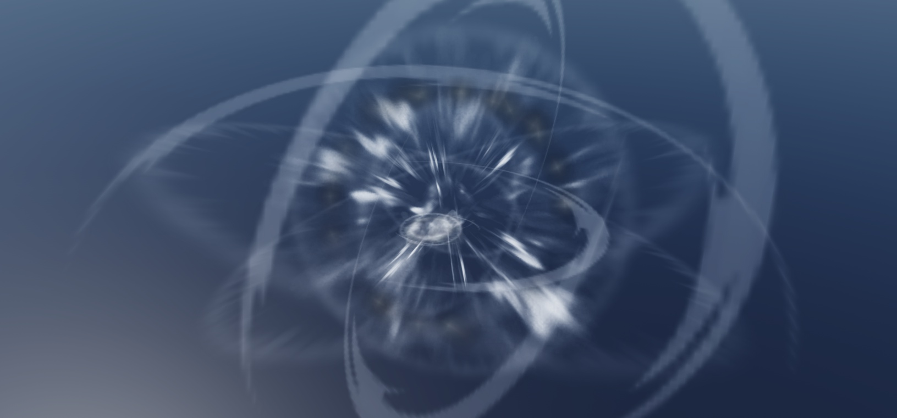

### effect-054

Isolated native burst, carrier geometry hidden. EmitCount/EmitDuration applied, captured simulation paused at ~0.18 sec. Not a motion recording.

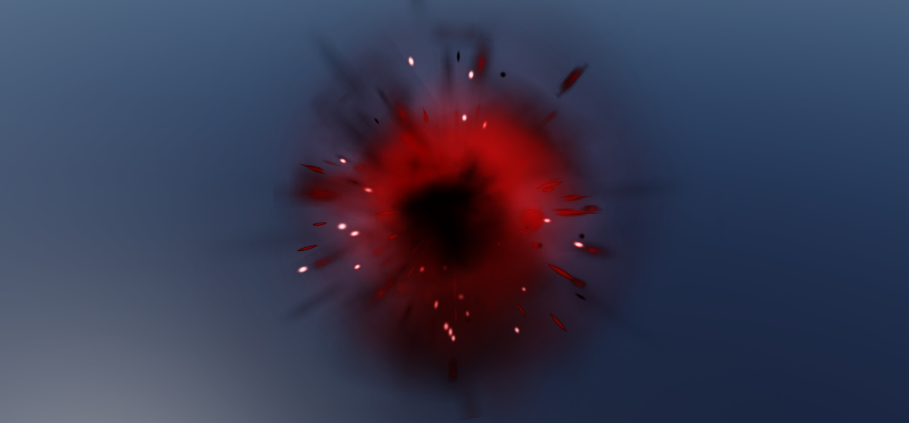

### effect-055

Isolated native burst, carrier geometry hidden. EmitCount/EmitDuration applied, captured simulation paused at ~0.18 sec. Not a motion recording.

### effect-056

Isolated native burst, carrier geometry hidden. EmitCount/EmitDuration applied, captured simulation paused at ~0.18 sec. Not a motion recording.

### effect-057

Isolated native burst, carrier geometry hidden. EmitCount/EmitDuration applied, captured simulation paused at ~0.18 sec. Not a motion recording.

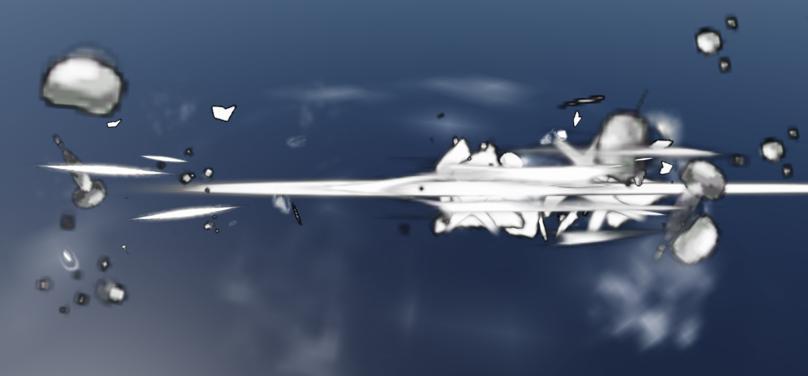

### effect-058

Isolated native burst, carrier geometry hidden. EmitCount/EmitDuration applied, captured simulation paused at ~0.18 sec. Not a motion recording.

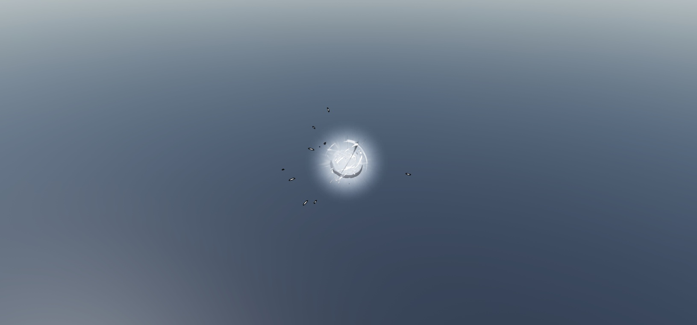

### effect-059

Isolated native burst, carrier geometry hidden. EmitCount/EmitDuration applied, captured simulation paused at ~0.18 sec. Not a motion recording.

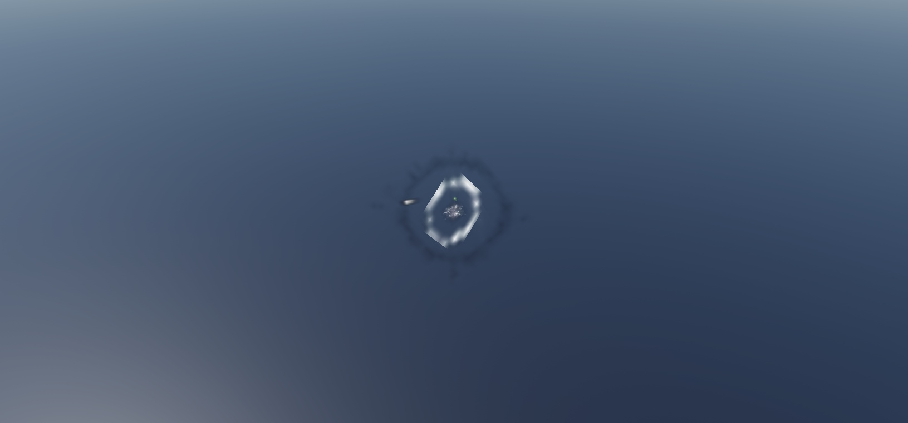

### effect-060

Isolated native burst, carrier geometry hidden. EmitCount/EmitDuration applied, captured simulation paused at ~0.18 sec. Not a motion recording.

### effect-061

Isolated native burst, carrier geometry hidden. EmitCount/EmitDuration applied, captured simulation paused at ~0.18 sec. Not a motion recording.

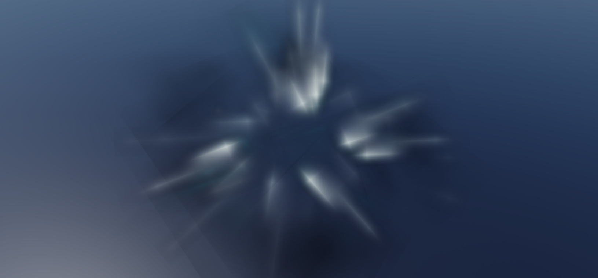

### effect-062

Isolated native burst, carrier geometry hidden. EmitCount/EmitDuration applied, captured simulation paused at ~0.18 sec. Not a motion recording.

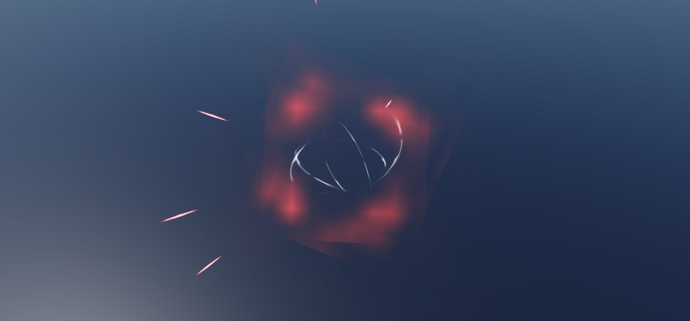

### effect-063

Isolated native burst, carrier geometry hidden. EmitCount/EmitDuration applied, captured simulation paused at ~0.18 sec. Not a motion recording.

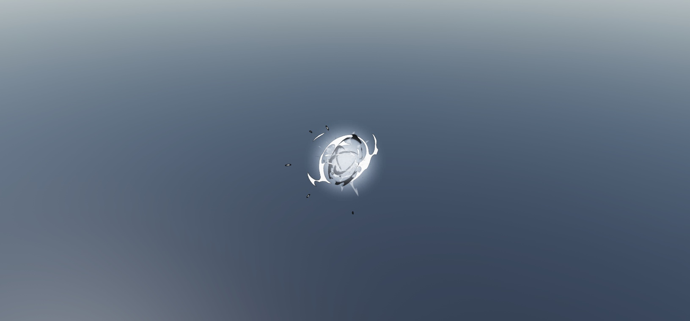

### effect-064

Isolated native burst, carrier geometry hidden. EmitCount/EmitDuration applied, captured simulation paused at ~0.18 sec. Not a motion recording.

### effect-065

Isolated native burst, carrier geometry hidden. EmitCount/EmitDuration applied, captured simulation paused at ~0.18 sec. Not a motion recording.

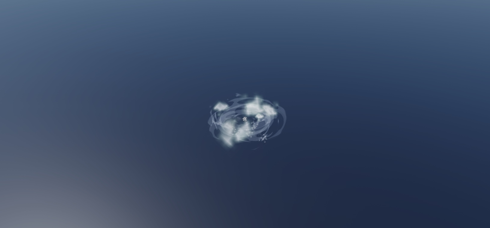

### effect-066

Isolated native burst, carrier geometry hidden. EmitCount/EmitDuration applied, captured simulation paused at ~0.18 sec. Not a motion recording.

### effect-067

Isolated native burst, carrier geometry hidden. EmitCount/EmitDuration applied, captured simulation paused at ~0.18 sec. Not a motion recording.

### effect-068

Isolated native burst, carrier geometry hidden. EmitCount/EmitDuration applied, captured simulation paused at ~0.18 sec. Not a motion recording.

### effect-069

Isolated native burst, carrier geometry hidden. EmitCount/EmitDuration applied, captured simulation paused at ~0.18 sec. Not a motion recording.

### effect-070

Isolated native burst, carrier geometry hidden. EmitCount/EmitDuration applied, captured simulation paused at ~0.18 sec. Not a motion recording.

### effect-071

Isolated native burst, carrier geometry hidden. EmitCount/EmitDuration applied, captured simulation paused at ~0.18 sec. Not a motion recording.

### effect-072

Isolated native burst, carrier geometry hidden. EmitCount/EmitDuration applied, captured simulation paused at ~0.18 sec. Not a motion recording.

### effect-073

Isolated native burst, carrier geometry hidden. EmitCount/EmitDuration applied, captured simulation paused at ~0.18 sec. Not a motion recording.

### effect-074

Isolated native burst, carrier geometry hidden. EmitCount/EmitDuration applied, captured simulation paused at ~0.18 sec. Not a motion recording.

### effect-075

Isolated native burst, carrier geometry hidden. EmitCount/EmitDuration applied, captured simulation paused at ~0.18 sec. Not a motion recording.

### effect-076

Isolated native burst, carrier geometry hidden. EmitCount/EmitDuration applied, captured simulation paused at ~0.18 sec. Not a motion recording.

### effect-077

Isolated native burst, carrier geometry hidden. EmitCount/EmitDuration applied, captured simulation paused at ~0.18 sec. Not a motion recording.

### effect-078

Isolated native burst, carrier geometry hidden. EmitCount/EmitDuration applied, captured simulation paused at ~0.18 sec. Not a motion recording.

### effect-079

Isolated native burst, carrier geometry hidden. EmitCount/EmitDuration applied, captured simulation paused at ~0.18 sec. Not a motion recording.

### effect-080

Isolated native burst, carrier geometry hidden. EmitCount/EmitDuration applied, captured simulation paused at ~0.18 sec. Not a motion recording.

### effect-081

Isolated native burst, carrier geometry hidden. EmitCount/EmitDuration applied, captured simulation paused at ~0.18 sec. Not a motion recording.

### effect-082

Isolated native burst, carrier geometry hidden. EmitCount/EmitDuration applied, captured simulation paused at ~0.18 sec. Not a motion recording.

### effect-083

Isolated native burst, carrier geometry hidden. EmitCount/EmitDuration applied, captured simulation paused at ~0.18 sec. Not a motion recording.

### effect-084

Isolated native burst, carrier geometry hidden. EmitCount/EmitDuration applied, captured simulation paused at ~0.18 sec. Not a motion recording.

### effect-085

Isolated native burst, carrier geometry hidden. EmitCount/EmitDuration applied, captured simulation paused at ~0.18 sec. Not a motion recording.

### effect-086

Isolated native burst, carrier geometry hidden. EmitCount/EmitDuration applied, captured simulation paused at ~0.18 sec. Not a motion recording.

### effect-087

Isolated native burst, carrier geometry hidden. EmitCount/EmitDuration applied, captured simulation paused at ~0.18 sec. Not a motion recording.

### effect-088

Isolated native burst, carrier geometry hidden. EmitCount/EmitDuration applied, captured simulation paused at ~0.18 sec. Not a motion recording.

### effect-089

Isolated native burst, carrier geometry hidden. EmitCount/EmitDuration applied, captured simulation paused at ~0.18 sec. Not a motion recording.

### effect-090

Isolated native burst, carrier geometry hidden. EmitCount/EmitDuration applied, captured simulation paused at ~0.18 sec. Not a motion recording.

### effect-091

Isolated native burst, carrier geometry hidden. EmitCount/EmitDuration applied, captured simulation paused at ~0.18 sec. Not a motion recording.

### effect-092

Isolated native burst, carrier geometry hidden. EmitCount/EmitDuration applied, captured simulation paused at ~0.18 sec. Not a motion recording.

### effect-093

Isolated native burst, carrier geometry hidden. EmitCount/EmitDuration applied, captured simulation paused at ~0.18 sec. Not a motion recording.

### effect-094

Isolated native burst, carrier geometry hidden. EmitCount/EmitDuration applied, captured simulation paused at ~0.18 sec. Not a motion recording.

### effect-095

Isolated native burst, carrier geometry hidden. EmitCount/EmitDuration applied, captured simulation paused at ~0.18 sec. Not a motion recording.

### effect-096

Isolated native burst, carrier geometry hidden. EmitCount/EmitDuration applied, captured simulation paused at ~0.18 sec. Not a motion recording.

### trail-1

Native trail width/texture/color shown on a staged path; lifetime extended to 5 seconds on preview clone only to inspect the ribbon. Some supplied trails are intrinsically faint. Not a native-timing demonstration.

### trail-2

Native trail width/texture/color shown on a staged path; lifetime extended to 5 seconds on preview clone only to inspect the ribbon. Some supplied trails are intrinsically faint. Not a native-timing demonstration.

### trail-3

Native trail width/texture/color shown on a staged path; lifetime extended to 5 seconds on preview clone only to inspect the ribbon. Some supplied trails are intrinsically faint. Not a native-timing demonstration.

### trail-4

Native trail width/texture/color shown on a staged path; lifetime extended to 5 seconds on preview clone only to inspect the ribbon. Some supplied trails are intrinsically faint. Not a native-timing demonstration.

### trail-5

Native trail width/texture/color shown on a staged path; lifetime extended to 5 seconds on preview clone only to inspect the ribbon. Some supplied trails are intrinsically faint. Not a native-timing demonstration.

