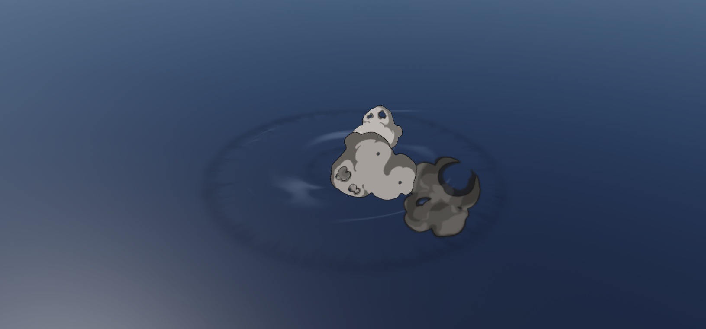
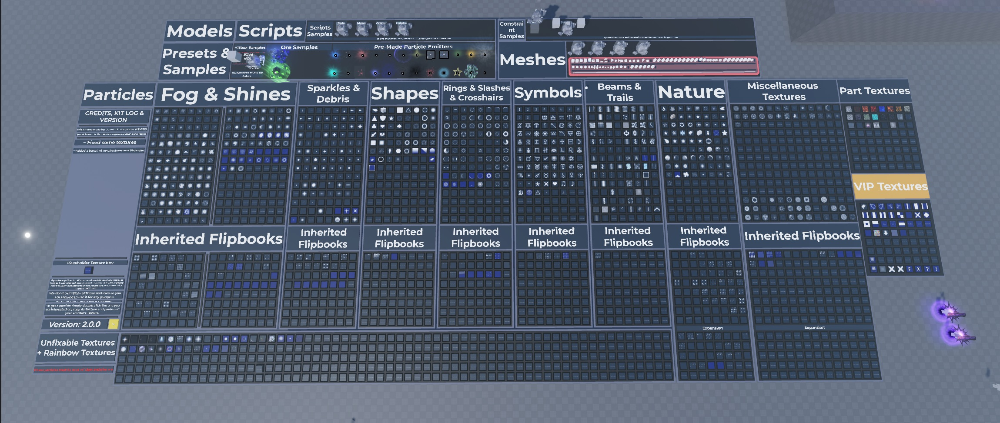
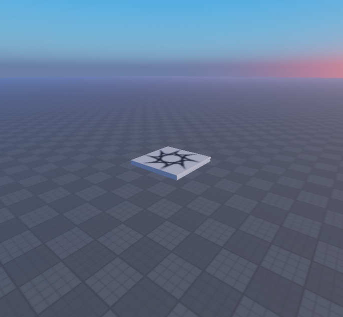

# Steal a Template / VFX

Editable Roblox particles, beams, and trails with native downloads and real Studio captures. Pick a pack and review its playback and verification limits.

| Pack | Gallery | Native model | Current status |
| --- | --- | --- | --- |
| [Combat VFX Collection](100-combat-vfx-pack-1/) | [101 screenshots](100-combat-vfx-pack-1/GALLERY.md) | [100+ Combat VFX Pack (1).rbxm](100-combat-vfx-pack-1/100%2B%20Combat%20VFX%20Pack%20%281%29.rbxm?raw=1) | Visual preview; motion recording pending |
| [PDS Particles & Models Kit](pds-particles-models-kit/) | [1 screenshots](pds-particles-models-kit/GALLERY.md) | [particle and model kit.rbxm](pds-particles-models-kit/particle%20and%20model%20kit.rbxm?raw=1) | Preview; see verification and integration limits |
| [HD Lighting](hd-lighting-place/) | [3 screenshots](hd-lighting-place/GALLERY.md) | [HDLighting.rbxm](hd-lighting-place/HDLighting.rbxm?raw=1) | Native lighting model; pistol removed |

### Combat VFX Collection

### PDS Particles & Models Kit

### HD Lighting

## Install

Download the native `.rbxm`, stop Play, and follow the exact destination and setup steps on its pack page. Review the documented dependencies and test limits before integrating it into a game.

Original Steal a Template contributions use [MIT terms](../../LICENSE); each pack's credits preserve applicable third-party notices.

[Back to Steal a Template](../../README.md)
