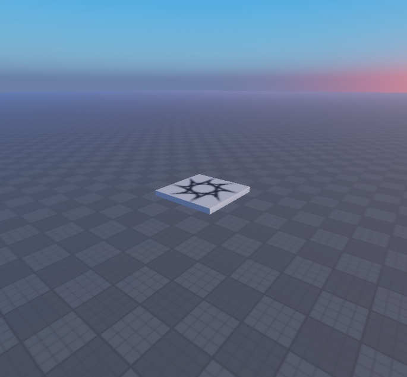
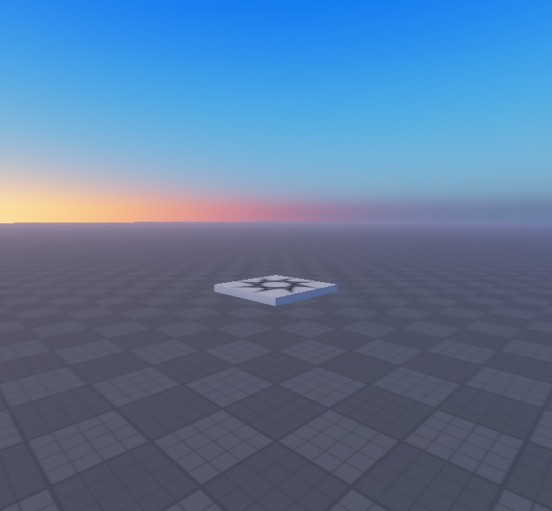
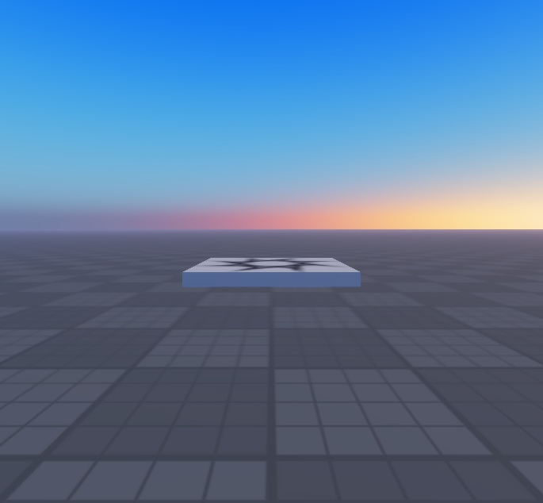

# HD Lighting — gallery

Actual Studio MCP captures of the source implementation. Conversion retains the pictured UI/geometry/lighting; service wrappers and LightingSettings are packaging, not visual additions. Model-specific complete runtime behavior has not been certified.

### Lighting Overview — actual supplied place

### Lighting Sunrise — actual supplied place

### Lighting Ground — actual supplied place

