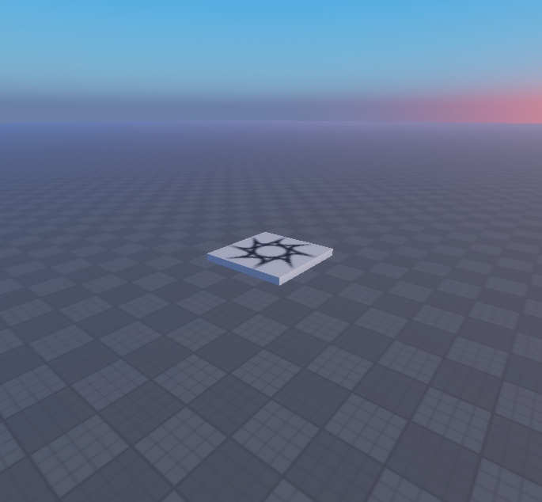

# HD Lighting Demo Place

Original native lighting demonstration place with a baseplate/spawn, two Atmosphere instances, two Sky instances, four Bloom effects, two ColorCorrection effects, four DepthOfField effects, eight Blur effects and six SunRays effects. Also contains a Pistol Tool under Lighting.Tools, with seven embedded weapon scripts; this is not a clean lighting-only model.

**Preview release 0.1.0.** Visual lighting preview only; no quality/performance or device certification. Duplicate effects and inactive blur states are retained exactly as supplied. The unrelated Pistol DamageHandler trusts client-supplied target/damage and EventCatcher accepts client positions without validation/rate limiting; do not deploy those weapon scripts. The pistol, weapon animations, sounds and damage were not exercised. Static screenshots show combined lighting, not isolated proof of every effect or animation.

## Download

[Download HD-Lighting.rbxl](HD-Lighting.rbxl?raw=1) — 672,177 bytes.

[Full gallery — 3 screenshots](GALLERY.md) | [Native inventory](INVENTORY.md) | [Compressed full hierarchy](HIERARCHY.json.gz) | [Verification](VERIFICATION.md)

**Native format: `.rbxl` place. Open it separately in Studio; this is not an `.rbxm` model.**

## Included assets

Original native lighting demonstration place with a baseplate/spawn, two Atmosphere instances, two Sky instances, four Bloom effects, two ColorCorrection effects, four DepthOfField effects, eight Blur effects and six SunRays effects. Also contains a Pistol Tool under Lighting.Tools, with seven embedded weapon scripts; this is not a clean lighting-only model.

7 embedded scripts are extracted verbatim in [src/manifest.json](src/manifest.json). The binary is authoritative; do not install duplicate extracted copies.

## Installation

Open the .rbxl as a separate place in Studio. Inspect LIGHTING-SETTINGS.json and Lighting properties. For integration, copy only the reviewed Lighting effects and desired property values into your own Lighting service. Review duplicate skies/atmospheres and enabled states rather than blindly stacking them. Do not copy Lighting.Tools or its Pistol into your game merely to install the lighting. A .rbxl is a place, not an insertable model.

## Customization and dependencies

Work on a copy in Studio. Preserve required internal hierarchy, attachments, bones and relative transforms. Inspect [asset references](ASSET-REFERENCES.json); their availability in this Studio session does not guarantee permission in your destination experience. Keep original creator notices.

## Verification and limitations

Opened the actual native place and inspected Lighting through Studio MCP. Recorded effect names, enabled states and principal properties. Limited Play check spawned the local character on the baseplate; the Backpack was empty and Lighting retained 31 children. The pistol remained in Lighting.Tools and was not equipped. Captures are 685 x 634 Edit-mode views at the supplied clock time, not alternate lighting presets. No changes saved to the original.

Visual lighting preview only; no quality/performance or device certification. Duplicate effects and inactive blur states are retained exactly as supplied. The unrelated Pistol DamageHandler trusts client-supplied target/damage and EventCatcher accepts client positions without validation/rate limiting; do not deploy those weapon scripts. The pistol, weapon animations, sounds and damage were not exercised. Static screenshots show combined lighting, not isolated proof of every effect or animation.

SHA-256: `21f40ee66e3cb45854ff0a237aff96a1843f41ac904181601ea4aafc2737abe3`

## Credits and license

[Credits](CREDITS.md) | [Scoped project MIT notice](LICENSE) | [Repository scope](../../../docs/LICENSING.md) | [Changelog](CHANGELOG.md)

[Back to category](../README.md)
