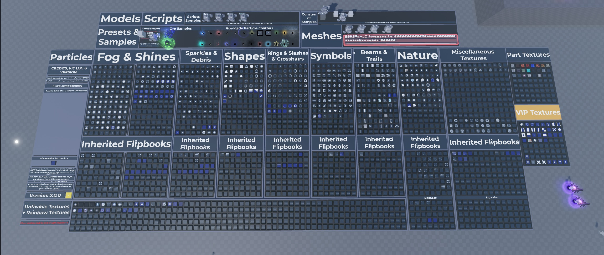

# PDS Particles & Models Kit

PDS particle/model library with three top-level groups: particles, model presets and Log.

**Preview release 0.1.0.** Uses the owner-supplied preview image as requested. No new particle simulation, per-effect gallery or motion/playback verification was performed. Original binary contains 34 ParticleEmitters and four scripts; the large hierarchy also includes model/geometry samples.

## Download

[Download particle and model kit.rbxm](particle%20and%20model%20kit.rbxm?raw=1) — 222,639 bytes.

[Full gallery — 1 screenshots](GALLERY.md) | [Native inventory](INVENTORY.md) | [Verification](VERIFICATION.md)

## Included assets

PDS particle/model library with three top-level groups: particles, model presets and Log.

4 embedded scripts are extracted verbatim in [src/manifest.json](src/manifest.json). The binary is authoritative; do not install duplicate extracted copies.

## Installation

Import into ServerStorage, inspect the PDS Particle Pack for BSED:R and PDS Models Pack for BSED:R groups, then copy the desired effect or model into Workspace. Keep required attachments, emitter parents and preset scripts together. Review each sample script before enabling it.

## Customization and dependencies

Work on a copy in Studio. Preserve required internal hierarchy, attachments, bones and relative transforms. Inspect [asset references](ASSET-REFERENCES.json); their availability in this Studio session does not guarantee permission in your destination experience. Keep original creator notices.

## Verification and limitations

Native binary hierarchy and scripts inspected. Reused owner-supplied image as explicitly requested. No new effect captures, simulation or per-effect verification.

Uses the owner-supplied preview image as requested. No new particle simulation, per-effect gallery or motion/playback verification was performed. Original binary contains 34 ParticleEmitters and four scripts; the large hierarchy also includes model/geometry samples.

SHA-256: `0a847652db657093d7ec6ac42a3f962d28f0b3d922714a482b76b9bd93be74cd`

## Credits and license

[Credits](CREDITS.md) | [Scoped project MIT notice](LICENSE) | [Repository scope](../../../docs/LICENSING.md) | [Changelog](CHANGELOG.md)

[Back to category](../README.md)
