# Steal a Template / Models

Editable Roblox model collections with native downloads and real Studio screenshots. Pick a pack, inspect its gallery, then read its setup and verification notes.

| Pack | Gallery | Native model | Current status |
| --- | --- | --- | --- |
| [Brainrot Models & Mutations](all-brainrots-models-with-all-mutations-1/) | [491 screenshots](all-brainrots-models-with-all-mutations-1/GALLERY.md) | [ALL BRAINROTS MODELS WITH ALL MUTATIONS (1).rbxm](all-brainrots-models-with-all-mutations-1/ALL%20BRAINROTS%20MODELS%20WITH%20ALL%20MUTATIONS%20%281%29.rbxm?raw=1) | Visual preview; mutation coverage sampled |
| [Car Pack](car-pack/) | [4 screenshots](car-pack/#screenshot-gallery) | [CarPack.rbxm](car-pack/CarPack.rbxm?raw=1) | Draft; see pack verification and device limits |
| [Forest Asset Pack](forest-asset-pack/) | [12 screenshots](forest-asset-pack/GALLERY.md) | [Forest Asset pack.rbxm](forest-asset-pack/Forest%20Asset%20pack.rbxm?raw=1) | Visual preview; geometry captured; gameplay/collision unverified |
| [Pickaxes](pickaxes/) | [22 screenshots](pickaxes/GALLERY.md) | [Pickaxes.rbxm](pickaxes/Pickaxes.rbxm?raw=1) | Visual preview; geometry captured; gameplay/collision unverified |
| [Small Lucky Block Pack](small-lucky-block-pack-tu/) | [3 screenshots](small-lucky-block-pack-tu/GALLERY.md) | [Small Lucky BLock Pack! - TU.rbxm](small-lucky-block-pack-tu/Small%20Lucky%20BLock%20Pack%21%20-%20TU.rbxm?raw=1) | Visual preview; geometry captured; gameplay/collision unverified |
| [Stud Animals](stud-animals/) | [6 screenshots](stud-animals/#screenshot-gallery) | [StudAnimals.rbxm](stud-animals/StudAnimals.rbxm?raw=1) | Draft; see pack verification and device limits |
| [Stud Asset Pack](stud-assets/) | [2 screenshots](stud-assets/#screenshot-gallery) | [StudAssets.rbxm](stud-assets/StudAssets.rbxm?raw=1) | Draft; see pack verification and device limits |
| [Stud Pack V1](stud-pack-v1/) | [1 screenshots](stud-pack-v1/#screenshot-gallery) | [StudPackV1.rbxm](stud-pack-v1/StudPackV1.rbxm?raw=1) | Draft; see pack verification and device limits |
| [Stud Vehicles](stud-vehicles/) | [1 screenshots](stud-vehicles/#screenshot-gallery) | [StudVehicles.rbxm](stud-vehicles/StudVehicles.rbxm?raw=1) | Draft; see pack verification and device limits |
| [Themed Karambits](themed-karambit-v1-3/) | [15 screenshots](themed-karambit-v1-3/GALLERY.md) | [Themed Karambit v1 (3).rbxm](themed-karambit-v1-3/Themed%20Karambit%20v1%20%283%29.rbxm?raw=1) | Visual preview; geometry captured; gameplay/collision unverified |
| [Bat Tool Models](bat-tools/) | [10 screenshots](bat-tools/GALLERY.md) | [BatTools.rbxm](bat-tools/BatTools.rbxm?raw=1) | Static geometry captured; gameplay unverified |
| [Vehicle Pack 2](vehicle-pack-2/) | [71 screenshots](vehicle-pack-2/GALLERY.md) | [VehiclePack.rbxm](vehicle-pack-2/VehiclePack.rbxm?raw=1) | Static geometry captured; gameplay unverified |
| [Gym Model Collection](gym-models/) | [85 screenshots](gym-models/GALLERY.md) | [GymModels.rbxm](gym-models/GymModels.rbxm?raw=1) | Static geometry captured; gameplay unverified |
| [Stud Pickaxes 2](pickaxes-studs-2/) | [19 screenshots](pickaxes-studs-2/GALLERY.md) | [PickaxePack_Studs_2.rbxm](pickaxes-studs-2/PickaxePack_Studs_2.rbxm?raw=1) | Static geometry captured; gameplay unverified |
| [Animal Pack 3](animal-pack-3/) | [181 screenshots](animal-pack-3/GALLERY.md) | [AnimalPack3.rbxm](animal-pack-3/AnimalPack3.rbxm?raw=1) | Static geometry captured; gameplay unverified |
| [Studded Egg Models](egg-models/) | [16 screenshots](egg-models/GALLERY.md) | [Egg Models.rbxm](egg-models/Egg%20Models.rbxm?raw=1) | Static geometry; gameplay unverified |
| [Lucky Blocks - Seven Variants](lucky-blocks-effects/) | [14 screenshots](lucky-blocks-effects/GALLERY.md) | [Lucky Blocks.rbxm](lucky-blocks-effects/Lucky%20Blocks.rbxm?raw=1) | Static geometry; gameplay unverified |
| [Classic Colored Lucky Blocks](classic-lucky-blocks/) | [10 screenshots](classic-lucky-blocks/GALLERY.md) | [LuckyBlocks.rbxm](classic-lucky-blocks/LuckyBlocks.rbxm?raw=1) | Static geometry; gameplay unverified |
| [Mythical Animals Collection](mythical-animals/) | [224 screenshots](mythical-animals/GALLERY.md) | [Mythical Animals.rbxm](mythical-animals/Mythical%20Animals.rbxm?raw=1) | Static geometry; gameplay unverified |
| [Anime Character Collection](anime-characters/) | [318 screenshots](anime-characters/GALLERY.md) | [anime characters.rbxm](anime-characters/anime%20characters.rbxm?raw=1) | Static geometry; rigs/gameplay unverified |
| [Classic Studded Eggs](classic-studded-eggs/) | [212 screenshots](classic-studded-eggs/GALLERY.md) | [Classic Studded Eggs.rbxm](classic-studded-eggs/Classic%20Studded%20Eggs.rbxm?raw=1) | Static geometry; rigs/gameplay unverified |

### Brainrot Models & Mutations

[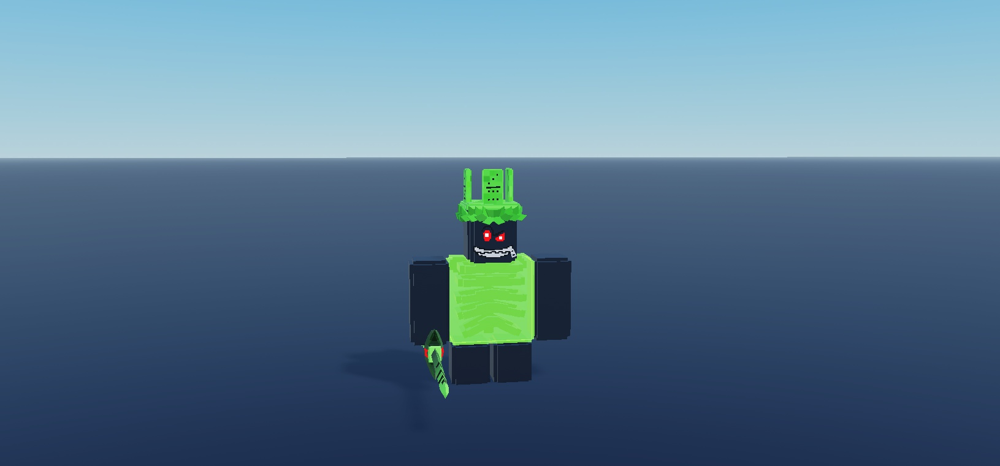](all-brainrots-models-with-all-mutations-1/)

### Car Pack

[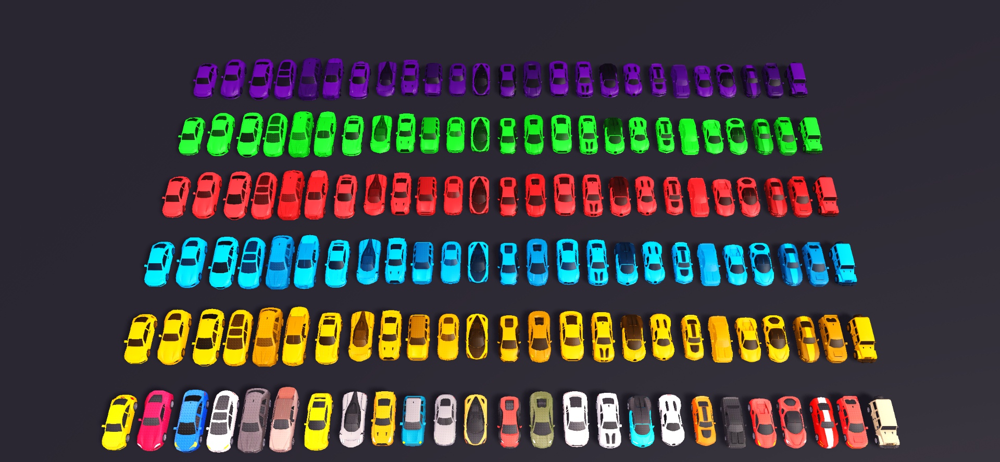](car-pack/)

### Forest Asset Pack

[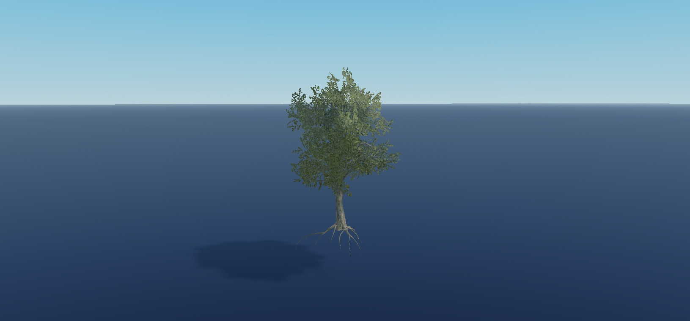](forest-asset-pack/)

### Pickaxes

[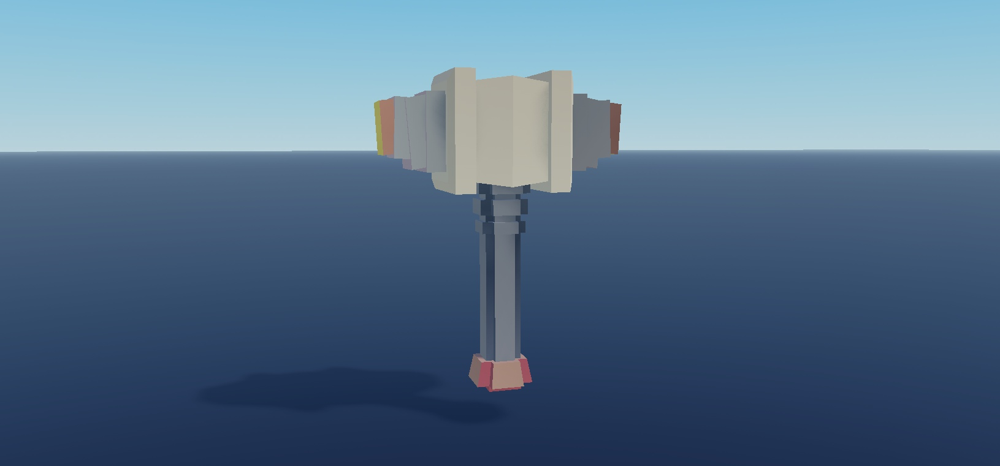](pickaxes/)

### Small Lucky Block Pack

[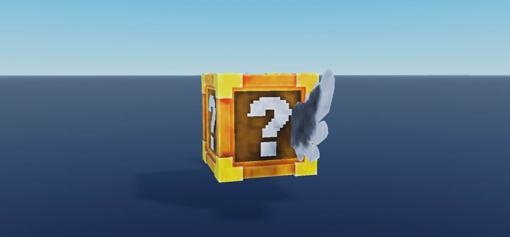](small-lucky-block-pack-tu/)

### Stud Animals

[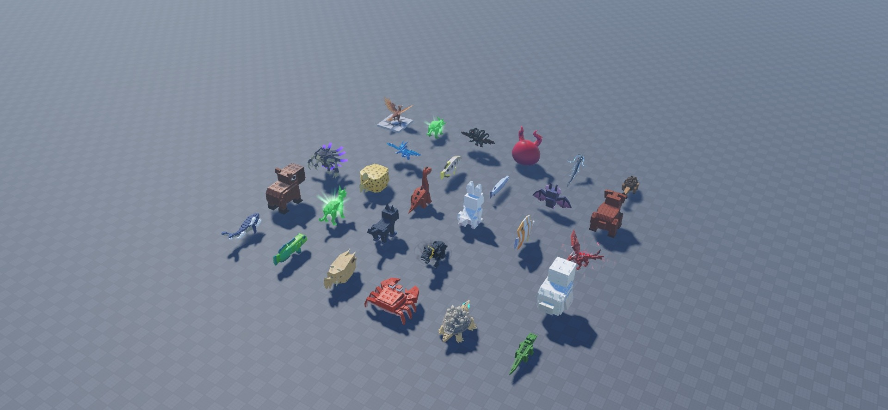](stud-animals/)

### Stud Asset Pack

[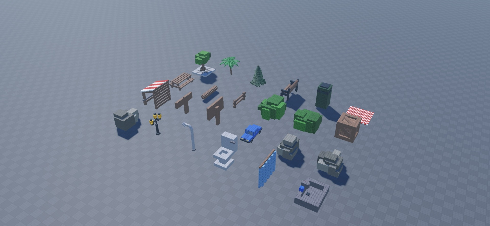](stud-assets/)

### Stud Pack V1

[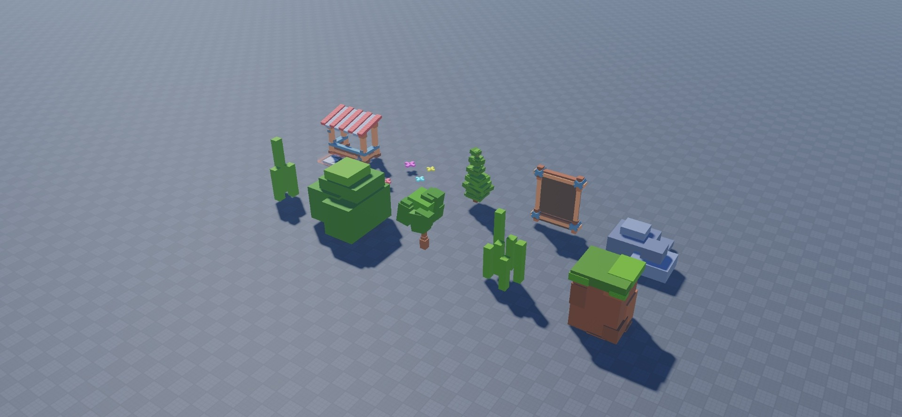](stud-pack-v1/)

### Stud Vehicles

[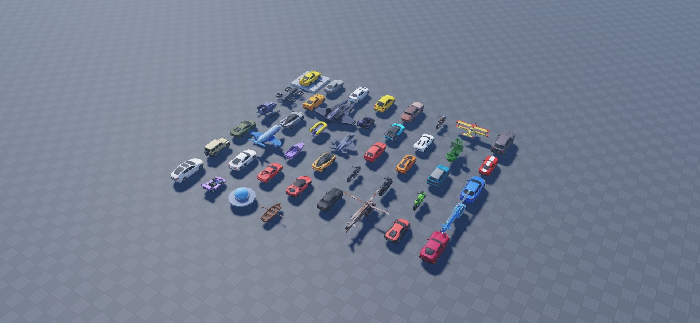](stud-vehicles/)

### Themed Karambits

[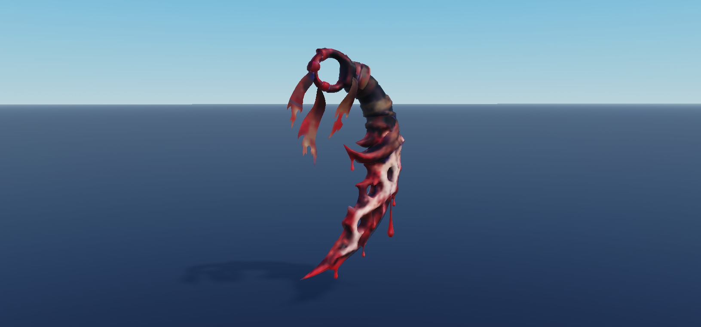](themed-karambit-v1-3/)

### Bat Tool Models

[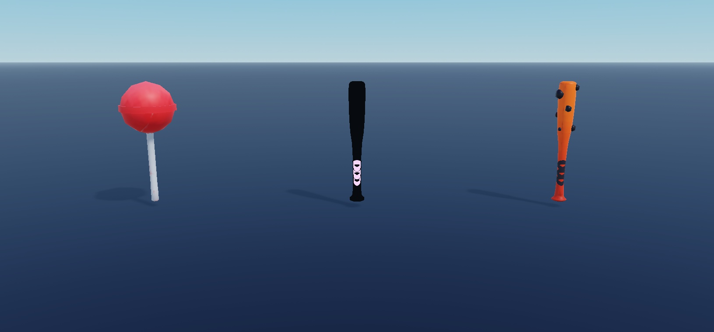](bat-tools/)

### Vehicle Pack 2

[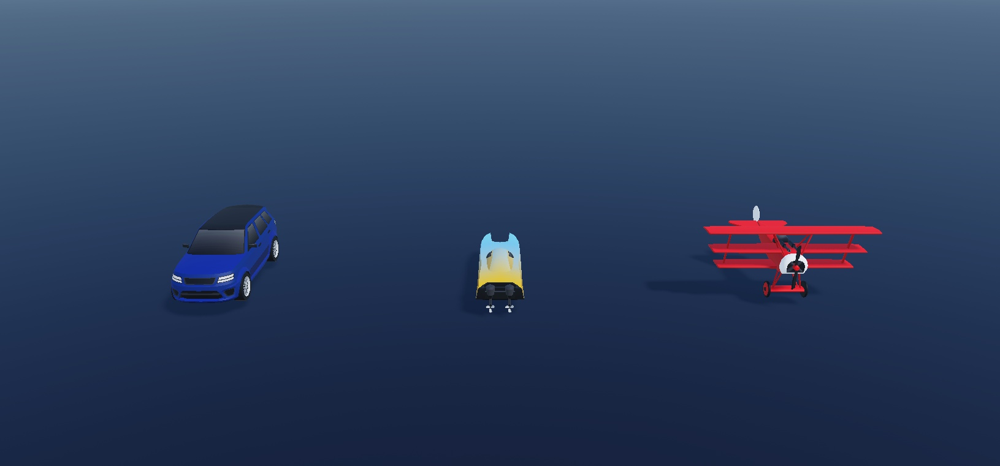](vehicle-pack-2/)

### Gym Model Collection

[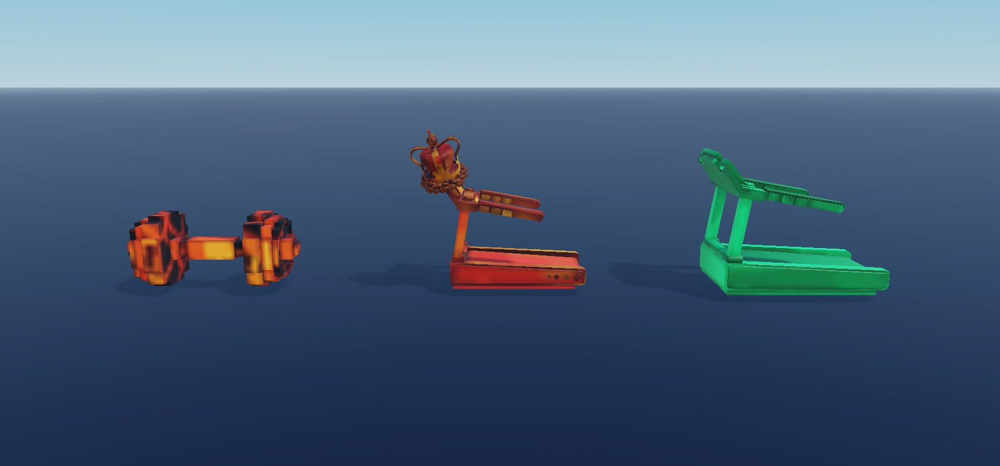](gym-models/)

### Stud Pickaxes 2

[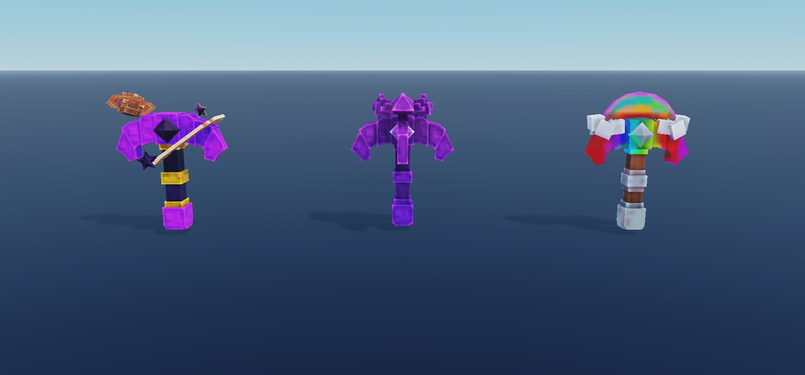](pickaxes-studs-2/)

### Animal Pack 3

[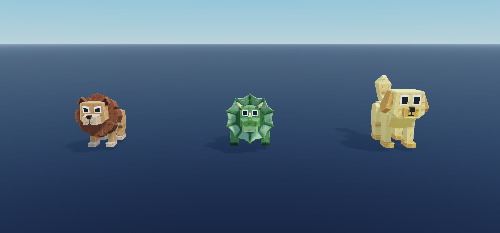](animal-pack-3/)

### Studded Egg Models

[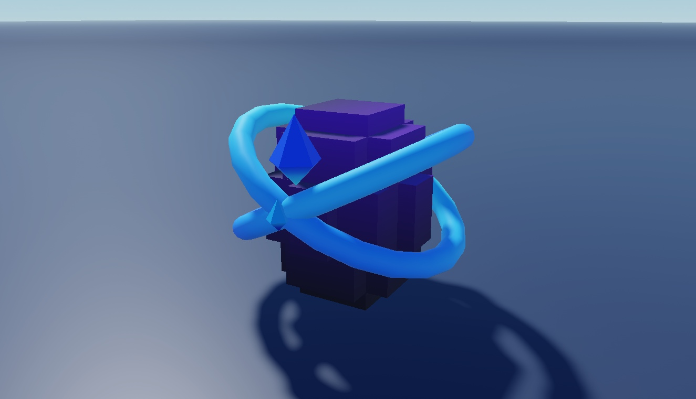](egg-models/)

### Lucky Blocks - Seven Variants

[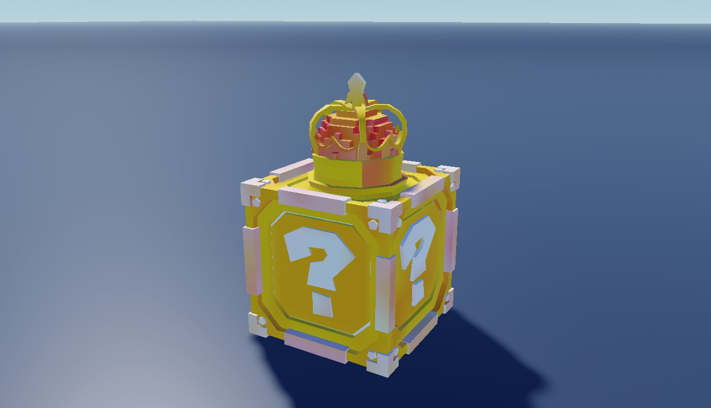](lucky-blocks-effects/)

### Classic Colored Lucky Blocks

[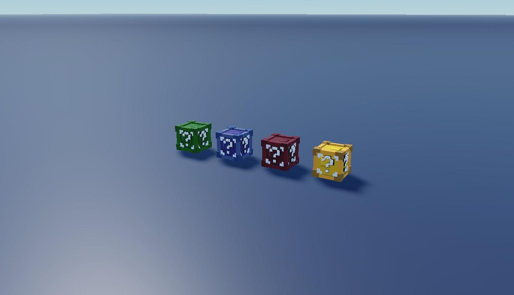](classic-lucky-blocks/)

### Mythical Animals Collection

[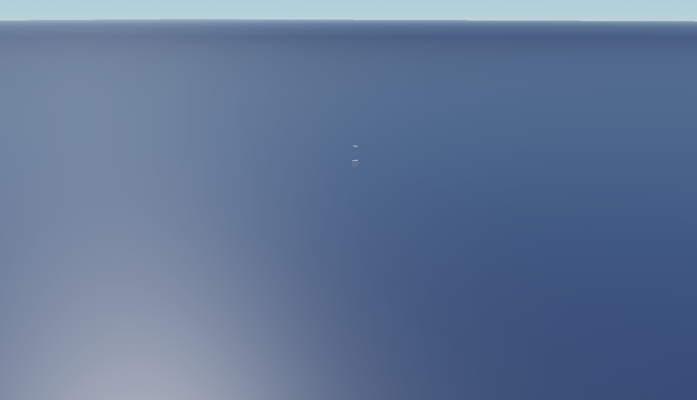](mythical-animals/)

### Anime Character Collection

[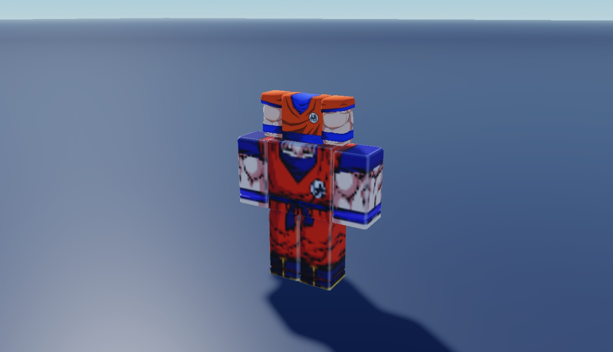](anime-characters/)

### Classic Studded Eggs

[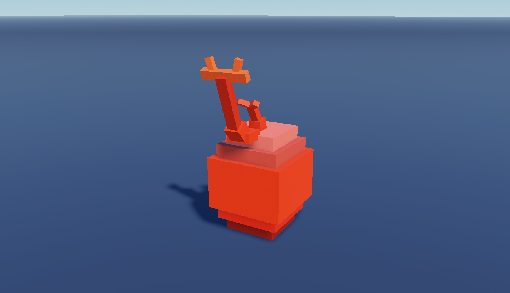](classic-studded-eggs/)

## Install

Download the pack's `.rbxm`, stop Play, and follow the exact destination and setup steps on its pack page. Review the documented dependencies and test limits before integrating it into a game.

Original Steal a Template contributions use [MIT terms](../../LICENSE); each pack's credits preserve applicable third-party notices.

[Back to Steal a Template](../../README.md)
