# Animal Pack 3 - Studio gallery

Actual Studio MCP captures from Place2. Each sheet lists visible items left-to-right; individual views have one item. Decorative effects suppressed to expose geometry; independent preview scales are not native scale comparisons.

## Cover - Lion | Triceratops | Dog

Left to right: `AnimalModels/BaseAnimals/Lion`; `AnimalModels/BaseAnimals/Triceratops`; `AnimalModels/BaseAnimals/Dog`

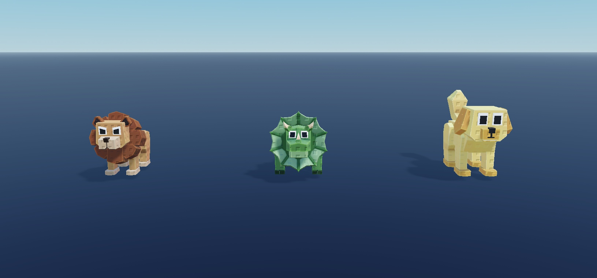

## Primary view - ARCHAEOPTERYX | ARGENTAVIS | AZHDARCHID

Left to right: `AnimalModels/BaseAnimals/ARCHAEOPTERYX`; `AnimalModels/BaseAnimals/ARGENTAVIS`; `AnimalModels/BaseAnimals/AZHDARCHID`

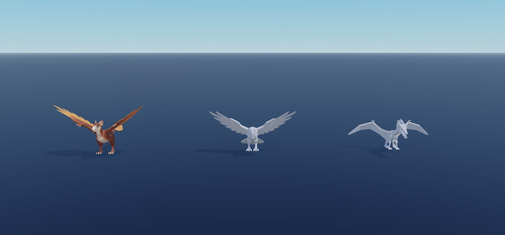

## Primary view - Ankylosaurus | Bat | Bear

Left to right: `AnimalModels/BaseAnimals/Ankylosaurus`; `AnimalModels/BaseAnimals/Bat`; `AnimalModels/BaseAnimals/Bear`

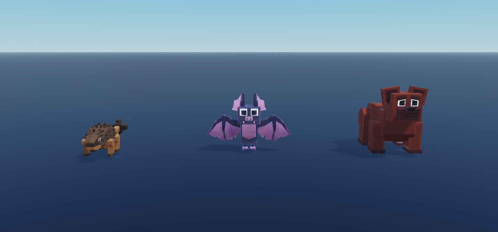

## Primary view - Brachiosaurus | Bull | Bunny

Left to right: `AnimalModels/BaseAnimals/Brachiosaurus`; `AnimalModels/BaseAnimals/Bull`; `AnimalModels/BaseAnimals/Bunny`

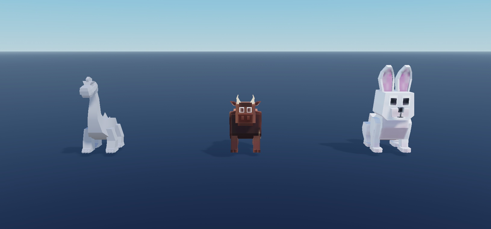

## Primary view - CALADRIUS | CERBERUS | CHIREMA

Left to right: `AnimalModels/BaseAnimals/CALADRIUS`; `AnimalModels/BaseAnimals/CERBERUS`; `AnimalModels/BaseAnimals/CHIREMA`

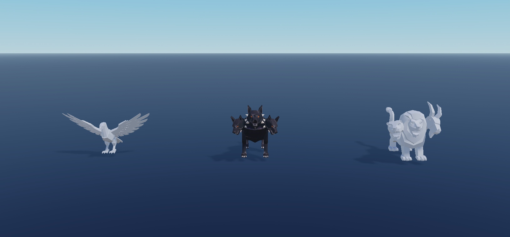

## Primary view - CLASSICDRAGON | COCKATRICE | Capybara

Left to right: `AnimalModels/BaseAnimals/CLASSICDRAGON`; `AnimalModels/BaseAnimals/COCKATRICE`; `AnimalModels/BaseAnimals/Capybara`

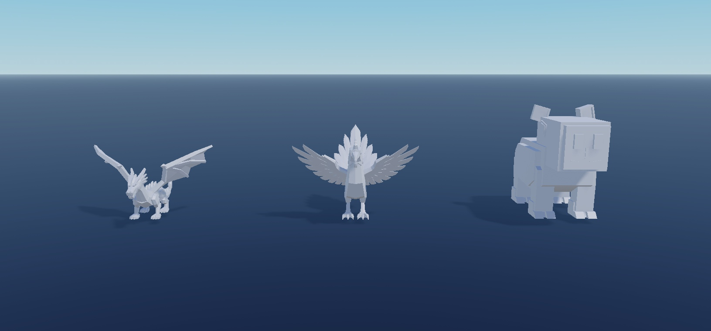

## Primary view - Cat | Chicken | Cobra

Left to right: `AnimalModels/BaseAnimals/Cat`; `AnimalModels/BaseAnimals/Chicken`; `AnimalModels/BaseAnimals/Cobra`

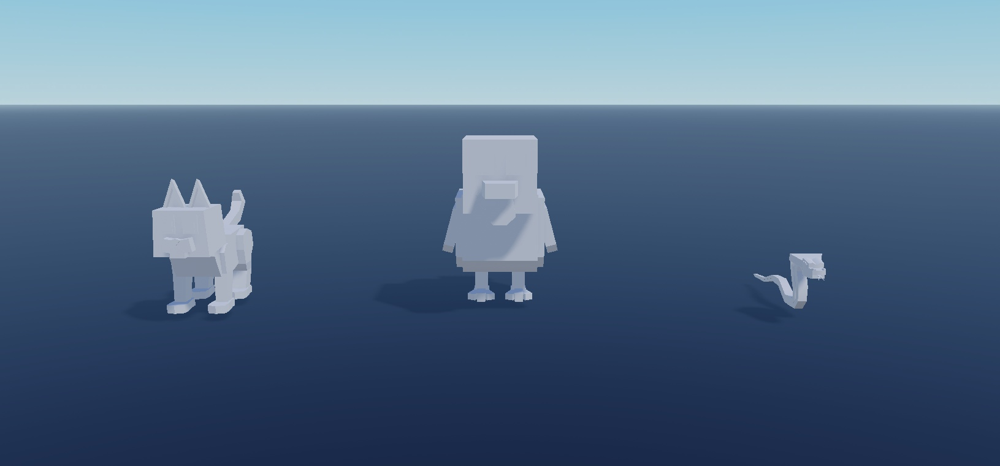

## Primary view - Cow | Crab | Crocodile

Left to right: `AnimalModels/BaseAnimals/Cow`; `AnimalModels/BaseAnimals/Crab`; `AnimalModels/BaseAnimals/Crocodile`

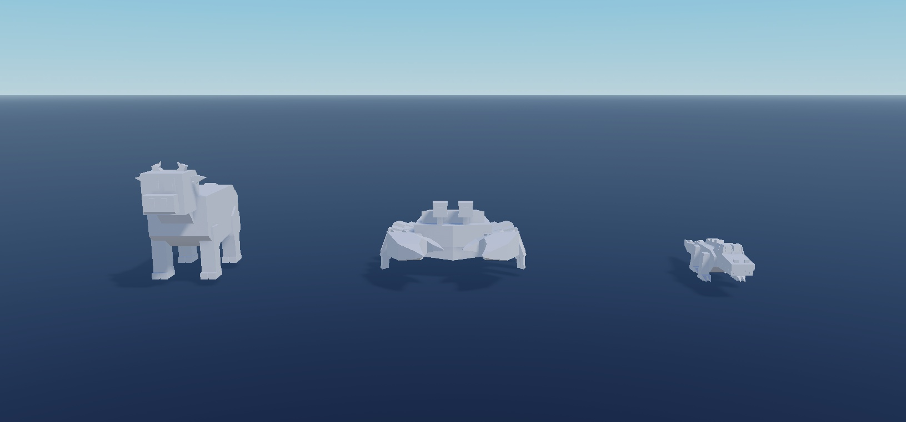

## Primary view - DIMETRODON | Dog | Elephant

Left to right: `AnimalModels/BaseAnimals/DIMETRODON`; `AnimalModels/BaseAnimals/Dog`; `AnimalModels/BaseAnimals/Elephant`

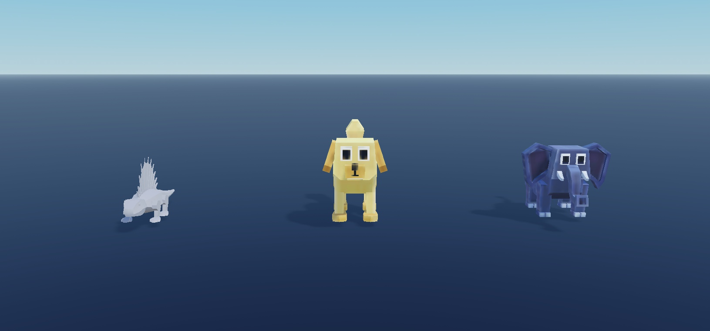

## Primary view - FIREPHOENIX | Frog | GARGOYLE_BAT

Left to right: `AnimalModels/BaseAnimals/FIREPHOENIX`; `AnimalModels/BaseAnimals/Frog`; `AnimalModels/BaseAnimals/GARGOYLE_BAT`

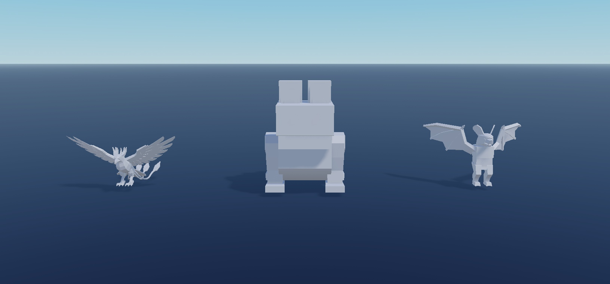

## Primary view - GARUDA | GRIFFIN | Gallimimus

Left to right: `AnimalModels/BaseAnimals/GARUDA`; `AnimalModels/BaseAnimals/GRIFFIN`; `AnimalModels/BaseAnimals/Gallimimus`

## Primary view - Giraffe | Goat | Goldfish

Left to right: `AnimalModels/BaseAnimals/Giraffe`; `AnimalModels/BaseAnimals/Goat`; `AnimalModels/BaseAnimals/Goldfish`

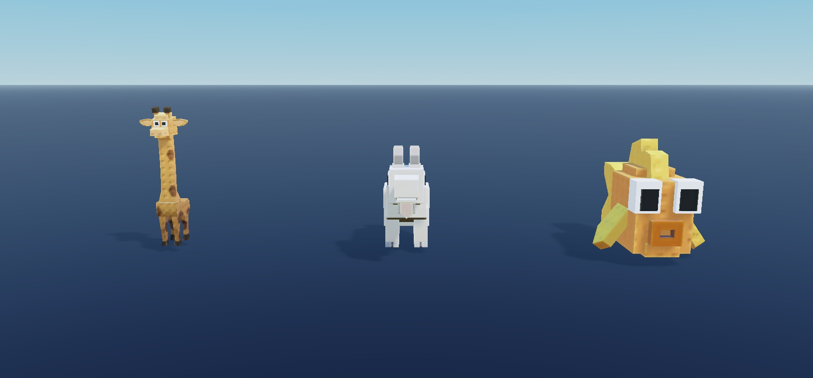

## Primary view - Gorilla | Guinea Pig | HYDRA

Left to right: `AnimalModels/BaseAnimals/Gorilla`; `AnimalModels/BaseAnimals/Guinea Pig`; `AnimalModels/BaseAnimals/HYDRA`

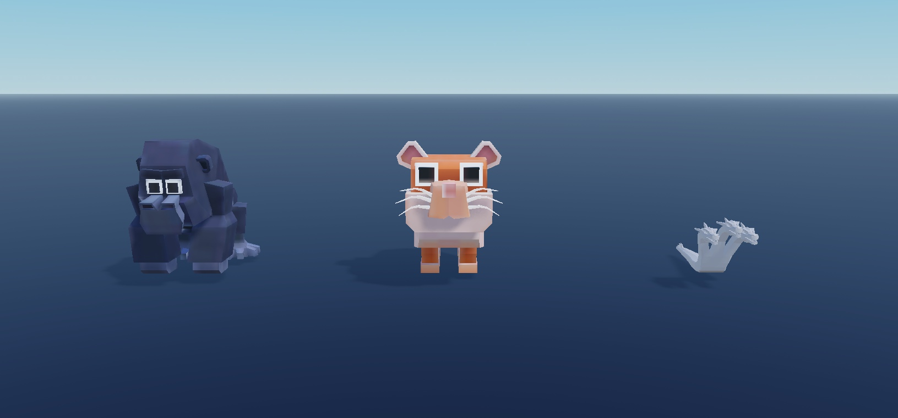

## Primary view - Hamster | Horse | Jellyfish

Left to right: `AnimalModels/BaseAnimals/Hamster`; `AnimalModels/BaseAnimals/Horse`; `AnimalModels/BaseAnimals/Jellyfish`

## Primary view - Kangaroo | Kitsune | Koala

Left to right: `AnimalModels/BaseAnimals/Kangaroo`; `AnimalModels/BaseAnimals/Kitsune`; `AnimalModels/BaseAnimals/Koala`

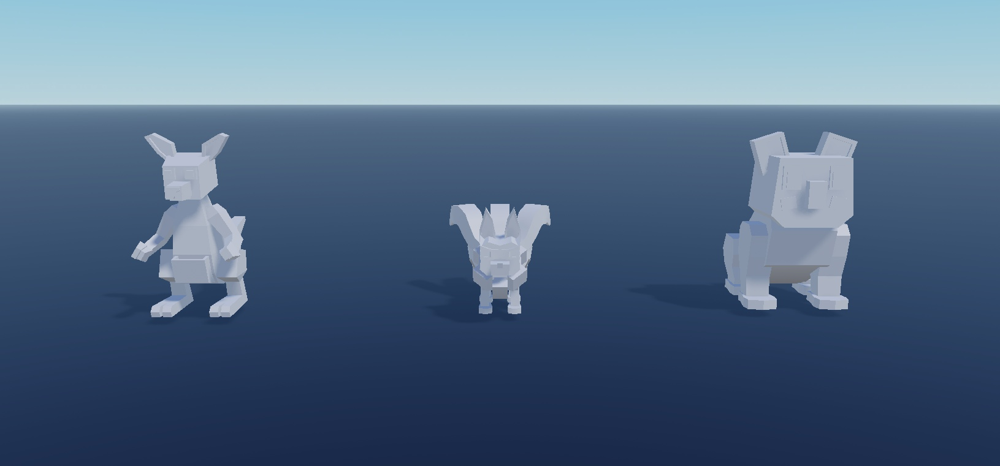

## Primary view - Lion | Lizard | Llama

Left to right: `AnimalModels/BaseAnimals/Lion`; `AnimalModels/BaseAnimals/Lizard`; `AnimalModels/BaseAnimals/Llama`

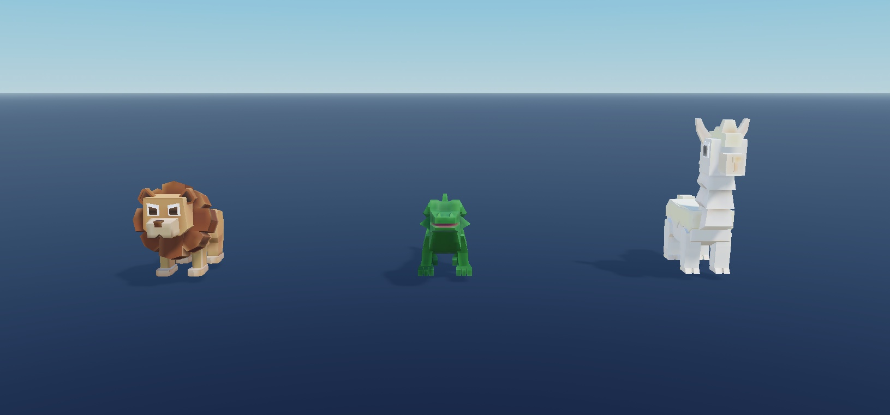

## Primary view - MANTICORE | MICRORAPTOR | MINOTAUR

Left to right: `AnimalModels/BaseAnimals/MANTICORE`; `AnimalModels/BaseAnimals/MICRORAPTOR`; `AnimalModels/BaseAnimals/MINOTAUR`

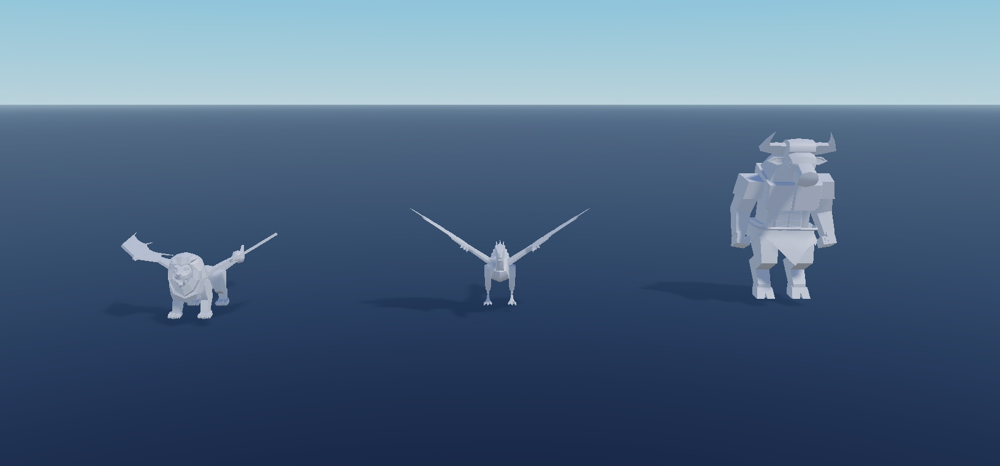

## Primary view - MOTHMAN | Mammoth | Mosasaurus

Left to right: `AnimalModels/BaseAnimals/MOTHMAN`; `AnimalModels/BaseAnimals/Mammoth`; `AnimalModels/BaseAnimals/Mosasaurus`

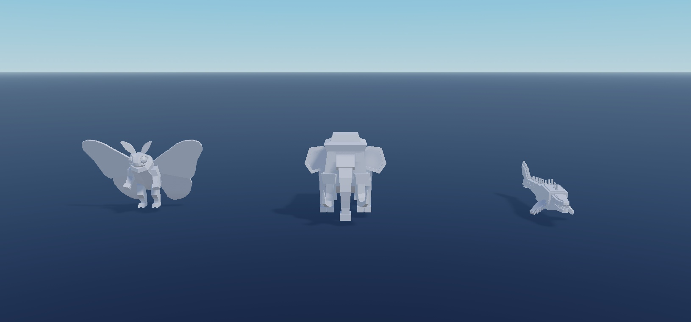

## Primary view - Ostrich | Owl | PEGASUS

Left to right: `AnimalModels/BaseAnimals/Ostrich`; `AnimalModels/BaseAnimals/Owl`; `AnimalModels/BaseAnimals/PEGASUS`

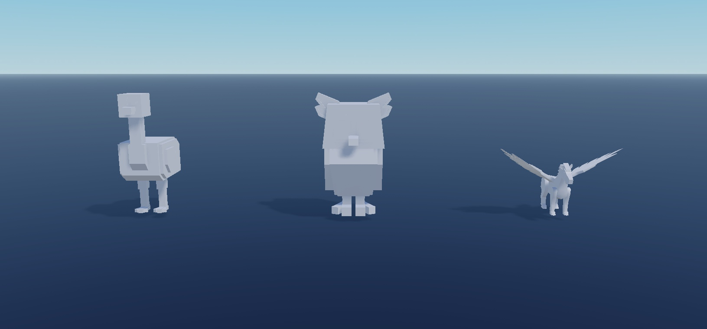

## Primary view - PREHISTORIC_DRAGONFLY | PREHISTORIC_MOTH | PTERANODON

Left to right: `AnimalModels/BaseAnimals/PREHISTORIC_DRAGONFLY`; `AnimalModels/BaseAnimals/PREHISTORIC_MOTH`; `AnimalModels/BaseAnimals/PTERANODON`

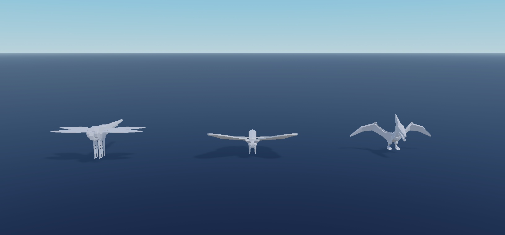

## Primary view - PTERODACTYL | Parrot | Pigeon

Left to right: `AnimalModels/BaseAnimals/PTERODACTYL`; `AnimalModels/BaseAnimals/Parrot`; `AnimalModels/BaseAnimals/Pigeon`

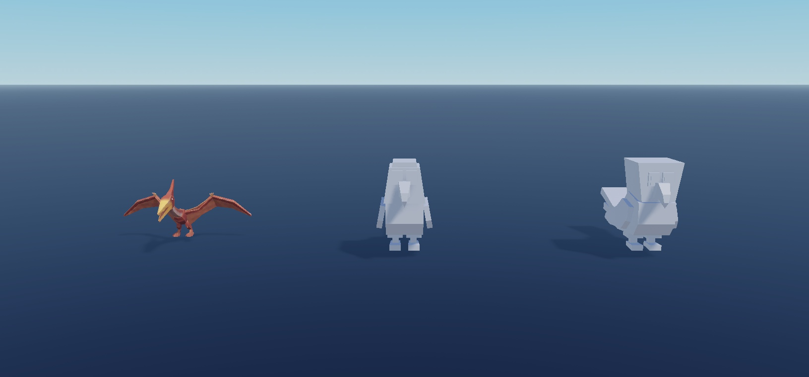

## Primary view - Polar Bear | Pony | QILIN

Left to right: `AnimalModels/BaseAnimals/Polar Bear`; `AnimalModels/BaseAnimals/Pony`; `AnimalModels/BaseAnimals/QILIN`

## Primary view - QUETZALCOATLUS | ROC | SABER_TOOTHED_TIGER

Left to right: `AnimalModels/BaseAnimals/QUETZALCOATLUS`; `AnimalModels/BaseAnimals/ROC`; `AnimalModels/BaseAnimals/SABER_TOOTHED_TIGER`

## Primary view - SIMURGH | SPHINX | STEGOSAURUS

Left to right: `AnimalModels/BaseAnimals/SIMURGH`; `AnimalModels/BaseAnimals/SPHINX`; `AnimalModels/BaseAnimals/STEGOSAURUS`

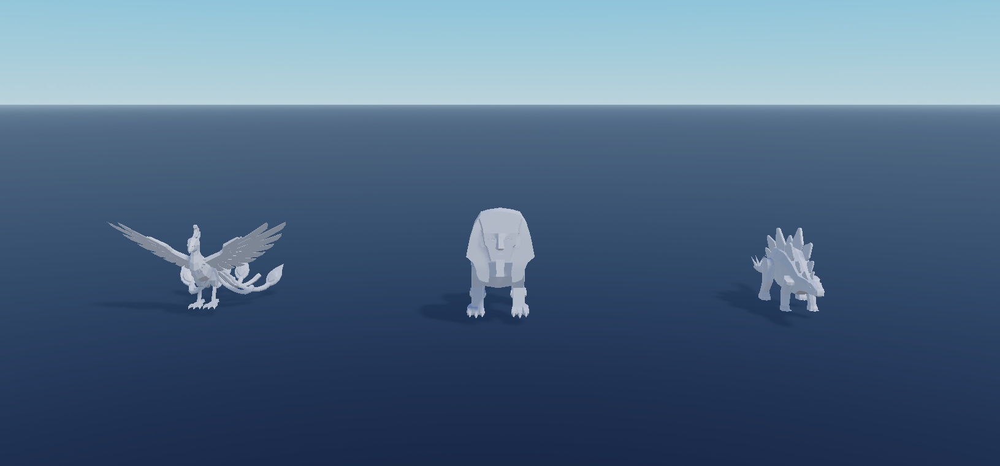

## Primary view - STYMPHALIANBIRD | Seal | Shark

Left to right: `AnimalModels/BaseAnimals/STYMPHALIANBIRD`; `AnimalModels/BaseAnimals/Seal`; `AnimalModels/BaseAnimals/Shark`

## Primary view - Snail | Snake | Spinosaurus

Left to right: `AnimalModels/BaseAnimals/Snail`; `AnimalModels/BaseAnimals/Snake`; `AnimalModels/BaseAnimals/Spinosaurus`

## Primary view - Swordfish | T-Rex | THUNDERBIRD

Left to right: `AnimalModels/BaseAnimals/Swordfish`; `AnimalModels/BaseAnimals/T-Rex`; `AnimalModels/BaseAnimals/THUNDERBIRD`

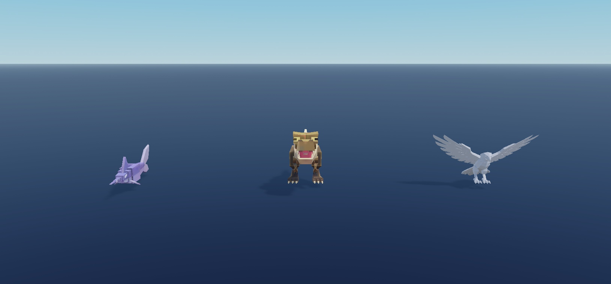

## Primary view - Tiger | Triceratops | Triple Cobra

Left to right: `AnimalModels/BaseAnimals/Tiger`; `AnimalModels/BaseAnimals/Triceratops`; `AnimalModels/BaseAnimals/Triple Cobra`

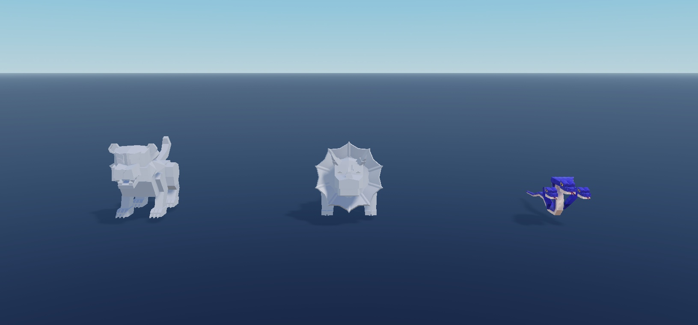

## Primary view - Turtle | Unicorn | Velicoraptor

Left to right: `AnimalModels/BaseAnimals/Turtle`; `AnimalModels/BaseAnimals/Unicorn`; `AnimalModels/BaseAnimals/Velicoraptor`

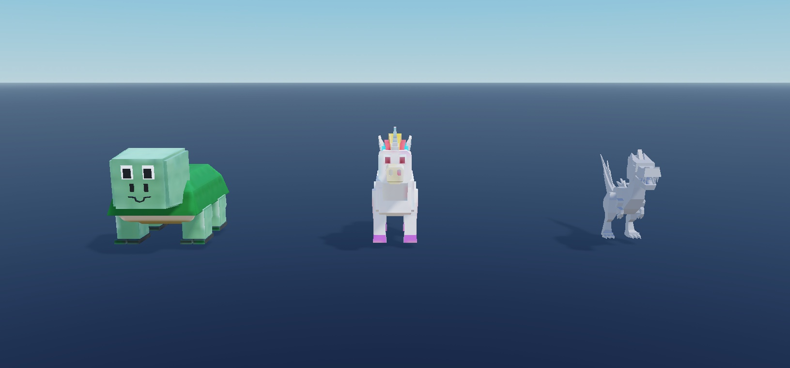

## Primary view - WINGED_IMP | WYVERN | Whale

Left to right: `AnimalModels/BaseAnimals/WINGED_IMP`; `AnimalModels/BaseAnimals/WYVERN`; `AnimalModels/BaseAnimals/Whale`

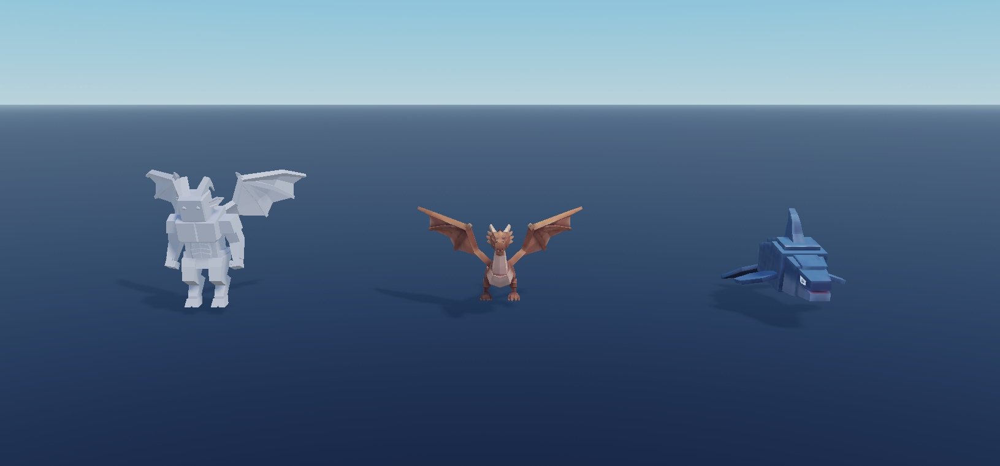

## Primary view - Wolf | YI_QI | Zebra

Left to right: `AnimalModels/BaseAnimals/Wolf`; `AnimalModels/BaseAnimals/YI_QI`; `AnimalModels/BaseAnimals/Zebra`

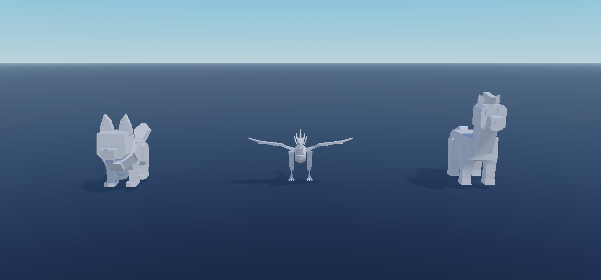

## Primary view - ARCHAEOPTERYX | ARGENTAVIS | AZHDARCHID

Left to right: `AnimalModels/DiamondAnimals/ARCHAEOPTERYX`; `AnimalModels/DiamondAnimals/ARGENTAVIS`; `AnimalModels/DiamondAnimals/AZHDARCHID`

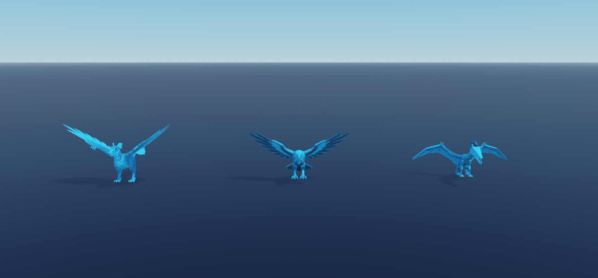

## Primary view - Ankylosaurus | Bat | Bear

Left to right: `AnimalModels/DiamondAnimals/Ankylosaurus`; `AnimalModels/DiamondAnimals/Bat`; `AnimalModels/DiamondAnimals/Bear`

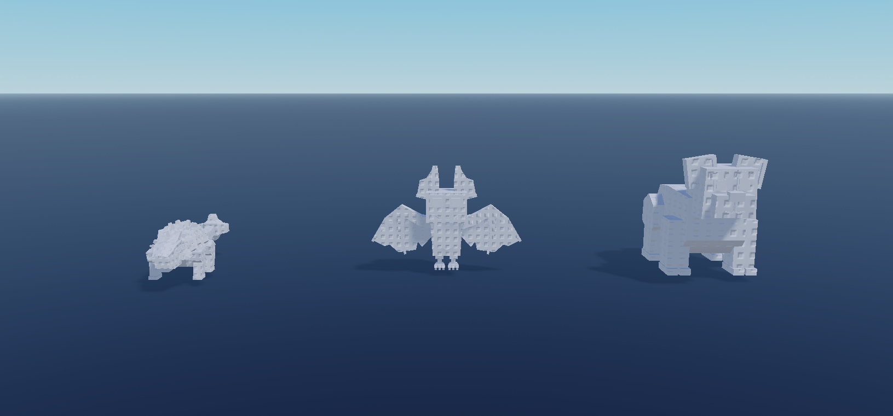

## Primary view - Brachiosaurus | Bull | Bunny

Left to right: `AnimalModels/DiamondAnimals/Brachiosaurus`; `AnimalModels/DiamondAnimals/Bull`; `AnimalModels/DiamondAnimals/Bunny`

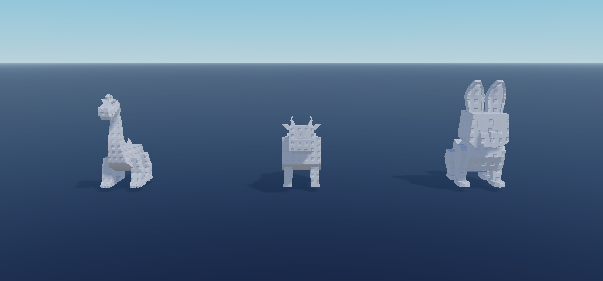

## Primary view - CALADRIUS | CERBERUS | CHIREMA

Left to right: `AnimalModels/DiamondAnimals/CALADRIUS`; `AnimalModels/DiamondAnimals/CERBERUS`; `AnimalModels/DiamondAnimals/CHIREMA`

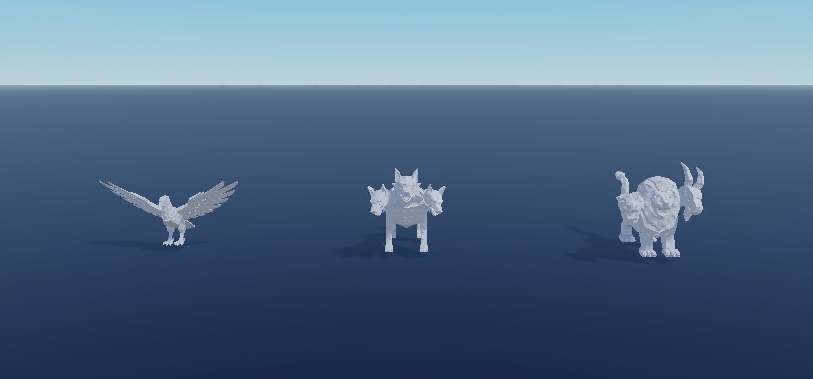

## Primary view - CLASSICDRAGON | COCKATRICE | Capybara

Left to right: `AnimalModels/DiamondAnimals/CLASSICDRAGON`; `AnimalModels/DiamondAnimals/COCKATRICE`; `AnimalModels/DiamondAnimals/Capybara`

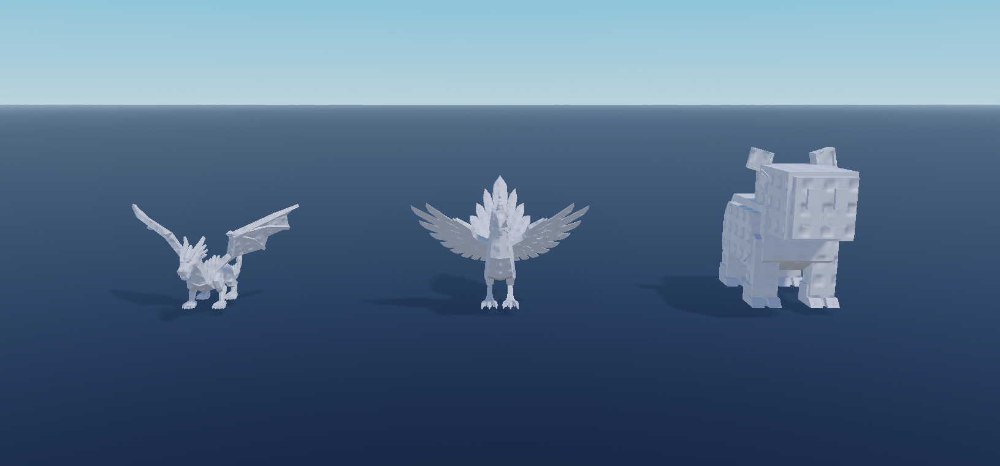

## Primary view - Cat | Chicken | Cobra

Left to right: `AnimalModels/DiamondAnimals/Cat`; `AnimalModels/DiamondAnimals/Chicken`; `AnimalModels/DiamondAnimals/Cobra`

## Primary view - Cow | Crab | Crocodile

Left to right: `AnimalModels/DiamondAnimals/Cow`; `AnimalModels/DiamondAnimals/Crab`; `AnimalModels/DiamondAnimals/Crocodile`

## Primary view - DIMETRODON | Dog | Elephant

Left to right: `AnimalModels/DiamondAnimals/DIMETRODON`; `AnimalModels/DiamondAnimals/Dog`; `AnimalModels/DiamondAnimals/Elephant`

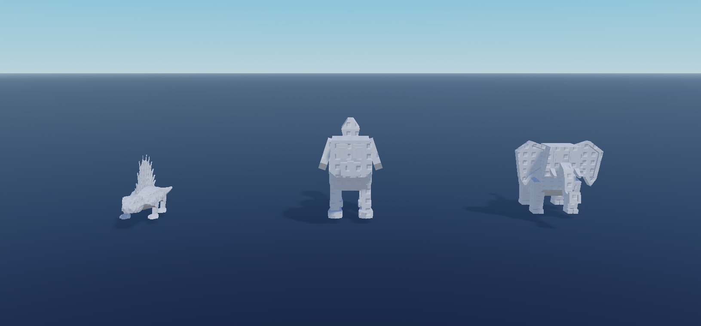

## Primary view - FIREPHOENIX | Frog | GARGOYLE_BAT

Left to right: `AnimalModels/DiamondAnimals/FIREPHOENIX`; `AnimalModels/DiamondAnimals/Frog`; `AnimalModels/DiamondAnimals/GARGOYLE_BAT`

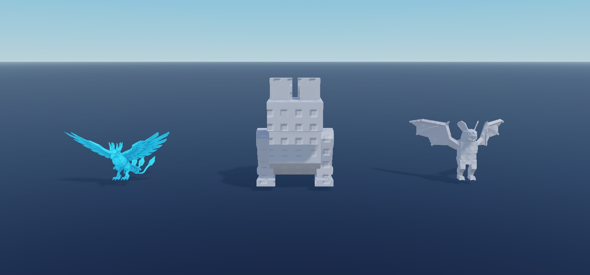

## Primary view - GARUDA | GRIFFIN | Gallimimus

Left to right: `AnimalModels/DiamondAnimals/GARUDA`; `AnimalModels/DiamondAnimals/GRIFFIN`; `AnimalModels/DiamondAnimals/Gallimimus`

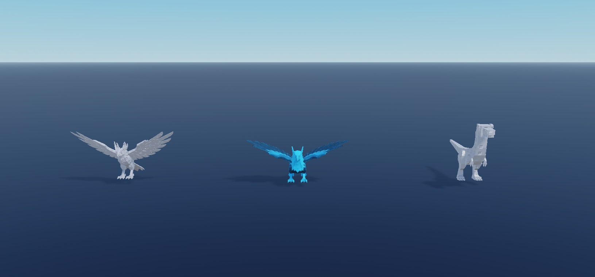

## Primary view - Giraffe | Goat | Goldfish

Left to right: `AnimalModels/DiamondAnimals/Giraffe`; `AnimalModels/DiamondAnimals/Goat`; `AnimalModels/DiamondAnimals/Goldfish`

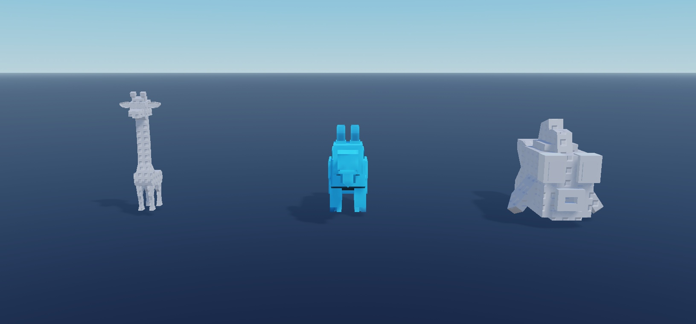

## Primary view - Gorilla | Guinea Pig | HYDRA

Left to right: `AnimalModels/DiamondAnimals/Gorilla`; `AnimalModels/DiamondAnimals/Guinea Pig`; `AnimalModels/DiamondAnimals/HYDRA`

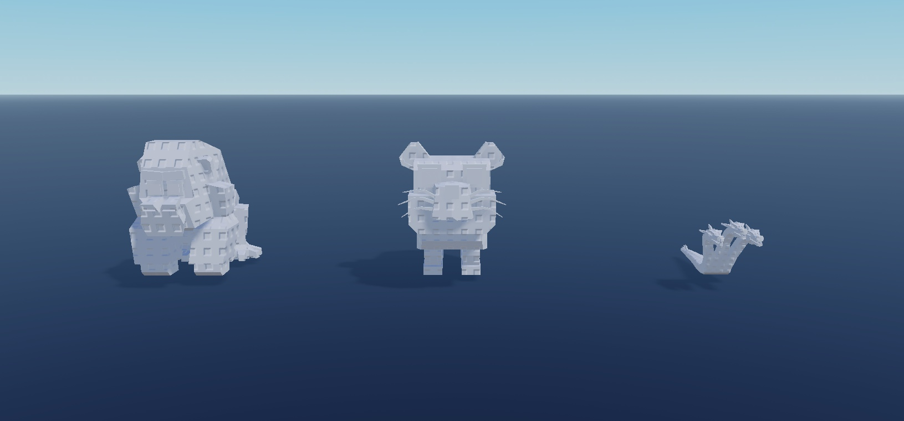

## Primary view - Hamster | Horse | Jellyfish

Left to right: `AnimalModels/DiamondAnimals/Hamster`; `AnimalModels/DiamondAnimals/Horse`; `AnimalModels/DiamondAnimals/Jellyfish`

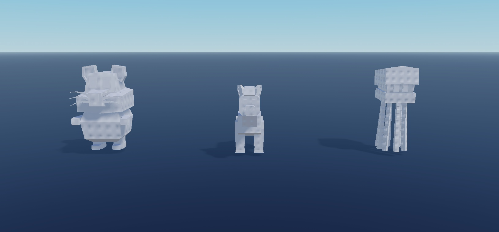

## Primary view - Kangaroo | Kitsune | Koala

Left to right: `AnimalModels/DiamondAnimals/Kangaroo`; `AnimalModels/DiamondAnimals/Kitsune`; `AnimalModels/DiamondAnimals/Koala`

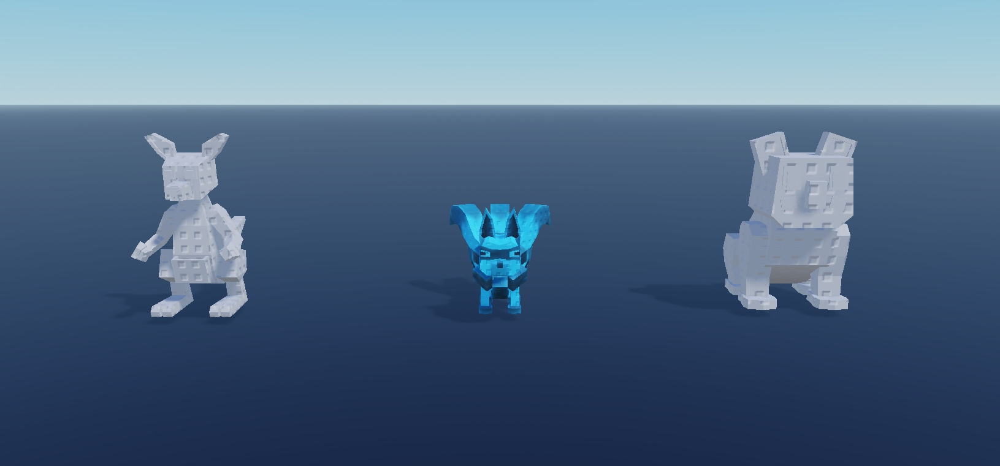

## Primary view - Lion | Lizard | Llama

Left to right: `AnimalModels/DiamondAnimals/Lion`; `AnimalModels/DiamondAnimals/Lizard`; `AnimalModels/DiamondAnimals/Llama`

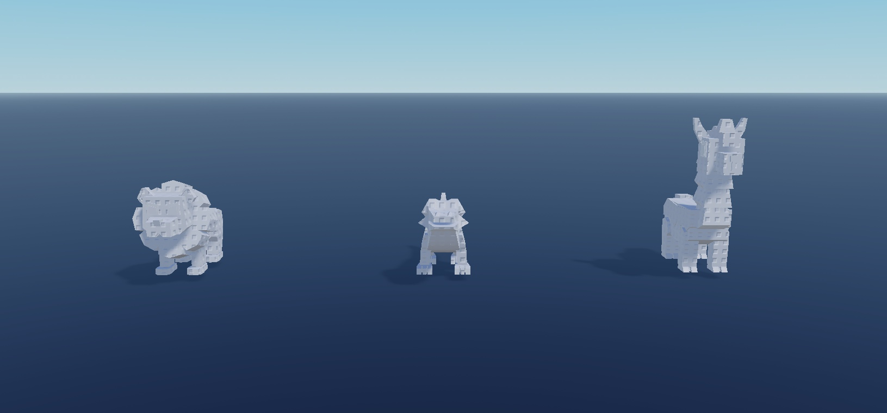

## Primary view - MANTICORE | MICRORAPTOR | MINOTAUR

Left to right: `AnimalModels/DiamondAnimals/MANTICORE`; `AnimalModels/DiamondAnimals/MICRORAPTOR`; `AnimalModels/DiamondAnimals/MINOTAUR`

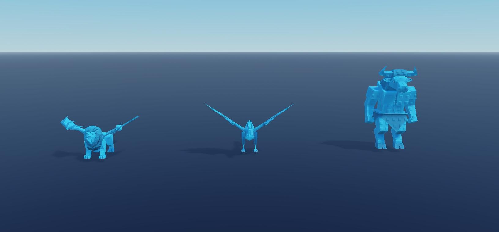

## Primary view - MOTHMAN | Mammoth | Mosasaurus

Left to right: `AnimalModels/DiamondAnimals/MOTHMAN`; `AnimalModels/DiamondAnimals/Mammoth`; `AnimalModels/DiamondAnimals/Mosasaurus`

## Primary view - Ostrich | Owl | PEGASUS

Left to right: `AnimalModels/DiamondAnimals/Ostrich`; `AnimalModels/DiamondAnimals/Owl`; `AnimalModels/DiamondAnimals/PEGASUS`

## Primary view - PREHISTORIC_DRAGONFLY | PREHISTORIC_MOTH | PTERANODON

Left to right: `AnimalModels/DiamondAnimals/PREHISTORIC_DRAGONFLY`; `AnimalModels/DiamondAnimals/PREHISTORIC_MOTH`; `AnimalModels/DiamondAnimals/PTERANODON`

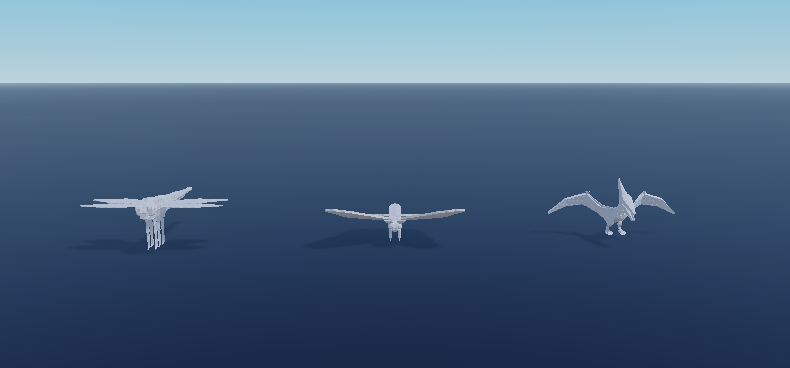

## Primary view - PTERODACTYL | Parrot | Pigeon

Left to right: `AnimalModels/DiamondAnimals/PTERODACTYL`; `AnimalModels/DiamondAnimals/Parrot`; `AnimalModels/DiamondAnimals/Pigeon`

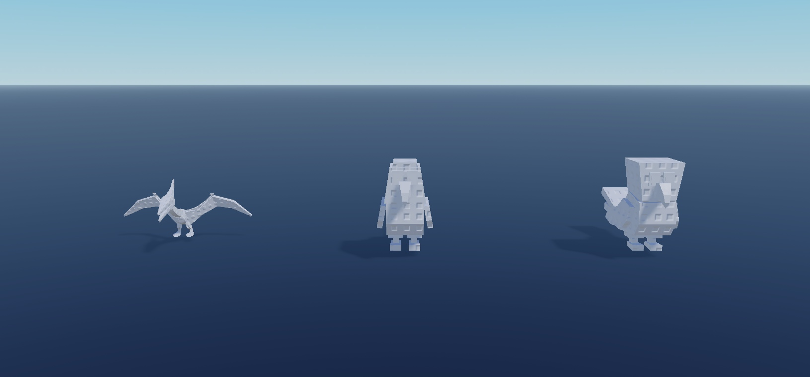

## Primary view - Polar Bear | Pony | QILIN

Left to right: `AnimalModels/DiamondAnimals/Polar Bear`; `AnimalModels/DiamondAnimals/Pony`; `AnimalModels/DiamondAnimals/QILIN`

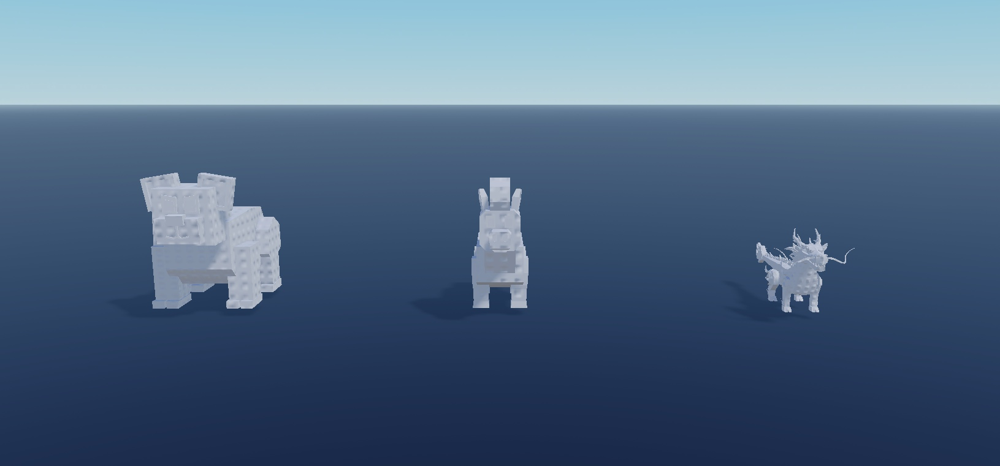

## Primary view - QUETZALCOATLUS | ROC | SABER_TOOTHED_TIGER

Left to right: `AnimalModels/DiamondAnimals/QUETZALCOATLUS`; `AnimalModels/DiamondAnimals/ROC`; `AnimalModels/DiamondAnimals/SABER_TOOTHED_TIGER`

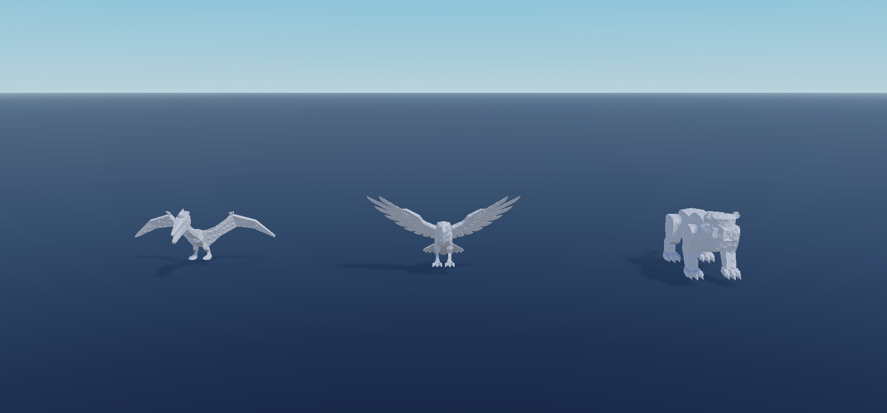

## Primary view - SIMURGH | SPHINX | STEGOSAURUS

Left to right: `AnimalModels/DiamondAnimals/SIMURGH`; `AnimalModels/DiamondAnimals/SPHINX`; `AnimalModels/DiamondAnimals/STEGOSAURUS`

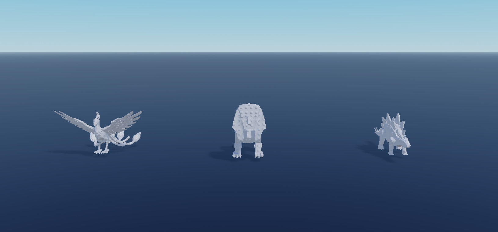

## Primary view - STYMPHALIANBIRD | Seal | Shark

Left to right: `AnimalModels/DiamondAnimals/STYMPHALIANBIRD`; `AnimalModels/DiamondAnimals/Seal`; `AnimalModels/DiamondAnimals/Shark`

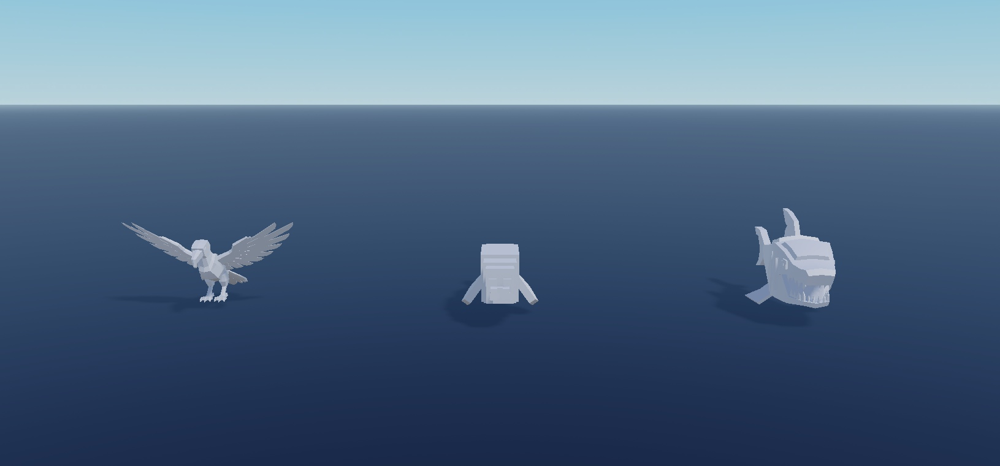

## Primary view - Snail | Snake | Spinosaurus

Left to right: `AnimalModels/DiamondAnimals/Snail`; `AnimalModels/DiamondAnimals/Snake`; `AnimalModels/DiamondAnimals/Spinosaurus`

## Primary view - Swordfish | T-Rex | THUNDERBIRD

Left to right: `AnimalModels/DiamondAnimals/Swordfish`; `AnimalModels/DiamondAnimals/T-Rex`; `AnimalModels/DiamondAnimals/THUNDERBIRD`

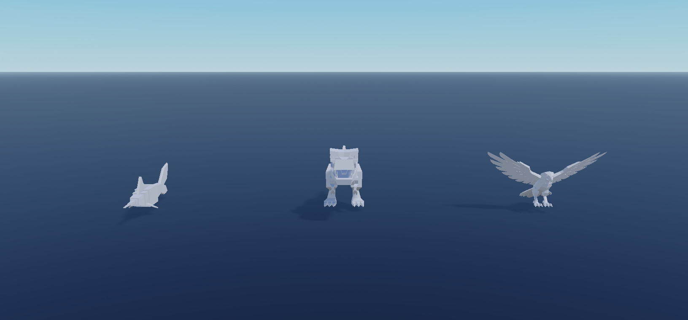

## Primary view - Tiger | Triceratops | Triple Cobra

Left to right: `AnimalModels/DiamondAnimals/Tiger`; `AnimalModels/DiamondAnimals/Triceratops`; `AnimalModels/DiamondAnimals/Triple Cobra`

## Primary view - Turtle | Unicorn | Velicoraptor

Left to right: `AnimalModels/DiamondAnimals/Turtle`; `AnimalModels/DiamondAnimals/Unicorn`; `AnimalModels/DiamondAnimals/Velicoraptor`

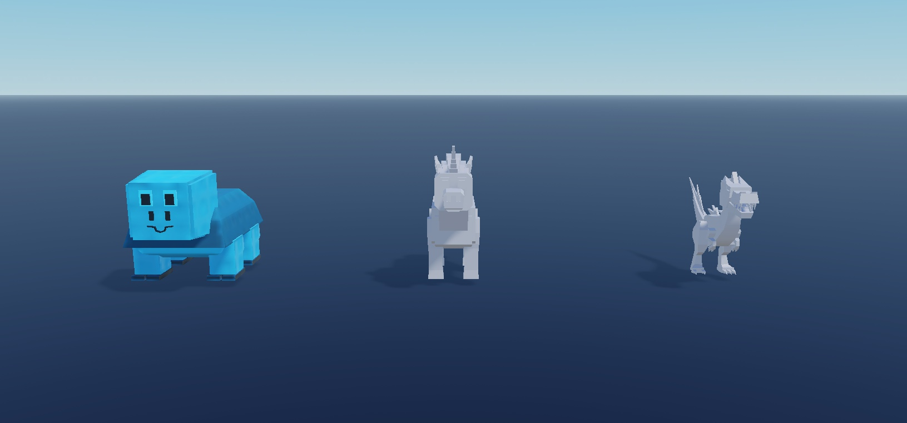

## Primary view - WINGED_IMP | WYVERN | Whale

Left to right: `AnimalModels/DiamondAnimals/WINGED_IMP`; `AnimalModels/DiamondAnimals/WYVERN`; `AnimalModels/DiamondAnimals/Whale`

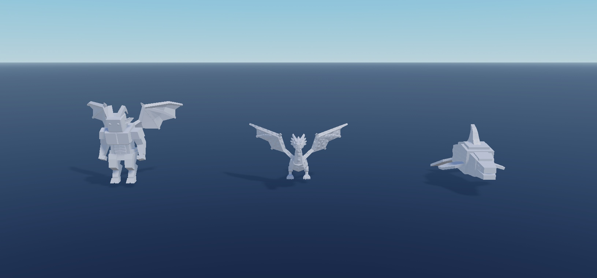

## Primary view - Wolf | YI_QI | Zebra

Left to right: `AnimalModels/DiamondAnimals/Wolf`; `AnimalModels/DiamondAnimals/YI_QI`; `AnimalModels/DiamondAnimals/Zebra`

## Primary view - ARCHAEOPTERYX | ARGENTAVIS | AZHDARCHID

Left to right: `AnimalModels/EmeraldAnimals/ARCHAEOPTERYX`; `AnimalModels/EmeraldAnimals/ARGENTAVIS`; `AnimalModels/EmeraldAnimals/AZHDARCHID`

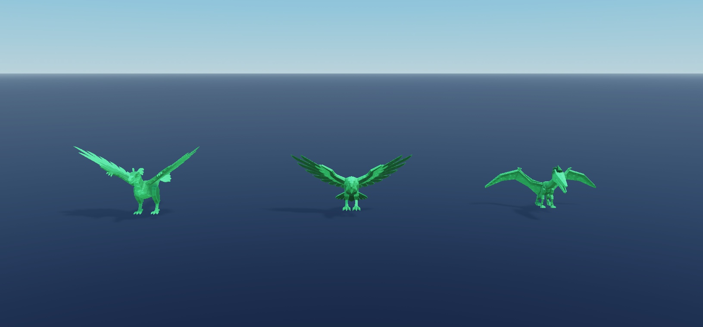

## Primary view - Ankylosaurus | Bat | Bear

Left to right: `AnimalModels/EmeraldAnimals/Ankylosaurus`; `AnimalModels/EmeraldAnimals/Bat`; `AnimalModels/EmeraldAnimals/Bear`

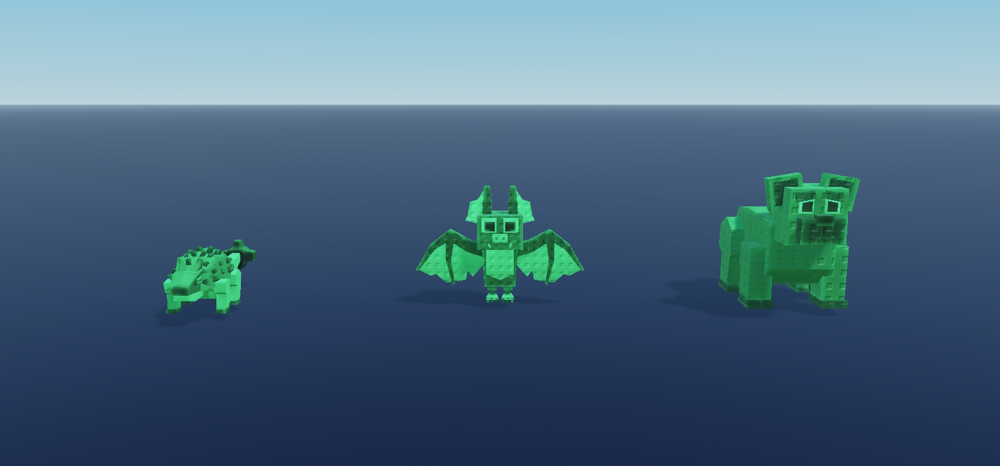

## Primary view - Brachiosaurus | Bull | Bunny

Left to right: `AnimalModels/EmeraldAnimals/Brachiosaurus`; `AnimalModels/EmeraldAnimals/Bull`; `AnimalModels/EmeraldAnimals/Bunny`

## Primary view - CALADRIUS | CERBERUS | CHIREMA

Left to right: `AnimalModels/EmeraldAnimals/CALADRIUS`; `AnimalModels/EmeraldAnimals/CERBERUS`; `AnimalModels/EmeraldAnimals/CHIREMA`

## Primary view - CLASSICDRAGON | COCKATRICE | Capybara

Left to right: `AnimalModels/EmeraldAnimals/CLASSICDRAGON`; `AnimalModels/EmeraldAnimals/COCKATRICE`; `AnimalModels/EmeraldAnimals/Capybara`

## Primary view - Cat | Chicken | Cobra

Left to right: `AnimalModels/EmeraldAnimals/Cat`; `AnimalModels/EmeraldAnimals/Chicken`; `AnimalModels/EmeraldAnimals/Cobra`

## Primary view - Cow | Crab | Crocodile

Left to right: `AnimalModels/EmeraldAnimals/Cow`; `AnimalModels/EmeraldAnimals/Crab`; `AnimalModels/EmeraldAnimals/Crocodile`

## Primary view - DIMETRODON | Dog | Elephant

Left to right: `AnimalModels/EmeraldAnimals/DIMETRODON`; `AnimalModels/EmeraldAnimals/Dog`; `AnimalModels/EmeraldAnimals/Elephant`

## Primary view - FIREPHOENIX | Frog | GARGOYLE_BAT

Left to right: `AnimalModels/EmeraldAnimals/FIREPHOENIX`; `AnimalModels/EmeraldAnimals/Frog`; `AnimalModels/EmeraldAnimals/GARGOYLE_BAT`

## Primary view - GARUDA | GRIFFIN | Gallimimus

Left to right: `AnimalModels/EmeraldAnimals/GARUDA`; `AnimalModels/EmeraldAnimals/GRIFFIN`; `AnimalModels/EmeraldAnimals/Gallimimus`

## Primary view - Giraffe | Goat | Goldfish

Left to right: `AnimalModels/EmeraldAnimals/Giraffe`; `AnimalModels/EmeraldAnimals/Goat`; `AnimalModels/EmeraldAnimals/Goldfish`

## Primary view - Gorilla | Guinea Pig | HYDRA

Left to right: `AnimalModels/EmeraldAnimals/Gorilla`; `AnimalModels/EmeraldAnimals/Guinea Pig`; `AnimalModels/EmeraldAnimals/HYDRA`

## Primary view - Hamster | Horse | Jellyfish

Left to right: `AnimalModels/EmeraldAnimals/Hamster`; `AnimalModels/EmeraldAnimals/Horse`; `AnimalModels/EmeraldAnimals/Jellyfish`

## Primary view - Kangaroo | Kitsune | Koala

Left to right: `AnimalModels/EmeraldAnimals/Kangaroo`; `AnimalModels/EmeraldAnimals/Kitsune`; `AnimalModels/EmeraldAnimals/Koala`

## Primary view - Lion | Lizard | Llama

Left to right: `AnimalModels/EmeraldAnimals/Lion`; `AnimalModels/EmeraldAnimals/Lizard`; `AnimalModels/EmeraldAnimals/Llama`

## Primary view - MANTICORE | MICRORAPTOR | MINOTAUR

Left to right: `AnimalModels/EmeraldAnimals/MANTICORE`; `AnimalModels/EmeraldAnimals/MICRORAPTOR`; `AnimalModels/EmeraldAnimals/MINOTAUR`

## Primary view - MOTHMAN | Mammoth | Mosasaurus

Left to right: `AnimalModels/EmeraldAnimals/MOTHMAN`; `AnimalModels/EmeraldAnimals/Mammoth`; `AnimalModels/EmeraldAnimals/Mosasaurus`

## Primary view - Ostrich | Owl | PEGASUS

Left to right: `AnimalModels/EmeraldAnimals/Ostrich`; `AnimalModels/EmeraldAnimals/Owl`; `AnimalModels/EmeraldAnimals/PEGASUS`

## Primary view - PREHISTORIC_DRAGONFLY | PREHISTORIC_MOTH | PTERANODON

Left to right: `AnimalModels/EmeraldAnimals/PREHISTORIC_DRAGONFLY`; `AnimalModels/EmeraldAnimals/PREHISTORIC_MOTH`; `AnimalModels/EmeraldAnimals/PTERANODON`

## Primary view - PTERODACTYL | Parrot | Pigeon

Left to right: `AnimalModels/EmeraldAnimals/PTERODACTYL`; `AnimalModels/EmeraldAnimals/Parrot`; `AnimalModels/EmeraldAnimals/Pigeon`

## Primary view - Polar Bear | Pony | QILIN

Left to right: `AnimalModels/EmeraldAnimals/Polar Bear`; `AnimalModels/EmeraldAnimals/Pony`; `AnimalModels/EmeraldAnimals/QILIN`

## Primary view - QUETZALCOATLUS | ROC | SABER_TOOTHED_TIGER

Left to right: `AnimalModels/EmeraldAnimals/QUETZALCOATLUS`; `AnimalModels/EmeraldAnimals/ROC`; `AnimalModels/EmeraldAnimals/SABER_TOOTHED_TIGER`

## Primary view - SIMURGH | SPHINX | STEGOSAURUS

Left to right: `AnimalModels/EmeraldAnimals/SIMURGH`; `AnimalModels/EmeraldAnimals/SPHINX`; `AnimalModels/EmeraldAnimals/STEGOSAURUS`

## Primary view - STYMPHALIANBIRD | Seal | Shark

Left to right: `AnimalModels/EmeraldAnimals/STYMPHALIANBIRD`; `AnimalModels/EmeraldAnimals/Seal`; `AnimalModels/EmeraldAnimals/Shark`

## Primary view - Snail | Snake | Spinosaurus

Left to right: `AnimalModels/EmeraldAnimals/Snail`; `AnimalModels/EmeraldAnimals/Snake`; `AnimalModels/EmeraldAnimals/Spinosaurus`

## Primary view - Swordfish | T-Rex | THUNDERBIRD

Left to right: `AnimalModels/EmeraldAnimals/Swordfish`; `AnimalModels/EmeraldAnimals/T-Rex`; `AnimalModels/EmeraldAnimals/THUNDERBIRD`

## Primary view - Tiger | Triceratops | Triple Cobra

Left to right: `AnimalModels/EmeraldAnimals/Tiger`; `AnimalModels/EmeraldAnimals/Triceratops`; `AnimalModels/EmeraldAnimals/Triple Cobra`

## Primary view - Turtle | Unicorn | Velicoraptor

Left to right: `AnimalModels/EmeraldAnimals/Turtle`; `AnimalModels/EmeraldAnimals/Unicorn`; `AnimalModels/EmeraldAnimals/Velicoraptor`

## Primary view - WINGED_IMP | WYVERN | Whale

Left to right: `AnimalModels/EmeraldAnimals/WINGED_IMP`; `AnimalModels/EmeraldAnimals/WYVERN`; `AnimalModels/EmeraldAnimals/Whale`

## Primary view - Wolf | YI_QI | Zebra

Left to right: `AnimalModels/EmeraldAnimals/Wolf`; `AnimalModels/EmeraldAnimals/YI_QI`; `AnimalModels/EmeraldAnimals/Zebra`

## Primary view - ARCHAEOPTERYX | ARGENTAVIS | AZHDARCHID

Left to right: `AnimalModels/GoldAnimals/ARCHAEOPTERYX`; `AnimalModels/GoldAnimals/ARGENTAVIS`; `AnimalModels/GoldAnimals/AZHDARCHID`

## Primary view - Ankylosaurus | Bat | Bear

Left to right: `AnimalModels/GoldAnimals/Ankylosaurus`; `AnimalModels/GoldAnimals/Bat`; `AnimalModels/GoldAnimals/Bear`

## Primary view - Brachiosaurus | Bull | Bunny

Left to right: `AnimalModels/GoldAnimals/Brachiosaurus`; `AnimalModels/GoldAnimals/Bull`; `AnimalModels/GoldAnimals/Bunny`

## Primary view - CALADRIUS | CERBERUS | CHIREMA

Left to right: `AnimalModels/GoldAnimals/CALADRIUS`; `AnimalModels/GoldAnimals/CERBERUS`; `AnimalModels/GoldAnimals/CHIREMA`

## Primary view - CLASSICDRAGON | COCKATRICE | Capybara

Left to right: `AnimalModels/GoldAnimals/CLASSICDRAGON`; `AnimalModels/GoldAnimals/COCKATRICE`; `AnimalModels/GoldAnimals/Capybara`

## Primary view - Cat | Chicken | Cobra

Left to right: `AnimalModels/GoldAnimals/Cat`; `AnimalModels/GoldAnimals/Chicken`; `AnimalModels/GoldAnimals/Cobra`

## Primary view - Cow | Crab | Crocodile

Left to right: `AnimalModels/GoldAnimals/Cow`; `AnimalModels/GoldAnimals/Crab`; `AnimalModels/GoldAnimals/Crocodile`

## Primary view - DIMETRODON | Dog | Elephant

Left to right: `AnimalModels/GoldAnimals/DIMETRODON`; `AnimalModels/GoldAnimals/Dog`; `AnimalModels/GoldAnimals/Elephant`

## Primary view - FIREPHOENIX | Frog | GARGOYLE_BAT

Left to right: `AnimalModels/GoldAnimals/FIREPHOENIX`; `AnimalModels/GoldAnimals/Frog`; `AnimalModels/GoldAnimals/GARGOYLE_BAT`

## Primary view - GARUDA | GRIFFIN | Gallimimus

Left to right: `AnimalModels/GoldAnimals/GARUDA`; `AnimalModels/GoldAnimals/GRIFFIN`; `AnimalModels/GoldAnimals/Gallimimus`

## Primary view - Giraffe | Goat | Goldfish

Left to right: `AnimalModels/GoldAnimals/Giraffe`; `AnimalModels/GoldAnimals/Goat`; `AnimalModels/GoldAnimals/Goldfish`

## Primary view - Gorilla | Guinea Pig | HYDRA

Left to right: `AnimalModels/GoldAnimals/Gorilla`; `AnimalModels/GoldAnimals/Guinea Pig`; `AnimalModels/GoldAnimals/HYDRA`

## Primary view - Hamster | Horse | Jellyfish

Left to right: `AnimalModels/GoldAnimals/Hamster`; `AnimalModels/GoldAnimals/Horse`; `AnimalModels/GoldAnimals/Jellyfish`

## Primary view - Kangaroo | Kitsune | Koala

Left to right: `AnimalModels/GoldAnimals/Kangaroo`; `AnimalModels/GoldAnimals/Kitsune`; `AnimalModels/GoldAnimals/Koala`

## Primary view - Lion | Lizard | Llama

Left to right: `AnimalModels/GoldAnimals/Lion`; `AnimalModels/GoldAnimals/Lizard`; `AnimalModels/GoldAnimals/Llama`

## Primary view - MANTICORE | MICRORAPTOR | MINOTAUR

Left to right: `AnimalModels/GoldAnimals/MANTICORE`; `AnimalModels/GoldAnimals/MICRORAPTOR`; `AnimalModels/GoldAnimals/MINOTAUR`

## Primary view - MOTHMAN | Mammoth | Mosasaurus

Left to right: `AnimalModels/GoldAnimals/MOTHMAN`; `AnimalModels/GoldAnimals/Mammoth`; `AnimalModels/GoldAnimals/Mosasaurus`

## Primary view - Ostrich | Owl | PEGASUS

Left to right: `AnimalModels/GoldAnimals/Ostrich`; `AnimalModels/GoldAnimals/Owl`; `AnimalModels/GoldAnimals/PEGASUS`

## Primary view - PREHISTORIC_DRAGONFLY | PREHISTORIC_MOTH | PTERANODON

Left to right: `AnimalModels/GoldAnimals/PREHISTORIC_DRAGONFLY`; `AnimalModels/GoldAnimals/PREHISTORIC_MOTH`; `AnimalModels/GoldAnimals/PTERANODON`

## Primary view - PTERODACTYL | Parrot | Pigeon

Left to right: `AnimalModels/GoldAnimals/PTERODACTYL`; `AnimalModels/GoldAnimals/Parrot`; `AnimalModels/GoldAnimals/Pigeon`

## Primary view - Polar Bear | Pony | QILIN

Left to right: `AnimalModels/GoldAnimals/Polar Bear`; `AnimalModels/GoldAnimals/Pony`; `AnimalModels/GoldAnimals/QILIN`

## Primary view - QUETZALCOATLUS | ROC | SABER_TOOTHED_TIGER

Left to right: `AnimalModels/GoldAnimals/QUETZALCOATLUS`; `AnimalModels/GoldAnimals/ROC`; `AnimalModels/GoldAnimals/SABER_TOOTHED_TIGER`

## Primary view - SIMURGH | SPHINX | STEGOSAURUS

Left to right: `AnimalModels/GoldAnimals/SIMURGH`; `AnimalModels/GoldAnimals/SPHINX`; `AnimalModels/GoldAnimals/STEGOSAURUS`

## Primary view - STYMPHALIANBIRD | Seal | Shark

Left to right: `AnimalModels/GoldAnimals/STYMPHALIANBIRD`; `AnimalModels/GoldAnimals/Seal`; `AnimalModels/GoldAnimals/Shark`

## Primary view - Snail | Snake | Spinosaurus

Left to right: `AnimalModels/GoldAnimals/Snail`; `AnimalModels/GoldAnimals/Snake`; `AnimalModels/GoldAnimals/Spinosaurus`

## Primary view - Swordfish | T-Rex | THUNDERBIRD

Left to right: `AnimalModels/GoldAnimals/Swordfish`; `AnimalModels/GoldAnimals/T-Rex`; `AnimalModels/GoldAnimals/THUNDERBIRD`

## Primary view - Tiger | Triceratops | Triple Cobra

Left to right: `AnimalModels/GoldAnimals/Tiger`; `AnimalModels/GoldAnimals/Triceratops`; `AnimalModels/GoldAnimals/Triple Cobra`

## Primary view - Turtle | Unicorn | Velicoraptor

Left to right: `AnimalModels/GoldAnimals/Turtle`; `AnimalModels/GoldAnimals/Unicorn`; `AnimalModels/GoldAnimals/Velicoraptor`

## Primary view - WINGED_IMP | WYVERN | Whale

Left to right: `AnimalModels/GoldAnimals/WINGED_IMP`; `AnimalModels/GoldAnimals/WYVERN`; `AnimalModels/GoldAnimals/Whale`

## Primary view - Wolf | YI_QI | Zebra

Left to right: `AnimalModels/GoldAnimals/Wolf`; `AnimalModels/GoldAnimals/YI_QI`; `AnimalModels/GoldAnimals/Zebra`

## Primary view - ARCHAEOPTERYX | ARGENTAVIS | AZHDARCHID

Left to right: `AnimalModels/RubyAnimals/ARCHAEOPTERYX`; `AnimalModels/RubyAnimals/ARGENTAVIS`; `AnimalModels/RubyAnimals/AZHDARCHID`

## Primary view - Ankylosaurus | Bat | Bear

Left to right: `AnimalModels/RubyAnimals/Ankylosaurus`; `AnimalModels/RubyAnimals/Bat`; `AnimalModels/RubyAnimals/Bear`

## Primary view - Brachiosaurus | Bull | Bunny

Left to right: `AnimalModels/RubyAnimals/Brachiosaurus`; `AnimalModels/RubyAnimals/Bull`; `AnimalModels/RubyAnimals/Bunny`

## Primary view - CALADRIUS | CERBERUS | CHIREMA

Left to right: `AnimalModels/RubyAnimals/CALADRIUS`; `AnimalModels/RubyAnimals/CERBERUS`; `AnimalModels/RubyAnimals/CHIREMA`

## Primary view - CLASSICDRAGON | COCKATRICE | Capybara

Left to right: `AnimalModels/RubyAnimals/CLASSICDRAGON`; `AnimalModels/RubyAnimals/COCKATRICE`; `AnimalModels/RubyAnimals/Capybara`

## Primary view - Cat | Chicken | Cobra

Left to right: `AnimalModels/RubyAnimals/Cat`; `AnimalModels/RubyAnimals/Chicken`; `AnimalModels/RubyAnimals/Cobra`

## Primary view - Cow | Crab | Crocodile

Left to right: `AnimalModels/RubyAnimals/Cow`; `AnimalModels/RubyAnimals/Crab`; `AnimalModels/RubyAnimals/Crocodile`

## Primary view - DIMETRODON | Dog | Elephant

Left to right: `AnimalModels/RubyAnimals/DIMETRODON`; `AnimalModels/RubyAnimals/Dog`; `AnimalModels/RubyAnimals/Elephant`

## Primary view - FIREPHOENIX | Frog | GARGOYLE_BAT

Left to right: `AnimalModels/RubyAnimals/FIREPHOENIX`; `AnimalModels/RubyAnimals/Frog`; `AnimalModels/RubyAnimals/GARGOYLE_BAT`

## Primary view - GARUDA | GRIFFIN | Gallimimus

Left to right: `AnimalModels/RubyAnimals/GARUDA`; `AnimalModels/RubyAnimals/GRIFFIN`; `AnimalModels/RubyAnimals/Gallimimus`

## Primary view - Giraffe | Goat | Goldfish

Left to right: `AnimalModels/RubyAnimals/Giraffe`; `AnimalModels/RubyAnimals/Goat`; `AnimalModels/RubyAnimals/Goldfish`

## Primary view - Gorilla | Guinea Pig | HYDRA

Left to right: `AnimalModels/RubyAnimals/Gorilla`; `AnimalModels/RubyAnimals/Guinea Pig`; `AnimalModels/RubyAnimals/HYDRA`

## Primary view - Hamster | Horse | Jellyfish

Left to right: `AnimalModels/RubyAnimals/Hamster`; `AnimalModels/RubyAnimals/Horse`; `AnimalModels/RubyAnimals/Jellyfish`

## Primary view - Kangaroo | Kitsune | Koala

Left to right: `AnimalModels/RubyAnimals/Kangaroo`; `AnimalModels/RubyAnimals/Kitsune`; `AnimalModels/RubyAnimals/Koala`

## Primary view - Lion | Lizard | Llama

Left to right: `AnimalModels/RubyAnimals/Lion`; `AnimalModels/RubyAnimals/Lizard`; `AnimalModels/RubyAnimals/Llama`

## Primary view - MANTICORE | MICRORAPTOR | MINOTAUR

Left to right: `AnimalModels/RubyAnimals/MANTICORE`; `AnimalModels/RubyAnimals/MICRORAPTOR`; `AnimalModels/RubyAnimals/MINOTAUR`

## Primary view - MOTHMAN | Mammoth | Mosasaurus

Left to right: `AnimalModels/RubyAnimals/MOTHMAN`; `AnimalModels/RubyAnimals/Mammoth`; `AnimalModels/RubyAnimals/Mosasaurus`

## Primary view - Ostrich | Owl | PEGASUS

Left to right: `AnimalModels/RubyAnimals/Ostrich`; `AnimalModels/RubyAnimals/Owl`; `AnimalModels/RubyAnimals/PEGASUS`

## Primary view - PREHISTORIC_DRAGONFLY | PREHISTORIC_MOTH | PTERANODON

Left to right: `AnimalModels/RubyAnimals/PREHISTORIC_DRAGONFLY`; `AnimalModels/RubyAnimals/PREHISTORIC_MOTH`; `AnimalModels/RubyAnimals/PTERANODON`

## Primary view - PTERODACTYL | Parrot | Pigeon

Left to right: `AnimalModels/RubyAnimals/PTERODACTYL`; `AnimalModels/RubyAnimals/Parrot`; `AnimalModels/RubyAnimals/Pigeon`

## Primary view - Polar Bear | Pony | QILIN

Left to right: `AnimalModels/RubyAnimals/Polar Bear`; `AnimalModels/RubyAnimals/Pony`; `AnimalModels/RubyAnimals/QILIN`

## Primary view - QUETZALCOATLUS | ROC | SABER_TOOTHED_TIGER

Left to right: `AnimalModels/RubyAnimals/QUETZALCOATLUS`; `AnimalModels/RubyAnimals/ROC`; `AnimalModels/RubyAnimals/SABER_TOOTHED_TIGER`

## Primary view - SIMURGH | SPHINX | STEGOSAURUS

Left to right: `AnimalModels/RubyAnimals/SIMURGH`; `AnimalModels/RubyAnimals/SPHINX`; `AnimalModels/RubyAnimals/STEGOSAURUS`

## Primary view - STYMPHALIANBIRD | Seal | Shark

Left to right: `AnimalModels/RubyAnimals/STYMPHALIANBIRD`; `AnimalModels/RubyAnimals/Seal`; `AnimalModels/RubyAnimals/Shark`

## Primary view - Snail | Snake | Spinosaurus

Left to right: `AnimalModels/RubyAnimals/Snail`; `AnimalModels/RubyAnimals/Snake`; `AnimalModels/RubyAnimals/Spinosaurus`

## Primary view - Swordfish | T-Rex | THUNDERBIRD

Left to right: `AnimalModels/RubyAnimals/Swordfish`; `AnimalModels/RubyAnimals/T-Rex`; `AnimalModels/RubyAnimals/THUNDERBIRD`

## Primary view - Tiger | Triceratops | Triple Cobra

Left to right: `AnimalModels/RubyAnimals/Tiger`; `AnimalModels/RubyAnimals/Triceratops`; `AnimalModels/RubyAnimals/Triple Cobra`

## Primary view - Turtle | Unicorn | Velicoraptor

Left to right: `AnimalModels/RubyAnimals/Turtle`; `AnimalModels/RubyAnimals/Unicorn`; `AnimalModels/RubyAnimals/Velicoraptor`

## Primary view - WINGED_IMP | WYVERN | Whale

Left to right: `AnimalModels/RubyAnimals/WINGED_IMP`; `AnimalModels/RubyAnimals/WYVERN`; `AnimalModels/RubyAnimals/Whale`

## Primary view - Wolf | YI_QI | Zebra

Left to right: `AnimalModels/RubyAnimals/Wolf`; `AnimalModels/RubyAnimals/YI_QI`; `AnimalModels/RubyAnimals/Zebra`

## Alternate view - ARCHAEOPTERYX | ARGENTAVIS | AZHDARCHID

Left to right: `AnimalModels/BaseAnimals/ARCHAEOPTERYX`; `AnimalModels/BaseAnimals/ARGENTAVIS`; `AnimalModels/BaseAnimals/AZHDARCHID`

## Alternate view - Ankylosaurus | Bat | Bear

Left to right: `AnimalModels/BaseAnimals/Ankylosaurus`; `AnimalModels/BaseAnimals/Bat`; `AnimalModels/BaseAnimals/Bear`

## Alternate view - Brachiosaurus | Bull | Bunny

Left to right: `AnimalModels/BaseAnimals/Brachiosaurus`; `AnimalModels/BaseAnimals/Bull`; `AnimalModels/BaseAnimals/Bunny`

## Alternate view - CALADRIUS | CERBERUS | CHIREMA

Left to right: `AnimalModels/BaseAnimals/CALADRIUS`; `AnimalModels/BaseAnimals/CERBERUS`; `AnimalModels/BaseAnimals/CHIREMA`

## Alternate view - CLASSICDRAGON | COCKATRICE | Capybara

Left to right: `AnimalModels/BaseAnimals/CLASSICDRAGON`; `AnimalModels/BaseAnimals/COCKATRICE`; `AnimalModels/BaseAnimals/Capybara`

## Alternate view - Cat | Chicken | Cobra

Left to right: `AnimalModels/BaseAnimals/Cat`; `AnimalModels/BaseAnimals/Chicken`; `AnimalModels/BaseAnimals/Cobra`

## Alternate view - Cow | Crab | Crocodile

Left to right: `AnimalModels/BaseAnimals/Cow`; `AnimalModels/BaseAnimals/Crab`; `AnimalModels/BaseAnimals/Crocodile`

## Alternate view - DIMETRODON | Dog | Elephant

Left to right: `AnimalModels/BaseAnimals/DIMETRODON`; `AnimalModels/BaseAnimals/Dog`; `AnimalModels/BaseAnimals/Elephant`

## Alternate view - FIREPHOENIX | Frog | GARGOYLE_BAT

Left to right: `AnimalModels/BaseAnimals/FIREPHOENIX`; `AnimalModels/BaseAnimals/Frog`; `AnimalModels/BaseAnimals/GARGOYLE_BAT`

## Alternate view - GARUDA | GRIFFIN | Gallimimus

Left to right: `AnimalModels/BaseAnimals/GARUDA`; `AnimalModels/BaseAnimals/GRIFFIN`; `AnimalModels/BaseAnimals/Gallimimus`

## Alternate view - Giraffe | Goat | Goldfish

Left to right: `AnimalModels/BaseAnimals/Giraffe`; `AnimalModels/BaseAnimals/Goat`; `AnimalModels/BaseAnimals/Goldfish`

## Alternate view - Gorilla | Guinea Pig | HYDRA

Left to right: `AnimalModels/BaseAnimals/Gorilla`; `AnimalModels/BaseAnimals/Guinea Pig`; `AnimalModels/BaseAnimals/HYDRA`

## Alternate view - Hamster | Horse | Jellyfish

Left to right: `AnimalModels/BaseAnimals/Hamster`; `AnimalModels/BaseAnimals/Horse`; `AnimalModels/BaseAnimals/Jellyfish`

## Alternate view - Kangaroo | Kitsune | Koala

Left to right: `AnimalModels/BaseAnimals/Kangaroo`; `AnimalModels/BaseAnimals/Kitsune`; `AnimalModels/BaseAnimals/Koala`

## Alternate view - Lion | Lizard | Llama

Left to right: `AnimalModels/BaseAnimals/Lion`; `AnimalModels/BaseAnimals/Lizard`; `AnimalModels/BaseAnimals/Llama`

## Alternate view - MANTICORE | MICRORAPTOR | MINOTAUR

Left to right: `AnimalModels/BaseAnimals/MANTICORE`; `AnimalModels/BaseAnimals/MICRORAPTOR`; `AnimalModels/BaseAnimals/MINOTAUR`

## Alternate view - MOTHMAN | Mammoth | Mosasaurus

Left to right: `AnimalModels/BaseAnimals/MOTHMAN`; `AnimalModels/BaseAnimals/Mammoth`; `AnimalModels/BaseAnimals/Mosasaurus`

## Alternate view - Ostrich | Owl | PEGASUS

Left to right: `AnimalModels/BaseAnimals/Ostrich`; `AnimalModels/BaseAnimals/Owl`; `AnimalModels/BaseAnimals/PEGASUS`

## Alternate view - PREHISTORIC_DRAGONFLY | PREHISTORIC_MOTH | PTERANODON

Left to right: `AnimalModels/BaseAnimals/PREHISTORIC_DRAGONFLY`; `AnimalModels/BaseAnimals/PREHISTORIC_MOTH`; `AnimalModels/BaseAnimals/PTERANODON`

## Alternate view - PTERODACTYL | Parrot | Pigeon

Left to right: `AnimalModels/BaseAnimals/PTERODACTYL`; `AnimalModels/BaseAnimals/Parrot`; `AnimalModels/BaseAnimals/Pigeon`

## Alternate view - Polar Bear | Pony | QILIN

Left to right: `AnimalModels/BaseAnimals/Polar Bear`; `AnimalModels/BaseAnimals/Pony`; `AnimalModels/BaseAnimals/QILIN`

## Alternate view - QUETZALCOATLUS | ROC | SABER_TOOTHED_TIGER

Left to right: `AnimalModels/BaseAnimals/QUETZALCOATLUS`; `AnimalModels/BaseAnimals/ROC`; `AnimalModels/BaseAnimals/SABER_TOOTHED_TIGER`

## Alternate view - SIMURGH | SPHINX | STEGOSAURUS

Left to right: `AnimalModels/BaseAnimals/SIMURGH`; `AnimalModels/BaseAnimals/SPHINX`; `AnimalModels/BaseAnimals/STEGOSAURUS`

## Alternate view - STYMPHALIANBIRD | Seal | Shark

Left to right: `AnimalModels/BaseAnimals/STYMPHALIANBIRD`; `AnimalModels/BaseAnimals/Seal`; `AnimalModels/BaseAnimals/Shark`

## Alternate view - Snail | Snake | Spinosaurus

Left to right: `AnimalModels/BaseAnimals/Snail`; `AnimalModels/BaseAnimals/Snake`; `AnimalModels/BaseAnimals/Spinosaurus`

## Alternate view - Swordfish | T-Rex | THUNDERBIRD

Left to right: `AnimalModels/BaseAnimals/Swordfish`; `AnimalModels/BaseAnimals/T-Rex`; `AnimalModels/BaseAnimals/THUNDERBIRD`

## Alternate view - Tiger | Triceratops | Triple Cobra

Left to right: `AnimalModels/BaseAnimals/Tiger`; `AnimalModels/BaseAnimals/Triceratops`; `AnimalModels/BaseAnimals/Triple Cobra`

## Alternate view - Turtle | Unicorn | Velicoraptor

Left to right: `AnimalModels/BaseAnimals/Turtle`; `AnimalModels/BaseAnimals/Unicorn`; `AnimalModels/BaseAnimals/Velicoraptor`

## Alternate view - WINGED_IMP | WYVERN | Whale

Left to right: `AnimalModels/BaseAnimals/WINGED_IMP`; `AnimalModels/BaseAnimals/WYVERN`; `AnimalModels/BaseAnimals/Whale`

## Alternate view - Wolf | YI_QI | Zebra

Left to right: `AnimalModels/BaseAnimals/Wolf`; `AnimalModels/BaseAnimals/YI_QI`; `AnimalModels/BaseAnimals/Zebra`

