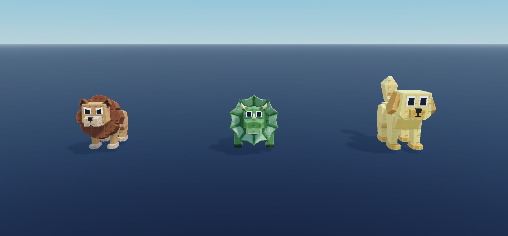

# Animal Pack 3

**Native model collection - v0.1.0 visual preview release.**

[Native model](AnimalPack3.rbxm?raw=1) | [Full gallery](GALLERY.md) | [Verification](VERIFICATION.md) | [Credits](CREDITS.md)

## Included

90 named animal/fantasy entries in BaseAnimals, GoldAnimals, DiamondAnimals, RubyAnimals and EmeraldAnimals: 450 native model variants. Static rig/geometry release draft, not a tested animated pet system.

181 images covering all 450 delivered entries, plus representative/alternate views. Multi-item sheets are listed left-to-right in GALLERY.md.

## Install

1. In a disposable Roblox Studio place, stop Play and import `AnimalPack3.rbxm` into **ServerStorage** as your editable master collection.
2. Expand the imported root and choose a named model/mesh. Clone that selected entry into **Workspace**, focus it with F, and position it deliberately. Supplied world coordinates may be far from the origin; previews were normalized, downloads were not.
3. Inspect external appearances, size, anchoring and collisions before integrating it. Keep one untouched master copy.
4. The imported AnimalModels folder contains five variant groups. Select an individual animal, not a group, for placement. An AnimationController/rig alone does not play an animation; implement and authorize any playback separately.

## Customize

The native model is editable source. Edit instances in Explorer: named groups, transforms, size, appearances and decorative effect properties. Preserve original creator notices and real asset IDs. No generated replacement meshes or invented IDs were used.

## Verification and limits

- 58 of 97 unique incoming MeshIds also occur in the existing Stud Animals pack. No exact-file duplicate was found; geometry reuse is partial and does not prove identical rigs, finishes or complete models. Do not market this as an entirely new set of meshes.
- The BaseAnimals/GRIFFIN entry has no serialized Animator; the other 449 do. No animal playback, skinning motion or animation permissions were tested. The source demo controller and 319 saved KeyframeSequences were excluded from this static models-only download and retained locally for separate review. The source has no RainbowAnimals group.
- All delivered model/tool entries have a primary static capture. Alternate angles cover all 104 Vehicle Pack models, 90 BaseAnimals and 19 Normal cars; other finishes have primary views, not every possible angle.
- Geometry-only previews: particles, beams and trails disabled on temporary clones, with independent normalization to a 10-stud largest visible bound, anchoring, orientation and lighting changes for framing. The delivered native model preserves original geometry, appearances, scale and effect instances. Screenshots are not common-scale comparisons or motion/effect demonstrations.
- No source code executed. No Play, collisions, physics, equipping, device, gameplay or production-integration certification. PreloadAsync callbacks reported no failed resources during these captures; that does not guarantee destination-experience access or correct materials.

## Native export and provenance

Models-only .rbxm export from the source .rbxl. Baseplate, camera, terrain, lighting/services, demo scripts and unrelated server animation-save data are not part of this download.

See inventory.json, inventory-full.json.gz and dependencies.json for the serialized structure and deduplicated external references. No serialized scripts remain in any of these six native downloads.

## License

See [CREDITS.md](CREDITS.md) and [LICENSE](LICENSE). Original creator terms have not been independently verified; preserve third-party notices and review the documented license scope.
