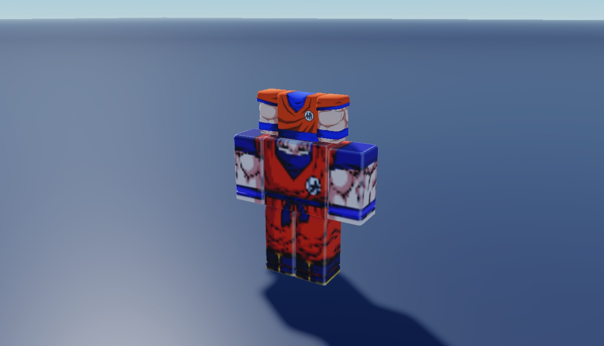

# Anime Character Collection

159 character models organized by 21 anime/franchise folders.

**Preview release 0.1.0.** No supplied gameplay or AI controller. Costume, mesh, texture and franchise rights remain with their respective creators; character appearance, physics and external asset permissions require destination testing.

## Download

[Download anime characters.rbxm](anime%20characters.rbxm?raw=1) - native Roblox model, 4,979,369 bytes.

[Full gallery - 318 screenshots](GALLERY.md) | [Included entries](INVENTORY.md) | [Verification](VERIFICATION.md)

## Included assets

159 character models organized by 21 anime/franchise folders.

See the [native inventory](INVENTORY.md) for original entry names and instance counts. All supplied descendants and original source notices are retained. No LuaSourceContainer scripts were found in the supplied native model.

## Installation

Stop Play and import Characters into ServerStorage. Copy selected character models into Workspace for inspection; retain rigs, attachments, constraints, accessories and appearance descendants. Review Humanoid rig structure before adding an Animator or game controller.

## Customization and dependencies

Duplicate a master before editing. Customize native instances in Roblox Studio rather than flattening them into an image. Preserve internal rig, constraint, mesh and appearance references. Linked Roblox-hosted content may need permission in your destination experience; the [asset reference inventory](ASSET-REFERENCES.json) is not an access guarantee. No external asset payloads are bundled beyond the original model.

## Verification and limitations

No supplied gameplay or AI controller. Costume, mesh, texture and franchise rights remain with their respective creators; character appearance, physics and external asset permissions require destination testing.

[Read scoped verification](VERIFICATION.md). The original download is byte-for-byte preserved; preview-only normalization, anchoring and effect/label visibility changes do not alter the delivered asset.

SHA-256: `e85795aa514d343cf130f6a58e3e234b0a19ea7a8a10c72bfb5ec7482e2541bf`

## Credits and license

[Credits and source provenance](CREDITS.md) | [MIT notice with limited project scope](LICENSE) | [Repository licensing](../../../docs/LICENSING.md). Existing third-party terms remain in effect; this listing does not establish original authorship.

[Changelog](CHANGELOG.md) | [Back to category](../README.md)

### Known cross-character link

The native Erwin accessory AccessoryRigidConstraint references Levi. Retarget or detach this cross-character link before separating or repositioning these rigs. The delivered binary is preserved, not silently repaired.
