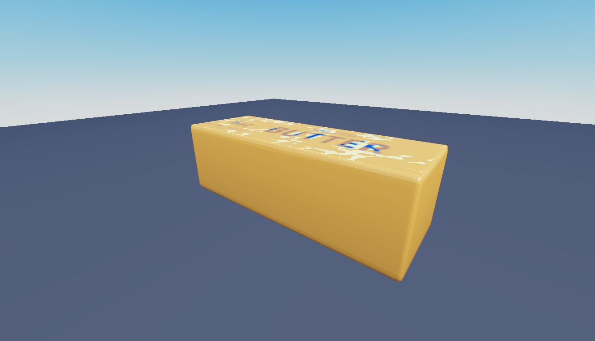

# ASMR Butter Models V1

Two skinned butter models: CrunchyButter and StandardButter, with editable bones.

**Preview release 0.1.0.** Static mesh/bone inspection only. No deformation animation, touch interaction, sound, collision or gameplay verification.

## Download

[Download ASMR_Butter_Models_V1.rbxm](ASMR_Butter_Models_V1.rbxm?raw=1) — 8,018 bytes.

[Full gallery — 4 screenshots](GALLERY.md) | [Native inventory](INVENTORY.md) | [Verification](VERIFICATION.md)

## Included assets

Two skinned butter models: CrunchyButter and StandardButter, with editable bones.

No embedded scripts were found.

## Installation

Import into ServerStorage, then copy the chosen model into Workspace. Preserve MeshParts and Bone descendants. These are model assets, not a complete ASMR interaction system.

## Customization and dependencies

Work on a copy in Studio. Preserve required internal hierarchy, attachments, bones and relative transforms. Inspect [asset references](ASSET-REFERENCES.json); their availability in this Studio session does not guarantee permission in your destination experience. Keep original creator notices.

## Verification and limitations

Static Studio Edit inspection on isolated clones; no runtime behavior certification. Native instance counts/root names matched the supplied imports. Original scripts were disabled on static preview clones.

Static mesh/bone inspection only. No deformation animation, touch interaction, sound, collision or gameplay verification.

SHA-256: `94b0cfb230c987e6274ed6d59b20232c2ccc653c9da84da139ffea3c35fc21b4`

## Credits and license

[Credits](CREDITS.md) | [Scoped project MIT notice](LICENSE) | [Repository scope](../../../docs/LICENSING.md) | [Changelog](CHANGELOG.md)

[Back to category](../README.md)
