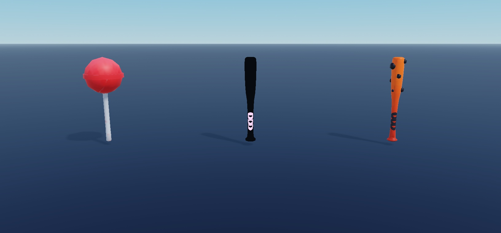
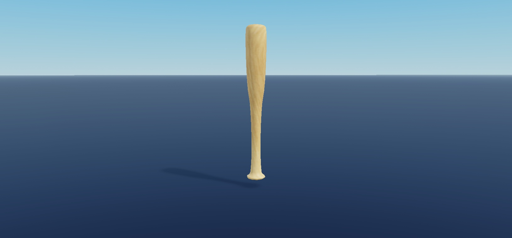
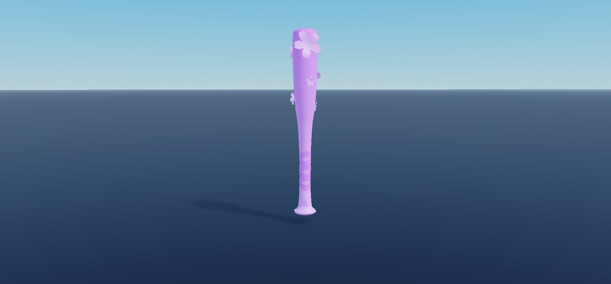
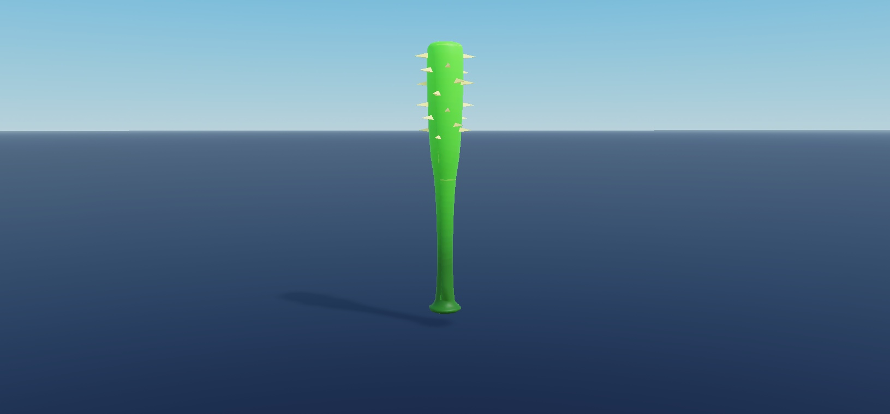
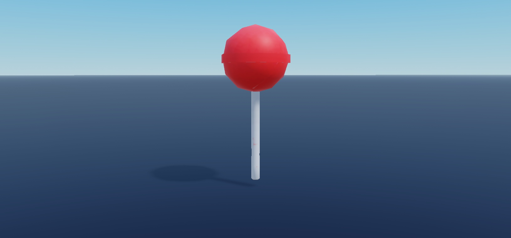
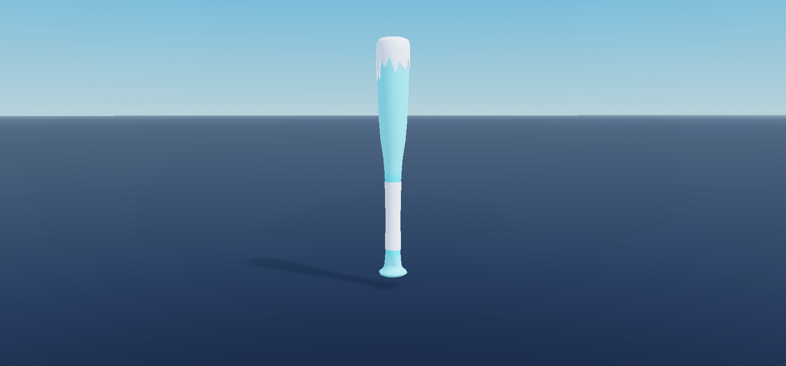
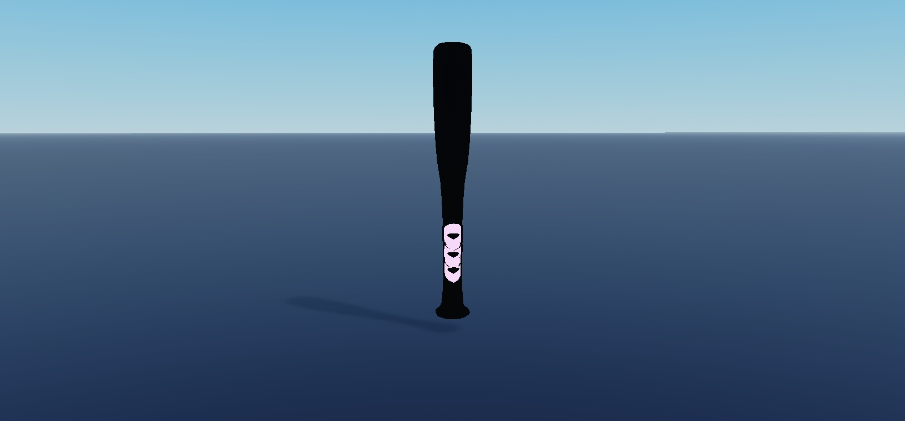
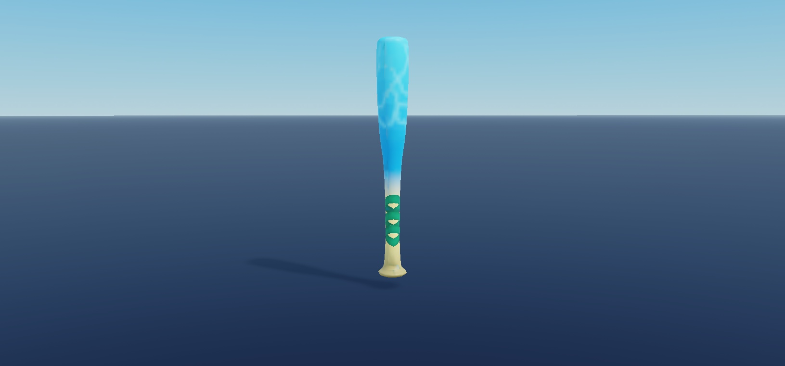
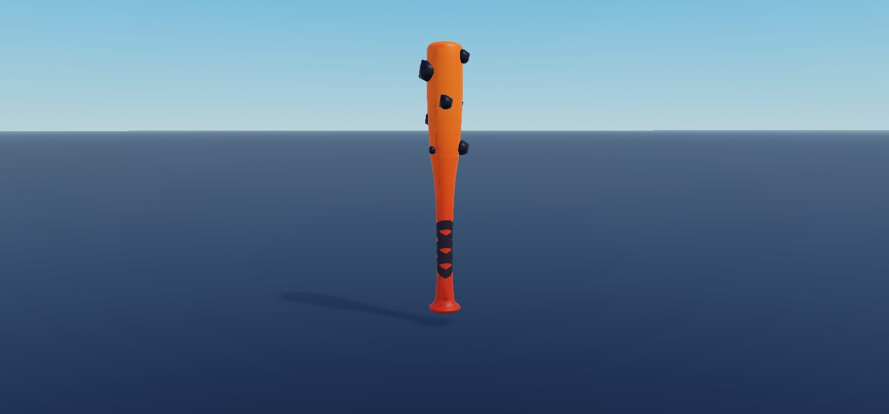
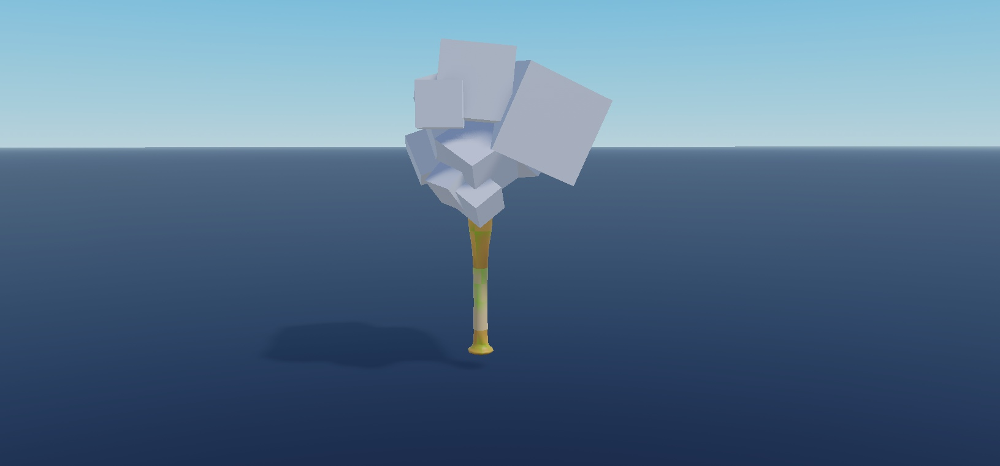

# Bat Tool Models - Studio gallery

Actual Studio MCP captures from Place2. Each sheet lists visible items left-to-right; individual views have one item. Decorative effects suppressed to expose geometry; independent preview scales are not native scale comparisons.

## Cover - CandyBat | GalaxyBat | LavaBat

Left to right: `Tools/CandyBat`; `Tools/GalaxyBat`; `Tools/LavaBat`

## Primary view - Bat

Left to right: `Tools/Bat`

## Primary view - BlossomBat

Left to right: `Tools/BlossomBat`

## Primary view - CactusBat

Left to right: `Tools/CactusBat`

## Primary view - CandyBat

Left to right: `Tools/CandyBat`

## Primary view - FrostBat

Left to right: `Tools/FrostBat`

## Primary view - GalaxyBat

Left to right: `Tools/GalaxyBat`

## Primary view - LakeBat

Left to right: `Tools/LakeBat`

## Primary view - LavaBat

Left to right: `Tools/LavaBat`

## Primary view - TreeBat

Left to right: `Tools/TreeBat`

