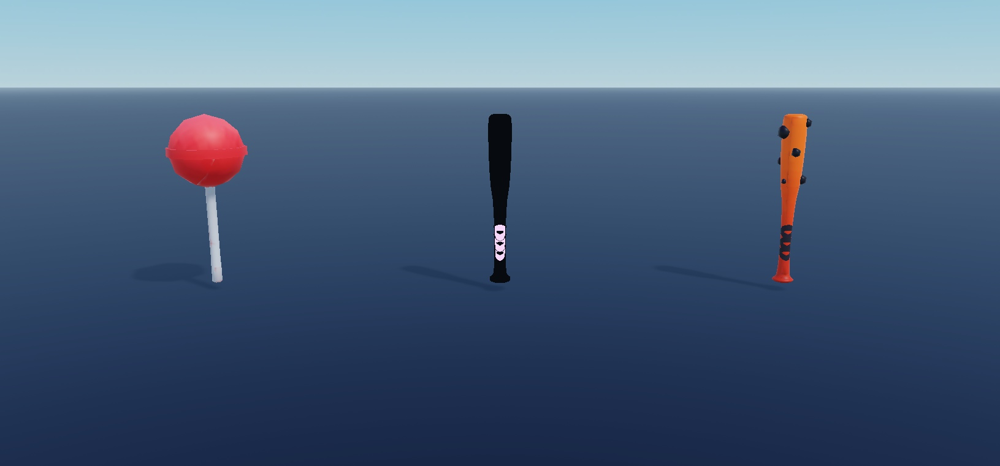

# Bat Tool Models

**Native model collection - v0.1.0 visual preview release.**

[Native model](BatTools.rbxm?raw=1) | [Full gallery](GALLERY.md) | [Verification](VERIFICATION.md) | [Credits](CREDITS.md)

## Included

9 named bat Tools with Handle parts and supplied welds/appearances. No damage, swing, combat or server controller is included.

10 images covering all 9 delivered entries, plus representative/alternate views. Multi-item sheets are listed left-to-right in GALLERY.md.

## Install

1. In a disposable Roblox Studio place, stop Play and import `BatTools.rbxm` into **ServerStorage** as your editable master collection.
2. Expand the imported root and choose a named model/mesh. Clone that selected entry into **Workspace**, focus it with F, and position it deliberately. Supplied world coordinates may be far from the origin; previews were normalized, downloads were not.
3. Inspect external appearances, size, anchoring and collisions before integrating it. Keep one untouched master copy.
4. For an equip test, move one selected **Tool**, not the enclosing Tools folder, into **StarterPack**. All 9 Tools have a Handle; equipping/grip and combat behavior were not Play-tested. No hit/damage logic is supplied.

## Customize

The native model is editable source. Edit instances in Explorer: named groups, transforms, size, appearances and decorative effect properties. Preserve original creator notices and real asset IDs. No generated replacement meshes or invented IDs were used.

## Verification and limits

- All delivered model/tool entries have a primary static capture. Alternate angles cover all 104 Vehicle Pack models, 90 BaseAnimals and 19 Normal cars; other finishes have primary views, not every possible angle.
- Geometry-only previews: particles, beams and trails disabled on temporary clones, with independent normalization to a 10-stud largest visible bound, anchoring, orientation and lighting changes for framing. The delivered native model preserves original geometry, appearances, scale and effect instances. Screenshots are not common-scale comparisons or motion/effect demonstrations.
- No source code executed. No Play, collisions, physics, equipping, device, gameplay or production-integration certification. PreloadAsync callbacks reported no failed resources during these captures; that does not guarantee destination-experience access or correct materials.

## Native export and provenance

The native .rbxm download is byte-identical to the supplied input.

See inventory.json, inventory-full.json.gz and dependencies.json for the serialized structure and deduplicated external references. No serialized scripts remain in any of these six native downloads.

## License

See [CREDITS.md](CREDITS.md) and [LICENSE](LICENSE). Original creator terms have not been independently verified; preserve third-party notices and review the documented license scope.
