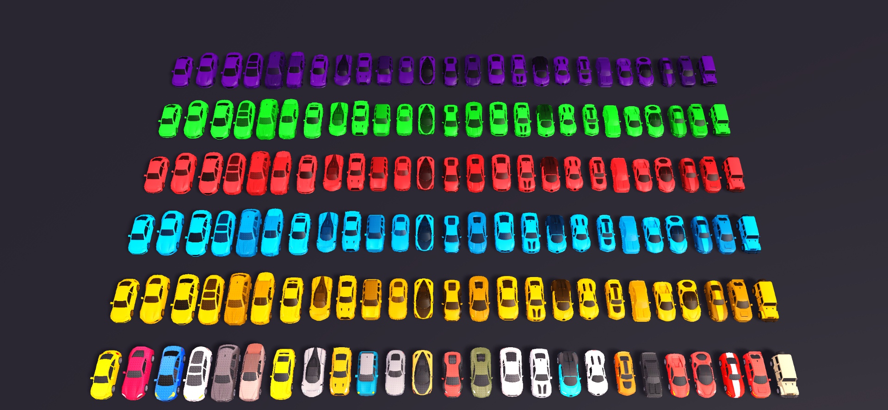
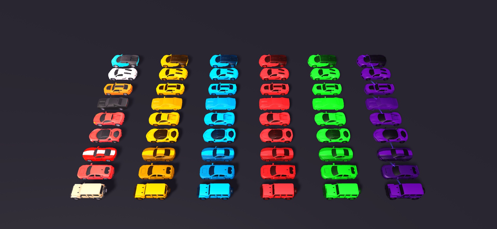
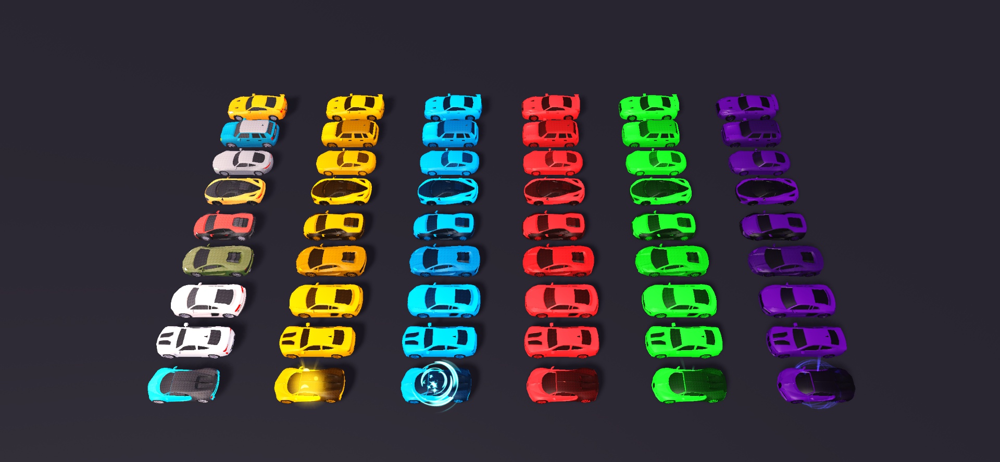
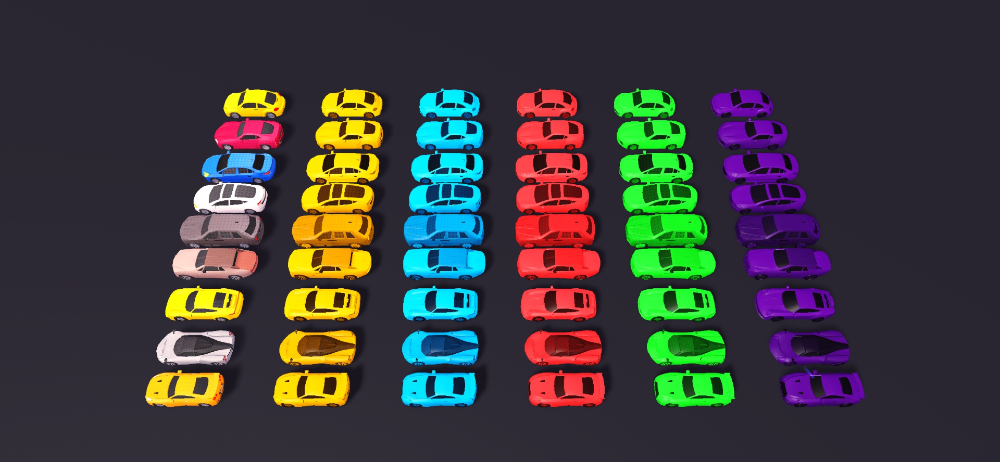

# Steal a Template / Car Pack

**25 car designs · 6 color collections · 150 editable models**

[**Download CarPack.rbxm**](CarPack.rbxm?raw=1) · [Aerial gallery](#aerial-gallery) · [Verification](VERIFICATION.md)

Local contribution draft. Redistribution permission and a fresh-place import check are still pending; see [credits](CREDITS.md) and [verification](VERIFICATION.md).

## Import into Roblox Studio

1. Download **CarPack.rbxm**.
2. Stop Play and right-click **Workspace → Insert from File**.
3. Select the downloaded model. It contains six named collection Models; keep them in Workspace.
4. Expand a collection and select the car you want. Move or duplicate that Model into your scene.
5. Keep decorative cars anchored. Add your own vehicle chassis and controls if you want drivable cars.

The native model is the editable source. No scripts, plugins, or code paste are required. The baseplate and preview lighting are not included.

## Included

Each collection contains these same 25 designs, preserving their supplied names:

| Designs | Designs | Designs | Designs | Designs |
| --- | --- | --- | --- | --- |
| 917 | ARMG GT-L | Bettle | BKM M4 | Boaty |
| Cully | Gatti Chiroko | Gatti Vekron | GT-S | Horse GT |
| Huraya | Kamar | KIVIK | Kooper | Korolla |
| Laventador | Mc740S | Off-Roader | R-3 | Rarri 444 |
| Rarri S100 | SKT R10 | Sterlatto | Supwa | Tesla |

Collections: **MainColors**, **GoldColors**, **DiamondColors**, **RubyColors**, **EmeraldColors**, and **CelestialColors**.

Includes 840 MeshParts, 705 SurfaceAppearances, 124 Attachments, and 272 ParticleEmitters across the six collections. All car parts are anchored and collidable. These are decorative model assets, not functioning vehicles.

## Aerial gallery

Actual Studio captures of the re-imported native model at **1920 × 888**. The overview above shows the entire collection. Its rows, bottom to top, are Main, Gold, Diamond, Ruby, Emerald, and Celestial.

The closer views below rotate the camera to show the cars' sides and roofs. Columns, left to right, are Main, Gold, Diamond, Ruby, Emerald, and Celestial. Neighboring sections overlap by one design. Other sections were temporarily hidden for readable framing; model geometry and finishes were unchanged.

### Section 1

Top to bottom: Gatti Chiroko, Gatti Vekron, Kamar, SKT R10, Rarri 444, Rarri S100, Horse GT, KIVIK, Off-Roader.

### Section 2

Top to bottom: GT-S, Kooper, ARMG GT-L, Mc740S, Sterlatto, Laventador, R-3, BKM M4, Gatti Chiroko.

### Section 3

Top to bottom: Bettle, Supwa, Korolla, Tesla, Cully, Boaty, 917, Huraya, GT-S.

## Customize

- Move, rotate, and scale each car Model using Studio's model tools.
- Edit MeshPart colors and materials, and SurfaceAppearance maps where present. Textured finishes may require changes to their maps.
- Toggle or tune ParticleEmitters beneath Attachments to customize the supplied decorative effects.
- Adjust collision settings for your scene. The supplied cars use collidable MeshParts; vehicle physics, walkability, and game-specific collision behavior need testing in your experience.

## Dependencies and compatibility

The asset IDs observed in the collection are recorded in [inventory.json](inventory.json). Meshes, appearance maps, and particle textures remain Roblox-hosted dependencies; no mesh-authoring files or external texture source files are supplied.

All tested content loaded in the current Studio session. This does not establish access from every account or published experience. Verify access in your destination experience.

See [verification and security audit](VERIFICATION.md), [credits and license scope](CREDITS.md), and [changelog](CHANGELOG.md).
