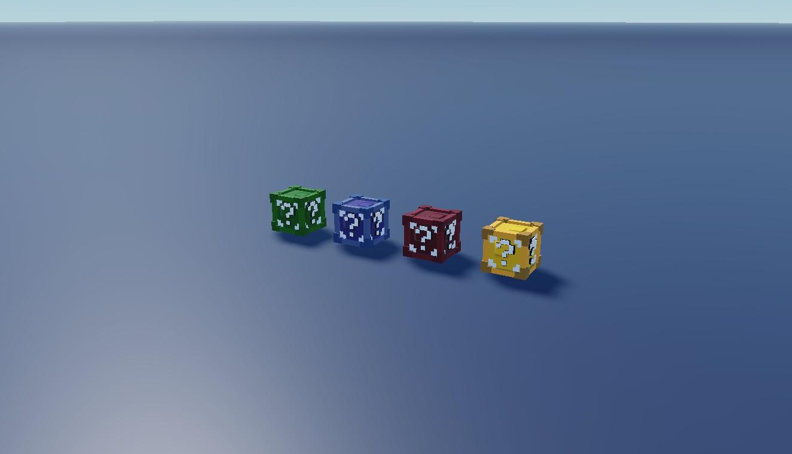

# Classic Colored Lucky Blocks

Five top-level groups, including four named colors and a nested multi-block group.

**Preview release 0.1.0.** Static decorative blocks; no opening or reward system. The nested Model group is preserved rather than incorrectly treated as a single unique variant.

## Download

[Download LuckyBlocks.rbxm](LuckyBlocks.rbxm?raw=1) - native Roblox model, 84,207 bytes.

[Full gallery - 10 screenshots](GALLERY.md) | [Included entries](INVENTORY.md) | [Verification](VERIFICATION.md)

## Included assets

Five top-level groups, including four named colors and a nested multi-block group.

See the [native inventory](INVENTORY.md) for original entry names and instance counts. All supplied descendants and original source notices are retained. No LuaSourceContainer scripts were found in the supplied native model.

## Installation

Stop Play and import the LuckyBlocks Model into ServerStorage. Expand the Red, Blue, Green, Yellow and nested Model groups and copy desired blocks into Workspace. Preserve unions and textures; configure anchoring/collisions for your game.

## Customization and dependencies

Duplicate a master before editing. Customize native instances in Roblox Studio rather than flattening them into an image. Preserve internal rig, constraint, mesh and appearance references. Linked Roblox-hosted content may need permission in your destination experience; the [asset reference inventory](ASSET-REFERENCES.json) is not an access guarantee. No external asset payloads are bundled beyond the original model.

## Verification and limitations

Static decorative blocks; no opening or reward system. The nested Model group is preserved rather than incorrectly treated as a single unique variant.

[Read scoped verification](VERIFICATION.md). The original download is byte-for-byte preserved; preview-only normalization, anchoring and effect/label visibility changes do not alter the delivered asset.

SHA-256: `e91e676440c52ae1c4434b62238833fe4237a725fbaf789deb0fbab04a9bdd0d`

## Credits and license

[Credits and source provenance](CREDITS.md) | [MIT notice with limited project scope](LICENSE) | [Repository licensing](../../../docs/LICENSING.md). Existing third-party terms remain in effect; this listing does not establish original authorship.

[Changelog](CHANGELOG.md) | [Back to category](../README.md)
