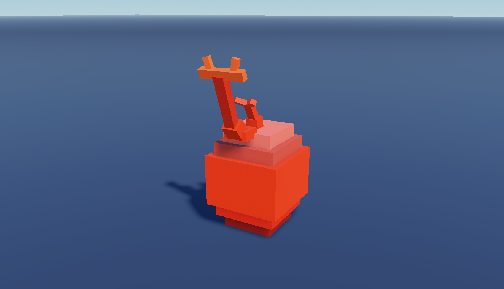

# Classic Studded Eggs

75 entries under Eggs (including dinosaur-named and other egg designs), 28 decorative model copies and four base/display helpers. Original duplicate entries are retained.

**Preview release 0.1.0.** Decorative egg assets, not a hatching, reward, inventory or monetization system. Static geometry only; rigs, effects, collisions and gameplay require testing. Original Uqel naming is retained as provenance, not independently verified authorship.

## Download

[Download Classic Studded Eggs.rbxm](Classic%20Studded%20Eggs.rbxm?raw=1) - native Roblox model, 101,831 bytes.

[Full gallery - 212 screenshots](GALLERY.md) | [Included entries](INVENTORY.md) | [Verification](VERIFICATION.md)

## Included assets

75 entries under Eggs (including dinosaur-named and other egg designs), 28 decorative model copies and four base/display helpers. Original duplicate entries are retained.

See the [native inventory](INVENTORY.md) for original entry names and instance counts. All supplied descendants and original source notices are retained. No LuaSourceContainer scripts were found in the supplied native model.

## Installation

Stop Play and import Studs Eggs - Uqel into ServerStorage. Copy selected models from Eggs into Workspace. Base and Decoration contain optional presentation scenery; they are not required for an egg-opening system. Preserve rigs/attachments if needed.

## Customization and dependencies

Duplicate a master before editing. Customize native instances in Roblox Studio rather than flattening them into an image. Preserve internal rig, constraint, mesh and appearance references. Linked Roblox-hosted content may need permission in your destination experience; the [asset reference inventory](ASSET-REFERENCES.json) is not an access guarantee. No external asset payloads are bundled beyond the original model.

## Verification and limitations

Decorative egg assets, not a hatching, reward, inventory or monetization system. Static geometry only; rigs, effects, collisions and gameplay require testing. Original Uqel naming is retained as provenance, not independently verified authorship.

[Read scoped verification](VERIFICATION.md). The original download is byte-for-byte preserved; preview-only normalization, anchoring and effect/label visibility changes do not alter the delivered asset.

SHA-256: `de3ed5a817676dbbbbc6858332784dcb012e17ec6116e6027f7ee594cca8a380`

## Credits and license

[Credits and source provenance](CREDITS.md) | [MIT notice with limited project scope](LICENSE) | [Repository licensing](../../../docs/LICENSING.md). Existing third-party terms remain in effect; this listing does not establish original authorship.

[Changelog](CHANGELOG.md) | [Back to category](../README.md)
