# Studded Egg Models / Gallery

Actual Studio Edit-mode captures of the delivered instances, isolated on temporary preview clones. Scale is normalized per model; these are not common-scale comparisons. Original files are unchanged. Effects/labels may be hidden only on preview clones. See [verification](VERIFICATION.md).

## 1. Angel Egg

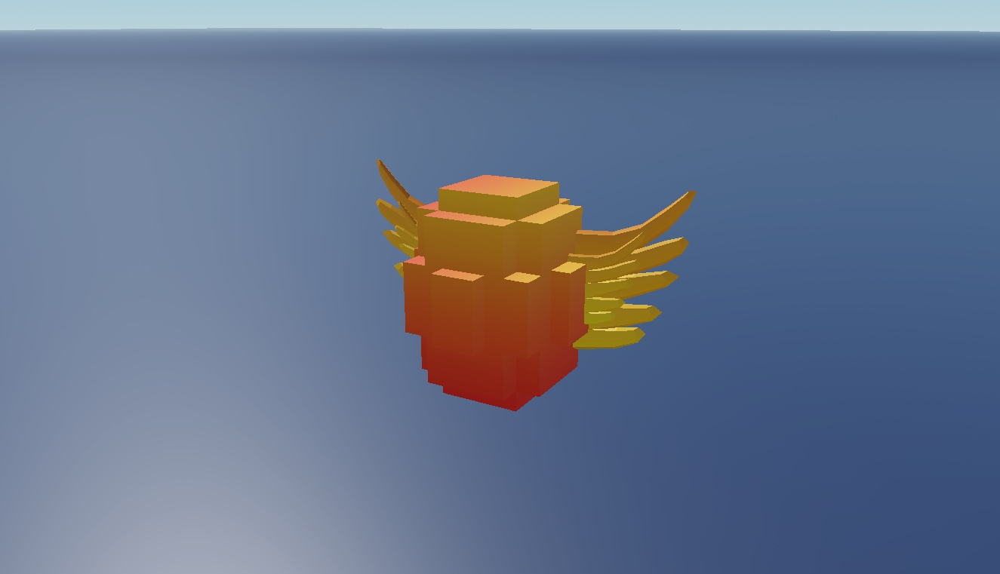

## 1. Angel Egg - reverse view

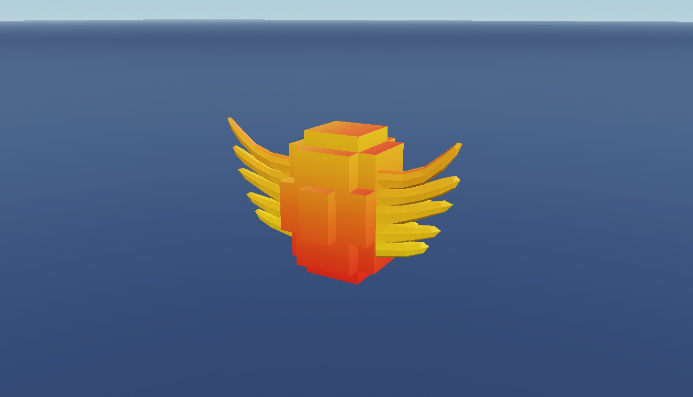

## 2. Aquatic Egg

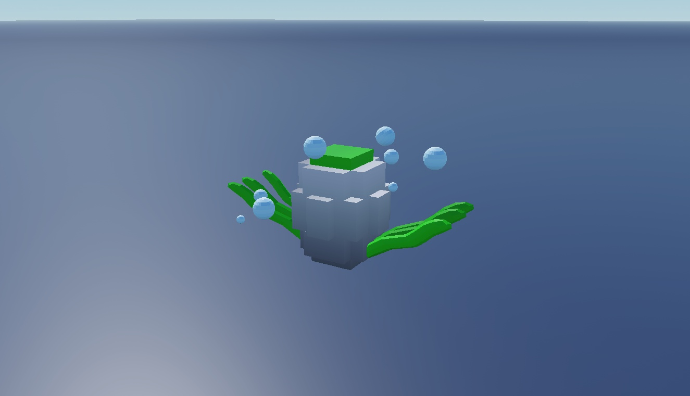

## 2. Aquatic Egg - reverse view

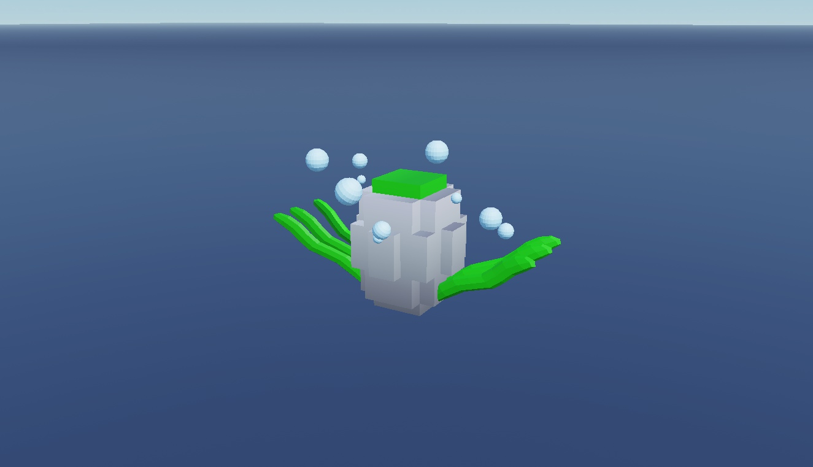

## 3. Basic Egg

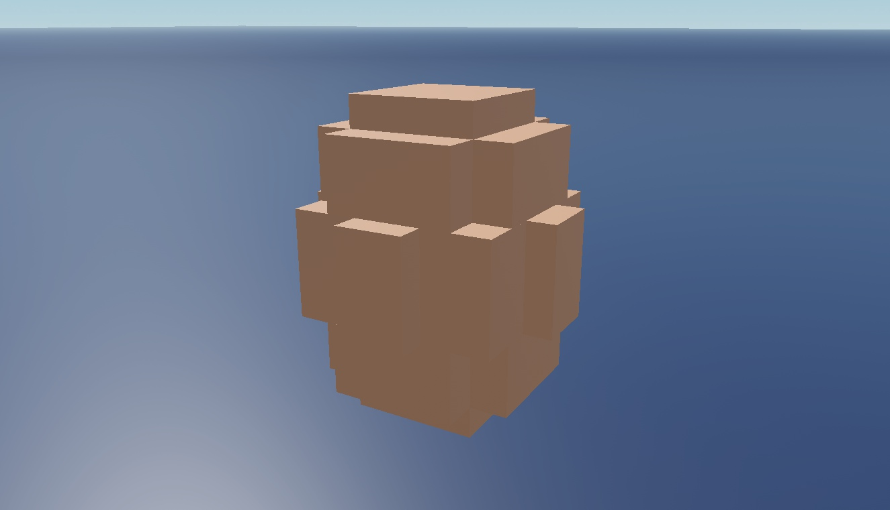

## 3. Basic Egg - reverse view

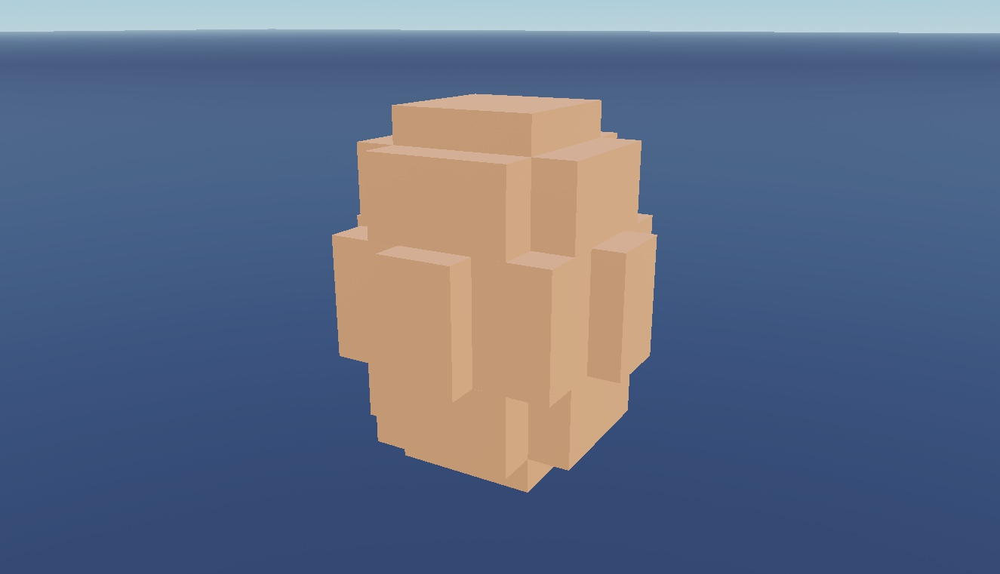

## 4. Demon Egg

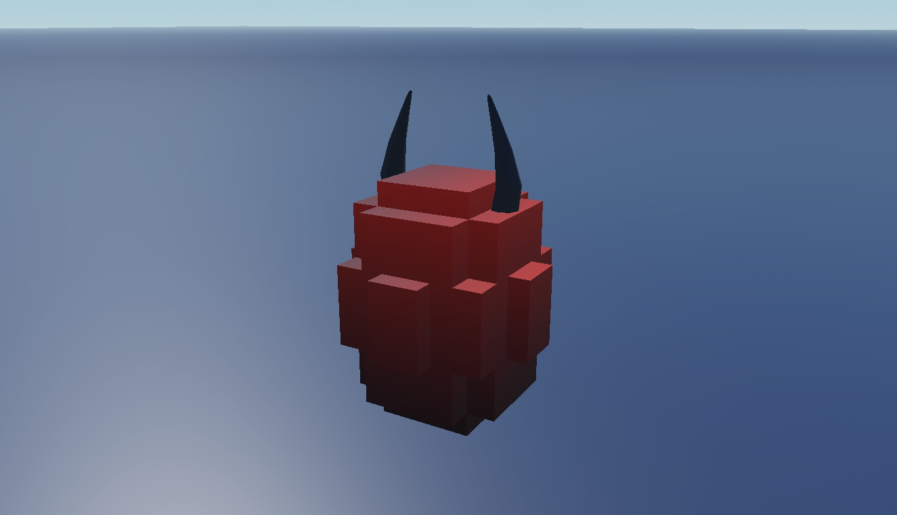

## 4. Demon Egg - reverse view

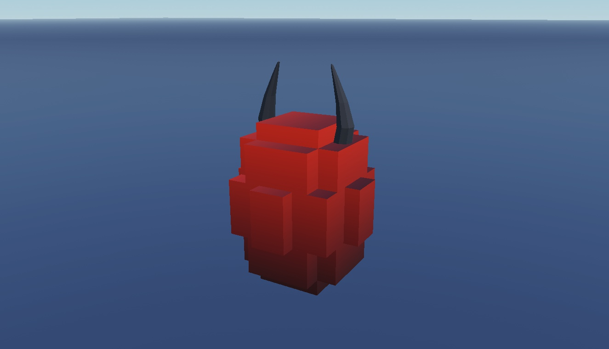

## 5. Galaxy Egg

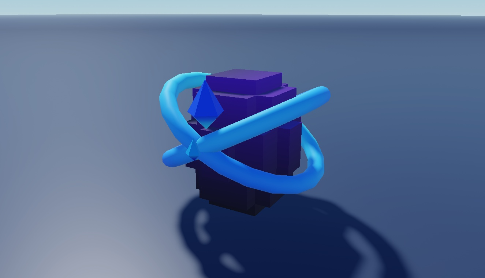

## 5. Galaxy Egg - reverse view

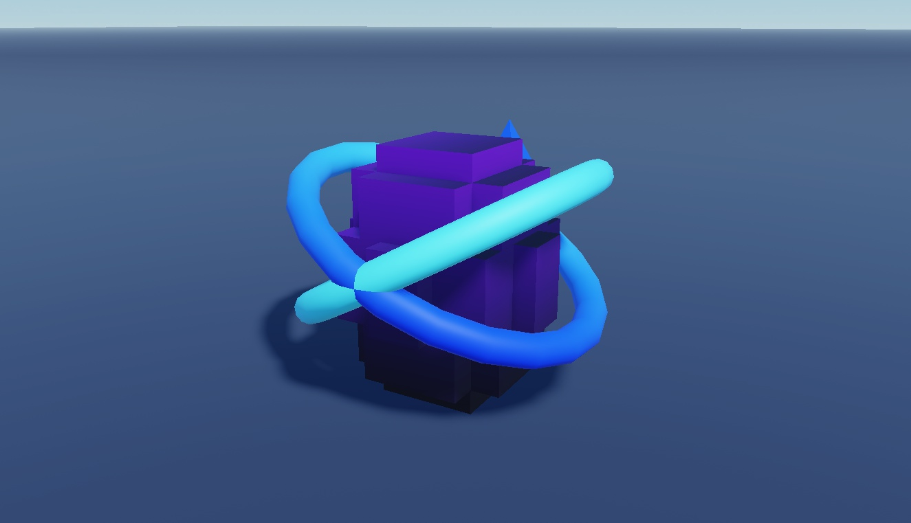

## 6. Nature Egg

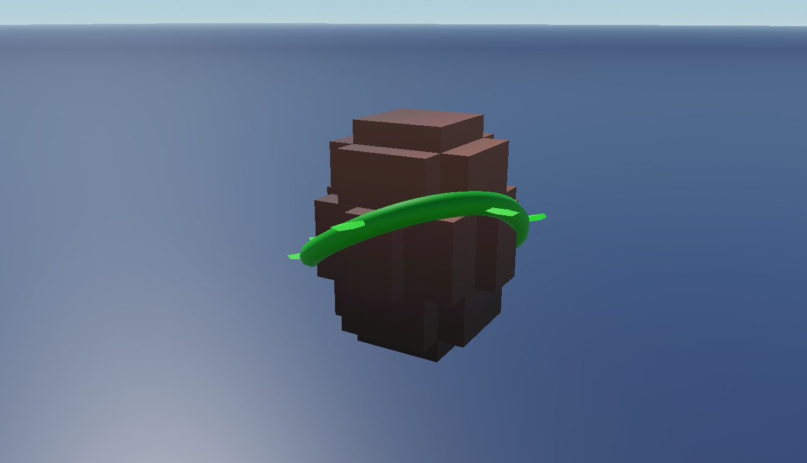

## 6. Nature Egg - reverse view

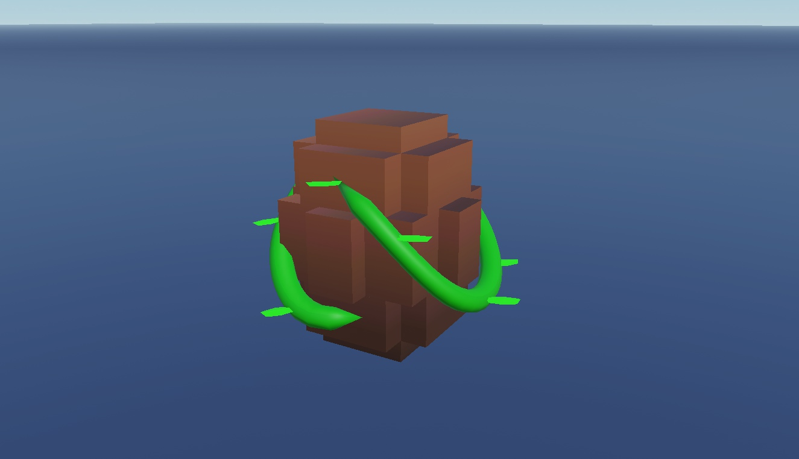

## 7. Rare Egg

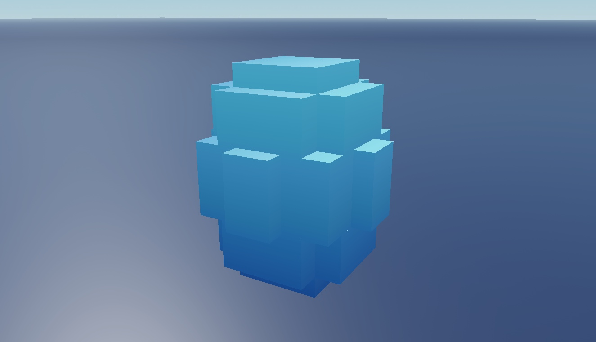

## 7. Rare Egg - reverse view

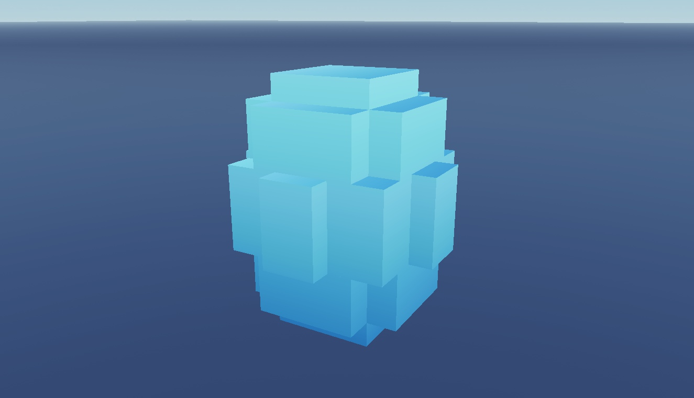

## 8. Spike Egg

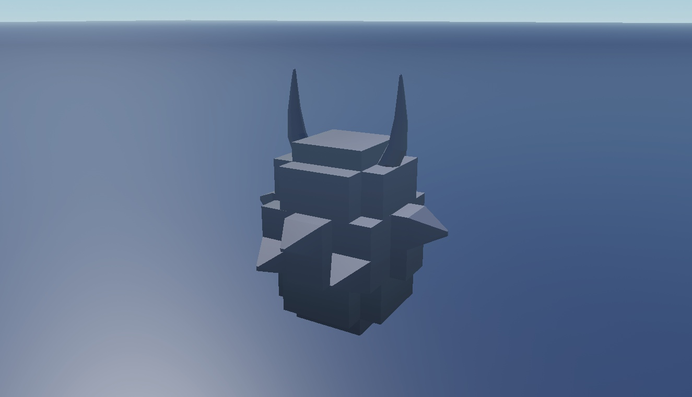

## 8. Spike Egg - reverse view

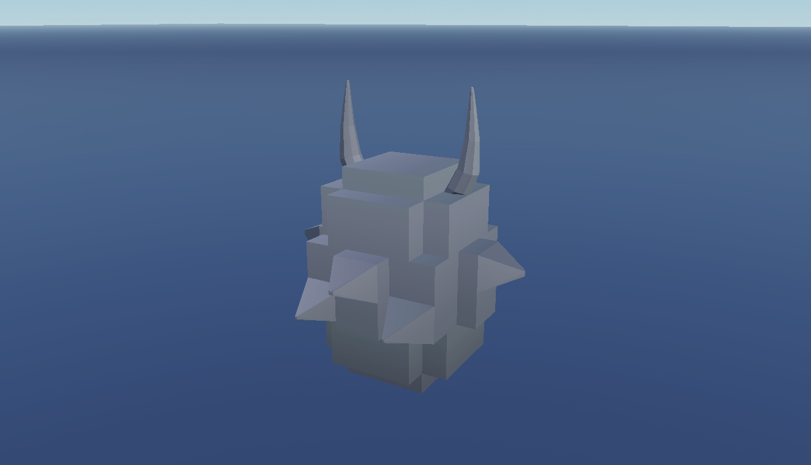
