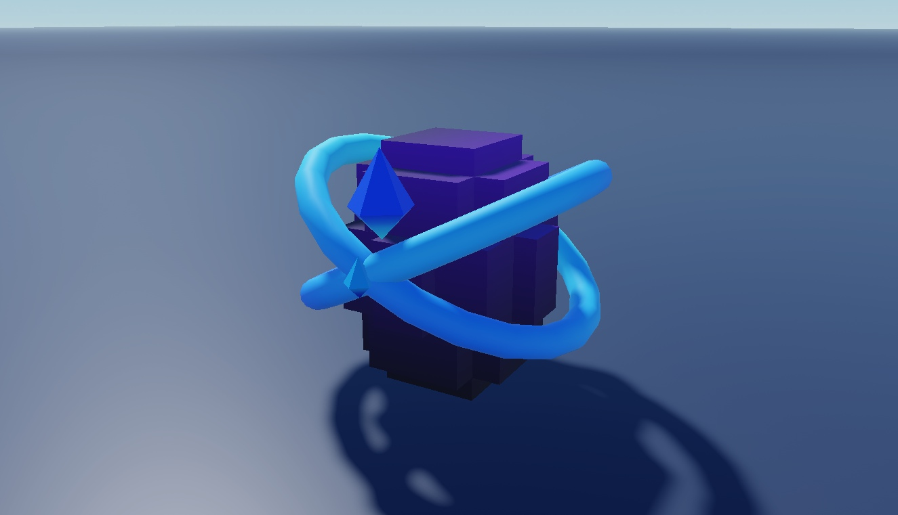

# Studded Egg Models

Eight eggs: Angel, Aquatic, Basic, Demon, Galaxy, Nature, Rare and Spike.

**Preview release 0.1.0.** Visual models and billboard labels only; no hatch, reward or purchase implementation. Original labels remain in the download but are hidden on geometry-only preview clones.

## Download

[Download Egg Models.rbxm](Egg%20Models.rbxm?raw=1) - native Roblox model, 88,484 bytes.

[Full gallery - 16 screenshots](GALLERY.md) | [Included entries](INVENTORY.md) | [Verification](VERIFICATION.md)

## Included assets

Eight eggs: Angel, Aquatic, Basic, Demon, Galaxy, Nature, Rare and Spike.

See the [native inventory](INVENTORY.md) for original entry names and instance counts. All supplied descendants and original source notices are retained. 1 embedded scripts are also extracted verbatim under [src/](src/manifest.json); the native binary remains authoritative. Do not install both extracted copies and embedded scripts.

## Installation

Stop Play and import Eggs into ServerStorage. Copy the desired egg Model into Workspace, retaining its MeshPart, Weld and BillboardGui descendants. Edit the included labels for your economy. The Delete me ModuleScript is a preserved source/provenance banner; it is not required for an egg-opening mechanic.

## Customization and dependencies

Duplicate a master before editing. Customize native instances in Roblox Studio rather than flattening them into an image. Preserve internal rig, constraint, mesh and appearance references. Linked Roblox-hosted content may need permission in your destination experience; the [asset reference inventory](ASSET-REFERENCES.json) is not an access guarantee. No external asset payloads are bundled beyond the original model.

## Verification and limitations

Visual models and billboard labels only; no hatch, reward or purchase implementation. Original labels remain in the download but are hidden on geometry-only preview clones.

[Read scoped verification](VERIFICATION.md). The original download is byte-for-byte preserved; preview-only normalization, anchoring and effect/label visibility changes do not alter the delivered asset.

SHA-256: `b3b28c38ba65943782d1cbb90cdc249184d27a1f2f9e35a28ca52c74064c6c90`

## Credits and license

[Credits and source provenance](CREDITS.md) | [MIT notice with limited project scope](LICENSE) | [Repository licensing](../../../docs/LICENSING.md). Existing third-party terms remain in effect; this listing does not establish original authorship.

[Changelog](CHANGELOG.md) | [Back to category](../README.md)
