# Review gallery — v2

Actual Roblox Studio MCP captures. Source geometry and effects are not interchangeable: geometry shots intentionally suppress particles/beams/trails; triggered-effect stills hide carriers. Preview scales/camera/visibility changes are confined to temporary clones. Runtime tests are labeled separately.

### BeechwoodTreeVar1

One native model per image, geometry-fitted camera, effects suppressed on preview clone for legibility; normalized scale. No animation/collision test.

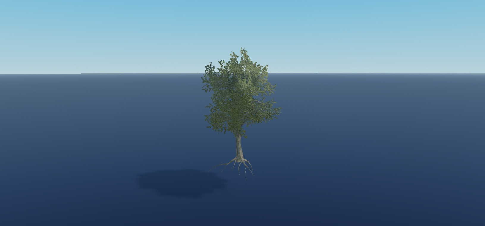

### BushVar0

One native model per image, geometry-fitted camera, effects suppressed on preview clone for legibility; normalized scale. No animation/collision test.

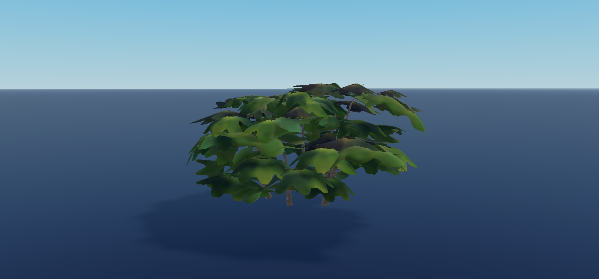

### DeadFernVar2

One native model per image, geometry-fitted camera, effects suppressed on preview clone for legibility; normalized scale. No animation/collision test.

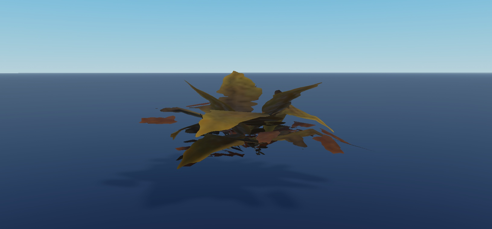

### DeadRedwoodTreeSnowyVar0

One native model per image, geometry-fitted camera, effects suppressed on preview clone for legibility; normalized scale. No animation/collision test.

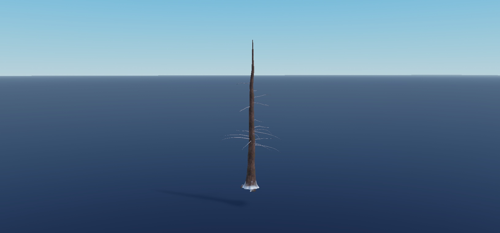

### DeadRedwoodTreeVar1

One native model per image, geometry-fitted camera, effects suppressed on preview clone for legibility; normalized scale. No animation/collision test.

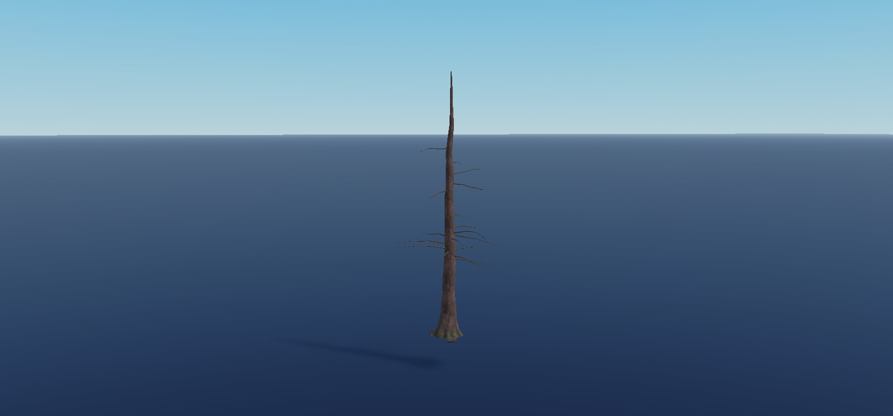

### DenseLeafPatchVar0

One native model per image, geometry-fitted camera, effects suppressed on preview clone for legibility; normalized scale. No animation/collision test.

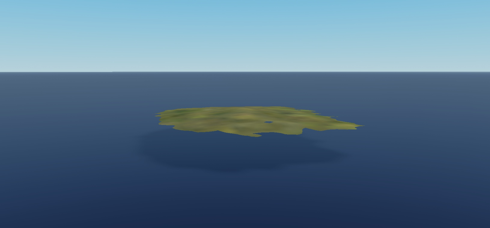

### FallenTreeVar0

One native model per image, geometry-fitted camera, effects suppressed on preview clone for legibility; normalized scale. No animation/collision test.

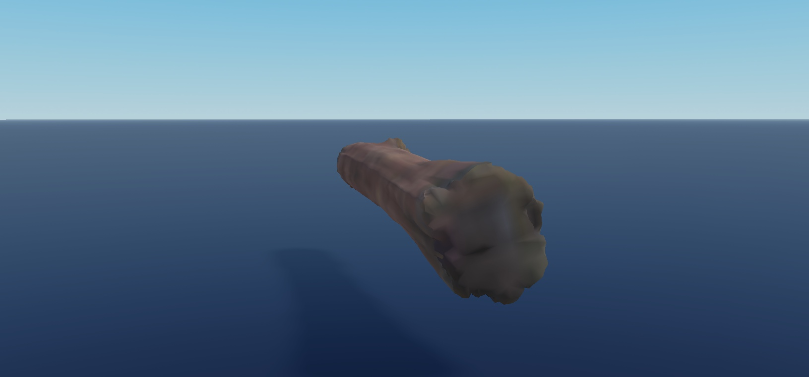

### FernVar1

One native model per image, geometry-fitted camera, effects suppressed on preview clone for legibility; normalized scale. No animation/collision test.

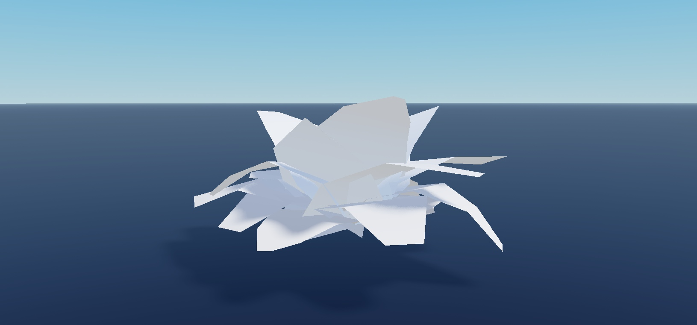

### MapleLeafTreeVar0

One native model per image, geometry-fitted camera, effects suppressed on preview clone for legibility; normalized scale. No animation/collision test.

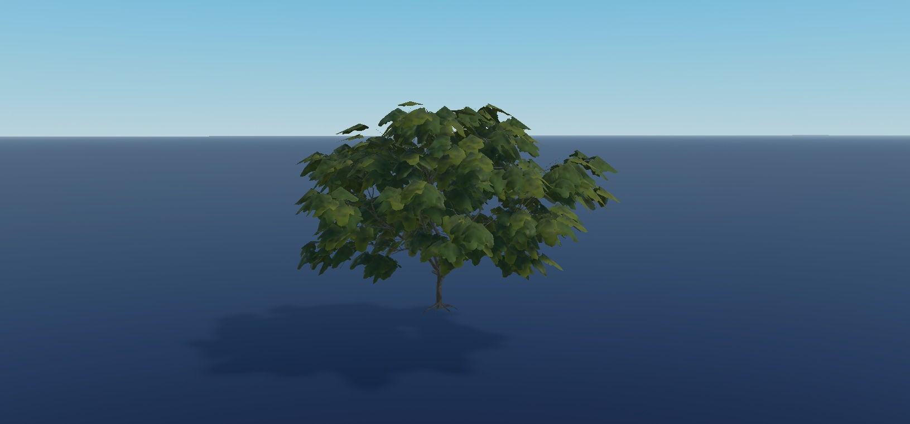

### RedwoodTreeSnowyVar0

One native model per image, geometry-fitted camera, effects suppressed on preview clone for legibility; normalized scale. No animation/collision test.

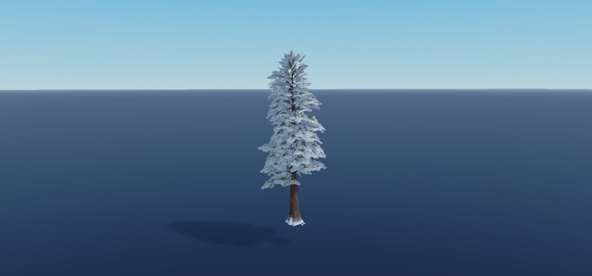

### RedwoodTreeVar2

One native model per image, geometry-fitted camera, effects suppressed on preview clone for legibility; normalized scale. No animation/collision test.

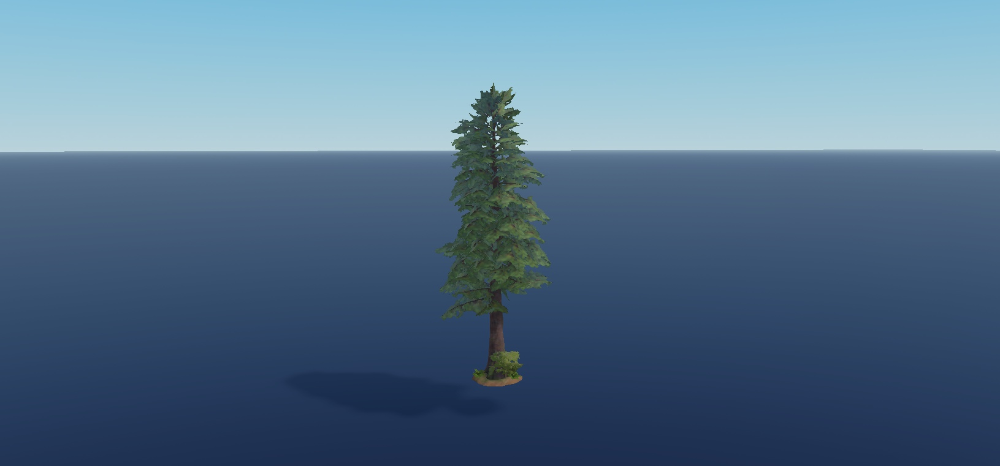

### TreeStumpVar0

One native model per image, geometry-fitted camera, effects suppressed on preview clone for legibility; normalized scale. No animation/collision test.

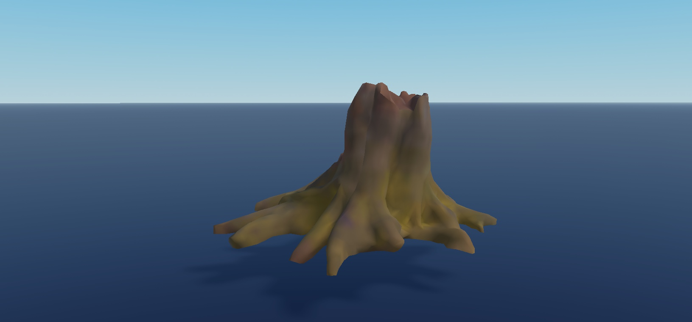
