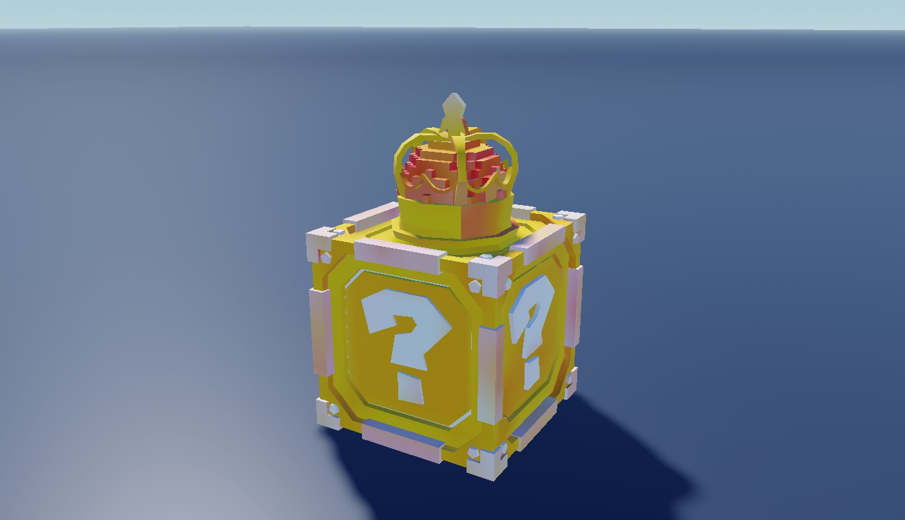

# Lucky Blocks - Seven Variants

Seven variants: Exclusive, Galaxy, Legendary, Mythic, Normal Galaxy, Party and Secret.

**Preview release 0.1.0.** Geometry-only captures with effects disabled on temporary clones. Supplied effects/controllers are retained in the native file but motion, timing, animation, opening and reward behavior are unverified.

## Download

[Download Lucky Blocks.rbxm](Lucky%20Blocks.rbxm?raw=1) - native Roblox model, 16,503 bytes.

[Full gallery - 14 screenshots](GALLERY.md) | [Included entries](INVENTORY.md) | [Verification](VERIFICATION.md)

## Included assets

Seven variants: Exclusive, Galaxy, Legendary, Mythic, Normal Galaxy, Party and Secret.

See the [native inventory](INVENTORY.md) for original entry names and instance counts. All supplied descendants and original source notices are retained. No LuaSourceContainer scripts were found in the supplied native model.

## Installation

Stop Play and import the LuckyBlocks Folder into ServerStorage. Copy individual block Models into Workspace. Preserve MeshParts, AnimationControllers, attachments, emitters and trails. Add your own opening, loot and server-authoritative reward logic.

## Customization and dependencies

Duplicate a master before editing. Customize native instances in Roblox Studio rather than flattening them into an image. Preserve internal rig, constraint, mesh and appearance references. Linked Roblox-hosted content may need permission in your destination experience; the [asset reference inventory](ASSET-REFERENCES.json) is not an access guarantee. No external asset payloads are bundled beyond the original model.

## Verification and limitations

Geometry-only captures with effects disabled on temporary clones. Supplied effects/controllers are retained in the native file but motion, timing, animation, opening and reward behavior are unverified.

[Read scoped verification](VERIFICATION.md). The original download is byte-for-byte preserved; preview-only normalization, anchoring and effect/label visibility changes do not alter the delivered asset.

SHA-256: `19e366c14793f85fca8279598e4f532f17622228ec940359db67802329b46dbf`

## Credits and license

[Credits and source provenance](CREDITS.md) | [MIT notice with limited project scope](LICENSE) | [Repository licensing](../../../docs/LICENSING.md). Existing third-party terms remain in effect; this listing does not establish original authorship.

[Changelog](CHANGELOG.md) | [Back to category](../README.md)
