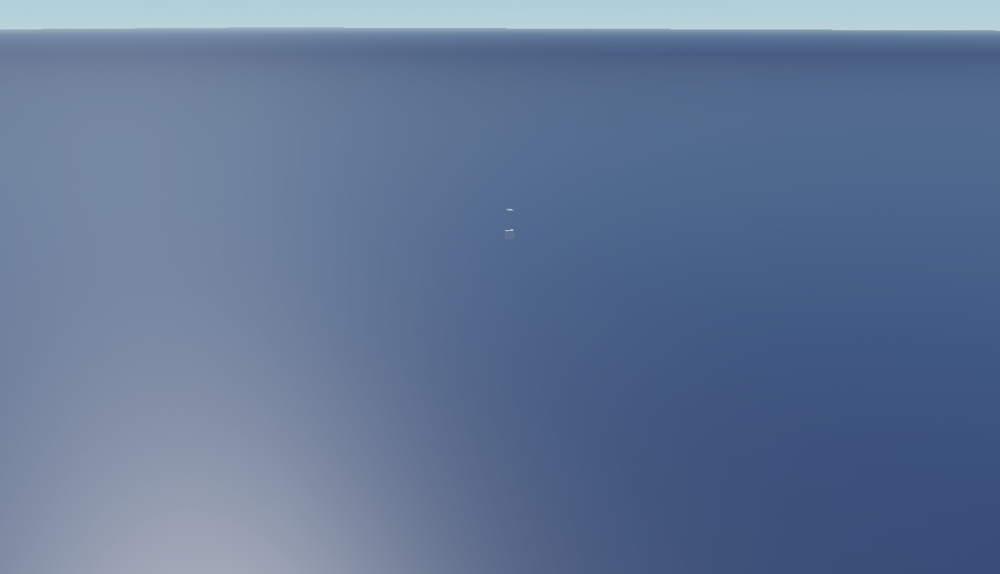

# Mythical Animals Collection

112 top-level entries in Models; duplicate names identify separate preserved entries. Includes dragons, phoenixes, unicorns and other fantasy creatures.

**Preview release 0.1.0.** Static geometry gallery, not motion or gameplay verification. Particles, beams and trails are hidden on preview clones so models remain readable. No supplied AI/combat scripts; rig behavior, collisions and external asset access remain unverified.

## Download

[Download Mythical Animals.rbxm](Mythical%20Animals.rbxm?raw=1) - native Roblox model, 16,062,412 bytes.

[Full gallery - 224 screenshots](GALLERY.md) | [Included entries](INVENTORY.md) | [Verification](VERIFICATION.md)

## Included assets

112 top-level entries in Models; duplicate names identify separate preserved entries. Includes dragons, phoenixes, unicorns and other fantasy creatures.

See the [native inventory](INVENTORY.md) for original entry names and instance counts. All supplied descendants and original source notices are retained. No LuaSourceContainer scripts were found in the supplied native model.

## Installation

Stop Play and import Mythical Animals into ServerStorage. Copy desired entries from Models into Workspace, retaining bones, Motor6Ds and appearance/effect descendants. Baseplate and Lighting are optional source presentation helpers; do not overwrite your game lighting unintentionally. Add your own Animator, AI, combat and networking as needed.

## Customization and dependencies

Duplicate a master before editing. Customize native instances in Roblox Studio rather than flattening them into an image. Preserve internal rig, constraint, mesh and appearance references. Linked Roblox-hosted content may need permission in your destination experience; the [asset reference inventory](ASSET-REFERENCES.json) is not an access guarantee. No external asset payloads are bundled beyond the original model.

## Verification and limitations

Static geometry gallery, not motion or gameplay verification. Particles, beams and trails are hidden on preview clones so models remain readable. No supplied AI/combat scripts; rig behavior, collisions and external asset access remain unverified.

[Read scoped verification](VERIFICATION.md). The original download is byte-for-byte preserved; preview-only normalization, anchoring and effect/label visibility changes do not alter the delivered asset.

SHA-256: `a41668f80628d89fe32571ce09a34ca7252620793f27c9f952cf7142d423c52c`

## Credits and license

[Credits and source provenance](CREDITS.md) | [MIT notice with limited project scope](LICENSE) | [Repository licensing](../../../docs/LICENSING.md). Existing third-party terms remain in effect; this listing does not establish original authorship.

[Changelog](CHANGELOG.md) | [Back to category](../README.md)
