# Review gallery — v2

Actual Roblox Studio MCP captures. Source geometry and effects are not interchangeable: geometry shots intentionally suppress particles/beams/trails; triggered-effect stills hide carriers. Preview scales/camera/visibility changes are confined to temporary clones. Runtime tests are labeled separately.

### i1

One native model per image, geometry-fitted camera, effects suppressed on preview clone for legibility; normalized scale. No animation/collision test.

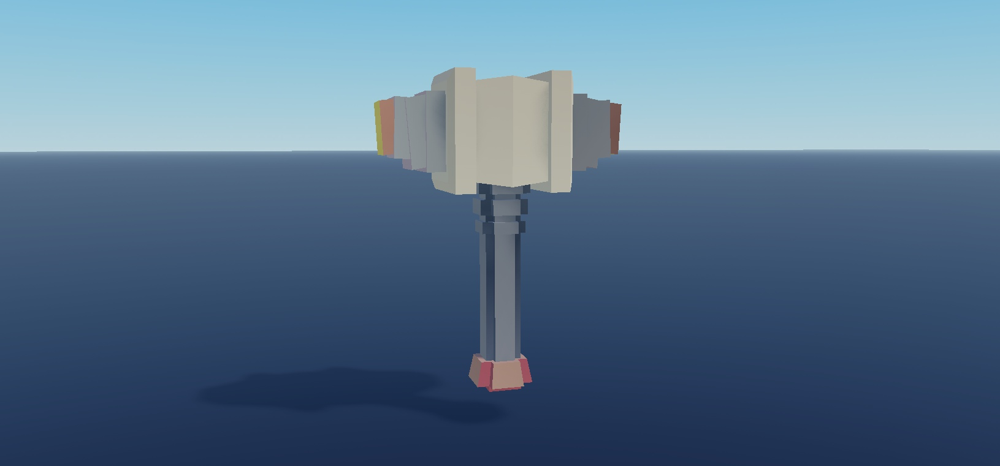

### i10

One native model per image, geometry-fitted camera, effects suppressed on preview clone for legibility; normalized scale. No animation/collision test.

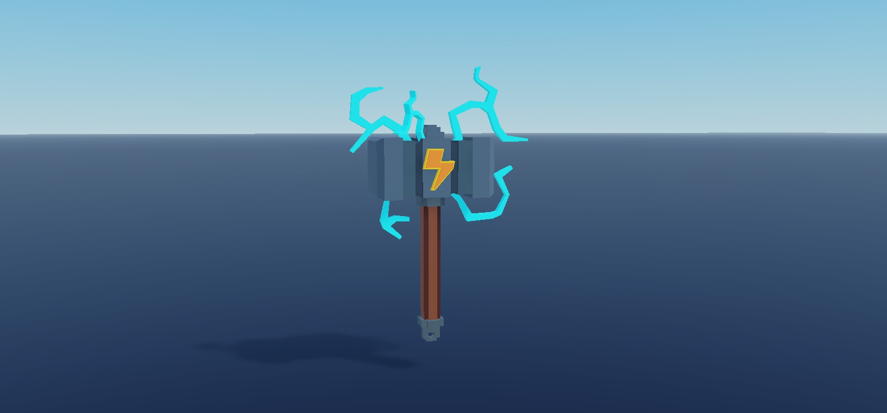

### i11

One native model per image, geometry-fitted camera, effects suppressed on preview clone for legibility; normalized scale. No animation/collision test.

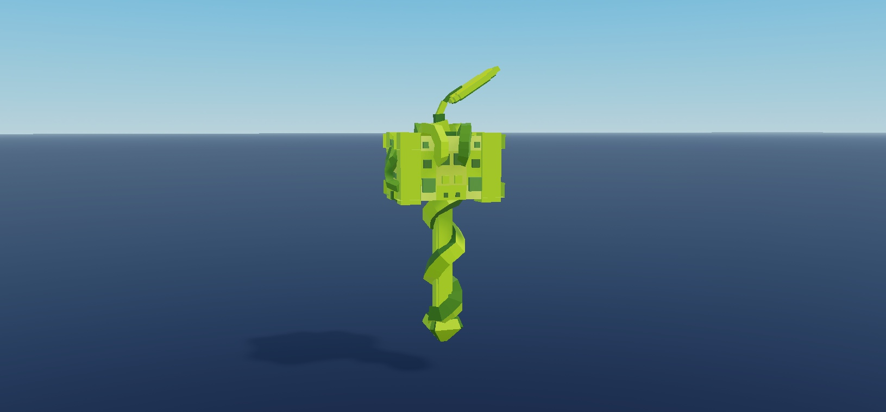

### i12

One native model per image, geometry-fitted camera, effects suppressed on preview clone for legibility; normalized scale. No animation/collision test.

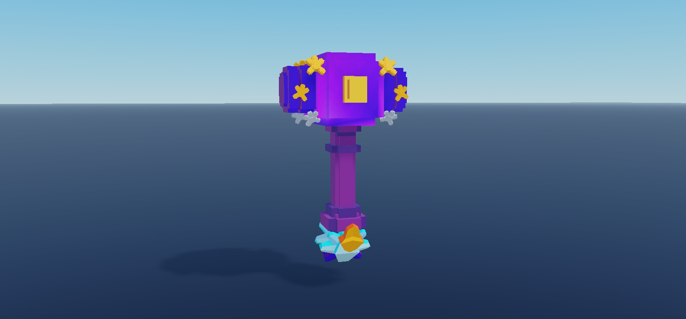

### i13

One native model per image, geometry-fitted camera, effects suppressed on preview clone for legibility; normalized scale. No animation/collision test.

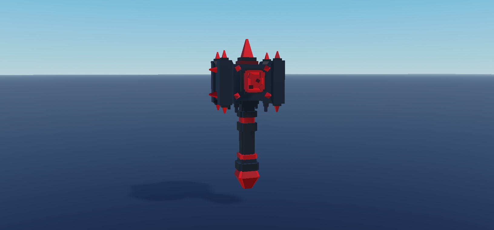

### i14

One native model per image, geometry-fitted camera, effects suppressed on preview clone for legibility; normalized scale. No animation/collision test.

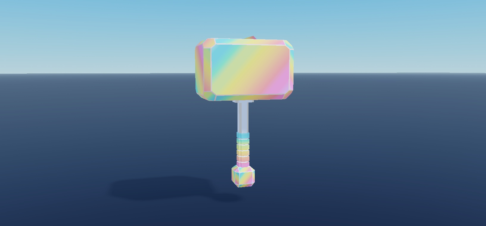

### i15

One native model per image, geometry-fitted camera, effects suppressed on preview clone for legibility; normalized scale. No animation/collision test.

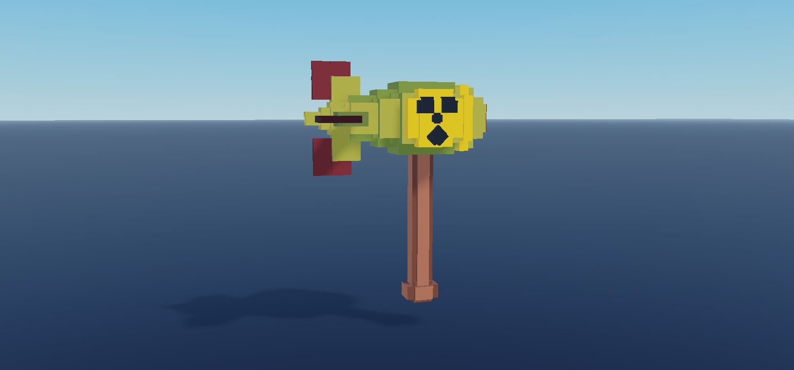

### i16

One native model per image, geometry-fitted camera, effects suppressed on preview clone for legibility; normalized scale. No animation/collision test.

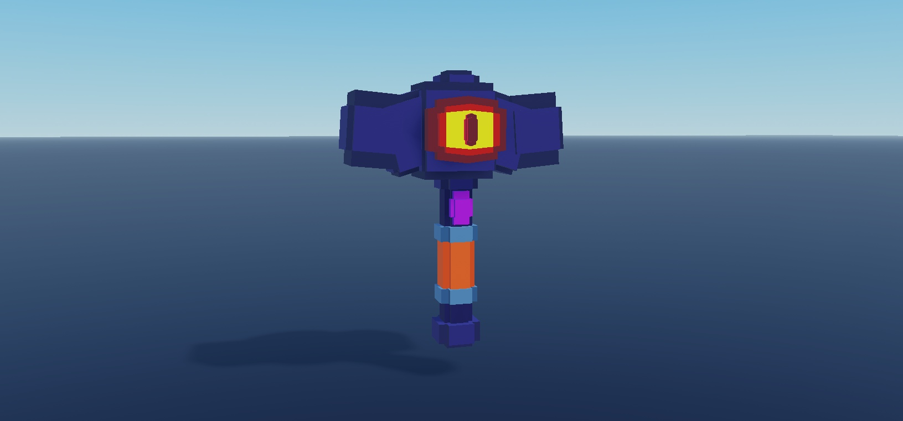

### i17

One native model per image, geometry-fitted camera, effects suppressed on preview clone for legibility; normalized scale. No animation/collision test.

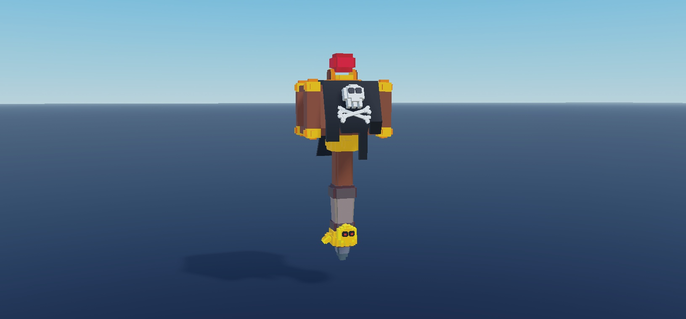

### i18

One native model per image, geometry-fitted camera, effects suppressed on preview clone for legibility; normalized scale. No animation/collision test.

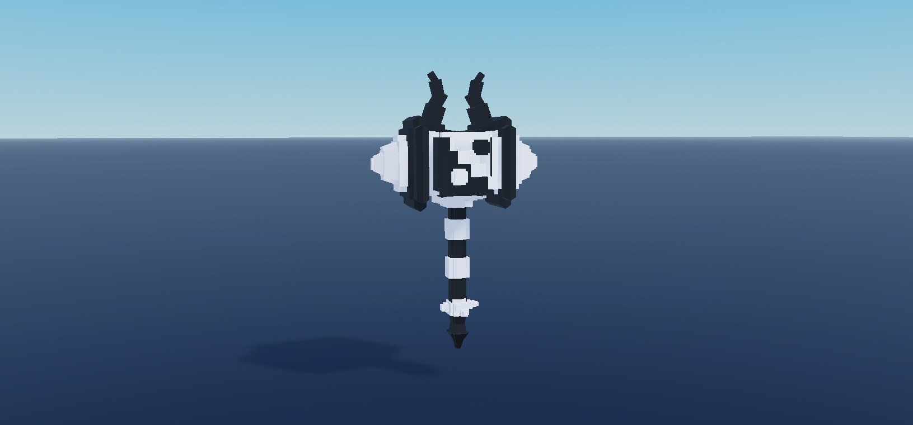

### i19

One native model per image, geometry-fitted camera, effects suppressed on preview clone for legibility; normalized scale. No animation/collision test.

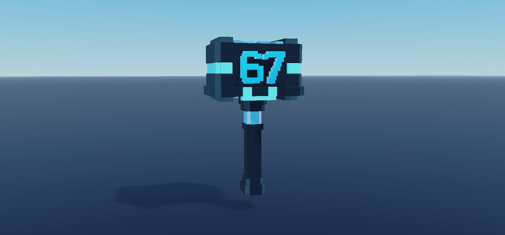

### i2

One native model per image, geometry-fitted camera, effects suppressed on preview clone for legibility; normalized scale. No animation/collision test.

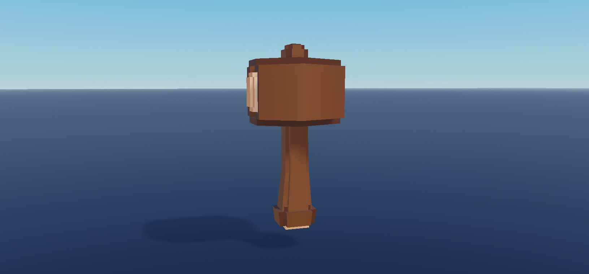

### i20

One native model per image, geometry-fitted camera, effects suppressed on preview clone for legibility; normalized scale. No animation/collision test.

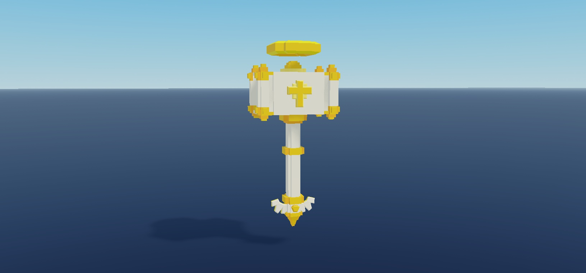

### i21

One native model per image, geometry-fitted camera, effects suppressed on preview clone for legibility; normalized scale. No animation/collision test.

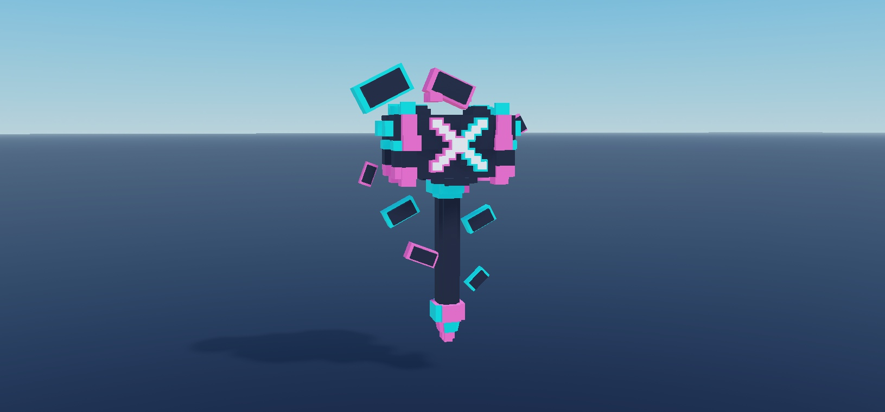

### i22

One native model per image, geometry-fitted camera, effects suppressed on preview clone for legibility; normalized scale. No animation/collision test.

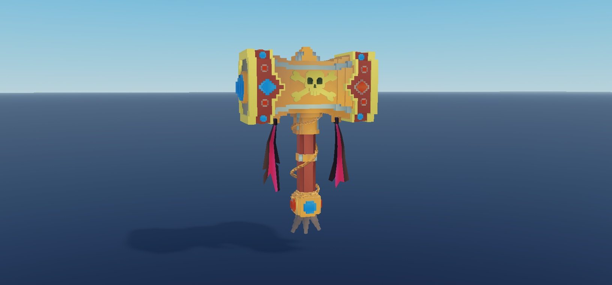

### i3

One native model per image, geometry-fitted camera, effects suppressed on preview clone for legibility; normalized scale. No animation/collision test.

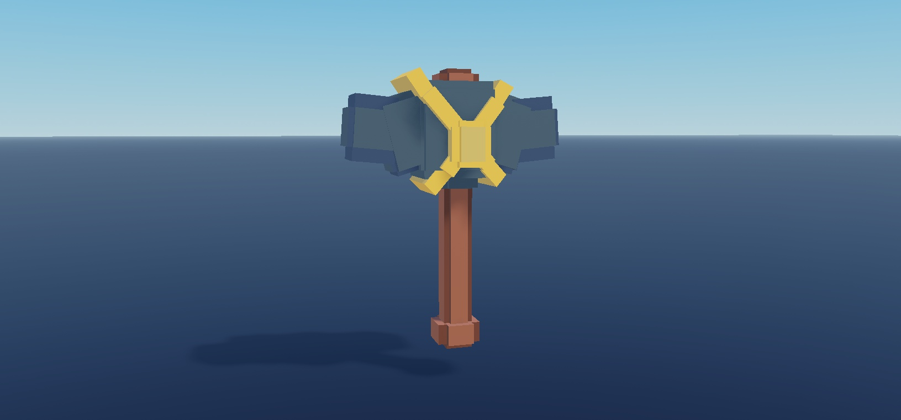

### i4

One native model per image, geometry-fitted camera, effects suppressed on preview clone for legibility; normalized scale. No animation/collision test.

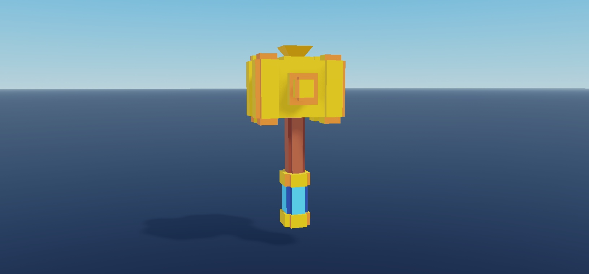

### i5

One native model per image, geometry-fitted camera, effects suppressed on preview clone for legibility; normalized scale. No animation/collision test.

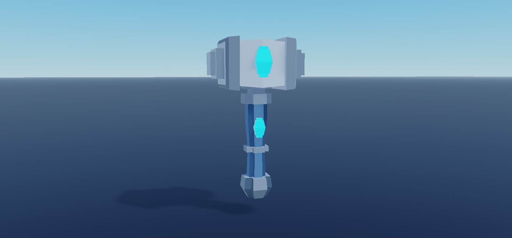

### i6

One native model per image, geometry-fitted camera, effects suppressed on preview clone for legibility; normalized scale. No animation/collision test.

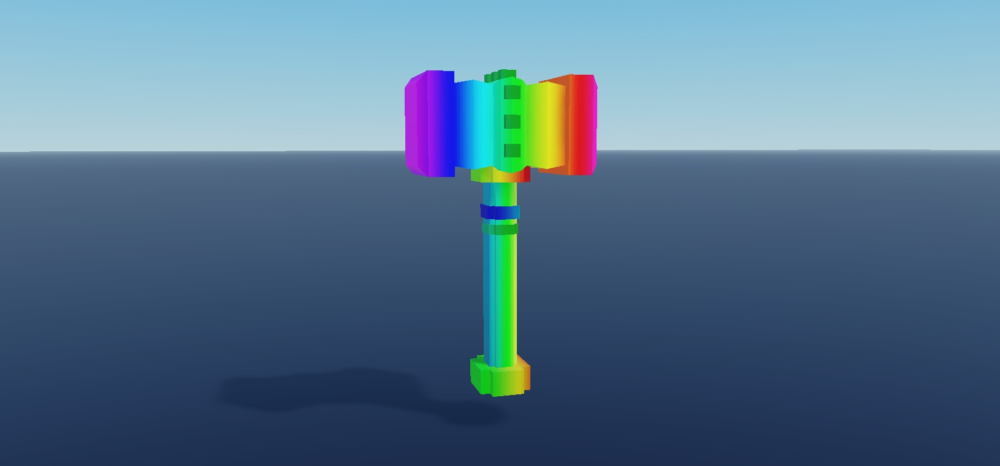

### i7

One native model per image, geometry-fitted camera, effects suppressed on preview clone for legibility; normalized scale. No animation/collision test.

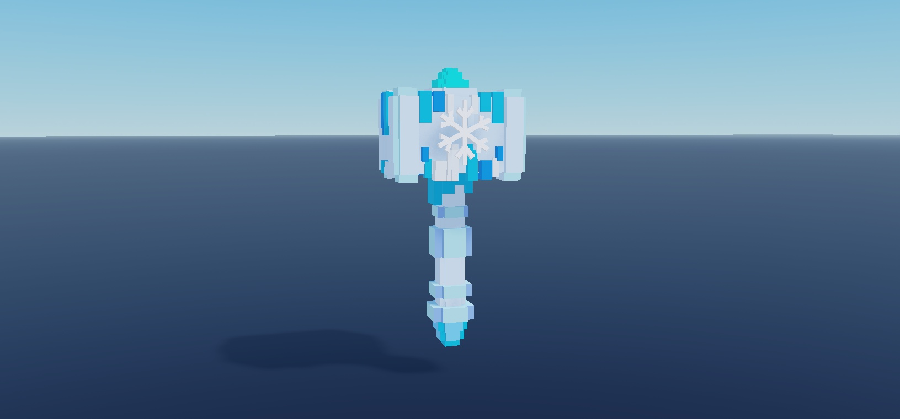

### i8

One native model per image, geometry-fitted camera, effects suppressed on preview clone for legibility; normalized scale. No animation/collision test.

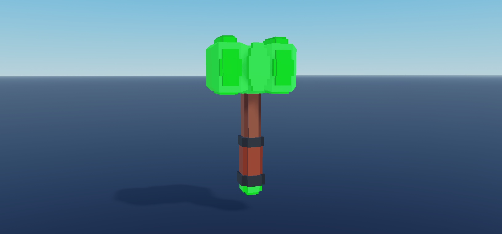

### i9

One native model per image, geometry-fitted camera, effects suppressed on preview clone for legibility; normalized scale. No animation/collision test.

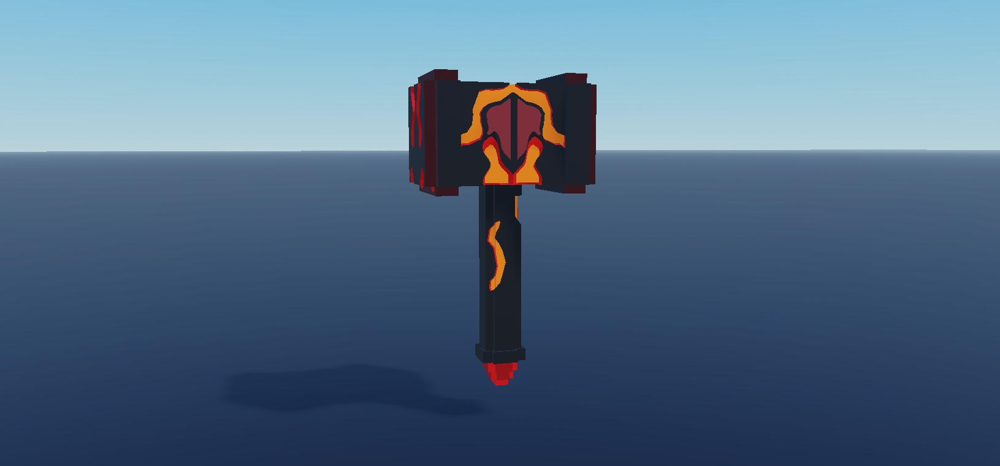
