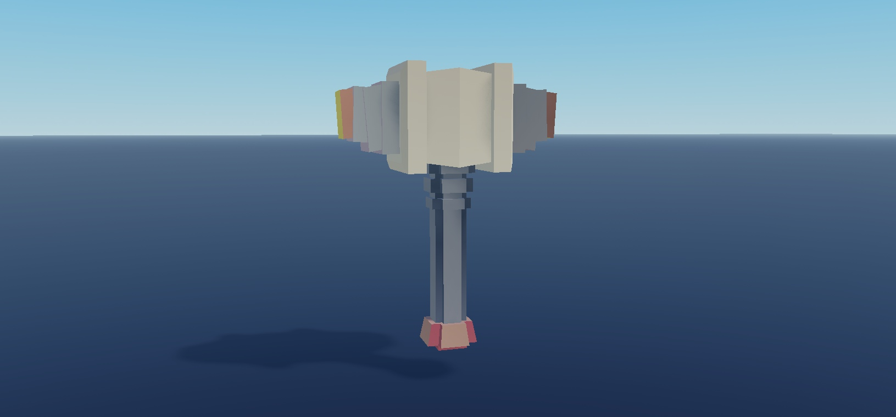

# Pickaxes

**Native Roblox asset collection · v0.1.0 · visual preview release**

[Download native model](Pickaxes.rbxm?raw=1) · [Full labeled gallery](GALLERY.md) · [Verification](VERIFICATION.md) · [Credits](CREDITS.md)

## Included and tested scope

22 Tool entries photographed individually with broadside mesh views. These are visual assets, not a complete mining system. Equipping, grip orientation, collision and server-authoritative mining behavior were not tested.

Browse **[every captured item and alternate angle](GALLERY.md)**. Captures are actual Studio MCP images, not generated mockups. Model previews use independent framing/normalization; they are not a common-scale comparison. Original native bytes are unchanged.

## Installation

1. In a disposable Roblox Studio place, import the native model into **Workspace** in Edit mode.
2. Inspect the named groups in Explorer and select the desired asset; do not flatten the original hierarchy.
3. Keep a reusable master under **ServerStorage** or **ReplicatedStorage** and clone the desired entries into Workspace for your game.
4. Test textures, scale, collisions and any effects in your own experience before integration.
5. For an equip test, copy ONE selected Tool into StarterPack, then test its Handle/grip in Play. Mining logic is not included.

## Customize

Edit the original instances in Explorer: names, transforms, mesh/appearance properties and effect settings as appropriate. Keep an untouched master. Preserve supplied asset IDs and creator notices; access to externally hosted assets may differ in your experience. No mobile, console, collision or production-readiness claim is made.

## Inventory and source

[inventory.json](inventory.json) summarizes the serialized classes/roots; [compressed full hierarchy](inventory-full.json.gz) preserves every parsed node. [dependencies.json](dependencies.json) lists deduplicated external references and occurrence counts. The native model is authoritative; src/ exists only where serialized script sources were present.

## License

[MIT](LICENSE), subject to [credits and preserved third-party terms](CREDITS.md).
