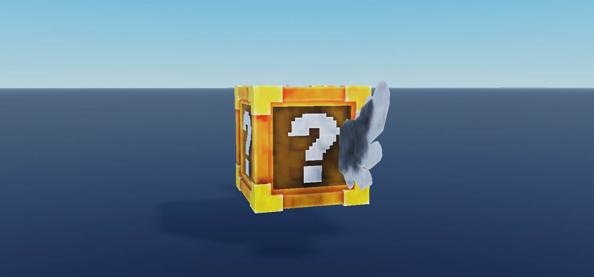
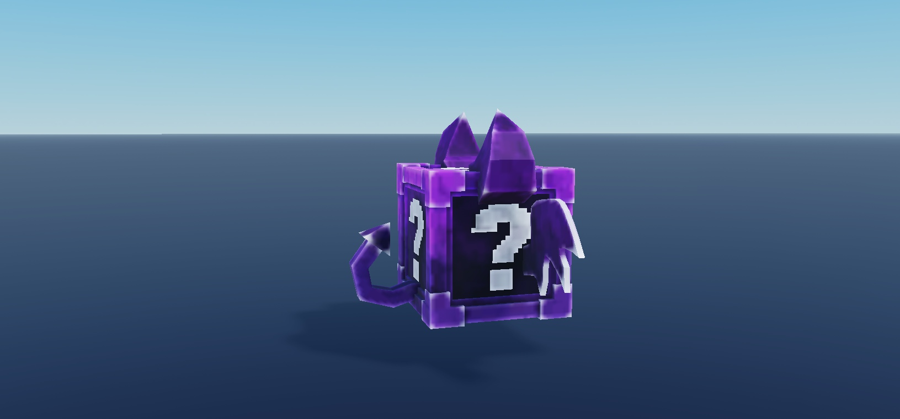
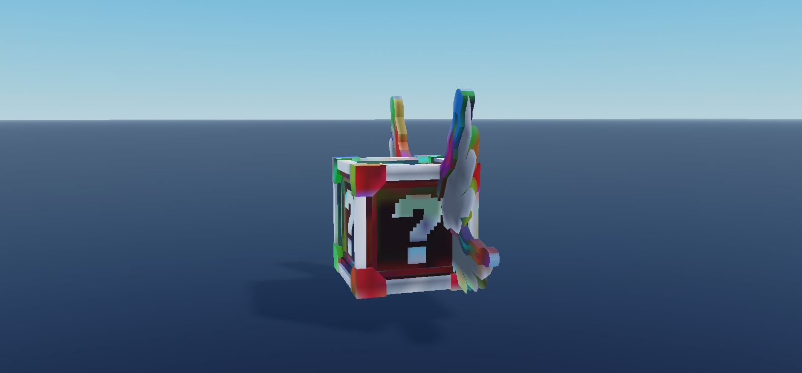

# Review gallery — v2

Actual Roblox Studio MCP captures. Source geometry and effects are not interchangeable: geometry shots intentionally suppress particles/beams/trails; triggered-effect stills hide carriers. Preview scales/camera/visibility changes are confined to temporary clones. Runtime tests are labeled separately.

### Basic Block

One native model per image, geometry-fitted camera, effects suppressed on preview clone for legibility; normalized scale. No animation/collision test.

### Epic Block

One native model per image, geometry-fitted camera, effects suppressed on preview clone for legibility; normalized scale. No animation/collision test.

### Mythic Block

One native model per image, geometry-fitted camera, effects suppressed on preview clone for legibility; normalized scale. No animation/collision test.

