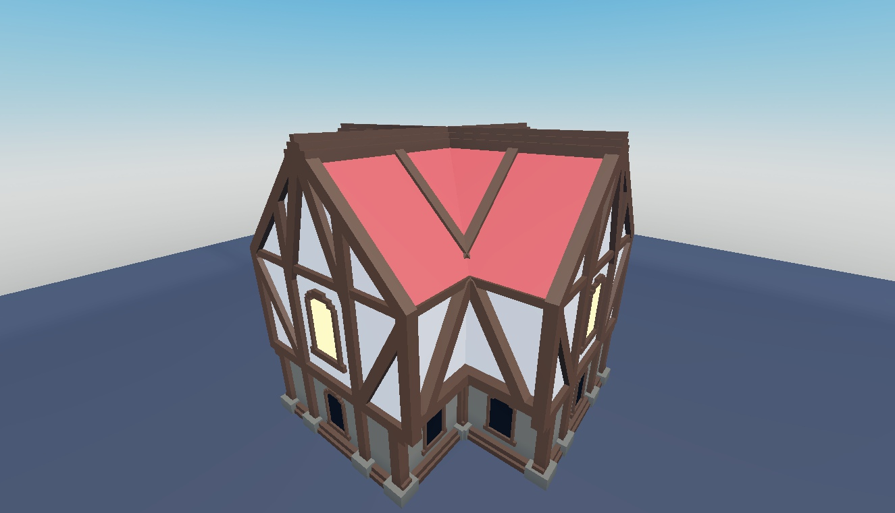

# Small Stud Asset Pack

20 scenery entries: houses, trees, shrubs, tent, flowers, mushrooms, water, lights, crate and hollow trunk.

**Preview release 0.1.0.** All 20 entries have front/back static Studio captures. Collision, performance, smoke/water motion and gameplay are unverified.

## Download

[Download Small Stud Asset Pack.rbxm](Small%20Stud%20Asset%20Pack.rbxm?raw=1) — 156,764 bytes.

[Full gallery — 40 screenshots](GALLERY.md) | [Native inventory](INVENTORY.md) | [Verification](VERIFICATION.md)

## Included assets

20 scenery entries: houses, trees, shrubs, tent, flowers, mushrooms, water, lights, crate and hollow trunk.

No embedded scripts were found.

## Installation

Import the folder into ServerStorage, then copy selected scenery into Workspace. Preserve welds, textures, lights and nested model parts. Review Anchored and collision properties for your own map rather than assuming every asset is ready for physics.

## Customization and dependencies

Work on a copy in Studio. Preserve required internal hierarchy, attachments, bones and relative transforms. Inspect [asset references](ASSET-REFERENCES.json); their availability in this Studio session does not guarantee permission in your destination experience. Keep original creator notices.

## Verification and limitations

Static Studio Edit inspection on isolated clones; no runtime behavior certification. Native instance counts/root names matched the supplied imports. Original scripts were disabled on static preview clones.

All 20 entries have front/back static Studio captures. Collision, performance, smoke/water motion and gameplay are unverified.

SHA-256: `edfc10b6d4cab796796ad4b0ecaeef16d1748524f3e86c0db77521b45756fa29`

## Credits and license

[Credits](CREDITS.md) | [Scoped project MIT notice](LICENSE) | [Repository scope](../../../docs/LICENSING.md) | [Changelog](CHANGELOG.md)

[Back to category](../README.md)
