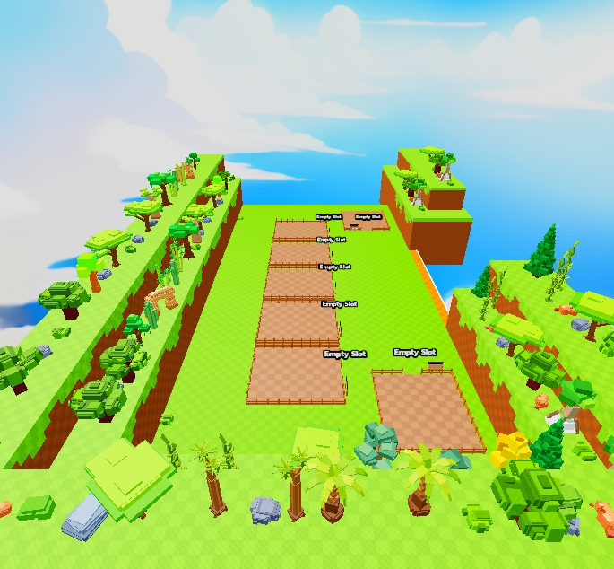
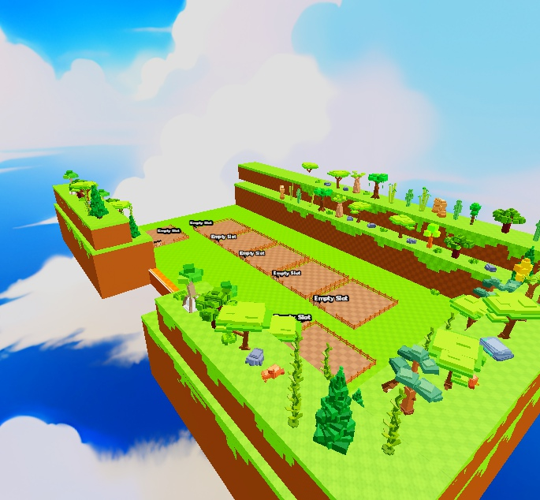
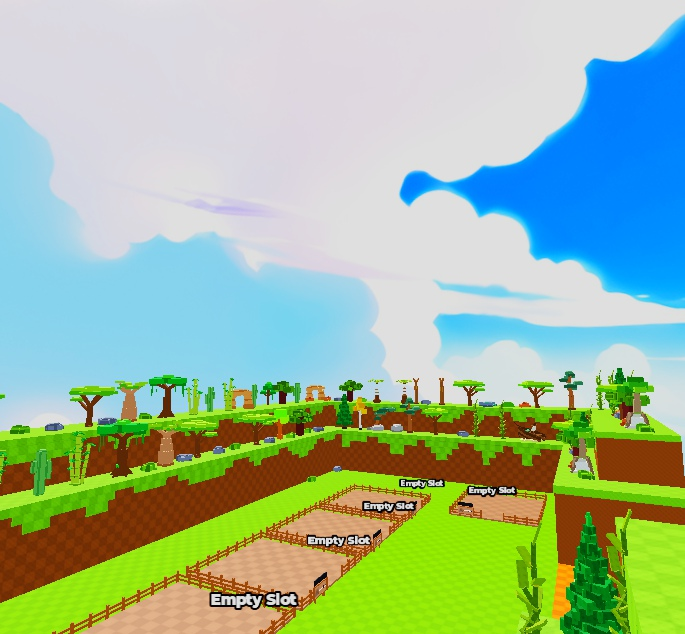
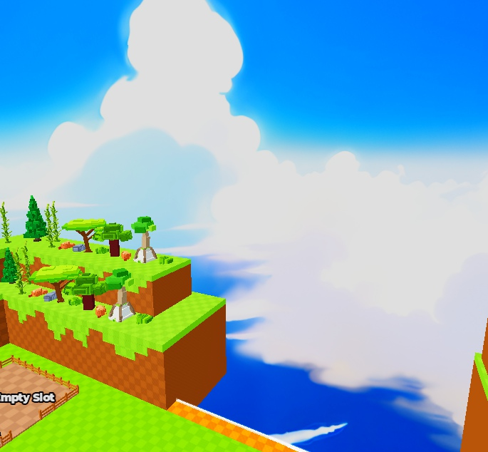
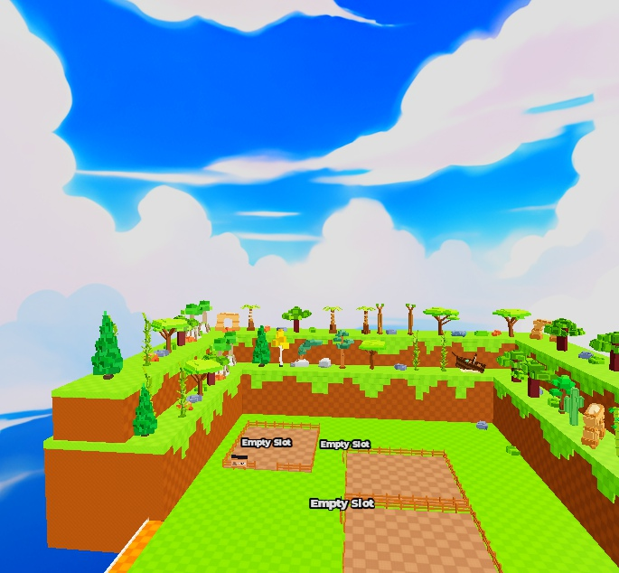
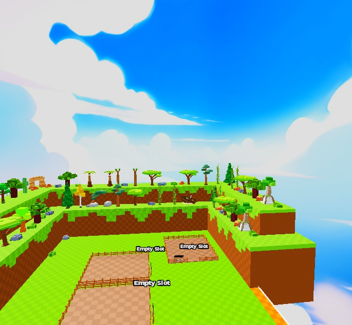
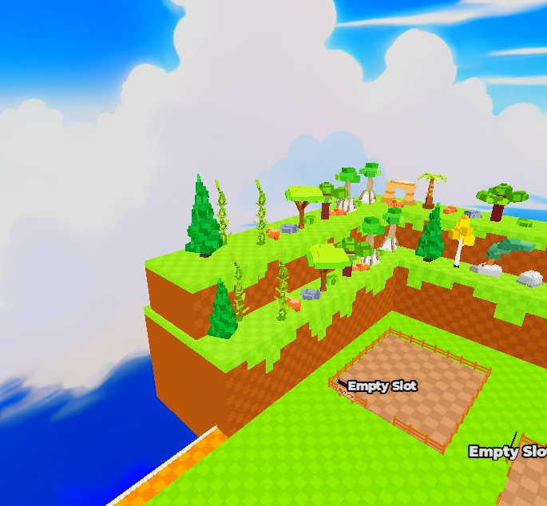

# Spawn Map by N2ls — gallery

Actual Studio MCP captures of the source implementation. Conversion retains the pictured UI/geometry/lighting; service wrappers and LightingSettings are packaging, not visual additions. Model-specific complete runtime behavior has not been certified.

### Spawn Courtyard — actual supplied place

### Spawn Reverse — actual supplied place

### Spawn Plots — actual supplied place

### Spawn West Props — actual supplied place

### Spawn North Props — actual supplied place

### Spawn South Props — actual supplied place

### Spawn East Props — actual supplied place

