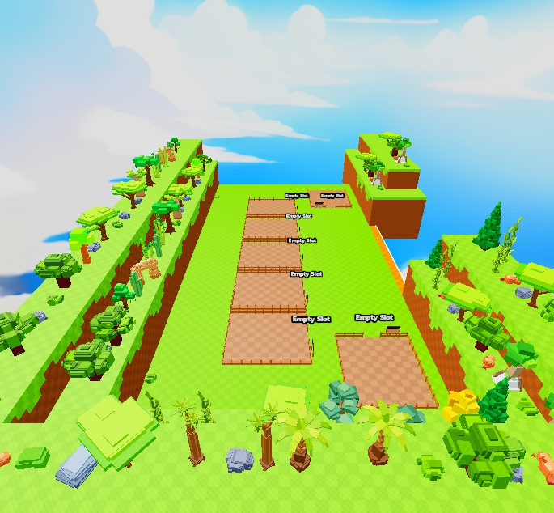

# Spawn Map by N2ls

Editable native scene/place with seven fenced Plot5 areas, Empty Slot labels, checker/stud ground, layered perimeter walls and varied forest, savanna, jungle, desert, mountain, taiga, ocean, ruins and prehistoric vegetation/rock props. The supplied file contains 6,363 instances and no embedded scripts. This is map geometry, not a functioning tycoon or complete game.

**Preview release 0.1.0.** Static scene preview and limited local spawn check only. No plot ownership, collecting, saving, economy or gameplay scripts are supplied. No authored SpawnLocation was found in the file. Local Play spawned at approximately (0, 5, 0); this is not proof of complete traversal or collision correctness. Galleries show grouped scene regions, not exhaustive isolated inspection of every prop copy. No mobile/gamepad or performance testing.

## Download

[Download SpawnMapByN2ls.rbxl](SpawnMapByN2ls.rbxl?raw=1) — 234,673 bytes.

[Full gallery — 7 screenshots](GALLERY.md) | [Native inventory](INVENTORY.md) | [Compressed full hierarchy](HIERARCHY.json.gz) | [Verification](VERIFICATION.md)

**Native format: `.rbxl` place. Open it separately in Studio; this is not an `.rbxm` model.**

## Included assets

Editable native scene/place with seven fenced Plot5 areas, Empty Slot labels, checker/stud ground, layered perimeter walls and varied forest, savanna, jungle, desert, mountain, taiga, ocean, ruins and prehistoric vegetation/rock props. The supplied file contains 6,363 instances and no embedded scripts. This is map geometry, not a functioning tycoon or complete game.

No embedded scripts were found.

## Installation

Open the .rbxl with File > Open from File in Studio. Use Save As to make a working copy. To merge geometry into another place, select intended Workspace objects in Studio and copy them into Workspace; merge Lighting separately if desired. Keep internal models and transforms intact. Add your own SpawnLocation, plot ownership, collection/economy and gameplay scripts. Do not overwrite an existing game with this scene unintentionally.

## Customization and dependencies

Work on a copy in Studio. Preserve required internal hierarchy, attachments, bones and relative transforms. Inspect [asset references](ASSET-REFERENCES.json); their availability in this Studio session does not guarantee permission in your destination experience. Keep original creator notices.

## Verification and limitations

Opened the actual supplied place and reviewed its Workspace hierarchy through Studio MCP. Local binary inspection found 6,363 instances and zero embedded LuaSourceContainer scripts. Captured courtyard, reverse and four perimeter detail regions at 685 x 634. Brief Play check spawned the local character near (0, 5, 0); no gameplay actions or full collision/traversal checks. Runtime engine character scripts are not scripts embedded in the file. Returned to Edit afterward.

Static scene preview and limited local spawn check only. No plot ownership, collecting, saving, economy or gameplay scripts are supplied. No authored SpawnLocation was found in the file. Local Play spawned at approximately (0, 5, 0); this is not proof of complete traversal or collision correctness. Galleries show grouped scene regions, not exhaustive isolated inspection of every prop copy. No mobile/gamepad or performance testing.

SHA-256: `54384fe598370016fe7dd7ccfd875f7a0899f50e286d773c3c6eb521c33c68dc`

## Credits and license

[Credits](CREDITS.md) | [Scoped project MIT notice](LICENSE) | [Repository scope](../../../docs/LICENSING.md) | [Changelog](CHANGELOG.md)

[Back to category](../README.md)
