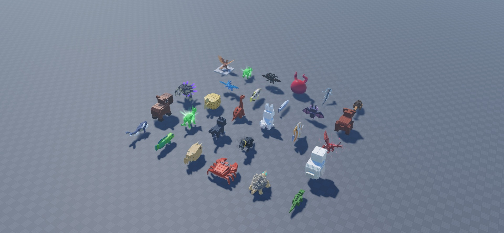
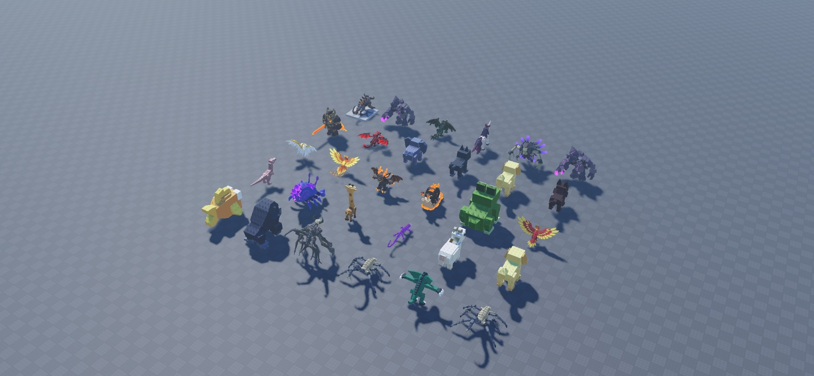
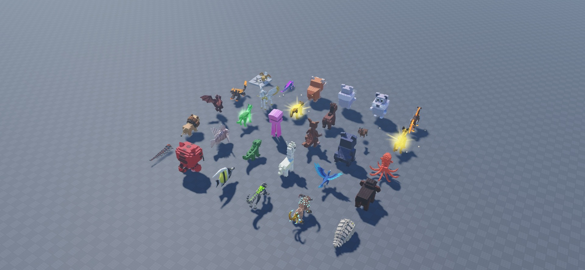
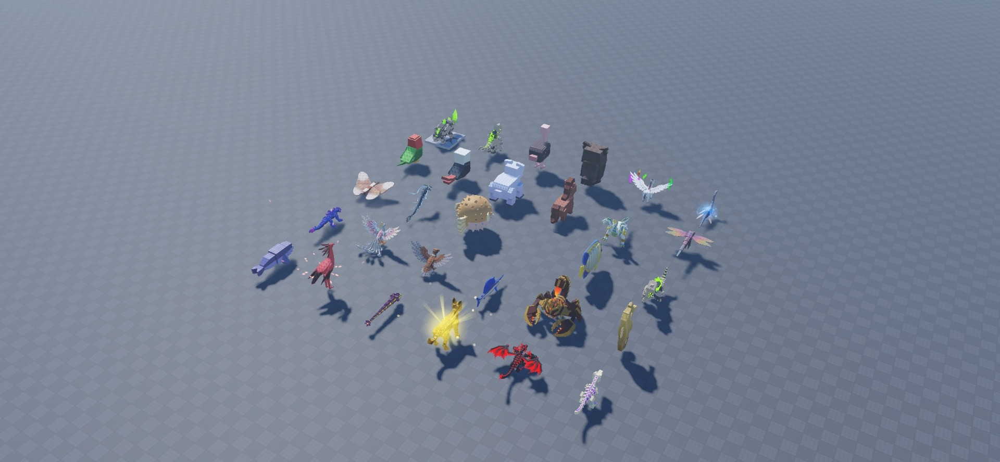
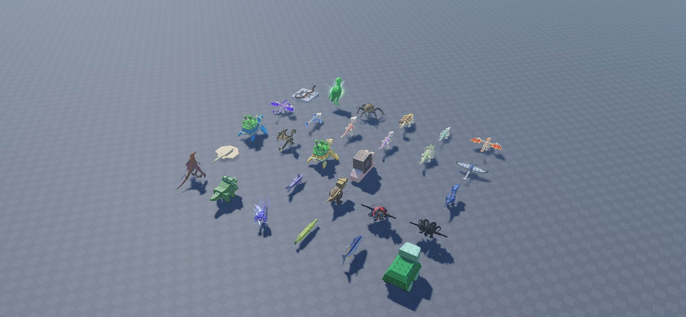
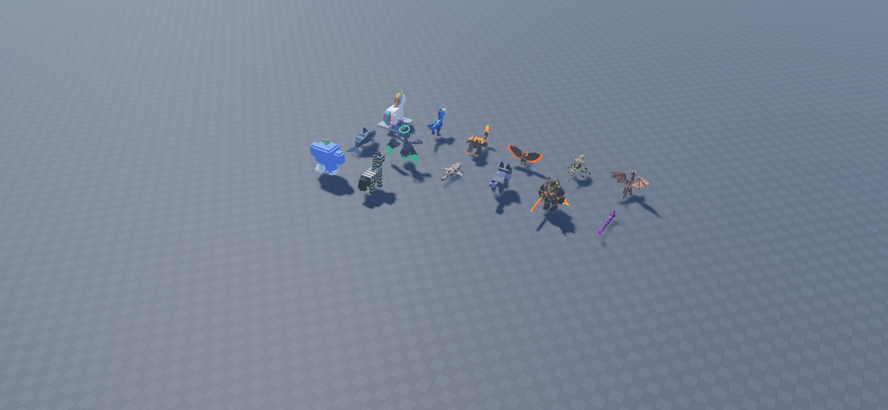

# Stud Animals

165 editable animal and fantasy models: pets, wildlife, birds, aquatic creatures, dinosaurs, dragons, skeleton creatures, dungeon monsters, and mythological characters. Two entries retain the name Hamster. These are visual assets; this pack supplies no AI, combat, pet-following, or animation controller.

[Download StudAnimals.rbxm](StudAnimals.rbxm) · [Item inventory](inventory.json) · [Script review](SECURITY.md) · [Credits](CREDITS.md) · [License](LICENSE)

## Installation

1. Download the native model and insert it into Workspace in Roblox Studio.
2. Expand the imported root and copy the models you want into your map. Keep assemblies grouped.
3. Set anchoring, collision groups, and CanCollide for your game; this pack does not supply runtime placement or collision logic.

## Included content

| # | Item | Category |
| --- | --- | --- |
| 1 | ARCHAEOPTERYX | Models |
| 2 | Aardvark | Models |
| 3 | Abyss Wyrm | Models |
| 4 | Admin Brainrot | Models |
| 5 | Aether Serpent | Models |
| 6 | Ankylosaurus | Models |
| 7 | Anubis | Models |
| 8 | Aqua Dragon | Models |
| 9 | Archerfish | Models |
| 10 | Barracuda | Models |
| 11 | Bat | Models |
| 12 | Bear | Models |
| 13 | Bone Basilisk | Models |
| 14 | Boxfish | Models |
| 15 | Brachiosaurus | Models |
| 16 | Bunny | Models |
| 17 | Butterflyfish | Models |
| 18 | CLASSIC DRAGON | Models |
| 19 | Capybara | Models |
| 20 | Caracal | Models |
| 21 | Cat | Models |
| 22 | Cerbero | Models |
| 23 | Cerberus | Models |
| 24 | Chicken | Models |
| 25 | Cloud Leviathan | Models |
| 26 | Coral Goby | Models |
| 27 | Cowfish | Models |
| 28 | Crab | Models |
| 29 | Cragjaw | Models |
| 30 | Crocodile | Models |
| 31 | Crowdyn | Models |
| 32 | Crypt Stalker | Models |
| 33 | Dark Dragon | Models |
| 34 | Dark Unicorn | Models |
| 35 | Deathbringer | Models |
| 36 | Demon Troll | Models |
| 37 | Dungeon Hound | Models |
| 38 | Dungeon Overlord | Models |
| 39 | Elephant | Models |
| 40 | Evil Cat | Models |
| 41 | Evil Dog | Models |
| 42 | Evil Wolf | Models |
| 43 | Eye of the Angel | Models |
| 44 | FIRE PHOENIX | Models |
| 45 | Fire Imp | Models |
| 46 | Fire Snail | Models |
| 47 | Frog | Models |
| 48 | GARUDA | Models |
| 49 | Gallimimus | Models |
| 50 | Gemtrail | Models |
| 51 | Giraffe | Models |
| 52 | Gloomfang | Models |
| 53 | Goat | Models |
| 54 | Golden Retriver | Models |
| 55 | Goldfish | Models |
| 56 | Gorilla | Models |
| 57 | Grabber | Models |
| 58 | Grave Colossus | Models |
| 59 | Gremlin | Models |
| 60 | Griever | Models |
| 61 | Griffin | Models |
| 62 | Gritmaw | Models |
| 63 | Guienna Pig | Models |
| 64 | Hamster | Models |
| 65 | Hamster | Models |
| 66 | Harbringer | Models |
| 67 | Hellhound | Models |
| 68 | Hermes | Models |
| 69 | HoneyBadger | Models |
| 70 | Horse | Models |
| 71 | Hydra | Models |
| 72 | Hyena | Models |
| 73 | Imp | Models |
| 74 | Jackal | Models |
| 75 | Jellyfish | Models |
| 76 | Kangaroo | Models |
| 77 | Koala | Models |
| 78 | Kraken | Models |
| 79 | Lion | Models |
| 80 | Lionfish | Models |
| 81 | Lizard | Models |
| 82 | Llama | Models |
| 83 | MICRORAPTOR | Models |
| 84 | Mammoth | Models |
| 85 | Millipede | Models |
| 86 | Mischief | Models |
| 87 | Moorish Idol | Models |
| 88 | Morphling | Models |
| 89 | Nightmare Bison | Models |
| 90 | Ossimite | Models |
| 91 | Ossirhino | Models |
| 92 | Ossuary | Models |
| 93 | Ostrich | Models |
| 94 | Owl | Models |
| 95 | PEGASUS | Models |
| 96 | PLESIOSAUR | Models |
| 97 | Parrot | Models |
| 98 | Pigeon | Models |
| 99 | Polar Bear | Models |
| 100 | Pony | Models |
| 101 | Poseidon | Models |
| 102 | Prehistoric Dragonfly | Models |
| 103 | Prehistoric Moth | Models |
| 104 | Prismora | Models |
| 105 | Pufferfish | Models |
| 106 | Ra | Models |
| 107 | Regal Angelfish | Models |
| 108 | Rex | Models |
| 109 | Rumblepaw | Models |
| 110 | SIMURGH | Models |
| 111 | STYMPHALIANBIRD | Models |
| 112 | Sailfish | Models |
| 113 | Scorpion King | Models |
| 114 | Seahorse | Models |
| 115 | Seal | Models |
| 116 | SecretaryBird | Models |
| 117 | Serpent-X | Models |
| 118 | Serval | Models |
| 119 | Shadow Skeleton Hydra | Models |
| 120 | Shadow Skeleton T-Rex | Models |
| 121 | Shardpod | Models |
| 122 | Shoebill | Models |
| 123 | Siege Crawler | Models |
| 124 | Skeleton Ankylosaurus | Models |
| 125 | Skeleton Crocodile | Models |
| 126 | Skeleton Dragon | Models |
| 127 | Skeleton Hydra | Models |
| 128 | Skeleton Megalodon | Models |
| 129 | Skeleton Mini Raptor | Models |
| 130 | Skeleton T-Rex | Models |
| 131 | Skeleton Triceratops | Models |
| 132 | Sky Ray | Models |
| 133 | Sky Turtle | Models |
| 134 | Sky Wyvern | Models |
| 135 | Skylands Turtle | Models |
| 136 | Snail | Models |
| 137 | Sphinx | Models |
| 138 | Spinosaurus | Models |
| 139 | Stingray | Models |
| 140 | Sunscarab | Models |
| 141 | Swordfish | Models |
| 142 | T-Rex | Models |
| 143 | Three Headed Cerbero | Models |
| 144 | Three Headed Skull Dragon | Models |
| 145 | Titan | Models |
| 146 | Triceratops | Models |
| 147 | Triple Cobra | Models |
| 148 | Trumpetfish | Models |
| 149 | Tuna | Models |
| 150 | Turtle | Models |
| 151 | Unicorn | Models |
| 152 | Velociraptor | Models |
| 153 | Volcanic Cerebus | Models |
| 154 | Volcanic Phoenix | Models |
| 155 | Vomoir | Models |
| 156 | WYVERN | Models |
| 157 | Whale | Models |
| 158 | Withered Angel | Models |
| 159 | Wobbegong | Models |
| 160 | Wolf | Models |
| 161 | Wraith Knight | Models |
| 162 | Wriggler | Models |
| 163 | Wumpy | Models |
| 164 | Zebra | Models |
| 165 | Zeus | Models |

## Customization and compatibility

Edit the native model’s parts, meshes, textures, colors, scale and grouping in Roblox Studio. External dependencies are listed in `dependencies.json`; successful loading in one session does not establish access for every experience. No mobile, gamepad, rigging, animation, or gameplay support is claimed. Original download scale and placement are preserved. Gallery copies were rearranged for visibility; animals and asset props were scaled for comparable preview size.

## Gallery

Actual Studio captures at 1920 × 888.

### Items 1–30, alphabetically, six columns

### Items 31–60, alphabetically, six columns

### Items 61–90, alphabetically, six columns

### Items 91–120, alphabetically, six columns

### Items 121–150, alphabetically, six columns

### Items 151–165, alphabetically, six columns

## Verification

See [VERIFICATION.md](VERIFICATION.md) for the tested import and preview scope, and [SECURITY.md](SECURITY.md) for the script review.

## Asset access observed in Studio

ContentProvider reported failures for linked IDs 133684342154416, 91962959432260, 90342441586472, 123257405590557, and 84808696497022; Studio logged that the account was not authorized to access them. Some linked details may therefore be missing. The gallery shows the actual loaded result; obtain access or substitute permitted assets for those references.
