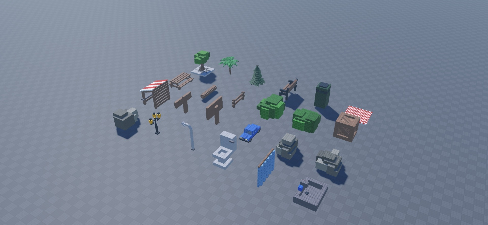
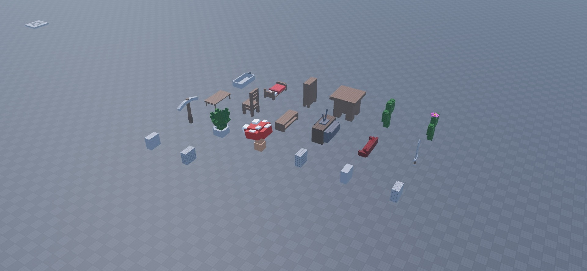

# Stud Asset Pack

44 editable items in 14 folders, covering trees, park furniture, bushes, signs, rocks, street lights, bathrooms, bedrooms, cacti, dining furniture, living-room furniture, tools, plants, and five classic surface samples. Sword, Pickaxe, and Car are decorative models without gameplay scripts.

[Download StudAssets.rbxm](StudAssets.rbxm) · [Item inventory](inventory.json) · [Script review](SECURITY.md) · [Credits](CREDITS.md) · [License](LICENSE)

## Installation

1. Download the native model and insert it into Workspace in Roblox Studio.
2. Expand the imported root and copy the models you want into your map. Keep assemblies grouped.
3. Set anchoring, collision groups, and CanCollide for your game; this pack does not supply runtime placement or collision logic.
4. The export contains only `Stud Asset pack`; it excludes the source place’s baseplate, spawn, lighting, services, and comment-only helper.

## Included content

| # | Item | Category |
| --- | --- | --- |
| 1 | Tree | Trees |
| 2 | Palm Tree | Trees |
| 3 | Pine Tree | Trees |
| 4 | Bench | Picnic - Park |
| 5 | Trash Bin | Picnic - Park |
| 6 | Picnic Carpet | Picnic - Park |
| 7 | Park Bench | Picnic - Park |
| 8 | Log | Picnic - Park |
| 9 | Fence | Picnic - Park |
| 10 | Large bush | Bushes |
| 11 | Medium Bush | Bushes |
| 12 | Box | Other |
| 13 | Shop | Other |
| 14 | Small Sign | Other |
| 15 | Big Sign | Other |
| 16 | Car | Other |
| 17 | Large Rock | Rocks |
| 18 | Medium Rock | Rocks |
| 19 | Small Rock | Rocks |
| 20 | Street Light 1 | Street Lights |
| 21 | Street Light 2 | Street Lights |
| 22 | Toilet | Bathroom |
| 23 | Curtain | Bathroom |
| 24 | Sink | Bathroom |
| 25 | Bath | Bathroom |
| 26 | Bed | Bedroom |
| 27 | Wardrobe | Bedroom |
| 28 | Small Wardrobe | Bedroom |
| 29 | Cactus | Cactus |
| 30 | Cactus Flower | Cactus |
| 31 | Table | Dinning Room |
| 32 | Chair | Dinning Room |
| 33 | Tv Stand | Living Room |
| 34 | Old TV | Living Room |
| 35 | Sofa | Living Room |
| 36 | Sword | Tools |
| 37 | Pickaxe | Tools |
| 38 | Plant | Plants |
| 39 | Mushromm | Plants |
| 40 | Inlet | Classic Material  |
| 41 | Smooth | Classic Material  |
| 42 | Universal | Classic Material  |
| 43 | Stud | Classic Material  |
| 44 | Weld | Classic Material  |

## Customization and compatibility

Edit the native model’s parts, meshes, textures, colors, scale and grouping in Roblox Studio. External dependencies are listed in `dependencies.json`; successful loading in one session does not establish access for every experience. No mobile, gamepad, rigging, animation, or gameplay support is claimed. Original download scale and placement are preserved. Gallery copies were rearranged for visibility; animals and asset props were scaled for comparable preview size.

## Gallery

Actual Studio captures at 1920 × 888.

### Items 1–24, six columns

### Items 25–44, six columns

## Verification

See [VERIFICATION.md](VERIFICATION.md) for the tested import and preview scope, and [SECURITY.md](SECURITY.md) for the script review.
