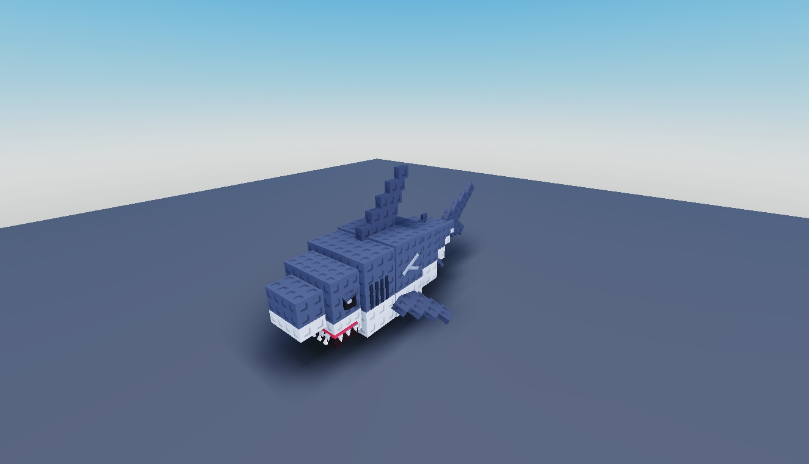

# Stud Fish Models

20 stud-style aquatic creatures, including sharks, whale shark, blue tang, seahorse, koi, octopus, manta ray and axolotl.

**Preview release 0.1.0.** Every model has front/back static Studio previews. No AI, swimming, rig animation, collision or gameplay certification.

## Download

[Download roblox fish models.rbxm](roblox%20fish%20models.rbxm?raw=1) — 154,497 bytes.

[Full gallery — 40 screenshots](GALLERY.md) | [Native inventory](INVENTORY.md) | [Verification](VERIFICATION.md)

## Included assets

20 stud-style aquatic creatures, including sharks, whale shark, blue tang, seahorse, koi, octopus, manta ray and axolotl.

No embedded scripts were found.

## Installation

Import fish into ServerStorage, then copy individual models into Workspace. These are decorative MeshPart assemblies; add your own movement, animation and game logic. Preserve colors, meshes and relative part transforms.

## Customization and dependencies

Work on a copy in Studio. Preserve required internal hierarchy, attachments, bones and relative transforms. Inspect [asset references](ASSET-REFERENCES.json); their availability in this Studio session does not guarantee permission in your destination experience. Keep original creator notices.

## Verification and limitations

Static Studio Edit inspection on isolated clones; no runtime behavior certification. Native instance counts/root names matched the supplied imports. Original scripts were disabled on static preview clones.

Every model has front/back static Studio previews. No AI, swimming, rig animation, collision or gameplay certification.

SHA-256: `54c524b68841a72b62b3c2a5f010d54488df44f9dd7679eeccf0ba2486fa8e1b`

## Credits and license

[Credits](CREDITS.md) | [Scoped project MIT notice](LICENSE) | [Repository scope](../../../docs/LICENSING.md) | [Changelog](CHANGELOG.md)

[Back to category](../README.md)
