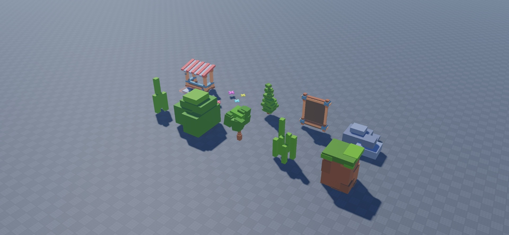

# Stud Pack V1

10 environment models: Shop, Flowers, Tree1, Leaderboard, two Rock models, Grass1, Tree2, Grass2, and Wall. The original model also includes EXTRA Lighting, Texture PLS Use, ThumbnailCamera, and an instruction part named DELETE. Leaderboard and Shop are decorative shells without gameplay logic.

[Download StudPackV1.rbxm](StudPackV1.rbxm) · [Item inventory](inventory.json) · [Script review](SECURITY.md) · [Credits](CREDITS.md) · [License](LICENSE)

## Installation

1. Download the native model and insert it into Workspace in Roblox Studio.
2. Expand the imported root and copy the models you want into your map. Keep assemblies grouped.
3. Set anchoring, collision groups, and CanCollide for your game; this pack does not supply runtime placement or collision logic.
4. `EXTRA Lighting` is optional: copy its intended effects into Lighting only after backing up your existing lighting. `Texture PLS Use` contains reusable texture samples. Remove `DELETE` and `ThumbnailCamera` if you do not need the original presentation helpers.

## Included content

| # | Item | Category |
| --- | --- | --- |
| 1 | Shop | Models |
| 2 | Flowers | Models |
| 3 | Tree1 | Models |
| 4 | Leaderboard | Models |
| 5 | Rock | Models |
| 6 | Grass1 | Models |
| 7 | Rock | Models |
| 8 | Tree2 | Models |
| 9 | Grass2 | Models |
| 10 | Wall | Models |

## Customization and compatibility

Edit the native model’s parts, meshes, textures, colors, scale and grouping in Roblox Studio. External dependencies are listed in `dependencies.json`; successful loading in one session does not establish access for every experience. No mobile, gamepad, rigging, animation, or gameplay support is claimed. Original download scale and placement are preserved. Gallery copies were rearranged for visibility; animals, asset props, and Stud V1 models were scaled for comparable preview size.

## Gallery

Actual Studio captures at 1920 × 888.

### V1 Overview

## Verification

See [VERIFICATION.md](VERIFICATION.md) for the tested import and preview scope, and [SECURITY.md](SECURITY.md) for the script review.
