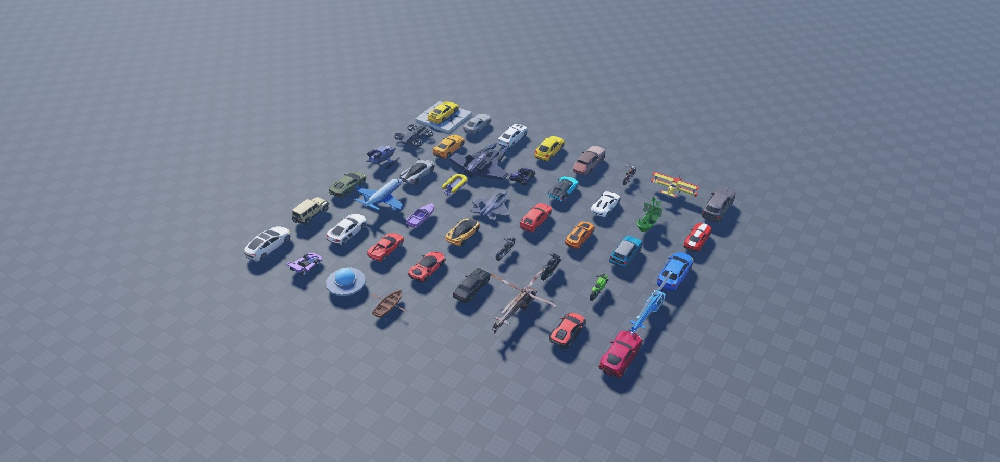

# Stud Vehicles

44 static vehicle models: sports cars, road cars, off-road vehicles, motorcycles, karts, boats, helicopters, aircraft, a drone, a UFO, and a ghost ship. These are display models without driving, flying, or sailing controllers.

[Download StudVehicles.rbxm](StudVehicles.rbxm) · [Item inventory](inventory.json) · [Script review](SECURITY.md) · [Credits](CREDITS.md) · [License](LICENSE)

## Installation

1. Download the native model and insert it into Workspace in Roblox Studio.
2. Expand the imported root and copy the models you want into your map. Keep assemblies grouped.
3. Set anchoring, collision groups, and CanCollide for your game; this pack does not supply runtime placement or collision logic.

## Included content

| # | Item | Category |
| --- | --- | --- |
| 1 | 917 | Models |
| 2 | ARMG GT-L | Models |
| 3 | BKM M4 | Models |
| 4 | Bettle | Models |
| 5 | Boaty | Models |
| 6 | Chopper | Models |
| 7 | Crop Duster | Models |
| 8 | Cully | Models |
| 9 | Drone | Models |
| 10 | GT-S | Models |
| 11 | Galaxy Fighter | Models |
| 12 | Galaxy Kart | Models |
| 13 | Gatti Chiroko | Models |
| 14 | Gatti Vekron | Models |
| 15 | Ghost Ship | Models |
| 16 | Horse GT | Models |
| 17 | Hovercraft | Models |
| 18 | Huraya | Models |
| 19 | Inflatable Boat | Models |
| 20 | Jet Fighter | Models |
| 21 | KIVIK | Models |
| 22 | Kamar | Models |
| 23 | Kooper | Models |
| 24 | Korolla | Models |
| 25 | Laventador | Models |
| 26 | Luxury Private Jet | Models |
| 27 | Luxury Speedboat | Models |
| 28 | Mc740S | Models |
| 29 | Motorcycle Hellfire | Models |
| 30 | Motorcycle Jet | Models |
| 31 | Motorcycle Ninja | Models |
| 32 | NEWS Helicopter | Models |
| 33 | Off-Roader | Models |
| 34 | R-3 | Models |
| 35 | Rarri 444 | Models |
| 36 | Rarri S100 | Models |
| 37 | SKT R10 | Models |
| 38 | Scrap Helicopter | Models |
| 39 | Sterlatto | Models |
| 40 | Supwa | Models |
| 41 | Tesla | Models |
| 42 | Turbo Kart | Models |
| 43 | UFO | Models |
| 44 | Wooden Boat | Models |

## Customization and compatibility

Edit the native model’s parts, meshes, textures, colors, scale and grouping in Roblox Studio. External dependencies are listed in `dependencies.json`; successful loading in one session does not establish access for every experience. No mobile, gamepad, rigging, animation, or gameplay support is claimed. Original download scale and placement are preserved. Gallery copies were rearranged for visibility; animals and asset props were scaled for comparable preview size.

## Gallery

Actual Studio captures at 1920 × 888.

### All 44 vehicles, alphabetically, eight columns

## Verification

See [VERIFICATION.md](VERIFICATION.md) for the tested import and preview scope, and [SECURITY.md](SECURITY.md) for the script review.
