# Review gallery — v2

Actual Roblox Studio MCP captures. Source geometry and effects are not interchangeable: geometry shots intentionally suppress particles/beams/trails; triggered-effect stills hide carriers. Preview scales/camera/visibility changes are confined to temporary clones. Runtime tests are labeled separately.

### Blood Karambit

One native model per image, geometry-fitted camera, effects suppressed on preview clone for legibility; normalized scale. No animation/collision test.

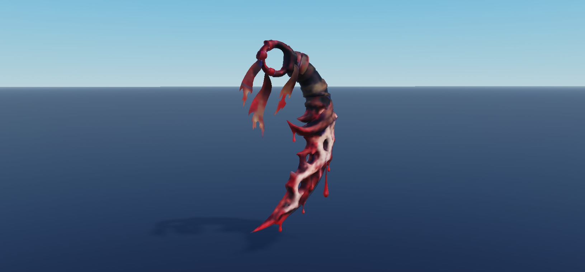

### Blue Butterfly Karambit

One native model per image, geometry-fitted camera, effects suppressed on preview clone for legibility; normalized scale. No animation/collision test.

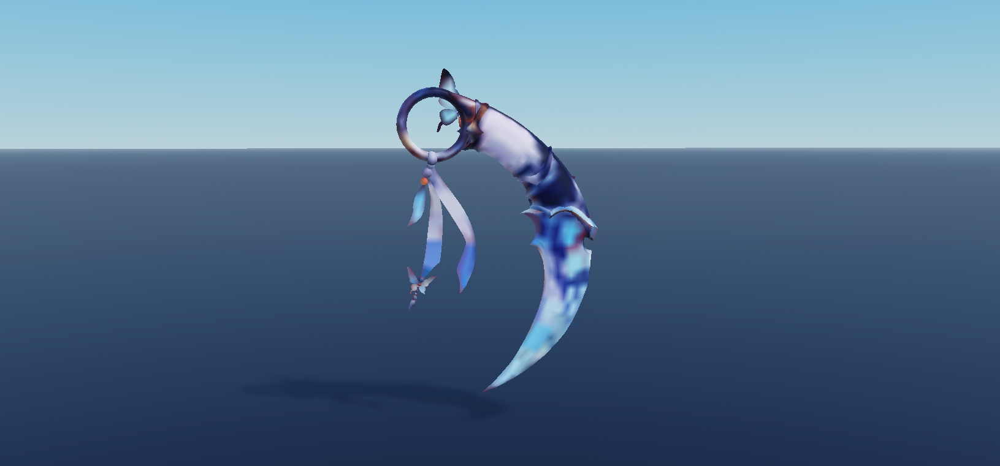

### Blue Wolf Karambit

One native model per image, geometry-fitted camera, effects suppressed on preview clone for legibility; normalized scale. No animation/collision test.

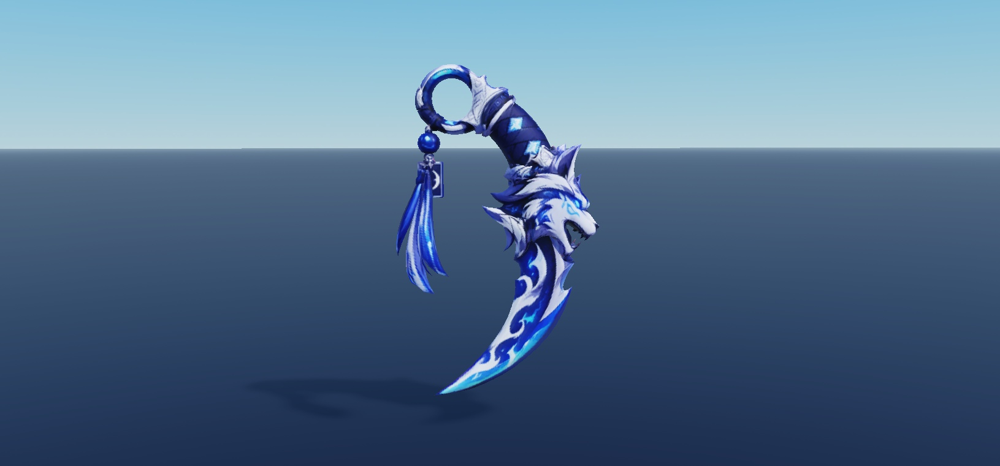

### Crimson Eye Karambit

One native model per image, geometry-fitted camera, effects suppressed on preview clone for legibility; normalized scale. No animation/collision test.

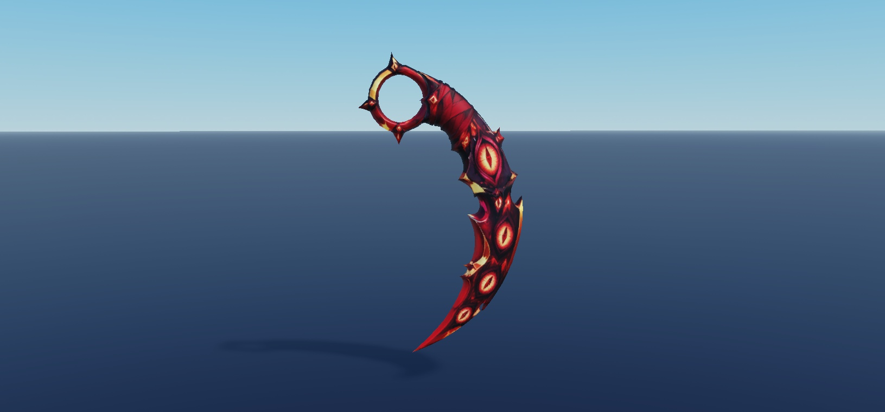

### Fire Karambit

One native model per image, geometry-fitted camera, effects suppressed on preview clone for legibility; normalized scale. No animation/collision test.

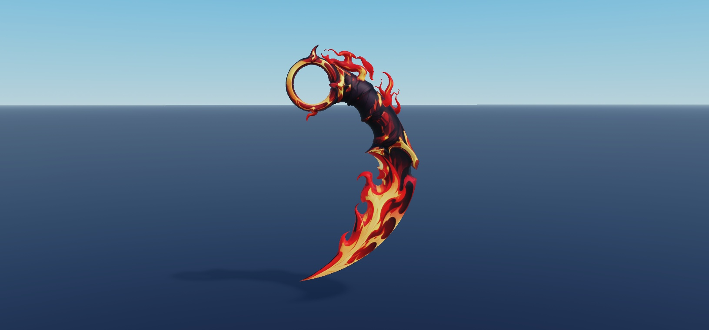

### Fire Sun Karambit

One native model per image, geometry-fitted camera, effects suppressed on preview clone for legibility; normalized scale. No animation/collision test.

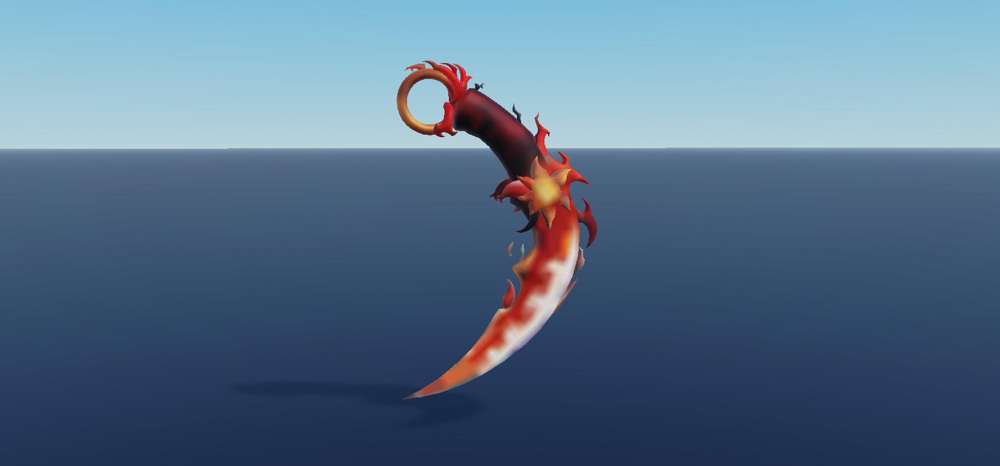

### Jade Karambit

One native model per image, geometry-fitted camera, effects suppressed on preview clone for legibility; normalized scale. No animation/collision test.

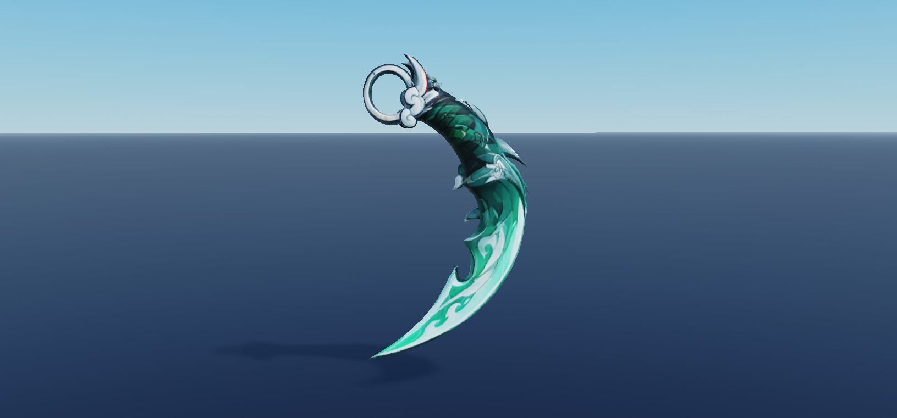

### Magenta Ribbon Karambit

One native model per image, geometry-fitted camera, effects suppressed on preview clone for legibility; normalized scale. No animation/collision test.

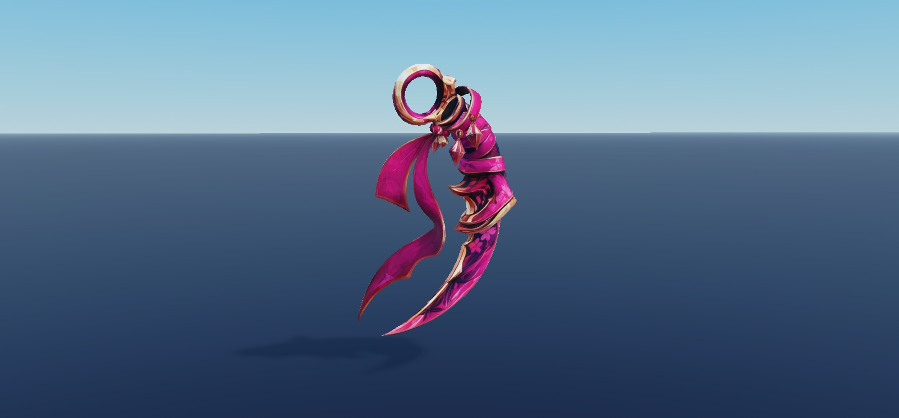

### Midnight Karambit

One native model per image, geometry-fitted camera, effects suppressed on preview clone for legibility; normalized scale. No animation/collision test.

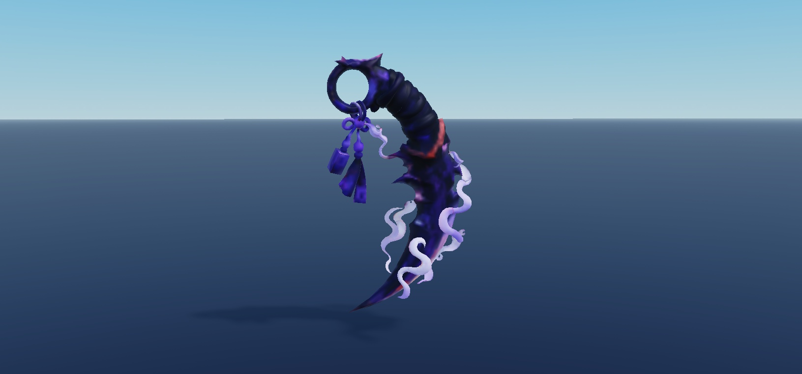

### Pink Wrap Karambit

One native model per image, geometry-fitted camera, effects suppressed on preview clone for legibility; normalized scale. No animation/collision test.

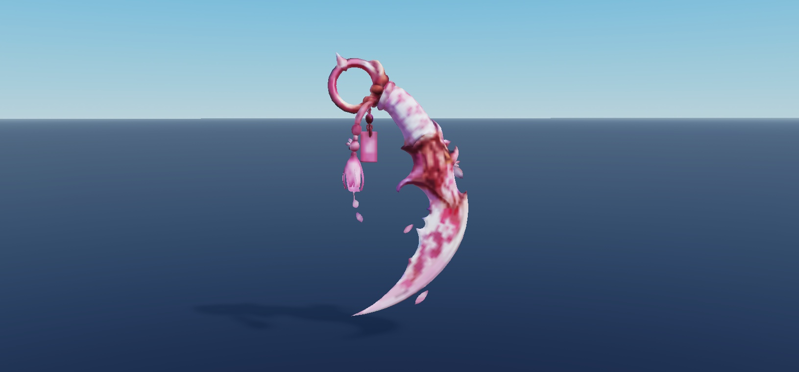

### Red Dragon Karambit

One native model per image, geometry-fitted camera, effects suppressed on preview clone for legibility; normalized scale. No animation/collision test.

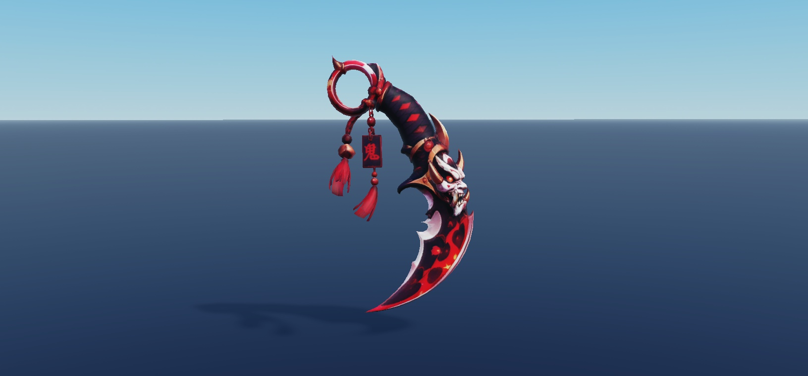

### Rose Karambit

One native model per image, geometry-fitted camera, effects suppressed on preview clone for legibility; normalized scale. No animation/collision test.

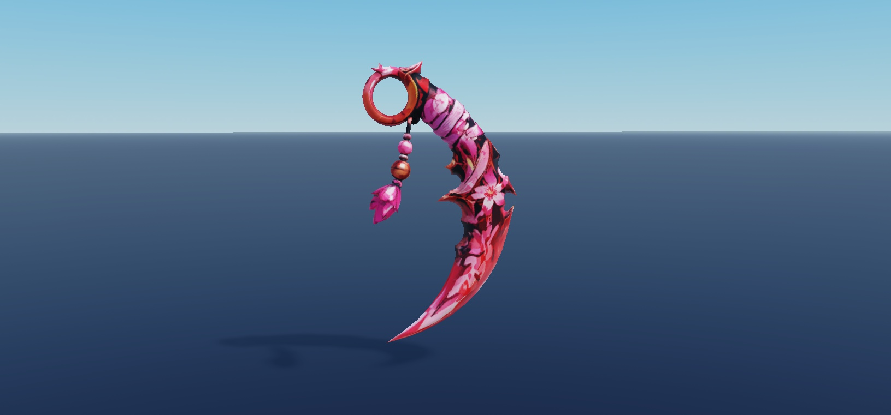

### Royal Violet Karambit

One native model per image, geometry-fitted camera, effects suppressed on preview clone for legibility; normalized scale. No animation/collision test.

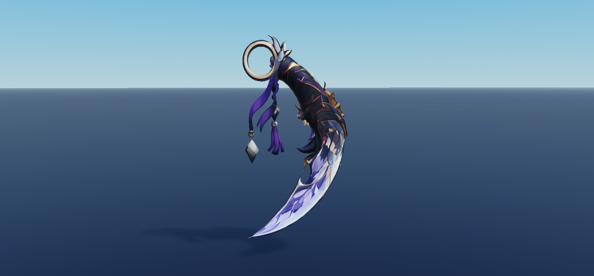

### Scarlet Karambit

One native model per image, geometry-fitted camera, effects suppressed on preview clone for legibility; normalized scale. No animation/collision test.

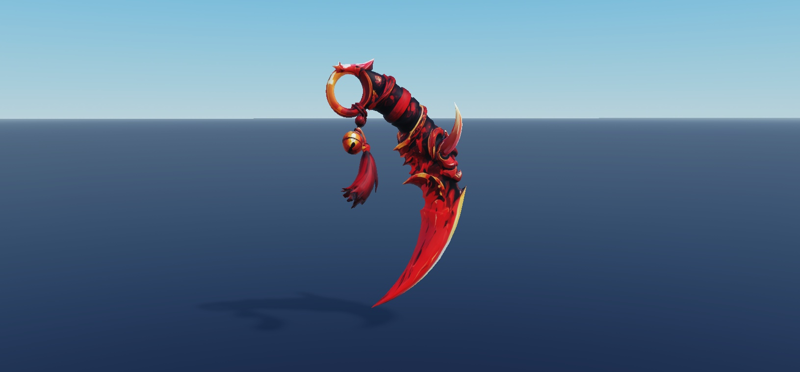

### Wisteria Karambit

One native model per image, geometry-fitted camera, effects suppressed on preview clone for legibility; normalized scale. No animation/collision test.

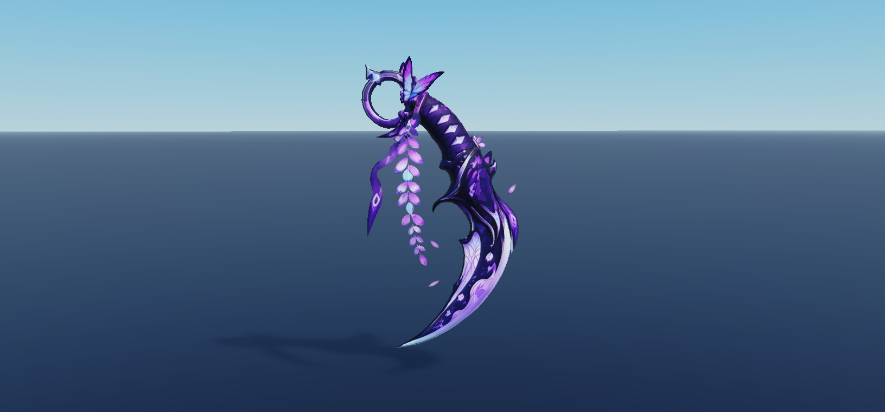
