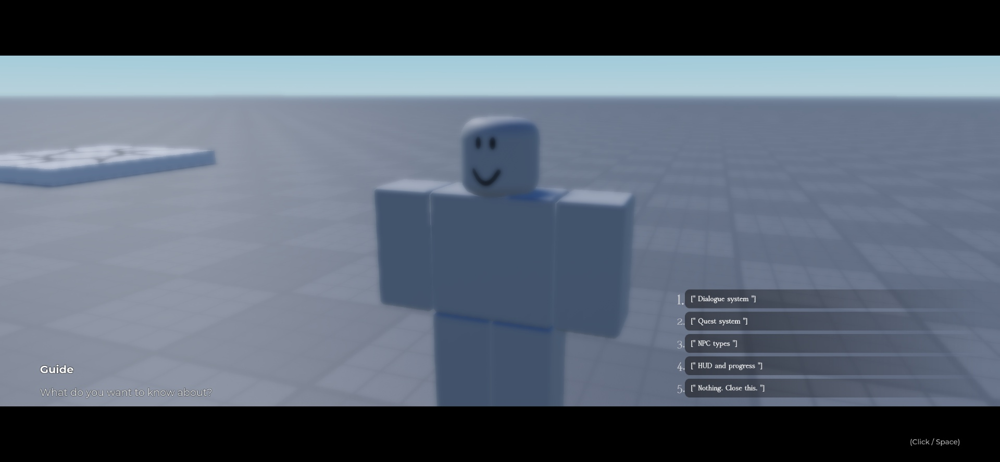
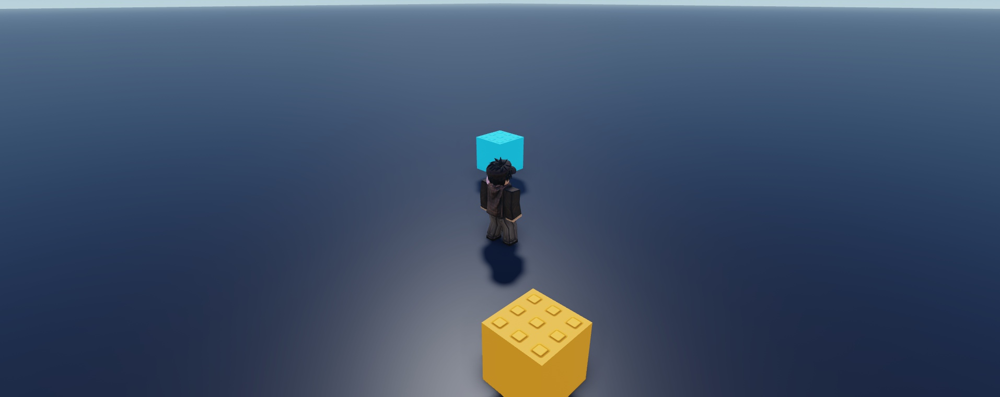

# Steal a Template / Luau systems

Editable Roblox systems with native models, Luau source, and real Studio screenshots. Pick a system, inspect the gallery, then read its setup notes.

| Pack | Gallery | Native model | Current status |
| --- | --- | --- | --- |
| [Dialogue and Quest System](dialogue-system/) | [7 screenshots](dialogue-system/#screenshot-gallery) | [DialogueSystem.rbxm](dialogue-system/DialogueSystem.rbxm?raw=1) | Draft; see pack verification and device limits |
| [Dungeon Camera](dungeoncam/) | [2 screenshots](dungeoncam/GALLERY.md) | [DungeonCam.rbxm](dungeoncam/DungeonCam.rbxm?raw=1) | Visual preview; limited camera Play test |

### Dialogue and Quest System

### Dungeon Camera

## Install

Download the pack's `.rbxm`, stop Play, and follow the exact destination and setup steps on its pack page. Review the documented dependencies and test limits before integrating it into a game.

Original Steal a Template contributions use [MIT terms](../../LICENSE); each pack's credits preserve applicable third-party notices.

[Back to Steal a Template](../../README.md)
