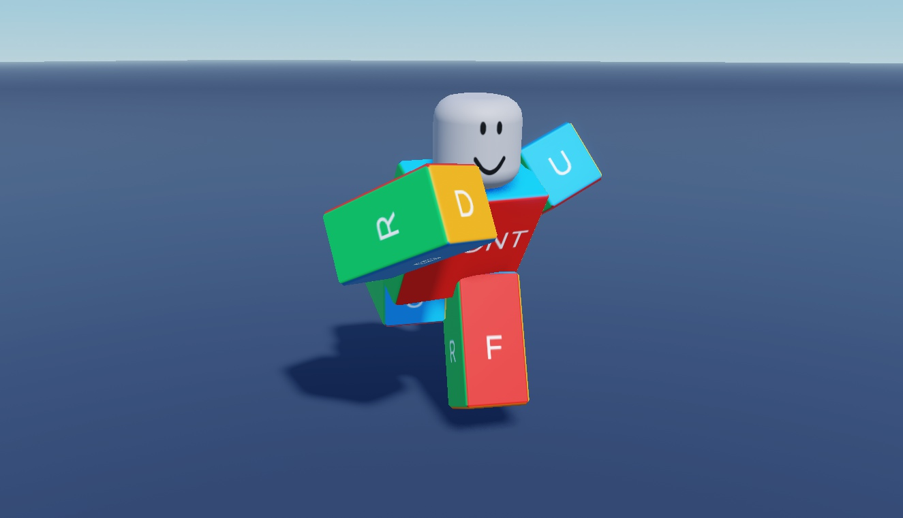
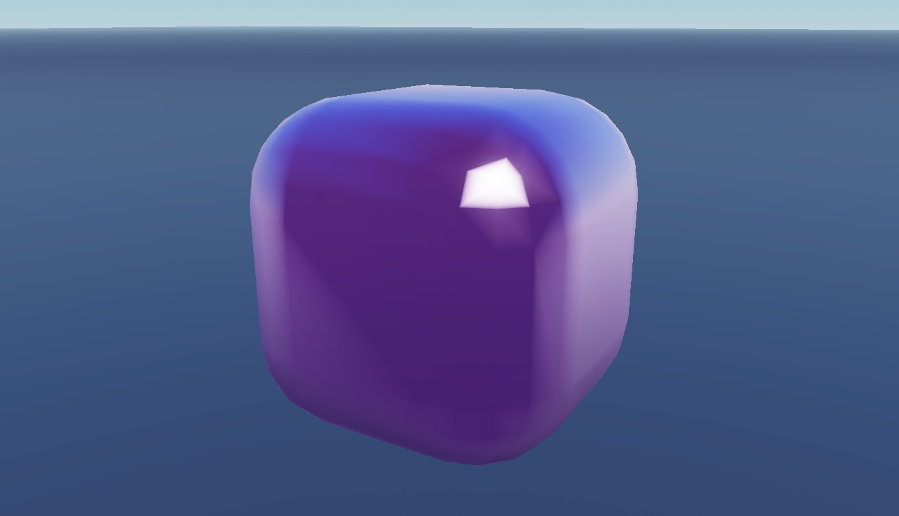
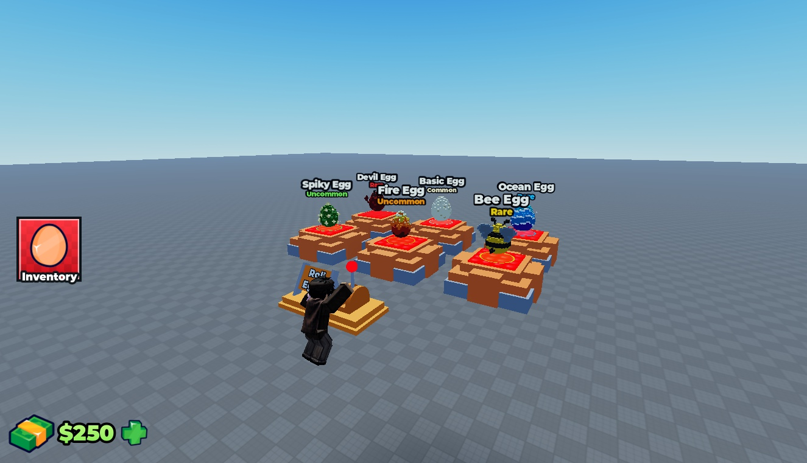
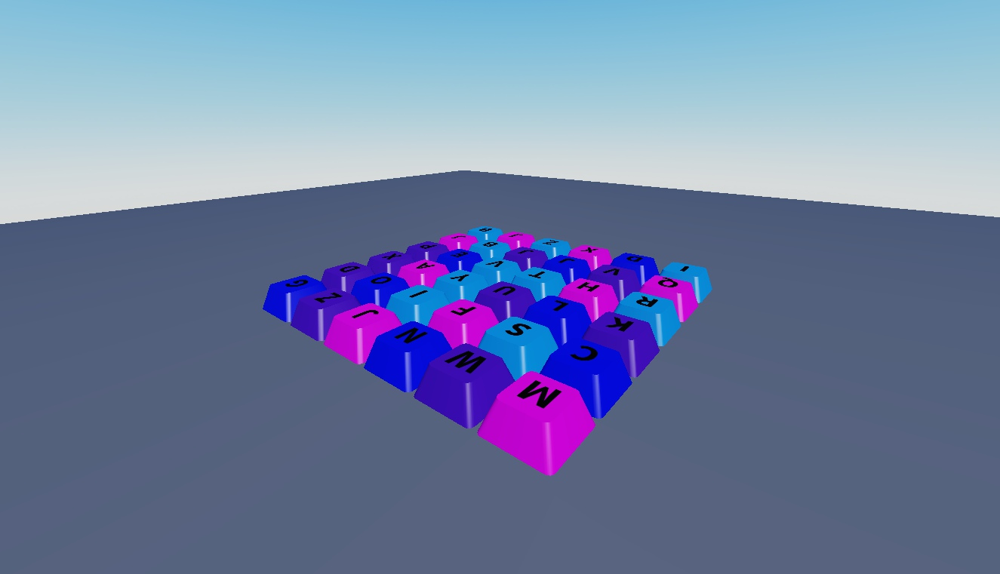
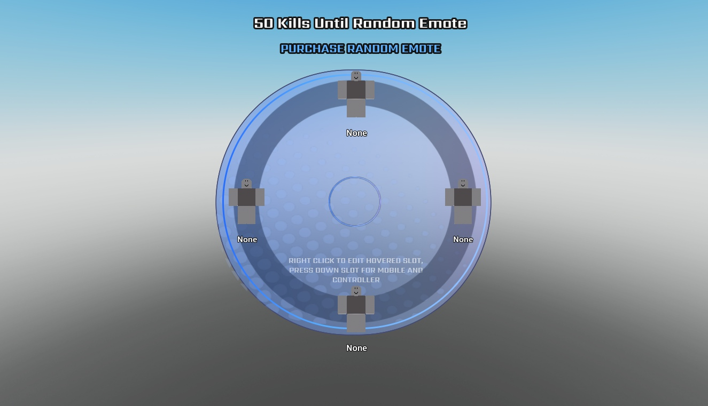
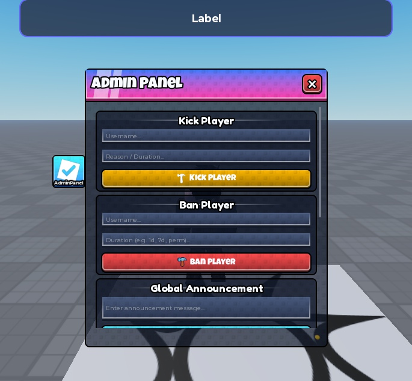

# Steal a Template / Luau systems

Editable Roblox systems with native models, Luau source, and real Studio screenshots. Pick a system, inspect the gallery, then read its setup notes.

| Pack | Gallery | Native model | Current status |
| --- | --- | --- | --- |
| [Dialogue and Quest System](dialogue-system/) | [7 screenshots](dialogue-system/#screenshot-gallery) | [DialogueSystem.rbxm](dialogue-system/DialogueSystem.rbxm?raw=1) | Draft; see pack verification and device limits |
| [Dungeon Camera](dungeoncam/) | [2 screenshots](dungeoncam/GALLERY.md) | [DungeonCam.rbxm](dungeoncam/DungeonCam.rbxm?raw=1) | Visual preview; limited camera Play test |
| [General Movement Animations](general-movement-animations/) | [66 screenshots](general-movement-animations/GALLERY.md) | [35+ General Movement Animations Pack.rbxm](general-movement-animations/35%2B%20General%20Movement%20Animations%20Pack.rbxm?raw=1) | Saved poses + sampled-pose GIFs; runtime unverified |
| [ASMR Interaction Kit](asmr-kit/) | [24 screenshots](asmr-kit/GALLERY.md) | [ASMRKit.rbxm](asmr-kit/ASMRKit.rbxm?raw=1) | Static interaction assets; touch/audio unverified |
| [Egg RNG Roller](egg-rng-roller/) | [34 screenshots](egg-rng-roller/GALLERY.md) | [EggRNGRoller.rbxm](egg-rng-roller/EggRNGRoller.rbxm?raw=1) | Preview; see verification and integration limits |
| [Interactive Keyboard Models](interactive-keyboards/) | [16 screenshots](interactive-keyboards/GALLERY.md) | [Keyboard.rbxm](interactive-keyboards/Keyboard.rbxm?raw=1) | Preview; see verification and integration limits |
| [Nebulix Emote System](nebulix-emote-system/) | [2 screenshots](nebulix-emote-system/GALLERY.md) | [omg emotes woww its mangos.rbxm](nebulix-emote-system/omg%20emotes%20woww%20its%20mangos.rbxm?raw=1) | Integration template; missing dependencies |
| [Free Admin Panel Demo Place](free-admin-panel-place/) | [3 screenshots](free-admin-panel-place/GALLERY.md) | [Free Admin Panel System.rbxl](free-admin-panel-place/Free%20Admin%20Panel%20System.rbxl?raw=1) | INSECURE demo place; authorization missing |

### Dialogue and Quest System

### Dungeon Camera

### General Movement Animations

### ASMR Interaction Kit

### Egg RNG Roller

### Interactive Keyboard Models

### Nebulix Emote System

### Free Admin Panel Demo Place

## Install

For a `.rbxl` demo place, use **File > Open from File** in Studio rather than inserting it as a model. For `.rbxm` packs, stop Play, and follow the exact destination and setup steps on its pack page. Review the documented dependencies and test limits before integrating it into a game.

Original Steal a Template contributions use [MIT terms](../../LICENSE); each pack's credits preserve applicable third-party notices.

[Back to Steal a Template](../../README.md)
