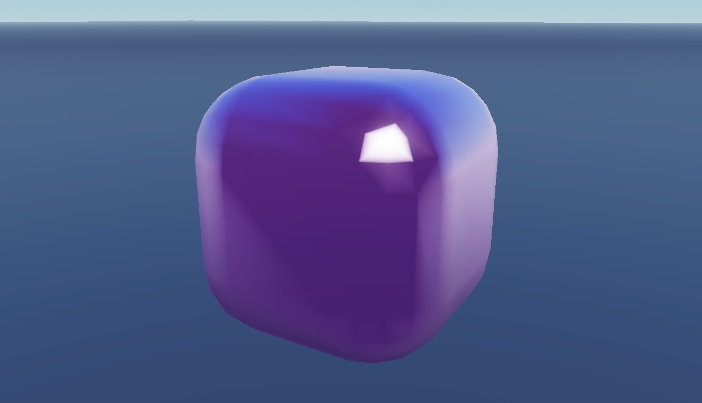

# ASMR Interaction Kit

Touch-reactive squish parts, butter props, keyboard and bubble generators with linked sound dependencies.

**Preview release 0.1.0.** Server scripts create touch-responsive parts and sound pools. No Play or audio playback certification. Generator initialization on temporary Edit-mode clones was inspected separately; see verification. Keyboard and Bubble grids are generated only at runtime; static screenshots show their supplied edit-time instances/templates, not a tested generated result.

## Download

[Download ASMRKit.rbxm](ASMRKit.rbxm?raw=1) - native Roblox model, 28,969 bytes.

[Full gallery - 24 screenshots](GALLERY.md) | [Included entries](INVENTORY.md) | [Verification](VERIFICATION.md)

## Included assets

Touch-reactive squish parts, butter props, keyboard and bubble generators with linked sound dependencies.

See the [native inventory](INVENTORY.md) for original entry names and instance counts. All supplied descendants and original source notices are retained. 11 embedded scripts are also extracted verbatim under [src/](src/manifest.json); the native binary remains authoritative. Do not install both extracted copies and embedded scripts.

## Installation

The source was supplied as Asmr_Packrbxm and renamed Asmr_Pack.rbxm for import; ASMRKit.rbxm contains exactly the same bytes. Stop Play, import into ServerStorage, inspect scripts, then copy the selected Needohs, Butters, Keyboard or Bubble group into Workspace. Preserve each script under its original parent and keep the Key/Bubble templates nested beneath their generators. Test in a separate place before integration.

## Customization and dependencies

Duplicate a master before editing. Customize native instances in Roblox Studio rather than flattening them into an image. Preserve internal rig, constraint, mesh and appearance references. Linked Roblox-hosted content may need permission in your destination experience; the [asset reference inventory](ASSET-REFERENCES.json) is not an access guarantee. No external asset payloads are bundled beyond the original model.

## Verification and limitations

Server scripts create touch-responsive parts and sound pools. No Play or audio playback certification. Generator initialization on temporary Edit-mode clones was inspected separately; see verification. Keyboard and Bubble grids are generated only at runtime; static screenshots show their supplied edit-time instances/templates, not a tested generated result.

[Read scoped verification](VERIFICATION.md). The original download is byte-for-byte preserved; preview-only normalization, anchoring and effect/label visibility changes do not alter the delivered asset.

SHA-256: `cac555c65726ad40dcc66581962b67080d49757cfda179d2e0de0303b49edc73`

## Credits and license

[Credits and source provenance](CREDITS.md) | [MIT notice with limited project scope](LICENSE) | [Repository licensing](../../../docs/LICENSING.md). Existing third-party terms remain in effect; this listing does not establish original authorship.

[Changelog](CHANGELOG.md) | [Back to category](../README.md)

### ASMR generator integration

Keyboard and Bubble generators use shared Workspace folders named `Keyboards` and `Bubbles` and create named sound-pool folders. Review/namespace these names before installing multiple copies. Generated parts and pools need cleanup when replacing a running instance. Keyboard/Bubble captures labeled initialized show original generator source initialized on isolated temporary clones in Edit mode; touch response, sound playback and game integration remain unverified.
