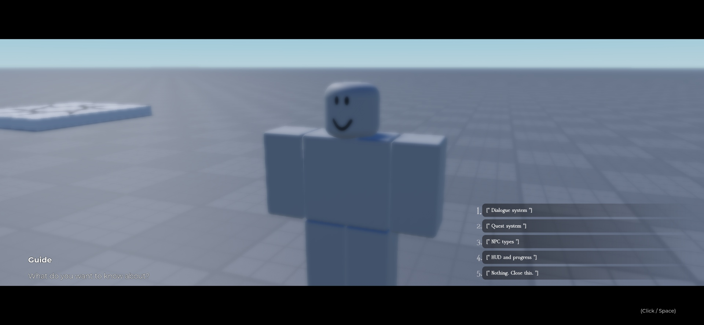
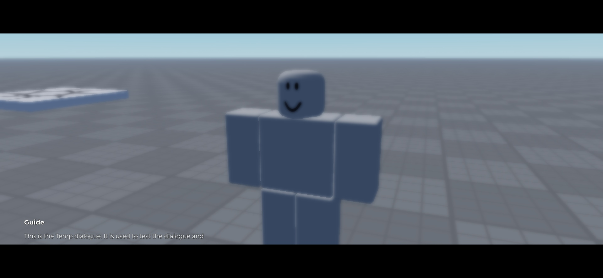
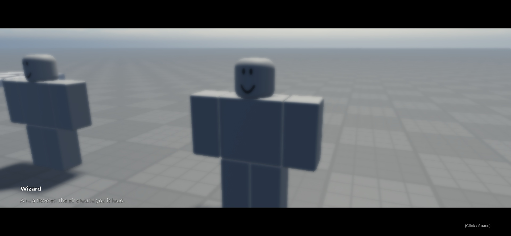
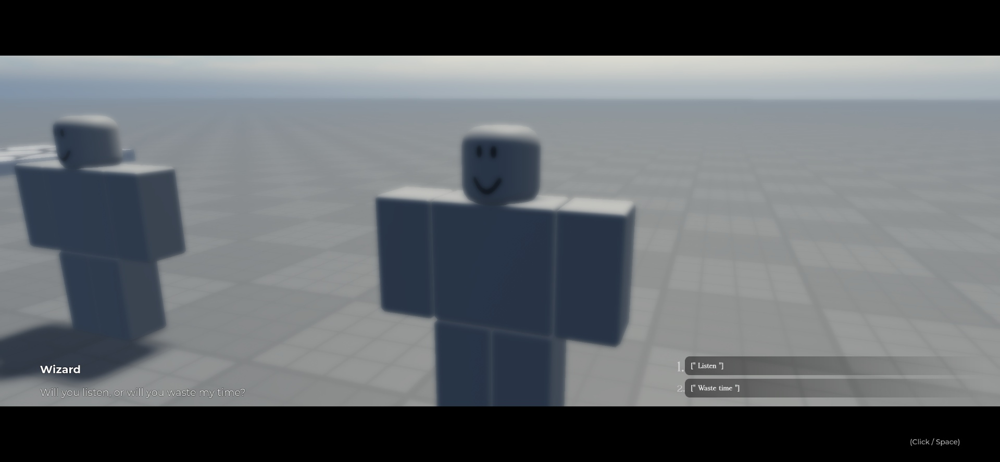
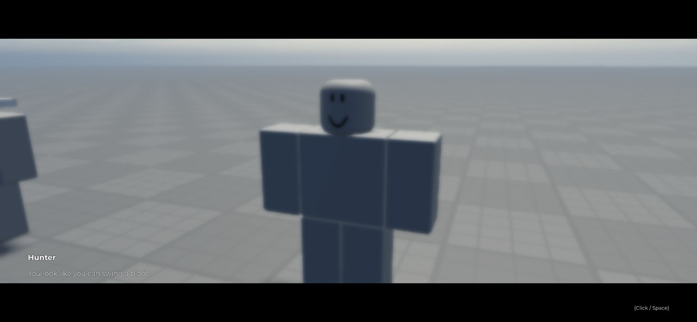
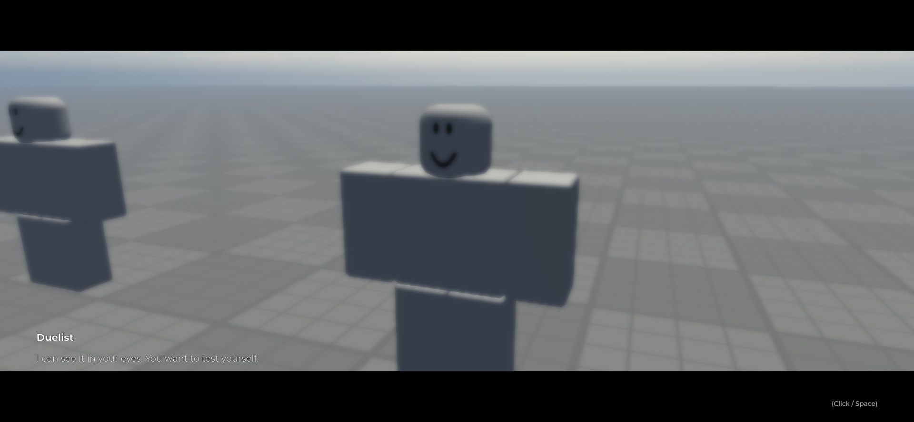
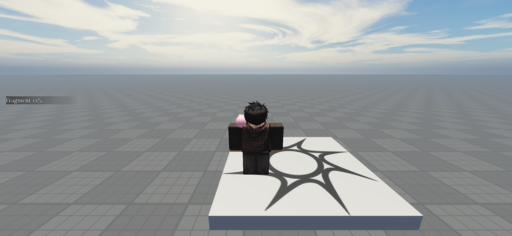

# Steal a Template / Dialogue and Quest System

**Four NPC conversations · branching choices · cinematic camera · quest examples**

[**Download DialogueSystem.rbxm**](DialogueSystem.rbxm?raw=1) · [Optional quest targets](OptionalQuestTargets.rbxm?raw=1) · [Editable Luau source](src/) · [Verification](VERIFICATION.md)

Interact with an NPC's **E** prompt to open a cinematic conversation. The core download includes the four demo NPCs, dialogue and quest GUIs, scripts, remotes, and fragment collectibles. Crystals and slimes were removed from the visible scene and placed in a separate optional download.

## Install in Roblox Studio

1. Download **[DialogueSystem.rbxm](DialogueSystem.rbxm?raw=1)**.
2. Stop Play. Right-click **Workspace → Insert from File** and select the download. It imports one `DialogueSystem` folder.
3. Expand that folder. Move the **contents** of each named subfolder to the matching service:

   | From imported folder | Move these children directly into |
   | --- | --- |
   | `Workspace` | `Workspace` |
   | `ReplicatedStorage` | `ReplicatedStorage` |
   | `ServerScriptService` | `ServerScriptService` |
   | `StarterGui` | `StarterGui` |
   | `ServerStorage` | `ServerStorage` |

4. Delete the empty imported `DialogueSystem` folder. Keep only one copy of the scripts, remotes, and GUIs.
5. Press **Play**, approach an NPC, and press **E** to talk. The Guide is a quick tour; Wizard, Hunter, and Duelist demonstrate quest conversations.

The server modules must sit directly inside **ServerScriptService** because the scripts use direct service paths. The baseplate, spawn pad, preview sky, and original place lighting are not included.

### Optional quest targets

The core download deliberately has **no background crystals or slimes**. To play the crystal collection or slime defeat examples, import [OptionalQuestTargets.rbxm](OptionalQuestTargets.rbxm?raw=1), then move its `Crystals` folder into `Workspace.Collectibles` and its `Monsters` folder into `Workspace`. You can instead supply your own tagged Crystal collectibles and Slime NPCs.

## What is included

- **Four example NPCs:** Guide (`Intro` model using `Temp` dialogue), Wizard, Hunter, and Duelist. Each has a `TalkPrompt`, camera marker, and talk point.
- **Dialogue presentation:** speaker name, colored rich text, typewriter text, optional type sound, cinematic letterbox, blur, camera tween and gentle camera movement. Choices slide in and respond to hover/selection. Space, Enter, or click advances or skips typing.
- **Branching:** `ReplicatedStorage.Dialogues` holds editable dialogue modules with lines, labels, numbered choices, jumps, end choices, and quest actions. The Guide menu explains the example systems.
- **Quest examples:** Wizard offers five fragments and three crystals; Hunter offers five slime defeats; Duelist offers three player defeats. Crystal and slime targets are optional and absent from the default backdrop.
- **Progress and rewards:** quest HUD, leaderstats Coins/EXP, server-side quest progress, turn-in, and a Sword reward for Hunter's quest. Wizard quests award 10 Coins/50 EXP and 20 Coins/80 EXP; Hunter awards 50 Coins/200 EXP plus a Sword; Duelist awards 100 Coins/300 EXP.
- **Editable assets:** native GUIs, NPC rigs, prompts, remotes, `QuestConfig`, and exact Luau sources under [src/](src/). The source files are copies of the scripts embedded in the model; edit both source and native export when updating the pack.

Quest state and leaderstats live only in server memory. This is a **demo**, with no DataStore persistence or production economy integration. Player defeat quests need another player; Crystal and Slime quests need the optional targets or your own replacements.

## Conversation gallery

| Guide explanation | Guide topic choices |
| --- | --- |
|  |  |

| Wizard introduction | Wizard branch choice |
| --- | --- |
|  |  |

| Hunter | Duelist |
| --- | --- |
|  |  |

The screenshots show the supplied NPC rigs and interactions in Studio Play mode. The Guide screenshots were taken after importing the actual model into a separate empty Studio place. The other NPC screens were captured from the matching source place after the same camera and backdrop changes.

## Customize

- Edit dialogue text, choice branches, colors, timing, sound, and camera settings in the four modules under `ReplicatedStorage.Dialogues`.
- Edit quest objectives, rewards, repeatability, and NPC chains in `ReplicatedStorage.QuestConfig`.
- Replace the NPC rigs while preserving their `TalkPrompt`, `TalkPoint`, `DialogueCamera`, and dialogue ID/quest giver attributes. Reposition the markers for your camera framing.
- Move the fragment example or tag your own parts `Fragment` or `Crystal` for collection prompts. Adjust the part's `RespawnTime` attribute as needed.
- The supplied type sound references Roblox asset `615716445`; check access in your experience or replace it. NPC rigs also contain animation IDs. External Roblox assets may have separate access or rights requirements.

See [credits and license scope](CREDITS.md), [verification](VERIFICATION.md), and [changelog](CHANGELOG.md).
