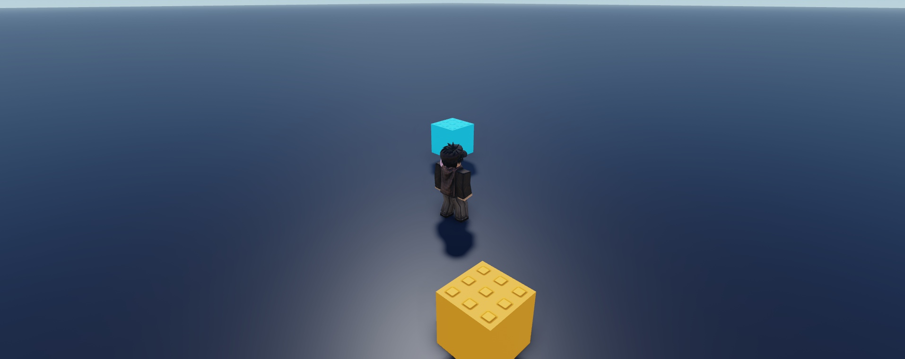
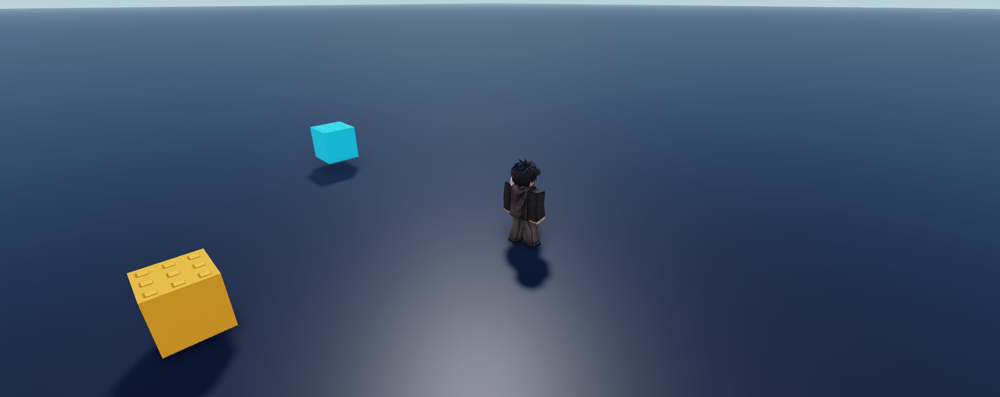

# Review gallery — v2

Actual Roblox Studio MCP captures. Source geometry and effects are not interchangeable: geometry shots intentionally suppress particles/beams/trails; triggered-effect stills hide carriers. Preview scales/camera/visibility changes are confined to temporary clones. Runtime tests are labeled separately.

### live-camera-a.jpg

Actual native camera controller in Play: fixed offset (18,12,18), FOV 50. Avatar and colored cubes are test fixtures, not included assets.

### live-camera-b.jpg

Actual native camera after moving the character. Follow observed; the per-frame Lerp still had a 2.56-stud residual offset after 0.8 s. No occlusion/zoom/mobile tests.

