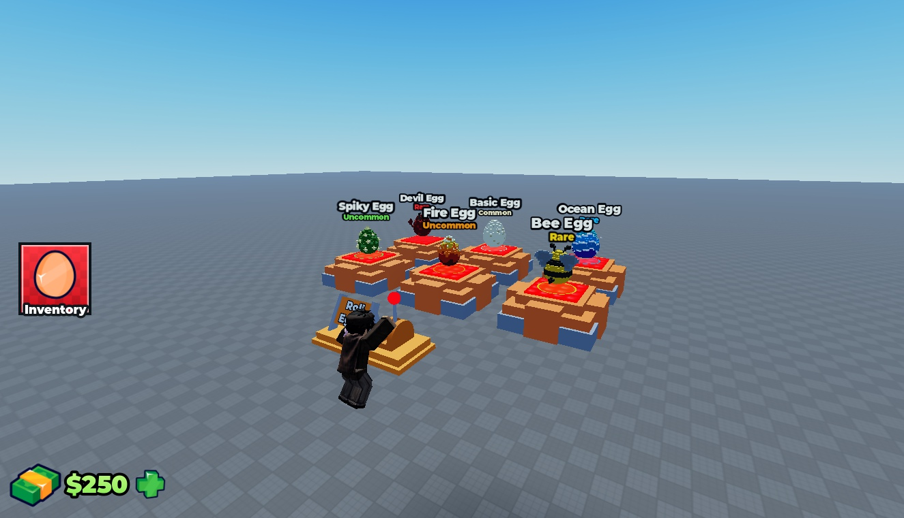
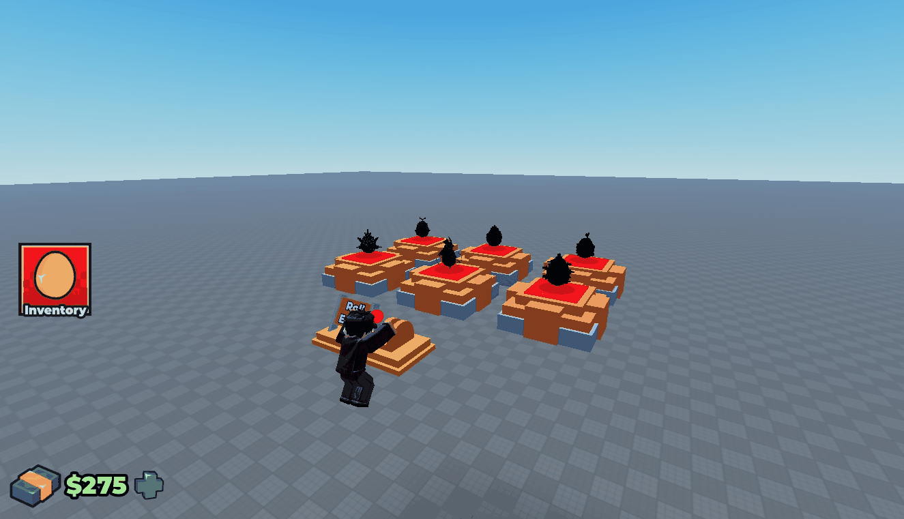

# Egg RNG Roller

Egg randomizer machine with 14 configured egg templates, shop/inventory UI, player data, admin tools and optional developer-product cash packs.

**Preview release 0.1.0.** Preview release; persistence, purchases, multiplayer security and production economy are not certified. Developer-product IDs default to 0. Do not enable live purchases or production data stores merely to inspect this pack.

## Download

[Download EggRNGRoller.rbxm](EggRNGRoller.rbxm?raw=1) — 315,495 bytes.

[Full gallery — 34 screenshots](GALLERY.md) | [Native inventory](INVENTORY.md) | [Verification](VERIFICATION.md)

## Included assets

Egg randomizer machine with 14 configured egg templates, shop/inventory UI, player data, admin tools and optional developer-product cash packs.

18 embedded scripts are extracted verbatim in [src/manifest.json](src/manifest.json). The binary is authoritative; do not install duplicate extracted copies.

## Installation

Import EggRandomizerKit into Workspace in a separate test place. Its AutoInstall script installs a runtime copy on Play. For permanent installation, review and run require(workspace.EggRandomizerKit.Install)(). The installer moves children into the Roblox services named by their parent folders. Configure ReplicatedStorage.EggRandomizer.Config, your own product IDs and data-store names before integration; merge ProcessReceipt into your existing receipt handler rather than installing competing handlers.

## Customization and dependencies

Work on a copy in Studio. Preserve required internal hierarchy, attachments, bones and relative transforms. Inspect [asset references](ASSET-REFERENCES.json); their availability in this Studio session does not guarantee permission in your destination experience. Keep original creator notices.

## Verification and limitations

Limited Studio Play check in unpublished Place1: AutoInstall populated its destination services, the lever E prompt triggered black-silhouette shuffling and colored egg reveal, and inventory/cash-shop windows opened/closed. Passive currency tick was observed. DataStore explicitly reported unavailable in an unpublished place; developer-product lookup returned HTTP 404. No purchases, saving, admin actions or multiplayer certification. An admin-layout capture, if present, is preview-only, not proof of authorized admin behavior.

Preview release; persistence, purchases, multiplayer security and production economy are not certified. Developer-product IDs default to 0. Do not enable live purchases or production data stores merely to inspect this pack.

SHA-256: `68f6471b18222478823095f995361cae1477f1cc33f95064ea00dee4fc9248cb`

## Credits and license

[Credits](CREDITS.md) | [Scoped project MIT notice](LICENSE) | [Repository scope](../../../docs/LICENSING.md) | [Changelog](CHANGELOG.md)

[Back to category](../README.md)

## Roll sequence

Timed Studio screenshot sequence of one lever roll, not a smooth frame-rate video or an audio verification.
