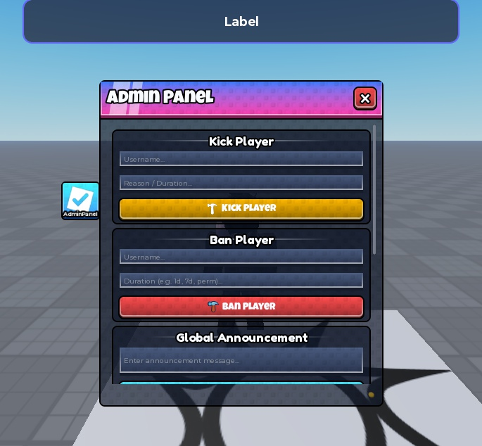

# Free Admin Panel System

Native model package with 233 instances: a ReplicatedStorage folder containing Packages, UITemplates and AdminPanelRemote; StarterPlayerScripts containing both clients; and ServerScriptService containing AdminHandler. All 210 original embedded scripts/modules are retained byte-for-byte.

**Preview release 0.1.1.** The original admin scripts still allow any player to kick, ban and announce, without server authorization, type validation, filtering or rate limits. Bans remain in-memory. This conversion does not repair those issues. Do not deploy the handler in a live game before securing it.

## Download

[Download FreeAdminPanelSystem.rbxm](FreeAdminPanelSystem.rbxm?raw=1) - 157,090 bytes, actual native Roblox model.

[Full gallery - 3 screenshots](GALLERY.md) | [Inventory](INVENTORY.md) | [Compressed hierarchy](HIERARCHY.json.gz) | [Verification](VERIFICATION.md)

## Installation

Insert FreeAdminPanelSystem.rbxm into ServerStorage while Play is stopped. Move the CONTENTS of its ReplicatedStorage folder into game.ReplicatedStorage. Move the CONTENTS of StarterPlayerScripts into game.StarterPlayer.StarterPlayerScripts. Move the CONTENTS of ServerScriptService into game.ServerScriptService only after securing AdminHandler. Merge folders; do not leave an extra ReplicatedStorage wrapper nested inside the service. Remove the empty staging folder afterward. Test in an isolated place, not your live game.

## Included source and customization

210 embedded scripts/modules are extracted in [src/manifest.json](src/manifest.json). The model is authoritative; do not install duplicate extracted copies. Customize native instances in Studio and preserve internal names and references. Linked Roblox assets may need permission in your destination experience; see [asset references](ASSET-REFERENCES.json).

## Verification and limitations

Exported real binary .rbxm with Studio SerializationService, not a renamed place file. Deserialized the final export buffer back through Studio; root names, native instance counts and class counts matched the local file inventory. Temporary export objects were unparented for serialization; source place originals were not saved or overwritten. All 210 original sources match the supplied place exactly. Additionally installed the deserialized final model into the documented services in Studio, with originals temporarily backed up. Play generated the UI; the actual open button enabled it and a local announcement request delivered Converted RBXM preview to the original client. Restored the original source contents afterward. No live moderation action, kick/ban test, persistence, multiplayer security or device certification.

The original admin scripts still allow any player to kick, ban and announce, without server authorization, type validation, filtering or rate limits. Bans remain in-memory. This conversion does not repair those issues. Do not deploy the handler in a live game before securing it.

SHA-256: `19d6839e934a2d96b0213c72504f0e494b2dbdbd546c67c657f60d66cf854c4b`

## Credits and license

Original attribution and notices remain applicable. [Credits](CREDITS.md) | [Scoped project MIT notice](LICENSE) | [Repository licensing](../../../docs/LICENSING.md) | [Changelog](CHANGELOG.md)

[Back to category](../README.md)
