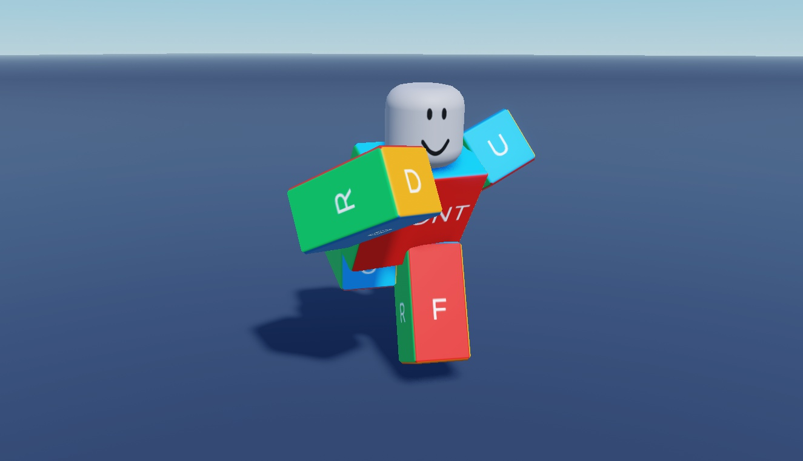

# General Movement Animations

33 saved KeyframeSequence clips across nine movement categories, not 35 verified clips.

**Preview release 0.1.0.** R6 rigs and saved poses are included. Animator playback, upload permissions, transitions, root motion, timing and device integration are unverified.

## Download

[Download 35+ General Movement Animations Pack.rbxm](35%2B%20General%20Movement%20Animations%20Pack.rbxm?raw=1) - native Roblox model, 332,037 bytes.

[Full gallery - 66 screenshots](GALLERY.md) | [Included entries](INVENTORY.md) | [Verification](VERIFICATION.md)

## Included assets

33 saved KeyframeSequence clips across nine movement categories, not 35 verified clips.

See the [native inventory](INVENTORY.md) for original entry names and instance counts. All supplied descendants and original source notices are retained. No LuaSourceContainer scripts were found in the supplied native model.

## Installation

Stop Play and import the folder into ServerStorage as an animation source library. The nine category models contain R6 preview rigs and saved KeyframeSequence clips. Open a selected rig in Animation Editor and import its saved sequence; publish animations under your own authorized creator/group and reference the resulting IDs from your movement controller. This pack does not include a movement controller.

## Customization and dependencies

Duplicate a master before editing. Customize native instances in Roblox Studio rather than flattening them into an image. Preserve internal rig, constraint, mesh and appearance references. Linked Roblox-hosted content may need permission in your destination experience; the [asset reference inventory](ASSET-REFERENCES.json) is not an access guarantee. No external asset payloads are bundled beyond the original model.

## Verification and limitations

R6 rigs and saved poses are included. Animator playback, upload permissions, transitions, root motion, timing and device integration are unverified.

[Read scoped verification](VERIFICATION.md). The original download is byte-for-byte preserved; preview-only normalization, anchoring and effect/label visibility changes do not alter the delivered asset.

SHA-256: `22c5e7fea19c91ebc8ee5d539b0a09d81dc501af7220d4b5c20ca26cf2c98262`

## Credits and license

[Credits and source provenance](CREDITS.md) | [MIT notice with limited project scope](LICENSE) | [Repository licensing](../../../docs/LICENSING.md). Existing third-party terms remain in effect; this listing does not establish original authorship.

[Changelog](CHANGELOG.md) | [Back to category](../README.md)
