# Interactive Keyboard Models — gallery

Actual Studio captures of the supplied instances. Preview-only framing, anchoring, GUI visibility/scale/position changes are not changes to the native download.

### Model — front

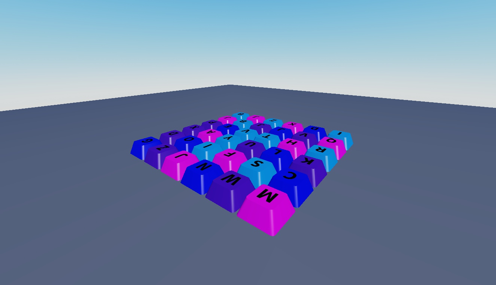

### Model — back

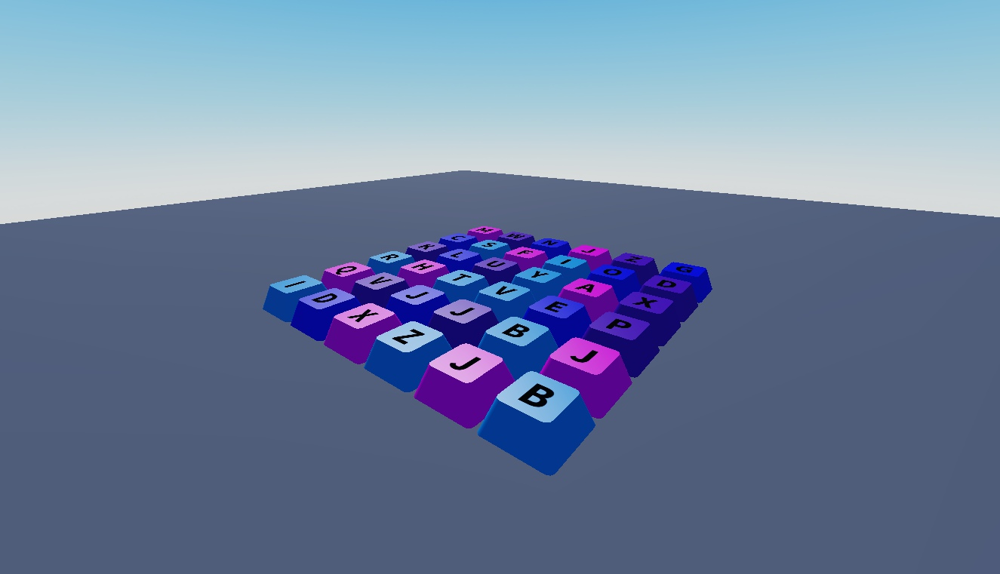

### Model — front

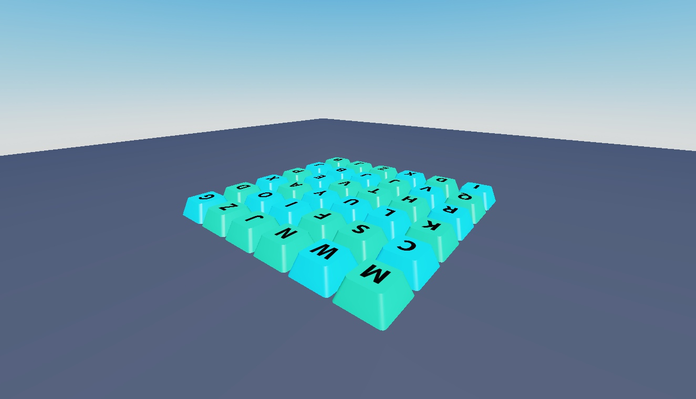

### Model — back

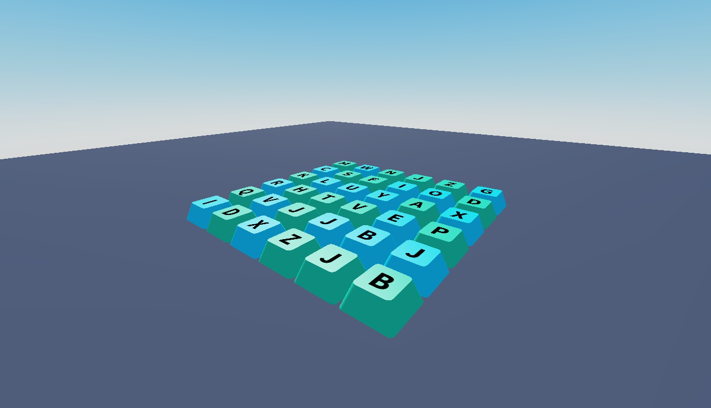

### Model — front

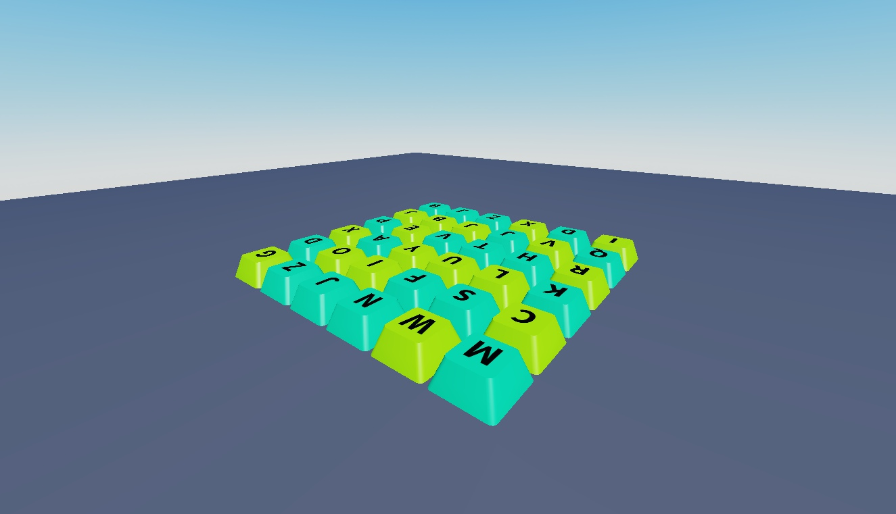

### Model — back

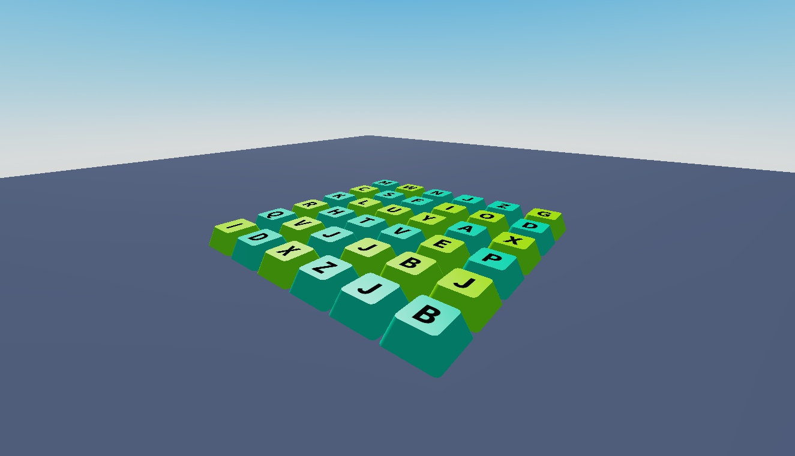

### Model — front

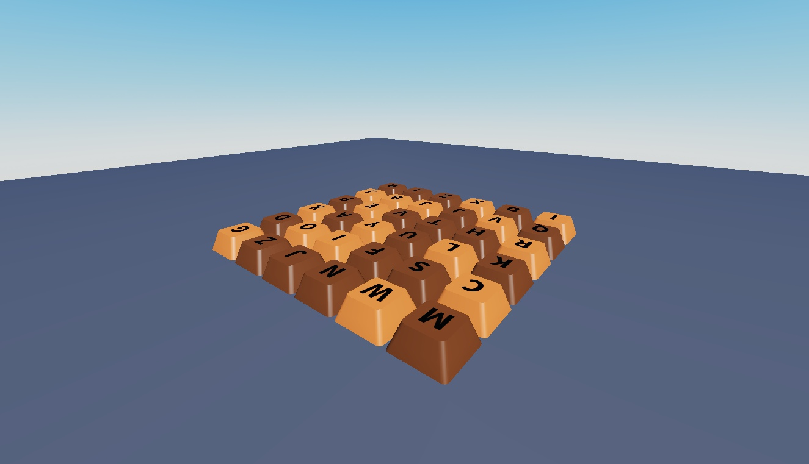

### Model — back

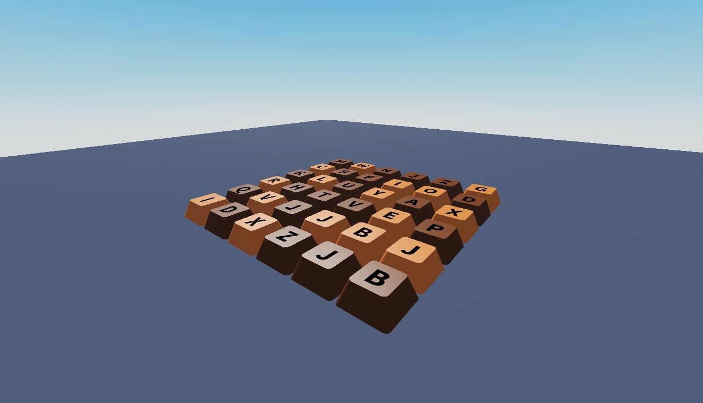

### Model — front

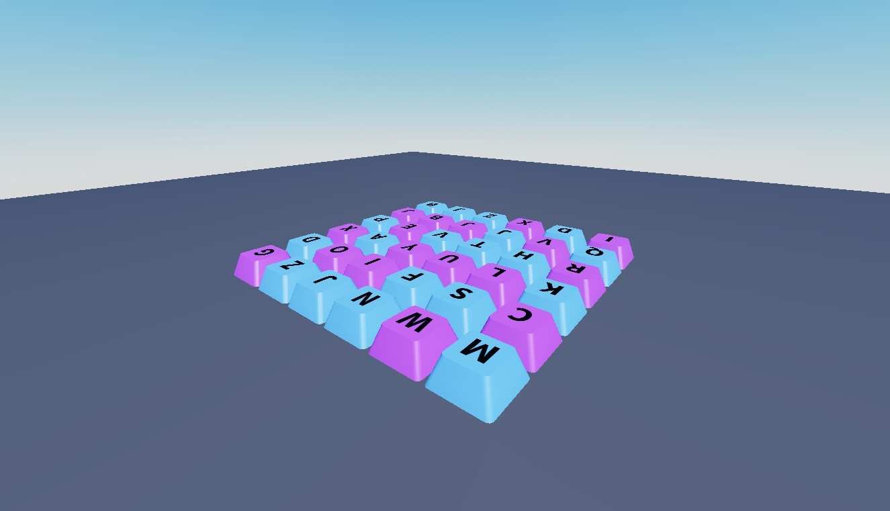

### Model — back

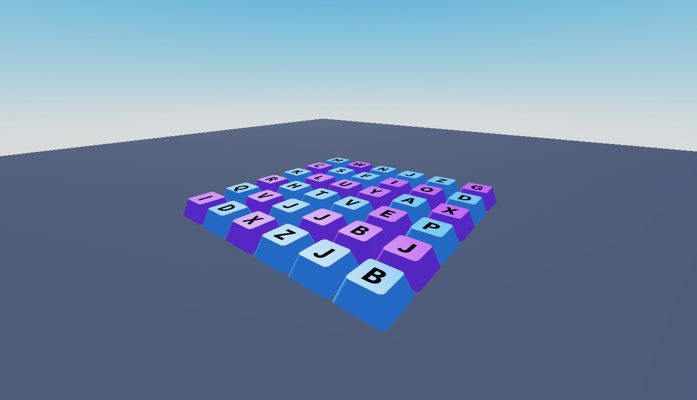

### Model — front

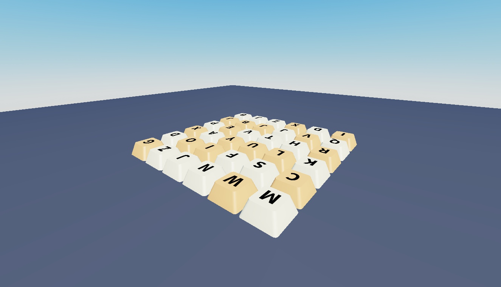

### Model — back

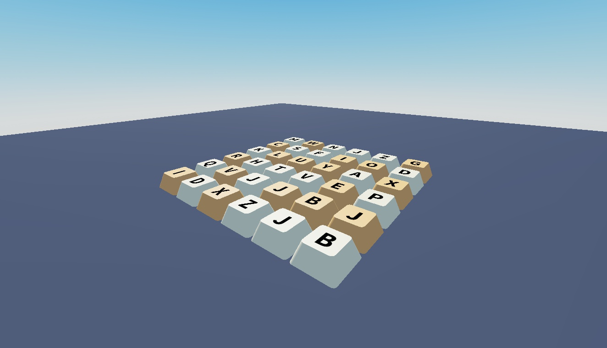

### Model — front

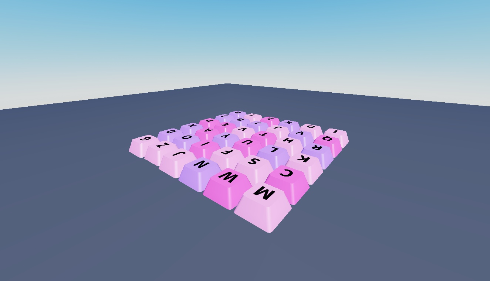

### Model — back

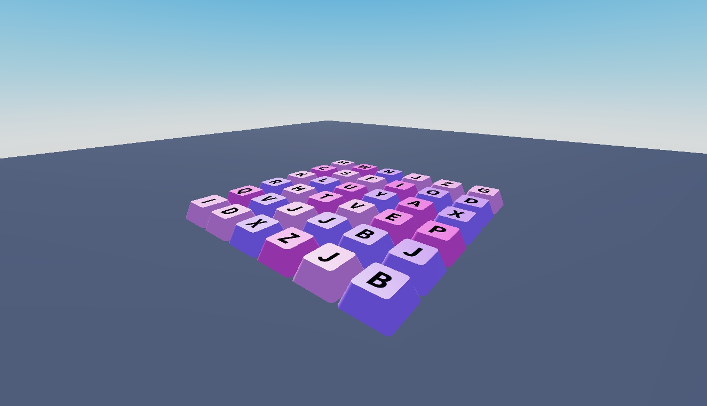

### Model — front

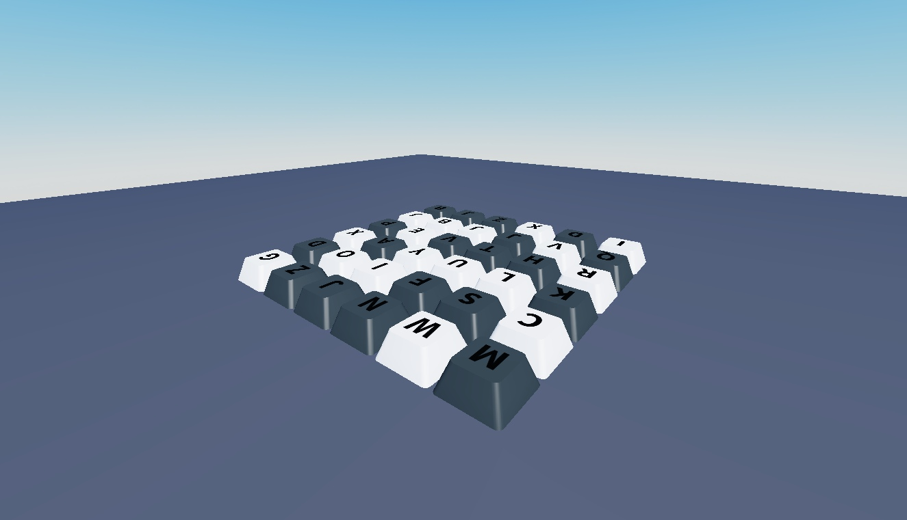

### Model — back

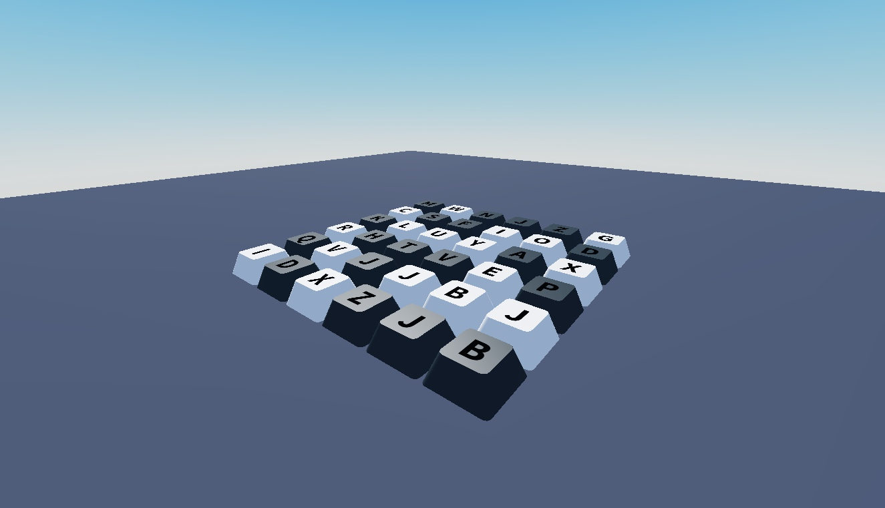

