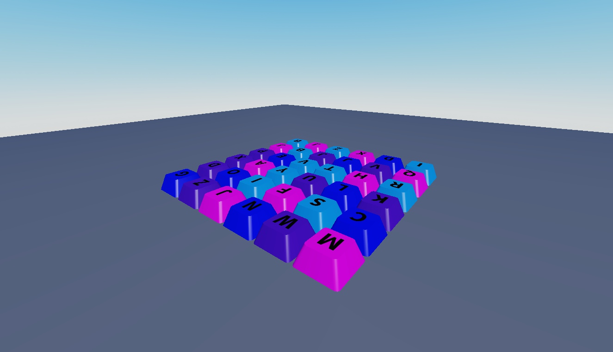

# Interactive Keyboard Models

Eight keyboard variants, each with 36 labeled keycap MeshParts and a touch-response script.

**Preview release 0.1.0.** All eight variants have static front/back previews. Key depression timing, touch response and sound playback remain unverified. Three external sound IDs require access in your experience.

## Download

[Download Keyboard.rbxm](Keyboard.rbxm?raw=1) — 22,910 bytes.

[Full gallery — 16 screenshots](GALLERY.md) | [Native inventory](INVENTORY.md) | [Verification](VERIFICATION.md)

## Included assets

Eight keyboard variants, each with 36 labeled keycap MeshParts and a touch-response script.

8 embedded scripts are extracted verbatim in [src/manifest.json](src/manifest.json). The binary is authoritative; do not install duplicate extracted copies.

## Installation

Import Keycap/Keyboard into ServerStorage for review, then copy one keyboard Model into Workspace. Preserve its Script, keycap MeshParts and SurfaceGui labels. Scripts respond to character contact and create click sounds/equalizers at runtime.

## Customization and dependencies

Work on a copy in Studio. Preserve required internal hierarchy, attachments, bones and relative transforms. Inspect [asset references](ASSET-REFERENCES.json); their availability in this Studio session does not guarantee permission in your destination experience. Keep original creator notices.

## Verification and limitations

Static Studio Edit inspection on isolated clones; no runtime behavior certification. Native instance counts/root names matched the supplied imports. Original scripts were disabled on static preview clones.

All eight variants have static front/back previews. Key depression timing, touch response and sound playback remain unverified. Three external sound IDs require access in your experience.

SHA-256: `3babd2f028e2a7a1c38a723f3981a6990f5dfa1b6c51e8fa0e5f70d7dcbe3bce`

## Credits and license

[Credits](CREDITS.md) | [Scoped project MIT notice](LICENSE) | [Repository scope](../../../docs/LICENSING.md) | [Changelog](CHANGELOG.md)

[Back to category](../README.md)
