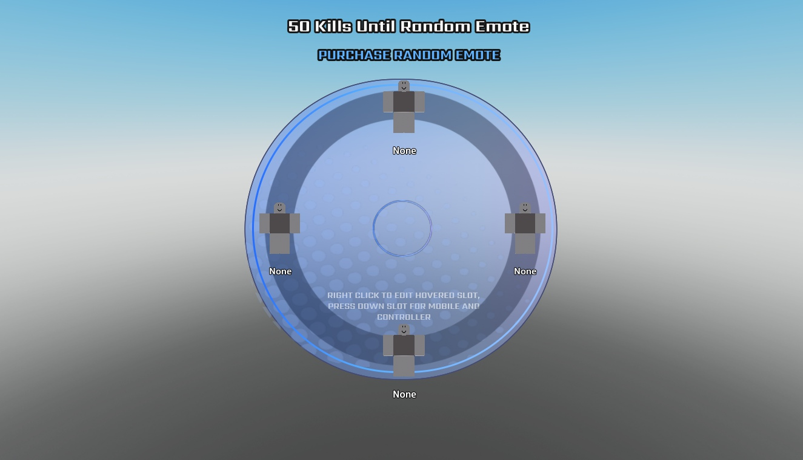

# Nebulix Emote System

Four-slot emote wheel UI, preview rigs, server handlers, data-store scripts and an example animation/module.

**Preview release 0.1.0.** Integration template, not drop-in working gameplay. Shared.Icon and MainGUI.SettingsFrame are absent; Topbar also references an unassigned settingsIcon. Reward/purchase/slot-change dependencies and remote validation need review. Data-store saving and emote playback are unverified.

## Download

[Download omg emotes woww its mangos.rbxm](omg%20emotes%20woww%20its%20mangos.rbxm?raw=1) — 56,574 bytes.

[Full gallery — 2 screenshots](GALLERY.md) | [Native inventory](INVENTORY.md) | [Verification](VERIFICATION.md)

## Included assets

Four-slot emote wheel UI, preview rigs, server handlers, data-store scripts and an example animation/module.

29 embedded scripts are extracted verbatim in [src/manifest.json](src/manifest.json). The binary is authoritative; do not install duplicate extracted copies.

## Installation

Inspect in ServerStorage first. Move the CONTENTS of the named ReplicatedStorage, ServerScriptService, ServerStorage and StarterGui containers to those services; StarterPlayerScripts contents belong in StarterPlayer.StarterPlayerScripts. Supply the missing Shared.Icon topbar library and game-specific Stats/Kills, SettingsFrame and remote handlers before enabling the complete system.

## Customization and dependencies

Work on a copy in Studio. Preserve required internal hierarchy, attachments, bones and relative transforms. Inspect [asset references](ASSET-REFERENCES.json); their availability in this Studio session does not guarantee permission in your destination experience. Keep original creator notices.

## Verification and limitations

Edit-mode GUI preview only. Wheel/list visibility was set on temporary clones; scripts were disabled. No animation/reward/purchase/save test. Missing Shared.Icon, SettingsFrame and game-specific handlers are documented.

Integration template, not drop-in working gameplay. Shared.Icon and MainGUI.SettingsFrame are absent; Topbar also references an unassigned settingsIcon. Reward/purchase/slot-change dependencies and remote validation need review. Data-store saving and emote playback are unverified.

SHA-256: `ba714391e93a2390c7dc2071d6d7af5fb55a4bfb36f3d25d3d6c3768e49d9327`

## Credits and license

[Credits](CREDITS.md) | [Scoped project MIT notice](LICENSE) | [Repository scope](../../../docs/LICENSING.md) | [Changelog](CHANGELOG.md)

[Back to category](../README.md)
