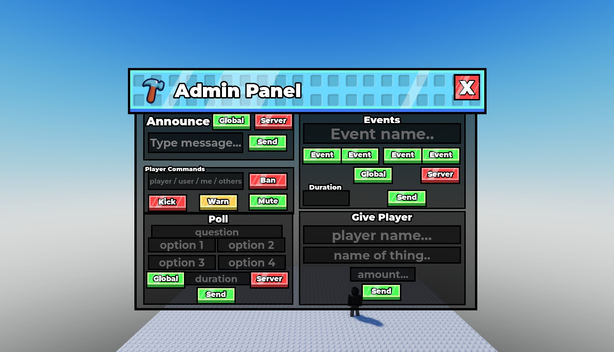

# Steal a Template / UI kits

Editable Roblox interfaces with native models, Luau source, and real Studio screenshots. Pick a kit, inspect the gallery, then read its setup notes.

| Kit | Gallery | Native model | Current status |
| --- | --- | --- | --- |
| [Studs UI](studs-ui/) | [10 screenshots](studs-ui/#screenshot-gallery) | [StudsUI.rbxm](studs-ui/StudsUI.rbxm?raw=1) | Draft; model import and render checked |
| [Essential STUD UI](essential-stud-ui/) | [13 screenshots](essential-stud-ui/#screenshot-gallery) | [EssentialStudUI.rbxm](essential-stud-ui/EssentialStudUI.rbxm?raw=1) | Draft; export, render, and Play checked |
| [Steal an Egg](steal-an-egg/) | [21 screenshots](steal-an-egg/#screenshot-gallery) | [StealAnEggUI.rbxm](steal-an-egg/StealAnEggUI.rbxm?raw=1) | Draft; imported desktop Play checked; other devices unverified |
| [Stud Admin Panel](stud-admin-panel/) | [7 screenshots](stud-admin-panel/#screenshot-gallery) | [StudAdminPanel.rbxm](stud-admin-panel/StudAdminPanel.rbxm?raw=1) | Draft; original layout preserved; desktop/tablet/phone fit checked |

### Stud Admin Panel

## Install

Download the kit's `.rbxm`, stop Play, then use **StarterGui → Insert from File** in Studio. Move the imported ScreenGui into StarterGui if necessary. Import one copy and press Play.

Each pack documents its source files, linked artwork, demo interactions, and device limitations. Original Steal a Template code and assets use [MIT terms](../../LICENSE); each pack's credits identify external material and permission records.

[UI design resources](../../resources/ui-figma-roblox/) - artwork and editable Figma/Roblox examples in this repository.

[Back to Steal a Template](../../README.md)
