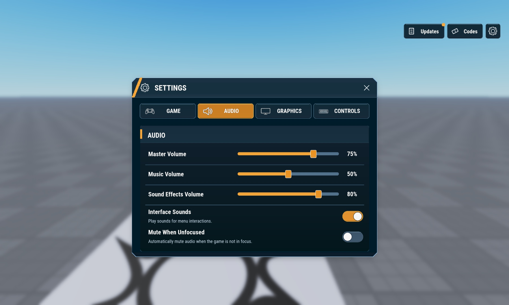
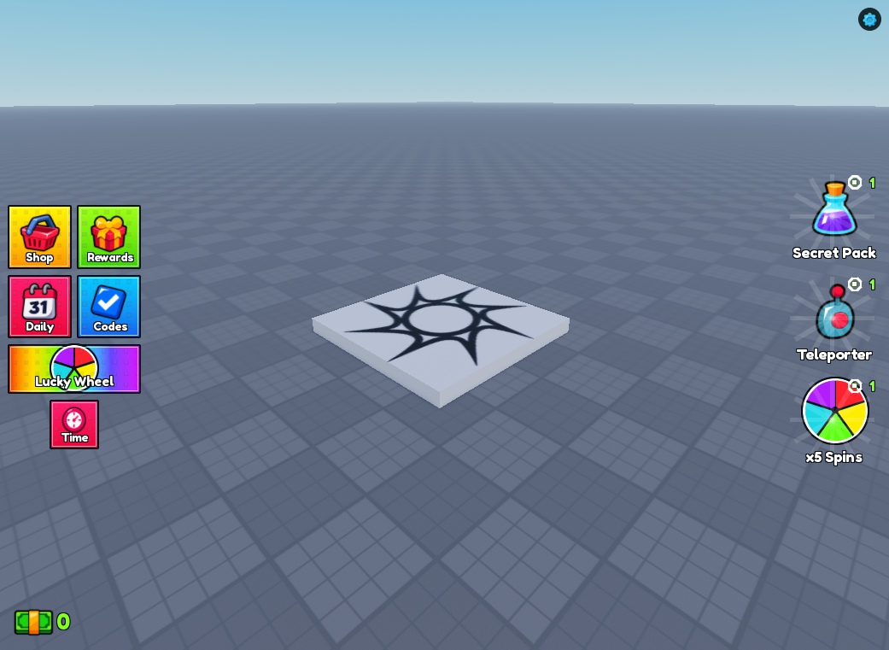
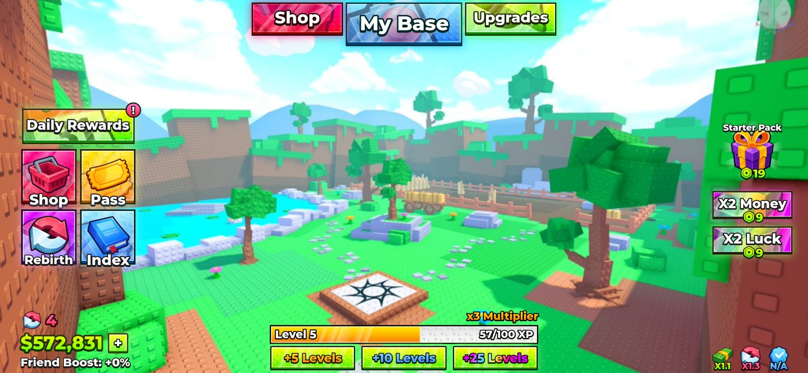

# Steal a Template / UI kits

Editable Roblox interfaces with native models, Luau source, and real Studio screenshots. Pick a kit, inspect the gallery, then read its setup notes.

| Kit | Gallery | Native model | Current status |
| --- | --- | --- | --- |
| [Command HQ - Roblox HUD and Interface Pack](command-hq/) | [12 screenshots](command-hq/#screenshot-gallery) | [CommandHQ.rbxm](command-hq/CommandHQ.rbxm?raw=1) | 0.3.1 draft; regenerated shared icons; imported Play checked; desktop/mobile captures; touch/gamepad gaps remain |
| [Essential STUD UI](essential-stud-ui/) | [13 screenshots](essential-stud-ui/#screenshot-gallery) | [EssentialStudUI.rbxm](essential-stud-ui/EssentialStudUI.rbxm?raw=1) | Draft; export, render, and Play checked |
| [Steal a Template / Steal an Egg - Roblox HUD and Interface Pack](steal-an-egg/) | [21 screenshots](steal-an-egg/#screenshot-gallery) | [StealAnEggUI.rbxm](steal-an-egg/StealAnEggUI.rbxm?raw=1) | Draft; imported desktop Play checked; other devices unverified |
| [Stud Admin Panel](stud-admin-panel/) | [7 screenshots](stud-admin-panel/#screenshot-gallery) | [StudAdminPanel.rbxm](stud-admin-panel/StudAdminPanel.rbxm?raw=1) | Draft; original layout preserved; desktop/tablet/phone fit checked |
| [Steal a Template / Studs UI - Roblox HUD and Modal Kit](studs-ui/) | [10 screenshots](studs-ui/#screenshot-gallery) | [StudsUI.rbxm](studs-ui/StudsUI.rbxm?raw=1) | Draft; model import and render checked |
| [Studs UI Pack 2](studs-ui-pack-2/) | [11 screenshots](studs-ui-pack-2/#screenshot-gallery) | [StudsUIPack2.rbxm](studs-ui-pack-2/StudsUIPack2.rbxm?raw=1) | Draft; see pack verification and device limits |

### Command HQ - Roblox HUD and Interface Pack

### Essential STUD UI

### Steal a Template / Steal an Egg - Roblox HUD and Interface Pack

### Stud Admin Panel

### Steal a Template / Studs UI - Roblox HUD and Modal Kit

### Studs UI Pack 2

## Install

Download the pack's `.rbxm`, stop Play, and follow the exact destination and setup steps on its pack page. UI kits generally import into **StarterGui**. Review the documented dependencies and test limits before integrating it into a game.

Original Steal a Template contributions use [MIT terms](../../LICENSE); each pack's credits preserve applicable third-party notices.

## More resources

- [Icons](icons/) - extracted icon collections.
- [UI design resources](ui-figma-roblox/) - artwork and editable Figma/Roblox examples.

[Back to Steal a Template](../../README.md)
