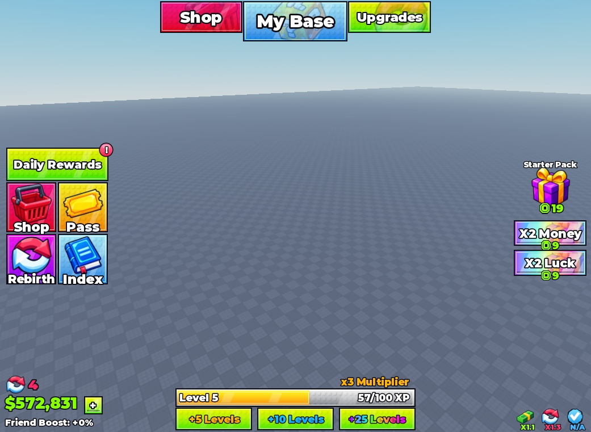

# Roblox UI Kits & Interface Packs

Each UI kit has its **own folder**, editable model download, installation guide and screenshot gallery. Add future kits beside `studs-ui/` rather than mixing their assets or scripts together.

## UI pack catalog

| Pack | Preview | Download | Status |
| --- | --- | --- | --- |
| [Studs UI — HUD & 9-panel kit](studs-ui/) | [All 10 screenshots](studs-ui/#screenshot-gallery) | [StudsUI.rbxm](studs-ui/StudsUI.rbxm?raw=1) | Private draft; native model round-trip/render checked |
| [Essential STUD UI](essential-stud-ui/) | [13 screenshots](essential-stud-ui/#gallery--actual-imported-model) | [EssentialStudUI.rbxm](essential-stud-ui/EssentialStudUI.rbxm?raw=1) | Private demo; native export/render/Play checked |

[](studs-ui/)

## Install a kit

Download its model and insert it under **StarterGui**. Each pack README covers its exact setup, included panels, dependencies and customization.

```text
packs/ui/
├── README.md
├── studs-ui/
│   ├── README.md
│   ├── StudsUI.rbxm
│   ├── previews/
│   ├── assets/
│   └── src/
└── <future-ui-kit>/           # Separate folder and README for each new kit
```

The repository remains private. Free public downloads are planned; review each pack's license before reuse or redistribution.

[All asset categories](../../README.md#catalog) · [Authoring guide](../../docs/AUTHORING.md)
