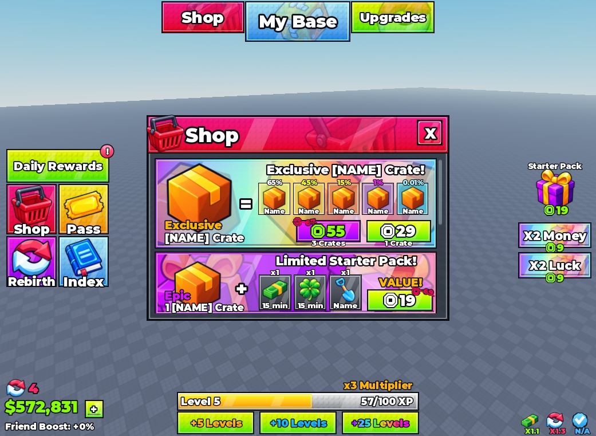
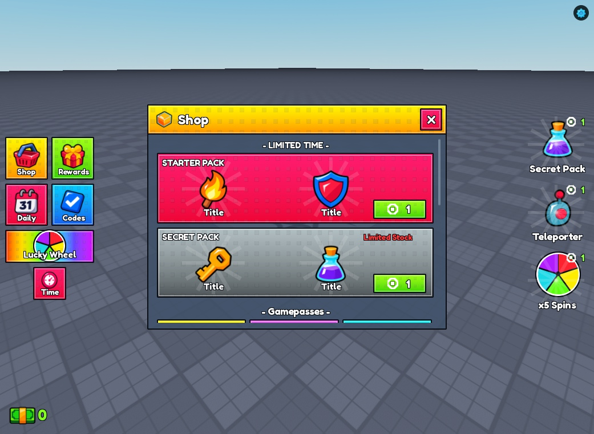

# Steal a Template / UI kits

Editable Roblox interfaces with native models, Luau source, and real Studio screenshots. Pick a kit, inspect the gallery, then read its setup notes.

| Kit | Gallery | Native model | Current status |
| --- | --- | --- | --- |
| [Studs UI](studs-ui/) | [10 screenshots](studs-ui/#screenshot-gallery) | [StudsUI.rbxm](studs-ui/StudsUI.rbxm?raw=1) | Draft; model import and render checked |
| [Essential STUD UI](essential-stud-ui/) | [13 screenshots](essential-stud-ui/#screenshot-gallery) | [EssentialStudUI.rbxm](essential-stud-ui/EssentialStudUI.rbxm?raw=1) | Draft; export, render, and Play checked |
| [Steal an Egg](steal-an-egg/) | [21 screenshots](steal-an-egg/#screenshot-gallery) | [StealAnEggUI.rbxm](steal-an-egg/StealAnEggUI.rbxm?raw=1) | Draft; imported desktop Play checked; other devices unverified |

## Studs UI

HUD and nine panels for shops, rewards, rebirth, upgrades, index, and settings. [Open the kit](studs-ui/).

## Essential STUD UI

Shops, gifting, rewards, codes, lucky wheel, settings, and loading, with item animation and effects. [Open the kit](essential-stud-ui/).

## Steal an Egg

HUD, inventory, pet collection, egg growth, fuse machine, and trail shop. [Open the kit](steal-an-egg/).

## Install

Download the kit's `.rbxm`, stop Play, then use **StarterGui → Insert from File** in Studio. Move the imported ScreenGui into StarterGui if necessary. Import one copy and press Play.

Each pack documents its source files, linked artwork, demo interactions, and device limitations. These private drafts are not yet licensed for reuse or redistribution.

[Back to Steal a Template](../../README.md) · [Agent guide](../../docs/USING_WITH_AGENTS.md) · [Machine-readable catalog](../../catalog.json)
