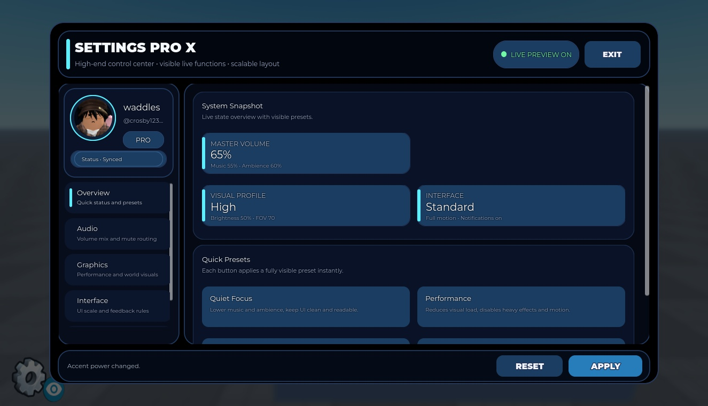
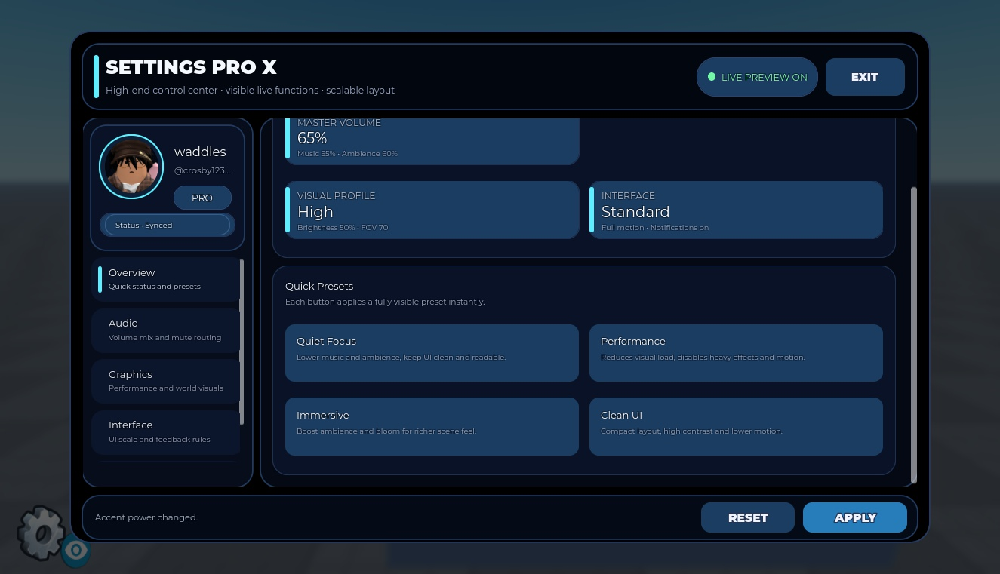
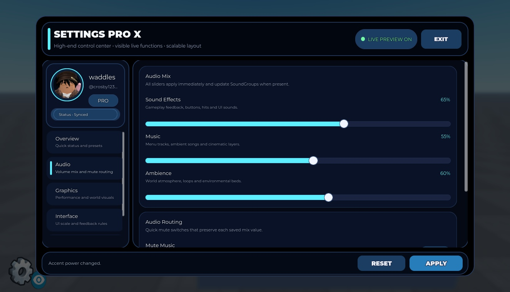
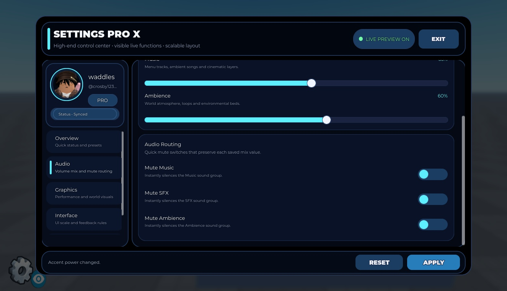
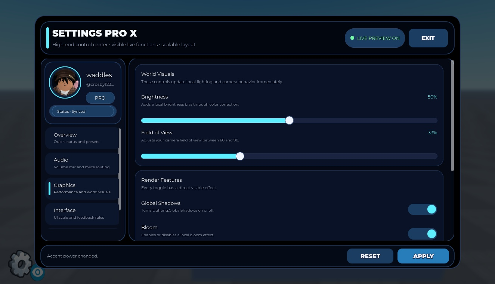
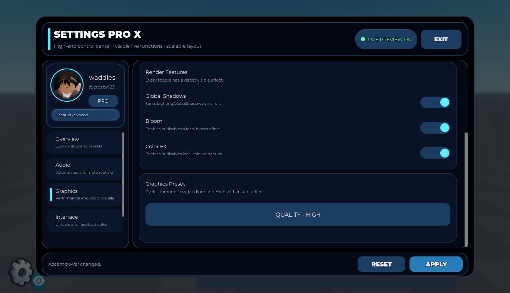
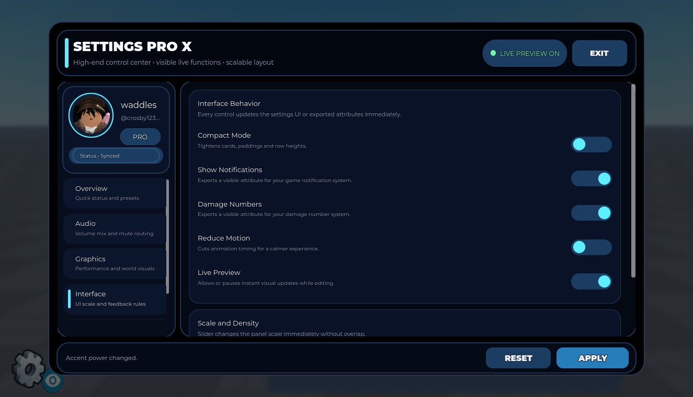
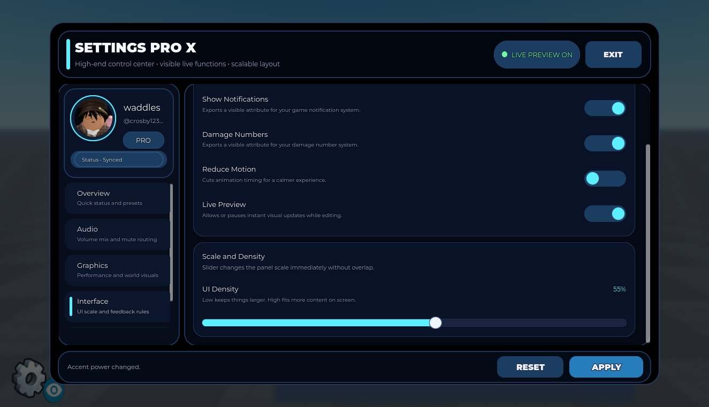
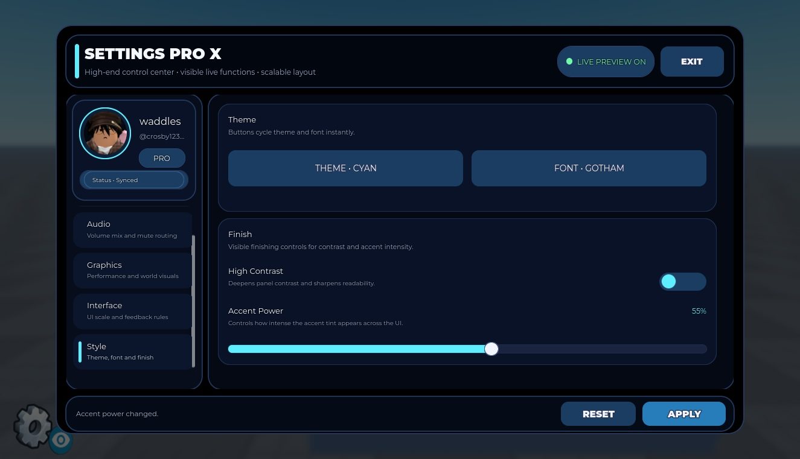

# Advanced Settings UI V1.6 — gallery

Actual Studio captures of the supplied instances. Preview-only framing, anchoring, GUI visibility/scale/position changes are not changes to the native download.

### settings Overview top

### settings Overview bottom

### settings Audio top final

### settings Audio confirmed

### settings Graphics top

### settings Graphics bottom

### settings Interface top

### settings Interface bottom

### settings Style top

